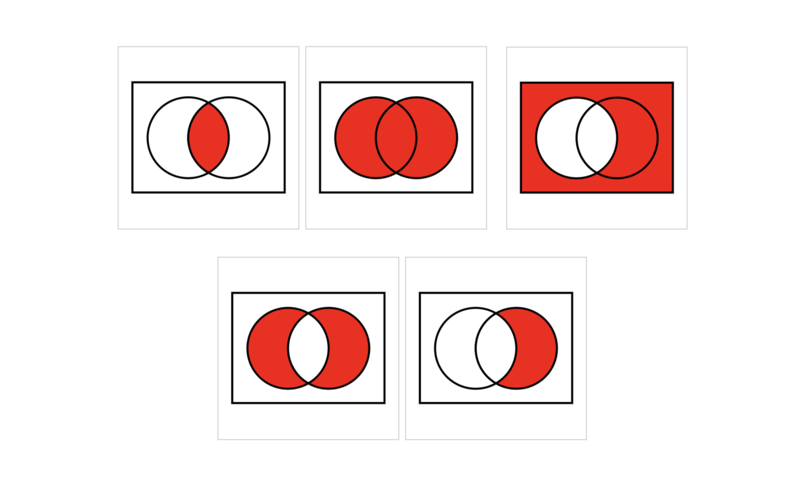
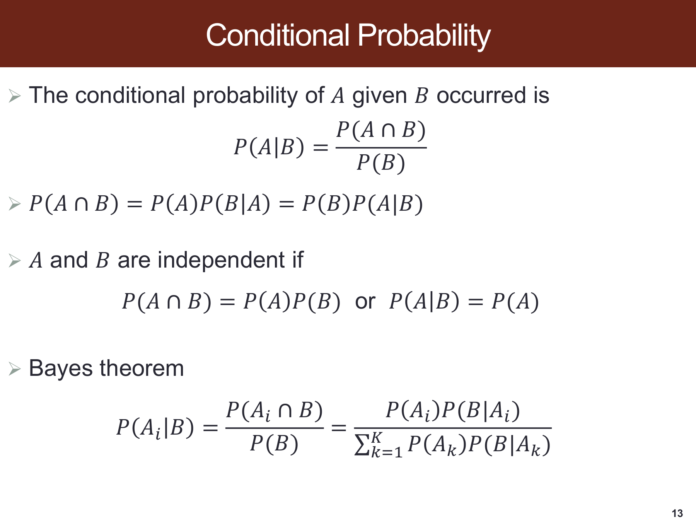
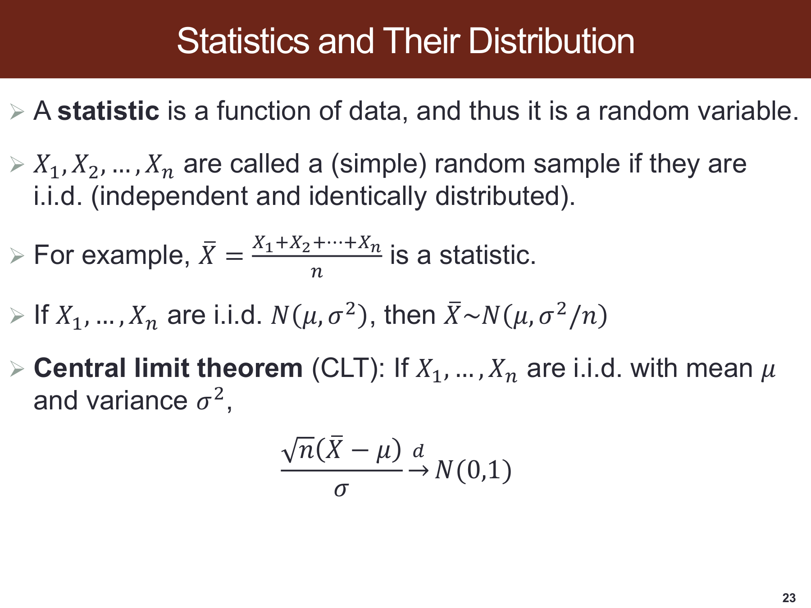
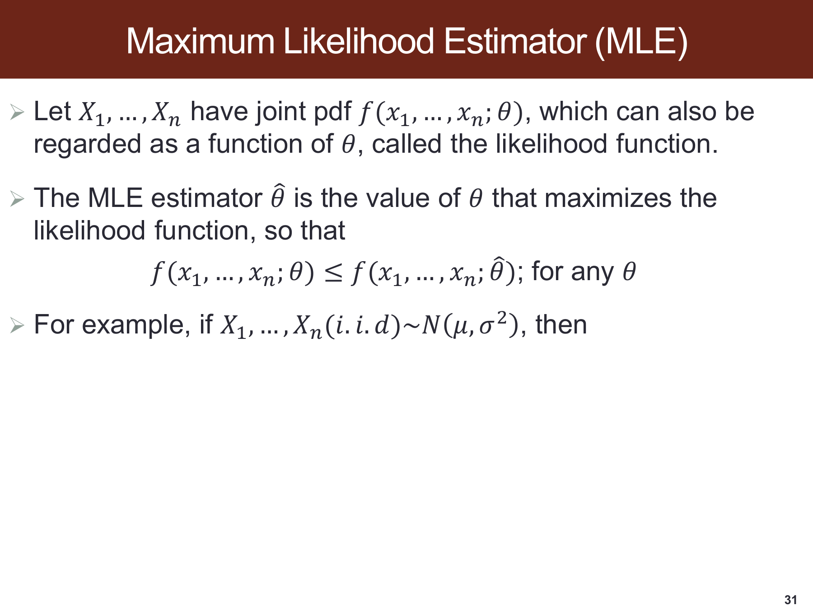
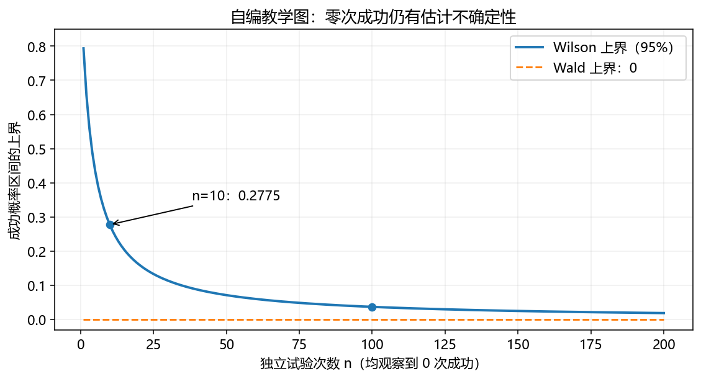

# SDSC5001 Topic 1：概率与统计复习详细笔记

[课程总目录](README.md) · [逐页对应表](Topic1_%E8%AF%BE%E4%BB%B6%E9%80%90%E9%A1%B5%E5%AF%B9%E5%BA%94%E8%A1%A8.md) · [离线 HTML 阅读版](5001_Topic1_%E8%AF%A6%E7%BB%86%E7%AC%94%E8%AE%B0.html)

> 来源：本地 `SDSC5001_Topic 1 Review of probability and statistics.pptx`，共 39 页，PDF 页序与幻灯片页序一致。按课件顺序讲解，补充推导、手算、应用与自测；补充内容和课件表述核对均在正文注明。
>
> Lumen 用法：在 Obsidian 的 guideline 笔记库点击“Lumen 本节定位”或“Lumen 图示定位”，可回到原 PDF 标记区域；标记备注可返回对应中文小节。图片为原课件局部截图，公式保留为可编辑 LaTeX。

## 阅读导航

- [0. 本章要解决什么问题](#section-0)
- [1. 样本空间、事件与集合运算](#section-1)
- [2. 等可能模型与计数方法](#section-2)
- [3. 概率公理、容斥与补事件](#section-3)
- [4. 条件概率、独立与 Bayes 公式](#section-4)
- [5. 随机变量、描述统计与离散分布](#section-5)
- [6. 连续分布：密度并不是点概率](#section-6)
- [7. 联合、边际、条件分布与相关性](#section-7)
- [8. 统计量与抽样分布](#section-8)
- [9. 点估计、偏差与均方误差](#section-9)
- [10. Uniform 算例与 MVUE](#section-10)
- [11. 矩估计与最大似然估计](#section-11)
- [12. 置信区间：估计不确定性](#section-12)
- [13. 假设检验、两类错误与 p 值](#section-13)
- [14. 方法应用与后续章节连接](#section-14)
- [15. 自测与参考答案](#section-15)

> **深化阅读（2026-10-31）：**本章新增 4 组分节详解与 3 张 PPT 完整截图。新增推导与手算均为配套补充，截图旁附逐项解读，沿用原有课件定位。
>
> [把条件概率写成一张人数表](#deep-t1-s4) · [原始数据、抽样分布与标准误分别画什么](#deep-t1-s8) · [完整做一遍 Bernoulli 极大似然](#deep-t1-s11) · [同一组数据怎样连接检验与置信区间](#deep-t1-s13)

> **外部资料强化（2026-11-01）：**本章在对应知识点内加入以下拓展，所有数值算例与教学图明确区分于课件原始内容。外部来源在小节末就近提供。
>
> [Bootstrap 估计的是重复抽样的波动，不是把数据凭空变多](#ext-t1-bootstrap) · [比例区间为什么不能总用“估计值 ± 1.96 个标准误”](#ext-t1-wilson) · [从一次检验到一组检验：FWER 与 FDR 回答不同问题](#ext-t1-multiple)

## 0. 本章要解决什么问题
> [课件第 1–2 页](../output/pdf/SDSC5001_Topic1_slides.pdf#page%3D1) · [Lumen 本节定位](obsidian://lumen-pdf?vault=guideline&file=course%2F5001%2Foutput%2Fpdf%2FSDSC5001_Topic1_slides.pdf&annotation=sdsc5001-t1-a48d0b9e28-page-001) · [逐页索引](Topic1_%E8%AF%BE%E4%BB%B6%E9%80%90%E9%A1%B5%E5%AF%B9%E5%BA%94%E8%A1%A8.md)

概率论从一个给定的随机机制出发，计算样本会怎样出现；统计推断从已经出现的样本出发，研究生成它们的机制。课件用抛硬币把两个方向放在一起：假定硬币公平，问 10,000 次中出现 5,200 次正面的概率，这是概率问题；已经观察到 5,200 次正面，问公平假设是否合理，这是推断问题。

总体 population 是希望讨论的全部对象，样本 sample 是实际观察到的部分。参数描述总体，例如正面概率 $p$；统计量由样本计算，例如正面比例 $\hat p$。$p$ 通常视为固定但未知，$\hat p$ 随抽到的样本变化。一次计算出的 0.52 是估计值，不再是尚未观察的随机量。

全章顺序是：事件与概率、条件概率、随机变量及分布、统计量的抽样分布、点估计、区间估计、假设检验。后续回归的标准误、置信区间以及分类中的 Bayes 公式都建立在这里。

## 1. 样本空间、事件与集合运算
> [课件第 3–4 页](../output/pdf/SDSC5001_Topic1_slides.pdf#page%3D3) · [Lumen 本节定位](obsidian://lumen-pdf?vault=guideline&file=course%2F5001%2Foutput%2Fpdf%2FSDSC5001_Topic1_slides.pdf&annotation=sdsc5001-t1-a48d0b9e28-page-003) · [逐页索引](Topic1_%E8%AF%BE%E4%BB%B6%E9%80%90%E9%A1%B5%E5%AF%B9%E5%BA%94%E8%A1%A8.md)

实验 experiment 产生结果，样本空间 $S$ 收集全部可能结果，事件 $A\subseteq S$ 收集满足某个条件的结果。掷一次骰子时，$S=\{1,2,3,4,5,6\}$，偶数事件为 $A=\{2,4,6\}$。

- 并集 $A\cup B$：至少一个发生，包含两个都发生的情况。
- 交集 $A\cap B$：两个同时发生。
- 补集 $A^c$：$A$ 不发生。
- 差集 $A\setminus B=A\cap B^c$：$A$ 发生而 $B$ 不发生。
- 对称差：恰好一个发生，即 $(A\setminus B)\cup(B\setminus A)$。

**读 Venn 图的方法：**先确定全集的矩形，再按条件涂区域。例如“至少一个”包含重叠区，“恰好一个”去掉重叠区，“并非两个都发生”是 $(A\cap B)^c=A^c\cup B^c$。不要把后者误读成“两个都不发生”。

> 图源：[原课件第 4 页](../output/pdf/SDSC5001_Topic1_slides.pdf#page%3D4) · [Lumen 图示定位](obsidian://lumen-pdf?vault=guideline&file=course%2F5001%2Foutput%2Fpdf%2FSDSC5001_Topic1_slides.pdf&annotation=sdsc5001-t1-a48d0b9e28-crop-004)。读图：Venn 图中的交、并、补与对称差；比较上排前两图的重叠区域。

## 2. 等可能模型与计数方法
> [课件第 5–9 页](../output/pdf/SDSC5001_Topic1_slides.pdf#page%3D5) · [Lumen 本节定位](obsidian://lumen-pdf?vault=guideline&file=course%2F5001%2Foutput%2Fpdf%2FSDSC5001_Topic1_slides.pdf&annotation=sdsc5001-t1-a48d0b9e28-page-005) · [逐页索引](Topic1_%E8%AF%BE%E4%BB%B6%E9%80%90%E9%A1%B5%E5%AF%B9%E5%BA%94%E8%A1%A8.md)

当有限样本空间中的基本结果**等可能**时，才可以直接按数量相除：

$$P(A)=\frac{\#A}{\#S}.$$

对于有偏骰子或不等概率抽样，应把各基本结果的概率相加。把结果列出来，只解决了“有哪些可能”，还没有证明“这些可能的概率相同”。

### 2.1 乘法原理

若第一步有 $m$ 种选择，每个第一步结果下第二步都有 $n$ 种选择，则合计 $mn$ 种。两次掷骰子有 $6\times6=36$ 种有序结果。这里是计数规则，不要求用概率意义上的独立性表述；关键是每个分支的选择数。

### 2.2 排列与组合

从 $n$ 个不同对象中不放回地取 $r$ 个，若顺序重要：

$$P_n^r=\frac{n!}{(n-r)!}.$$

若只关心选了哪些对象：

$$\binom nr=\frac{n!}{r!(n-r)!},\qquad P_n^r=\binom nr r!.$$

例如从五个人中选三人组成小组有 $\binom53=10$ 种；为三人安排不同职位则有 $P_5^3=60$ 种。判断题目时依次问：对象是否不同、是否放回、顺序是否重要、每个结果是否等可能。课件第 7–8 页的 $k/r$ 混写只影响记号，公式中的取出数量应保持一致。

### 2.3 课件骰子题的完整解法

设两颗公平骰子独立，求第二颗比第一颗大。第一颗分别是 $1,2,3,4,5,6$ 时，第二颗可选数依次为 $5,4,3,2,1,0$，因此

$$P(X_2>X_1)=\frac{5+4+3+2+1}{36}=\frac5{12}.$$

也可利用对称性：两颗相等的概率为 $6/36=1/6$，剩下的 $5/6$ 平分给“大于”和“小于”。结果是 $\frac12(1-1/6)$，不能直接写 $1/2$，因为平局占有正概率。

## 3. 概率公理、容斥与补事件
> [课件第 10–12 页](../output/pdf/SDSC5001_Topic1_slides.pdf#page%3D10) · [Lumen 本节定位](obsidian://lumen-pdf?vault=guideline&file=course%2F5001%2Foutput%2Fpdf%2FSDSC5001_Topic1_slides.pdf&annotation=sdsc5001-t1-a48d0b9e28-page-010) · [逐页索引](Topic1_%E8%AF%BE%E4%BB%B6%E9%80%90%E9%A1%B5%E5%AF%B9%E5%BA%94%E8%A1%A8.md)

概率满足非负性、$P(S)=1$，以及对两两互斥事件的可列可加性。常用推论为

$$P(A^c)=1-P(A),$$

$$P(A\cup B)=P(A)+P(B)-P(A\cap B).$$

三事件时先加单个，再减两两交集，再加三重交集。互斥是 $A\cap B=\varnothing$；独立是概率乘法关系。若两个事件都有正概率且互斥，它们反而不独立，因为一个发生会排除另一个。

### 3.1 至少一位心理学家

30 位精神科医师和 24 位心理学家中，等概率、不放回地选三人。补事件是三人都来自前 30 位：

$$P(\text{至少一位心理学家})=1-\frac{\binom{30}3}{\binom{54}3}\approx0.8363.$$

课件四舍五入为 0.84。不能把三次抽取当成独立，把全为医师写成 $(30/54)^3$；抽走一人会改变后面的比例。

### 3.2 生日问题

假设一年有 365 天、生日独立且各天等可能，并忽略闰年。对 $n\le365$：

$$P(\text{至少两人同生日})=1-\prod_{j=0}^{n-1}\frac{365-j}{365}.$$

23 人时约为 0.5073。“至少一对”比“与指定某人相同”更容易，因为它比较所有人对。若 $n>365$，由抽屉原理概率为 1。真实生日并不完全均匀，公式表达的是课件的理想模型。

## 4. 条件概率、独立与 Bayes 公式
> [课件第 13–16 页](../output/pdf/SDSC5001_Topic1_slides.pdf#page%3D13) · [Lumen 本节定位](obsidian://lumen-pdf?vault=guideline&file=course%2F5001%2Foutput%2Fpdf%2FSDSC5001_Topic1_slides.pdf&annotation=sdsc5001-t1-a48d0b9e28-page-013) · [逐页索引](Topic1_%E8%AF%BE%E4%BB%B6%E9%80%90%E9%A1%B5%E5%AF%B9%E5%BA%94%E8%A1%A8.md)

当 $P(B)>0$ 时：

$$P(A\mid B)=\frac{P(A\cap B)}{P(B)},\qquad P(A\cap B)=P(B)P(A\mid B).$$

条件概率相当于把样本空间缩到 $B$，再重新归一化。独立可写成 $P(A\cap B)=P(A)P(B)$；在分母有效时等价于 $P(A\mid B)=P(A)$。

若 $A_1,\ldots,A_K$ 构成互斥且穷尽的划分，则

$$P(B)=\sum_{k=1}^K P(B\mid A_k)P(A_k),$$

$$P(A_i\mid B)=\frac{P(B\mid A_i)P(A_i)}{\sum_kP(B\mid A_k)P(A_k)}.$$

分子是该原因产生证据的联合概率，分母是所有原因产生同一证据的概率。先验 prior 在看到证据之前给出，后验 posterior 在条件化后给出。$P(B\mid A)$ 与 $P(A\mid B)$ 的条件方向不同。

### 4.1 课件检测题：99% 为什么不等于后验 99%

设 $U$ 表示使用者，$+$ 表示检测阳性。课件给出 $P(+\mid U)=0.99$、$P(-\mid U^c)=0.99$、$P(U)=0.005$。因此

$$P(U\mid+)=\frac{0.99\times0.005}{0.99\times0.005+0.01\times0.995}\approx0.3322.$$

用 100,000 人的期望计数更直观：500 位使用者中约 495 位阳性，99,500 位非使用者中约 995 位假阳性。阳性总人数约 1,490，其中 495 位是真使用者。这是低先验率造成的基率效应，数值算例用于理解概率，不涉及实际检测建议。

### 4.2 Monty Hall 三门题

标准解答需要明确主持人的机制：知道奖品位置、总打开未选中的羊门、总提供换门机会。最初选中汽车的概率为 $1/3$，选中羊的概率为 $2/3$。换门策略在初选为羊时获胜，因此获胜概率 $2/3$，坚持为 $1/3$。若主持人随机开门、可能开到汽车，观察过程变了，就必须重建条件概率。课件第 14 页只有 Bayes 标题，本节公式推演与三门题解答为配套补充。

### 深入讲解：把条件概率写成一张人数表

**补充算例。**设邮件中垃圾邮件占 20%，垃圾邮件出现词语“优惠”的概率为 60%，正常邮件出现该词的概率为 10%。令 $S$ 表示垃圾邮件，$W$ 表示出现该词。先把题目翻译为 $P(S)=0.2$、$P(W\mid S)=0.6$、$P(W\mid S^c)=0.1$，再计算：

$$P(W)=0.6\times0.2+0.1\times0.8=0.20,$$

$$P(S\mid W)=\frac{0.6\times0.2}{0.20}=0.60.$$

可以想象 1,000 封邮件：200 封垃圾邮件中有 120 封含该词，800 封正常邮件中有 80 封含该词。看到该词后，新的比较范围是这 200 封含词邮件，因此分母为 $120+80$。虽然 $P(W\mid S)$ 与 $P(S\mid W)$ 在这组特意选取的数值下恰好都是 0.6，二者的分母和问题仍完全不同。

**再加一条证据不能直接相乘。**若 $V$ 表示含附件，则一般应写

$$P(W,V\mid S)=P(W\mid S)P(V\mid W,S).$$

只有假设给定类别后的条件独立，才能换成 $P(W\mid S)P(V\mid S)$。这正是 Topic 6 朴素 Bayes 的关键假设。无条件独立与给定类别后的独立也不能相互替代。

还可用 odds 形式理解更新：后验 odds 等于先验 odds 乘似然比。本例为 $(0.2/0.8)\times(0.6/0.1)=1.5$，再转回概率 $1.5/(1+1.5)=0.6$。似然比衡量这条证据把判断推向哪一类。

### PPT 第 13 页逐项讲解：条件概率与 Bayes 公式

> 原课件：[第 13 页](../output/pdf/SDSC5001_Topic1_slides.pdf#page=13)。截图保留课件原貌，下面按阅读顺序解释；原页简写与笔误以正文核对为准。

**先读第一行的分母。**$P(B)$ 把范围限定在已经发生的 $B$ 中，所以应先确认条件事件，而不是只按公式的位置代数。第二行把同一个联合事件拆成两种条件方向，是 Bayes 反推的起点。

**再读独立性的等号。**$P(A\mid B)=P(A)$ 表示得知 $B$ 不改变对 $A$ 的判断，需条件概率有定义。它与互斥不同：互斥是不能同时发生，独立是条件信息不改变概率。

**最后读底部求和。**分母必须收集所有互斥且穷尽的来源 $A_k$ 对证据 $B$ 的贡献。结合本节邮件人数表，先画来源分组、算证据人数，再除以证据总人数，比背分子分母更容易检查。

## 5. 随机变量、描述统计与离散分布
> [课件第 17–19 页](../output/pdf/SDSC5001_Topic1_slides.pdf#page%3D17) · [Lumen 本节定位](obsidian://lumen-pdf?vault=guideline&file=course%2F5001%2Foutput%2Fpdf%2FSDSC5001_Topic1_slides.pdf&annotation=sdsc5001-t1-a48d0b9e28-page-017) · [逐页索引](Topic1_%E8%AF%BE%E4%BB%B6%E9%80%90%E9%A1%B5%E5%AF%B9%E5%BA%94%E8%A1%A8.md)

严格地说，随机变量是从基本结果到数值的映射 $X:S\to\mathbb R$。离散随机变量的可能取值有限或可数。PMF 为 $p(x)=P(X=x)$，满足 $p(x)\ge0$、$\sum_xp(x)=1$；CDF 为 $F(x)=P(X\le x)$，单调不减、右连续。

$$E(X)=\sum_xxp(x),\qquad \operatorname{Var}(X)=E[(X-E X)^2]=E(X^2)-[E(X)]^2.$$

均值描述中心位置，方差描述围绕均值的平均平方偏离，标准差与原变量单位相同。中位数和截尾均值通常比均值更抗极端值，但它们对应的总体目标未必相同。不要只因为几个估计值接近，就认为它们都在所有分布下估计同一参数。

| 分布 | 随机机制 | PMF | 均值与方差 |
|---|---|---|---|
| Bernoulli$(p)$ | 一次成功/失败 | $p^x(1-p)^{1-x}$，$x=0,1$ | $p$，$p(1-p)$ |
| Binomial$(n,p)$ | $n$ 次独立、成功率相同的试验 | $\binom nxp^x(1-p)^{n-x}$ | $np$，$np(1-p)$ |
| Poisson$(\lambda)$ | 一个观察区间内的计数模型 | $e^{-\lambda}\lambda^x/x!$ | $\lambda$，$\lambda$ |

课件还列举几何、超几何与负二项。补充区别：几何描述首次成功所需次数，负二项描述累计到指定成功次数的等待，超几何描述有限总体的不放回计数。几何变量从 0 还是从 1 开始存在两种约定，使用公式前必须确认。Poisson 是概率模型，不能仅凭“是计数”就断定适用；其均值等于方差等性质需要检查。

## 6. 连续分布：密度并不是点概率
> [课件第 20–21 页](../output/pdf/SDSC5001_Topic1_slides.pdf#page%3D20) · [Lumen 本节定位](obsidian://lumen-pdf?vault=guideline&file=course%2F5001%2Foutput%2Fpdf%2FSDSC5001_Topic1_slides.pdf&annotation=sdsc5001-t1-a48d0b9e28-page-020) · [逐页索引](Topic1_%E8%AF%BE%E4%BB%B6%E9%80%90%E9%A1%B5%E5%AF%B9%E5%BA%94%E8%A1%A8.md)

连续型分布用非负密度 $f$ 表示，$\int f(x)dx=1$，区间概率由面积给出：

$$P(a<X\le b)=\int_a^b f(x)\,dx,\qquad F(x)=\int_{-\infty}^x f(t)\,dt.$$

在 CDF 可导处有 $f(x)=F'(x)$。对普通连续分布，$P(X=x)=0$，但某个区间可以有正概率；密度数值可以超过 1。课件第 20 页的密度极限写法缺少除以区间宽度 $h$，应理解为 $\lim_{h\to0^+}P(x\le X<x+h)/h$，且需局部正则条件。

$$E(X)=\int xf(x)\,dx,\qquad E[g(X)]=\int g(x)f(x)\,dx.$$

| 分布 | 密度与定义域 | 均值 | 方差 |
|---|---|---|---|
| Uniform$(a,b)$ | $1/(b-a)$，$a\le x\le b$ | $(a+b)/2$ | $(b-a)^2/12$ |
| Exponential$(\lambda)$ | $\lambda e^{-\lambda x}$，$x\ge0$，$\lambda$ 为 rate | $1/\lambda$ | $1/\lambda^2$ |
| Normal$(\mu,\sigma^2)$ | $\exp[-(x-\mu)^2/(2\sigma^2)]/\sqrt{2\pi\sigma^2}$ | $\mu$ | $\sigma^2$ |

软件中的指数分布可能使用 scale $=1/\lambda$。正态标准化为 $Z=(X-\mu)/\sigma$。课件还列出 Gamma、Beta、卡方、Weibull、Lognormal，主要目的是说明不同支撑集和形状对应不同建模选择，并没有在本章推导它们全部的性质。

## 7. 联合、边际、条件分布与相关性
> [课件第 22 页](../output/pdf/SDSC5001_Topic1_slides.pdf#page%3D22) · [Lumen 本节定位](obsidian://lumen-pdf?vault=guideline&file=course%2F5001%2Foutput%2Fpdf%2FSDSC5001_Topic1_slides.pdf&annotation=sdsc5001-t1-a48d0b9e28-page-022) · [逐页索引](Topic1_%E8%AF%BE%E4%BB%B6%E9%80%90%E9%A1%B5%E5%AF%B9%E5%BA%94%E8%A1%A8.md)

联合密度 $f_{X,Y}(x,y)$ 描述两个变量一起出现的规律。对连续变量：

$$f_X(x)=\int f_{X,Y}(x,y)dy,\qquad f_{Y\mid X}(y\mid x)=\frac{f_{X,Y}(x,y)}{f_X(x)}.$$

离散情形把积分换成求和。这里的“条件密度”不应误写为正概率事件 $X=x$ 的简单频率比，而应通过联合与边际密度定义。独立时联合分解为边际乘积。

$$\operatorname{Cov}(X,Y)=E(XY)-E(X)E(Y),$$

$$\operatorname{Corr}(X,Y)=\frac{\operatorname{Cov}(X,Y)}{\sqrt{\operatorname{Var}(X)\operatorname{Var}(Y)}}.$$

相关系数要求两个方差有限且非零。独立并且相应矩存在时协方差为 0，反方向通常不成立。补充反例：$X\sim U(-1,1)$、$Y=X^2$，则 $E X=E X^3=0$，协方差为 0，但 $Y$ 完全由 $X$ 决定。

## 8. 统计量与抽样分布
> [课件第 23–24 页](../output/pdf/SDSC5001_Topic1_slides.pdf#page%3D23) · [Lumen 本节定位](obsidian://lumen-pdf?vault=guideline&file=course%2F5001%2Foutput%2Fpdf%2FSDSC5001_Topic1_slides.pdf&annotation=sdsc5001-t1-a48d0b9e28-page-023) · [逐页索引](Topic1_%E8%AF%BE%E4%BB%B6%E9%80%90%E9%A1%B5%E5%AF%B9%E5%BA%94%E8%A1%A8.md)

统计量是只依赖样本与已知量、而不含待估未知参数的函数。简单随机样本在课件中指 $X_1,\ldots,X_n$ 独立同分布。样本均值满足

$$\bar X=\frac1n\sum_iX_i,\quad E\bar X=\mu,\quad \operatorname{Var}(\bar X)=\frac{\sigma^2}{n}.$$

均值的标准误为 $\sigma/\sqrt n$，表达“重复抽样时样本均值的波动”，区别于单个观测的标准差 $\sigma$。样本量乘 4，标准误约减半。

若总体正态，$\bar X\sim N(\mu,\sigma^2/n)$ 是有限样本精确结论。若总体非正态，但满足本课所用 iid、有限均值和有限非零方差条件，CLT 给出

$$\frac{\sqrt n(\bar X-\mu)}{\sigma}\xrightarrow{d}N(0,1).$$

CLT 说的是标准化均值的分布接近正态，不是原始数据随着 $n$ 增大变成正态。“$n\ge30$”也不是对所有分布都可靠的通用保证。

对 $Y=\sum_i a_iX_i$，线性期望永远适用，方差则要包含协方差：

$$E(Y)=\sum_i a_i\mu_i,\quad \operatorname{Var}(Y)=\sum_i a_i^2\sigma_i^2+2\sum_{i<j}a_ia_j\operatorname{Cov}(X_i,X_j).$$

独立时交叉项为 0；独立正态的线性组合还精确为正态。第 24 页交叉项中的 $Y_j$ 应与该页其他符号一致地理解为 $X_j$。

### 深入讲解：原始数据、抽样分布与标准误分别画什么

设一个总体均值为 $\mu$、标准差为 $\sigma=12$，每次独立抽取 $n=36$ 个对象。一次抽样得到的 36 个原始值，其散布主要由 12 描述；如果反复抽取很多批，每批只留下一个样本均值，则这些均值的标准差为 $12/\sqrt{36}=2$。后者才是均值的标准误。

因此“数据很分散”和“均值估计很精确”可以同时成立。若样本量从 36 增至 144，单个对象的总体波动仍是 12，但均值标准误降为 1。想让标准误变成原来的一半，需要约四倍独立样本，而非两倍。

这里的 $1/\sqrt n$ 来自协方差计算，并非所有数据结构都适用。若各观测方差为 $\sigma^2$，不同观测有相同相关系数 $\rho$，则

$$\operatorname{Var}(\bar X)=\frac{1}{n^2}\left[n\sigma^2+n(n-1)\rho\sigma^2\right]
=\frac{\sigma^2}{n}[1+(n-1)\rho].$$

例如同一设备的连续测量往往相关，把每条记录当成新增的独立对象可能明显低估标准误。上式仅演示等相关结构，实际时间序列需采用与依赖方式匹配的方差估计。

**CLT 的使用顺序：**先确认研究的是和或均值，再检查独立性及矩条件，最后决定正态近似是否合理。若原数据偏斜，原始值的直方图仍可偏斜；接近正态的是经过适当标准化的样本均值在重复抽样下的分布。

### PPT 第 23 页逐项讲解：统计量、抽样分布与 CLT

> 原课件：[第 23 页](../output/pdf/SDSC5001_Topic1_slides.pdf#page=23)。截图保留课件原貌，下面按阅读顺序解释；原页简写与笔误以正文核对为准。

**第一个转折是从对象到统计量。**$X_i$ 是单个对象的随机测量，$\bar X$ 是整批数据的函数，因而也有自己的分布。不要把“样本均值是一个数”误解为抽样前它没有随机性。

**两条正态结论条件不同。**上方 $\bar X\sim N(\mu,\sigma^2/n)$ 依赖原总体正态，是有限样本精确结论；底部箭头是极限分布，需要相应 iid、矩条件，描述标准化均值随样本量增大的行为。

**读分母时注意量纲。**$\sqrt n(\bar X-\mu)/\sigma$ 等于 $(\bar X-\mu)/(\sigma/\sqrt n)$。均值的标准差是 $\sigma/\sqrt n$，不能直接用原始标准差代替。

### 外部拓展：Bootstrap 估计的是重复抽样的波动，不是把数据凭空变多

**课内衔接：**[本章第 8 节](#section-8) · [原课件第 23 页](../output/pdf/SDSC5001_Topic1_slides.pdf#page=23) · [复用原有 Lumen 定位](obsidian://lumen-pdf?vault=guideline&file=course%2F5001%2Foutput%2Fpdf%2FSDSC5001_Topic1_slides.pdf&annotation=sdsc5001-t1-a48d0b9e28-page-023)

**外部拓展｜连接统计量的抽样分布。**当标准误没有方便的解析公式，可以用已观测样本构造经验分布，近似研究统计量的抽样波动。普通非参数 bootstrap 的基本单位是独立观测对象。

设观测为 $x_1,\ldots,x_n$，统计量写为 $\hat\theta=T(x_1,\ldots,x_n)$，T 是计算规则，例如中位数；θ 是目标总体参数，帽号表示估计。第 b 次从这 n 个观测中有放回抽 n 次，得到重样本及其统计量 $\hat\theta^{*(b)}$。星号表示重采样，括号 b 是第几次，不是乘方。做 B 次后：

$$
\overline{\theta^*}=\frac1B\sum_{b=1}^B\hat\theta^{*(b)},\qquad
\widehat{SE}_{boot}=\sqrt{\frac1{B-1}\sum_{b=1}^B(\hat\theta^{*(b)}-\overline{\theta^*})^2}.
$$

这里求和是对重采样轮次，不是对原始样本；$\overline{\theta^*}$ 是重采样统计量的平均。读作：每次重新组织一批同样大小的数据，计算同一统计量，再用这些统计量的样本标准差估计标准误。

**自编可枚举算例。**原数据 [1,2,9] 的中位数为 2。有放回抽 3 个值，若区分抽取顺序，共有 $3^3=27$ 个等概率重样本；其中中位数为 1、2、9 的个数分别为 7、13、7。如此小的样本形成离散且偏斜的分布，不能因为 B 很大就认为区间非常精确。增大 B 主要减少模拟误差，不增加原始信息。

百分位区间取重采样统计量的两端分位数；BCa 会进一步调整偏差与加速度，二者不是同一个区间。成对数据应成对重采样；同一人的重复记录应考虑按人或按适当的簇重采样；时间依赖数据通常需要分块方案。普通逐行重采样不会自动处理这些依赖。

**迁移到机器学习。**若目标是“包括筛选和调参的整条流程”的波动，就要在每次适当重采样内部重做这些步骤。只固定已选模型再重采样预测，回答的是更窄的问题。

**外部来源与阅读定位：**[SciPy：bootstrap 的重采样与区间方法](https://docs.scipy.org/doc/scipy/reference/generated/scipy.stats.bootstrap.html)。本文推导与自编算例用于解释相应方法，不冒充来源中的实验结果。

## 9. 点估计、偏差与均方误差
> [课件第 25–27 页](../output/pdf/SDSC5001_Topic1_slides.pdf#page%3D25) · [Lumen 本节定位](obsidian://lumen-pdf?vault=guideline&file=course%2F5001%2Foutput%2Fpdf%2FSDSC5001_Topic1_slides.pdf&annotation=sdsc5001-t1-a48d0b9e28-page-025) · [逐页索引](Topic1_%E8%AF%BE%E4%BB%B6%E9%80%90%E9%A1%B5%E5%AF%B9%E5%BA%94%E8%A1%A8.md)

估计量 $\hat\theta=T(X_1,\ldots,X_n)$ 的偏差定义为 $E\hat\theta-\theta$。无偏性考察重复抽样平均结果，不保证某一次估计离真值最近。

$$\operatorname{MSE}(\hat\theta)=E[(\hat\theta-\theta)^2]=\operatorname{Var}(\hat\theta)+\operatorname{Bias}(\hat\theta)^2.$$

因此少量偏差可能换来明显的方差下降，这与后续 Ridge、Lasso 的思想相连。无偏、低方差、一致性是不同性质；一致性研究 $n\to\infty$ 时是否趋近真值。

课件第 26 页同一样本得到均值约 27.79、中位数 27.96、最小最大值中点 27.67、10% 截尾均值约 27.84。**仅凭这一次样本不能知道谁最接近未知总体均值。**需要总体假设、重复抽样性质或相应风险准则。极值中点对尾部观测特别敏感。

为什么样本方差分母是 $n-1$？因为

$$\sum_i(X_i-\bar X)^2=\sum_i(X_i-\mu)^2-n(\bar X-\mu)^2,$$

取期望得到 $n\sigma^2-\sigma^2=(n-1)\sigma^2$，所以 $S^2=\sum_i(X_i-\bar X)^2/(n-1)$ 无偏。使用 $1/n$ 的版本在正态模型中是方差的 MLE，但它不是有限样本无偏估计。

## 10. Uniform 算例与 MVUE
> [课件第 28–29 页](../output/pdf/SDSC5001_Topic1_slides.pdf#page%3D28) · [Lumen 本节定位](obsidian://lumen-pdf?vault=guideline&file=course%2F5001%2Foutput%2Fpdf%2FSDSC5001_Topic1_slides.pdf&annotation=sdsc5001-t1-a48d0b9e28-page-028) · [逐页索引](Topic1_%E8%AF%BE%E4%BB%B6%E9%80%90%E9%A1%B5%E5%AF%B9%E5%BA%94%E8%A1%A8.md)

设 $X_i\overset{iid}\sim U(0,\theta)$，$M=\max_iX_i$。对 $0\le m\le\theta$：

$$P(M\le m)=\prod_iP(X_i\le m)=(m/\theta)^n.$$

求导得到 $f_M(m)=nm^{n-1}/\theta^n$，进而

$$E(M)=\frac n{n+1}\theta,\qquad E(M^2)=\frac n{n+2}\theta^2.$$

所以 $M$ 向下有偏，修正后 $\hat\theta_1=(n+1)M/n$ 无偏；由 $E(X)=\theta/2$ 也得到无偏估计 $\hat\theta_2=2\bar X$。两者方差分别为

$$\operatorname{Var}(\hat\theta_1)=\frac{\theta^2}{n(n+2)},\qquad \operatorname{Var}(\hat\theta_2)=\frac{\theta^2}{3n}.$$

**原页核对：第 29 页第一项方差印成 $\theta^2/[n(n+1)]$，与上述由 CDF 算出的结果不符，应为 $n(n+2)$。** $n=1$ 时两个估计量都等于 $2X_1$，方差都应为 $\theta^2/3$，这提供了很直接的检验。

MVUE 指所有无偏估计量中方差最小者；只比较上述两个候选，尚不能证明“对所有无偏估计量最小”。课件举例用来说明为什么要考虑方差，完整 MVUE 证明需要充分性等更进一步的理论。

## 11. 矩估计与最大似然估计
> [课件第 30–32 页](../output/pdf/SDSC5001_Topic1_slides.pdf#page%3D30) · [Lumen 本节定位](obsidian://lumen-pdf?vault=guideline&file=course%2F5001%2Foutput%2Fpdf%2FSDSC5001_Topic1_slides.pdf&annotation=sdsc5001-t1-a48d0b9e28-page-030) · [逐页索引](Topic1_%E8%AF%BE%E4%BB%B6%E9%80%90%E9%A1%B5%E5%AF%B9%E5%BA%94%E8%A1%A8.md)

### 11.1 矩估计 Method of Moments

把总体矩 $E(X^k)$ 与样本原点矩 $n^{-1}\sum_iX_i^k$ 对齐，解出参数。正态总体有 $E X=\mu$、$E X^2=\mu^2+\sigma^2$，得到

$$\hat\mu_{MM}=\bar X,\quad \hat\sigma^2_{MM}=\frac1n\sum_iX_i^2-\bar X^2=\frac1n\sum_i(X_i-\bar X)^2.$$

矩估计计算通常简单，但可能依赖不存在的矩、产生参数范围外的解，或不充分利用分布信息。

### 11.2 MLE 的逻辑与正态例子

给定已经观测的数据，把联合密度当作参数的函数：$L(\theta;x)=\prod_i f(x_i;\theta)$。似然并不是关于参数的概率密度；MLE 选择使当前数据最“相容”的参数。对数不改变最大点，乘积变求和：

$$\ell(\mu,\sigma^2)=-\frac n2\log(2\pi\sigma^2)-\frac1{2\sigma^2}\sum_i(x_i-\mu)^2.$$

对参数求导、检查极值后，得到 $\hat\mu=\bar x$、$\hat\sigma^2=n^{-1}\sum_i(x_i-\bar x)^2$。MLE 可以有偏，不应把“最大似然”与“无偏”当作同义词。

### 11.3 Uniform 的 MM 与 MLE

对 $U(0,\theta)$：

$$L(\theta)=\theta^{-n}\mathbf1\{\theta\ge M\}.$$

可行范围中 $\theta^{-n}$ 随 $\theta$ 增大而下降，因此 $\hat\theta_{MLE}=M$，而 $\hat\theta_{MM}=2\bar X$。这里支撑集依赖参数，不能忽略指示函数后机械地令导数为 0。课件问答页没有完整展开，上述求解为补充推导。

### 深入讲解：完整做一遍 Bernoulli 极大似然

**补充推导。**若 $X_i$ 独立同分布于 $Bernoulli(p)$，观测中共有 $s=\sum_i x_i$ 次成功，则

$$L(p)=p^s(1-p)^{n-s},\qquad
\ell(p)=s\log p+(n-s)\log(1-p).$$

当 $0<s<n$ 时，令一阶导为零：

$$\ell'(p)=\frac{s}{p}-\frac{n-s}{1-p}=0
\iff s(1-p)=(n-s)p\iff\hat p=\frac sn.$$

二阶导为 $-s/p^2-(n-s)/(1-p)^2<0$，因此这是内部最大值。若 $s=0$，似然在 $p=0$ 最大；若 $s=n$，在 $p=1$ 最大。边界数据应直接检查边界，不能把含 $\log0$ 的内部求导公式机械套用。

例如 20 次试验有 7 次成功，MLE 为 0.35。它是估计值；在抽样前，$\hat p$ 是随机变量，满足 $E\hat p=p$、$\operatorname{Var}(\hat p)=p(1-p)/n$。用 0.35 代入得到估计标准误约 $\sqrt{0.35\times0.65/20}=0.1067$，但这不代表小样本下简单正态区间必然准确。

如果只记录“成功总次数”，二项似然还包含 $\binom ns$。该因子不随 $p$ 改变，所以最大化位置不变。由此可见：**可删除的是与待估参数无关的因子**，Uniform 似然中含 $\theta$ 的支持集指示项则不能删除。

### PPT 第 31 页逐项讲解：极大似然的定义

> 原课件：[第 31 页](../output/pdf/SDSC5001_Topic1_slides.pdf#page=31)。截图保留课件原貌，下面按阅读顺序解释；原页简写与笔误以正文核对为准。

**这页先固定数据，再改变参数。**同一个联合密度可视为数据的函数，也可在观测后视为参数的函数；后者称似然。它不要求关于参数积分为 1，也不是参数的后验概率。

**中间不等式是全局最大化定义。**它要求在允许的参数范围内，所选估计使似然不小于其他候选。求导等于零只是一种找候选的方法，仍需检查边界、支持集与极值。

**页尾正态例子在原页只提出起点。**正文已经补出对数似然与 $\mu,\sigma^2$ 的解，本轮再用 Bernoulli 完整展开内部解、边界解和二阶导。应把这些推导视为笔记配套讲解，而不是截图中已经给出的结论。

## 12. 置信区间：估计不确定性
> [课件第 33–35 页](../output/pdf/SDSC5001_Topic1_slides.pdf#page%3D33) · [Lumen 本节定位](obsidian://lumen-pdf?vault=guideline&file=course%2F5001%2Foutput%2Fpdf%2FSDSC5001_Topic1_slides.pdf&annotation=sdsc5001-t1-a48d0b9e28-page-033) · [逐页索引](Topic1_%E8%AF%BE%E4%BB%B6%E9%80%90%E9%A1%B5%E5%AF%B9%E5%BA%94%E8%A1%A8.md)

对正态总体均值，若总体标准差 $\sigma_0$ 已知，$100(1-\alpha)\%$ 双侧置信区间为

$$\bar X\pm z_{1-\alpha/2}\frac{\sigma_0}{\sqrt n}.$$

若未知，用样本标准差 $S$ 并换成 $t$ 分布：

$$\bar X\pm t_{1-\alpha/2,n-1}\frac S{\sqrt n}.$$

本笔记把分位数下标写成“左侧累计概率”，避免课件用上尾 $\alpha/2$ 记号时混淆。小样本 $t$ 区间的精确性依赖正态总体；大样本下可使用合适的近似。

### 12.1 95% 的正确解释

抽样前，区间端点随数据变化，区间构造程序有 95% 覆盖率。抽样后真参数固定，实际得到的区间要么包含它，要么不包含它。频率学派的标准解释是重复使用同样抽样与构造程序时，长期约 95% 区间覆盖真参数；不是“95% 的样本在区间里”，也不是在没有额外概率模型时给固定参数赋后验概率。

### 12.2 补充算例

若 $n=25$、$\bar x=10$、$\sigma_0=2$，已知方差的 95% 区间为 $10\pm1.96(2/5)=(9.216,10.784)$。若 2 是样本标准差，则应采用 $t_{0.975,24}\approx2.064$，区间约为 $(9.174,10.826)$。提高置信水平会加宽区间，增大样本量通常缩窄区间。

### 12.3 一般近似区间

若 $\hat\theta$ 近似正态、偏差相对标准误可忽略，且标准误估计可靠，则常构造 $\hat\theta\pm z_{1-\alpha/2}\widehat{SE}(\hat\theta)$。小样本、边界参数、严重偏态或依赖样本中，应重新检查近似条件，不能对任何统计量直接套正负 1.96。

### 外部拓展：比例区间为什么不能总用“估计值 ± 1.96 个标准误”

**课内衔接：**[本章第 12 节](#section-12) · [原课件第 33 页](../output/pdf/SDSC5001_Topic1_slides.pdf#page=33) · [复用原有 Lumen 定位](obsidian://lumen-pdf?vault=guideline&file=course%2F5001%2Foutput%2Fpdf%2FSDSC5001_Topic1_slides.pdf&annotation=sdsc5001-t1-a48d0b9e28-page-033)

**外部拓展｜连接本节的置信区间。**独立重复 n 次成功/失败试验，成功次数记为 s，未知成功概率为 p，样本比例为 $\hat p=s/n$。帽号表示用数据算出的估计；置信水平写为 $1-\alpha$，令 $z=z_{1-\alpha/2}$ 为标准正态分布的相应分位数，95% 时约为 1.96。

常见 Wald 区间把估计标准误直接代入。但 n=10、s=0 时，$\hat p=0$，标准误也成为 0，区间退化为 [0,0]。观察到零次成功，显然不等于已经证明总体成功概率严格为零。

**补充推导。**Wilson 区间从候选原假设 $H_0:p=p_0$ 的得分检验反推：保留满足 $|\hat p-p_0|/\sqrt{p_0(1-p_0)/n}\le z$ 的候选值。平方、移项得到关于 $p_0$ 的二次不等式，端点为

$$
\frac{\hat p+z^2/(2n)\ \pm\ z\sqrt{\hat p(1-\hat p)/n+z^2/(4n^2)}}{1+z^2/n}.
$$

这里 $p_0$ 是正在逐个检查的假设概率，不是新的估计量。整式读作：对每个可能的总体比例，用该假设自身的方差判断它是否与数据相容，再把未拒绝的候选值组成区间。它并非简单地对 Wald 端点截断到 [0,1]。

**自编手算。**n=10、s=0、z=1.959964 时，下界为 0，上界为 $z^2/(10+z^2)\approx0.2775$。这个结果承认“十次都没见到”仍有抽样不确定性。Wilson 通常比简单 Wald 更适合靠近边界或样本较小的比例，但不是所有 p、n 下覆盖率都恰好为 95%。

**读图。**横轴是独立试验数，纵轴是 95% 区间上界；图中都观察到零次成功。蓝线随样本增加下降，橙线是退化的 Wald 上界。曲线为按公式计算的自编教学图，不是课件原图。

**检查理解。**如果 100 次仍是零次成功，能否说概率为零？不能；按相同公式，上界约为 0.0370。若观测存在设备内相关，独立二项模型还需要重新检查。

**外部来源与阅读定位：**[NIST：二项比例置信区间](https://www.itl.nist.gov/div898/handbook/prc/section2/prc241.htm)。本文推导与自编算例用于解释相应方法，不冒充来源中的实验结果。

## 13. 假设检验、两类错误与 p 值
> [课件第 36–39 页](../output/pdf/SDSC5001_Topic1_slides.pdf#page%3D36) · [Lumen 本节定位](obsidian://lumen-pdf?vault=guideline&file=course%2F5001%2Foutput%2Fpdf%2FSDSC5001_Topic1_slides.pdf&annotation=sdsc5001-t1-a48d0b9e28-page-036) · [逐页索引](Topic1_%E8%AF%BE%E4%BB%B6%E9%80%90%E9%A1%B5%E5%AF%B9%E5%BA%94%E8%A1%A8.md)

检验先明确总体参数，再在看结果前写 $H_0$ 与 $H_a$。双侧、右侧与左侧备择对应不同的极端方向。若正态均值已知方差，检验 $H_0:\mu=\mu_0$ 可用

$$Z=\frac{\bar X-\mu_0}{\sigma_0/\sqrt n}.$$

双侧拒绝域是 $|Z|>z_{1-\alpha/2}$，右侧为 $Z>z_{1-\alpha}$。未知方差时在相应正态条件下用 $T$ 和 $n-1$ 个自由度。复合原假设如 $\mu\le\mu_0$ 通常在边界控制拒绝概率。

| 真实状态 | 拒绝 $H_0$ | 不拒绝 $H_0$ |
|---|---|---|
| $H_0$ 成立 | 第一类错误，概率受 $\alpha$ 控制 | 正确不拒绝 |
| 指定备择成立 | 检验功效 $1-\beta$ | 第二类错误 $\beta$ |

$\beta$ 与具体备择效应大小、样本量、噪声水平有关。固定其他条件，放宽拒绝标准通常提高功效，但提高第一类错误风险。“不拒绝”表示证据不足，不等于证明无效应；统计显著也不表示效应足够大或具有因果意义。

双侧正态检验的 p 值为

$$p=2[1-\Phi(|z_{obs}|)].$$

它是在 $H_0$ 及模型条件下，出现当前或更极端统计量的概率。它不是 $P(H_0\mid\text{数据})$，不是“结果纯属偶然的概率”，也不直接给出效应大小。

### 13.1 回到 10,000 次抛硬币

对 $H_0:p=0.5$，观察 $\hat p=0.52$，标准误按原假设取 $\sqrt{0.5\times0.5/10000}=0.005$，得到 $z=4$，双侧正态近似 p 值约 $6.33\times10^{-5}$。精确二项检验或连续性修正会有细微差异。**恰好出现 5,200 次的点概率**与“至少这么偏离 5,000”的双侧尾概率是不同问题。

### 深入讲解：同一组数据怎样连接检验与置信区间

**补充手算。**假定独立正态样本，$n=16$、$\bar x=52$、$s=8$。检验 $H_0:\mu=48$ 对 $H_a:\mu\ne48$，取 $\alpha=0.05$。

1. 总体方差未知，使用 $t$ 检验，自由度为 $16-1=15$。
2. 均值标准误为 $s/\sqrt n=8/4=2$，因此 $t_{obs}=(52-48)/2=2$。
3. 临界值 $t_{0.975,15}\approx2.131$，由于 $|2|<2.131$，本次不拒绝 $H_0$。双侧 p 值约为 0.0639。
4. 相应 95% 区间为 $52\pm2.131\times2\approx(47.737,56.263)$，它包含 48，与检验结果一致。

这种对偶关系要求使用同一模型、同一标准误、同一双侧水平。它不意味着“区间包含 48 就证明均值等于 48”。数据还与附近很多数值相容，样本可能不足以区分它们。

若事先指定的备择是 $\mu>48$，单侧临界值约为 $t_{0.95,15}=1.753$，同一 $t=2$ 会拒绝单侧原假设。方向改变会改变检验问题，不能先看结果再临时把双侧改成单侧来获得显著性。

**答题检查：**最后同时报告差值 4、标准误 2、区间和检验方向。只报“显著/不显著”，会丢失效应大小与不确定性。

### 外部拓展：从一次检验到一组检验：FWER 与 FDR 回答不同问题

**课内衔接：**[本章第 13 节](#section-13) · [原课件第 36 页](../output/pdf/SDSC5001_Topic1_slides.pdf#page=36) · [复用原有 Lumen 定位](obsidian://lumen-pdf?vault=guideline&file=course%2F5001%2Foutput%2Fpdf%2FSDSC5001_Topic1_slides.pdf&annotation=sdsc5001-t1-a48d0b9e28-page-036)

**外部拓展｜连接显著性水平。**同时检查很多基因、回归系数或模型差异时，每个检验都取 5% 并不意味着“整组只有 5% 的出错机会”。若 m 个真实原假设的检验相互独立，每个都按 α 拒绝，则至少误拒一个的概率为

$$FWER=1-(1-\alpha)^m.$$

m 是检验总数，α 是单次检验的错误控制水平，FWER 是整组至少发生一次误拒的概率。自编例子：m=20、α=0.05 时结果约为 0.6415。这个等式需要独立；Bonferroni 的上界则不要求独立。

Bonferroni 把每次门槛改为 $\alpha/m$，用并集上界控制整组错误。另一种目标是控制“发现中有多少比例是假的”：令 V 为误拒数，R 为全部拒绝数，

$$FDR=E\left[\frac{V}{\max(R,1)}\right].$$

V、R 在重复抽样下都随机，期望是对重复实验平均；分母至少取 1，用于约定没有发现时比例为零。FDR 不是某个被选变量为假的后验概率，也不是每批结果中假发现比例都不超过给定门槛。

BH 操作：把 p 值排序为 $p_{(1)}\le\cdots\le p_{(m)}$，寻找最大 k 使 $p_{(k)}\le kq/m$，拒绝前 k 个；q 是目标 FDR 水平，括号索引表示排序后的名次，没有满足者则不拒绝。

**自编手算。**五个 p 值为 0.001、0.012、0.028、0.20、0.80，q=0.05；五条比较线为 0.01、0.02、0.03、0.04、0.05，最大满足名次是 3，因此 BH 选前三个。Bonferroni 门槛 0.01 只选第一个。BH 的常见保证依赖独立或适当正依赖条件；任意依赖下需考虑 BY 等方案。

**与 Topic 5 的连接。**先搜索出最好看的变量，再直接引用固定模型的原始 p 值，还存在选择后推断问题；它不能简单等同于事先明确的一组 m 次检验。

**外部来源与阅读定位：**[R stats：p.adjust，多重检验与 BH/BY](https://stat.ethz.ch/R-manual/R-devel/library/stats/html/p.adjust.html)。本文推导与自编算例用于解释相应方法，不冒充来源中的实验结果。

## 14. 方法应用与后续章节连接

在数据项目里，先确定抽样单位和目标总体，再讨论模型。若同一个人的记录多次出现，不能仅因有很多行就假设 iid。若关心预测单个新对象，参数的置信区间也不能直接代替预测区间。

估计总体比例时，Bernoulli/二项模型给出均值和标准误；分类模型用 Bayes 公式组合先验与特征证据；线性回归用统计量的抽样分布形成系数检验。偏差与方差则连接第 3 章的预测风险、第 4 章的系数稳定性以及第 5 章的正则化。

学习时应能对每个公式回答四个问题：它计算的对象是什么，随机性来自哪里，需要哪些假设，输出的单位或范围是什么。知道公式适用范围，比只记一个分母更有帮助。

## 15. 自测与参考答案

1. 两个正概率事件互斥，能否独立？
2. 为什么第二颗骰子大于第一颗的概率不是 $1/2$？
3. 检测的敏感度很高，为什么阳性后验概率仍可能低？
4. 连续密度能否大于 1？单点概率是多少？
5. 零相关是否能证明独立？给一个反例。
6. 原总体不是正态，是否可以说样本均值精确正态？
7. 无偏估计量是否一定比有偏估计量 MSE 小？
8. $U(0,\theta)$ 的 MLE 为什么取样本最大值？
9. 样本方差 $1/n$ 与 $1/(n-1)$ 两种形式分别有什么角色？
10. 95% 置信区间中的 95% 指什么？
11. p 值为 0.03 是否表示原假设为真的概率为 3%？
12. 不拒绝零效应假设能否证明没有实际作用？

> [!success]- 参考答案
> 1. 不能，交集概率为 0 而边际乘积为正。2. 要扣除平局，结果 $5/12$。3. 大量非事件对象产生的假阳性可占优势。4. 可以，密度的面积才是概率，单点为 0。5. 不能，如对称 $X$ 与 $X^2$。6. 不能，CLT 给大样本近似，精确性需额外分布条件。7. 不一定，应比较方差加偏差平方。8. 可行范围为 $\theta\ge M$，似然在范围内递减。9. 前者是正态方差 MLE/MM，后者无偏。10. 区间构造程序的长期覆盖率。11. 不是，它按原假设计算尾概率。12. 不能，也可能样本少、噪声大或检验功效不足。

---

[返回课程总目录](README.md) · [39 页课件索引](Topic1_%E8%AF%BE%E4%BB%B6%E9%80%90%E9%A1%B5%E5%AF%B9%E5%BA%94%E8%A1%A8.md)
