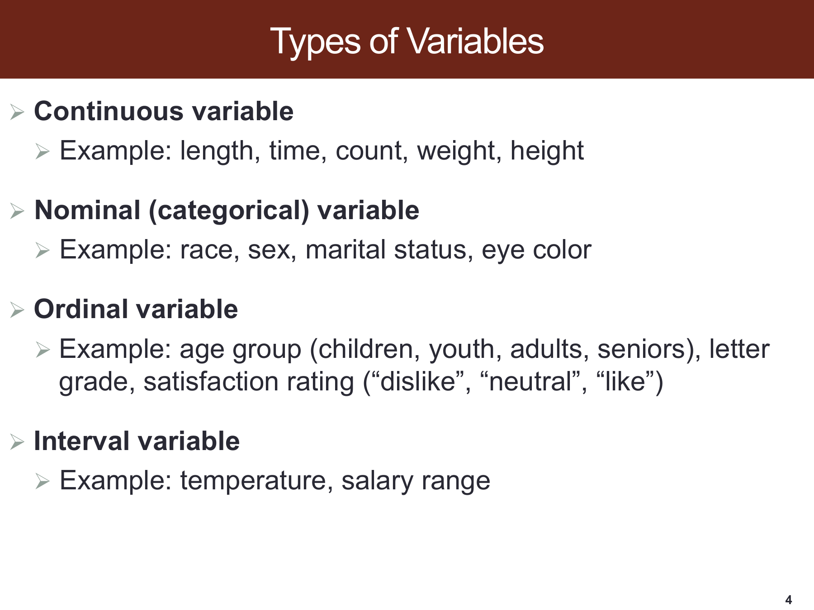
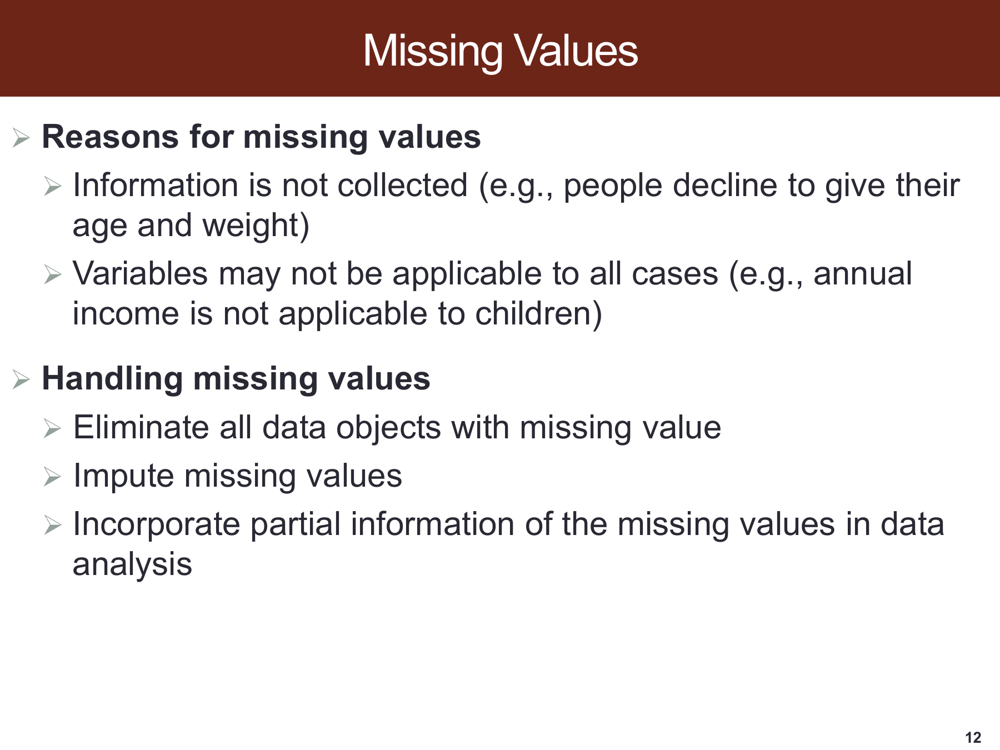
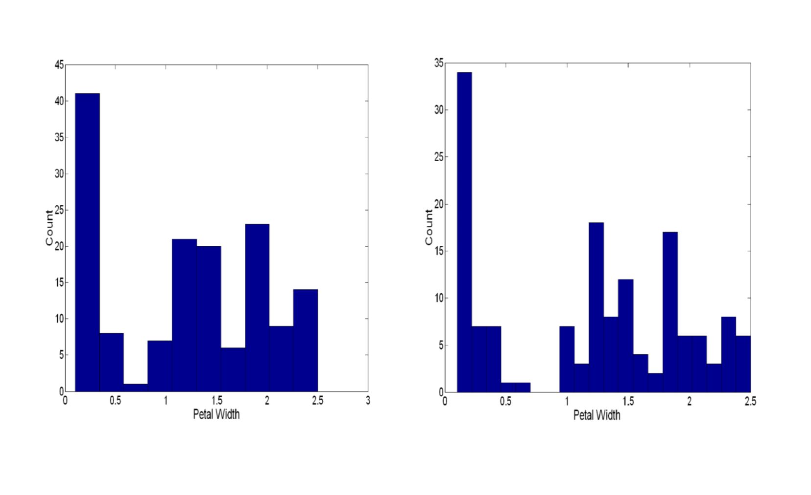
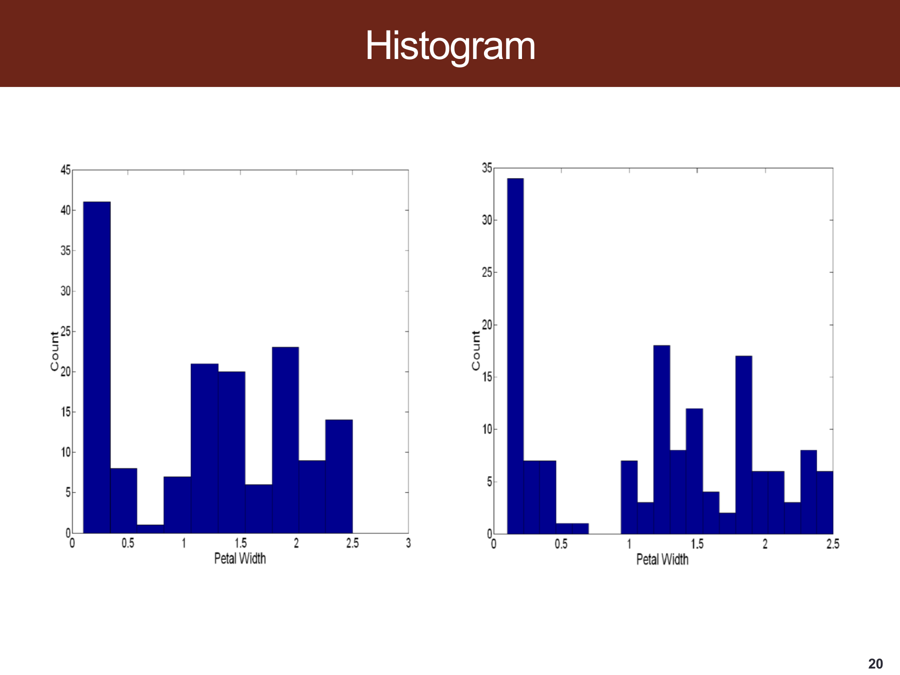
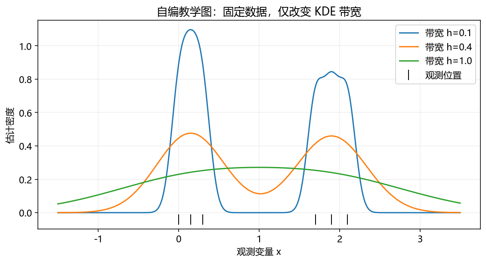
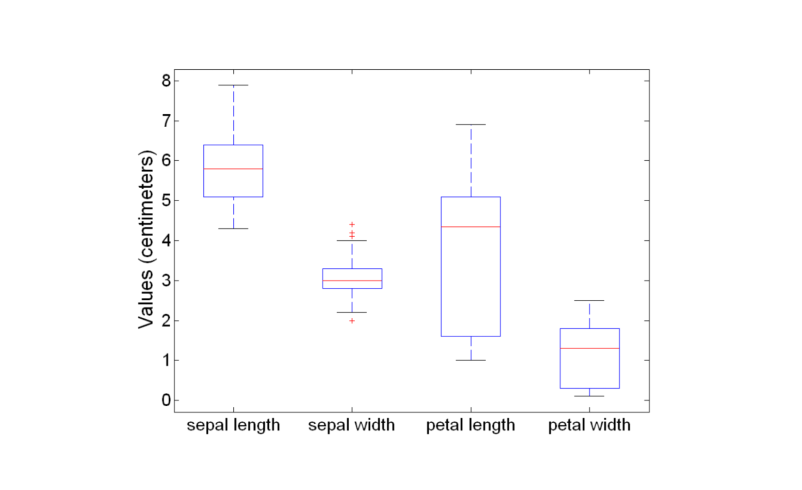
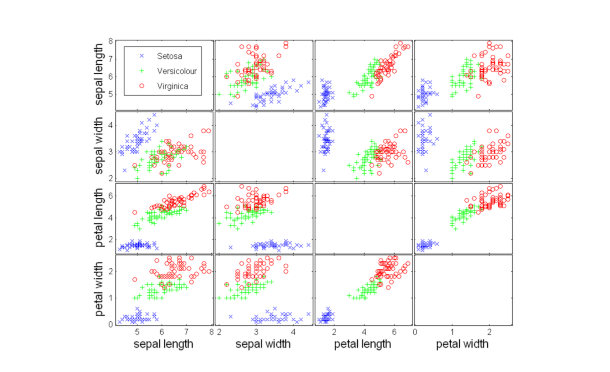
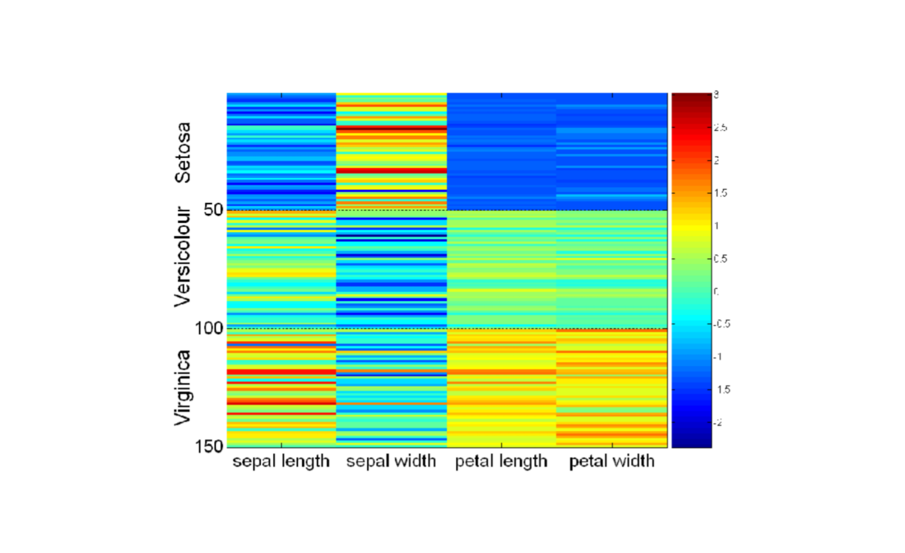
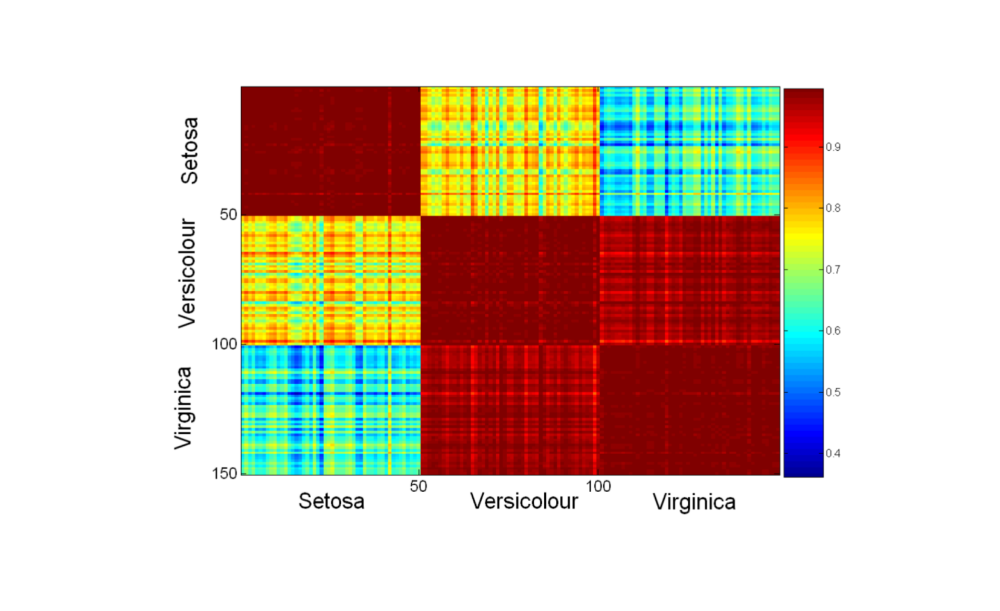
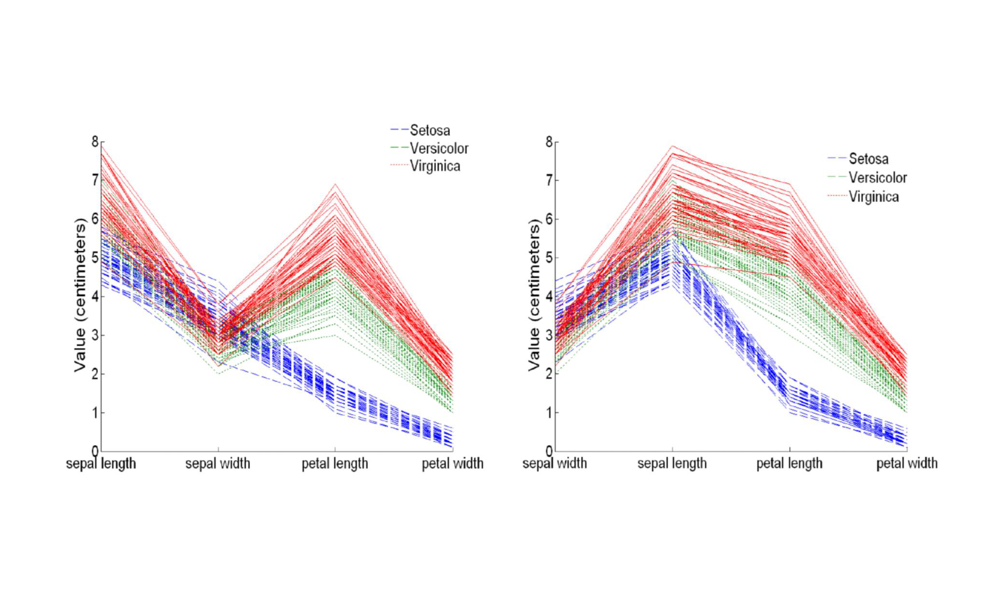

# SDSC5001 Topic 2：数据探索详细笔记

[课程总目录](README.md) · [逐页对应表](Topic2_%E8%AF%BE%E4%BB%B6%E9%80%90%E9%A1%B5%E5%AF%B9%E5%BA%94%E8%A1%A8.md) · [离线 HTML 阅读版](5001_Topic2_%E8%AF%A6%E7%BB%86%E7%AC%94%E8%AE%B0.html)

> 来源：本地 `SDSC5001_Topic 2 Exploration.pptx`，共 30 页，PDF 页序与幻灯片页序一致。按课件顺序讲解，补充推导、手算、应用与自测；补充内容和课件表述核对均在正文注明。
>
> Lumen 用法：在 Obsidian 的 guideline 笔记库点击“Lumen 本节定位”或“Lumen 图示定位”，可回到原 PDF 标记区域；标记备注可返回对应中文小节。图片为原课件局部截图，公式保留为可编辑 LaTeX。

## 阅读导航

- [0. 本章主线与实际工作顺序](#section-0)
- [1. 变量类型决定了哪些运算有意义](#section-1)
- [2. 数据表示：矩阵、文本、交易和图](#section-2)
- [3. 数据质量：噪声、异常值与缺失](#section-3)
- [4. 抽样偏差与类别不平衡](#section-4)
- [5. EDA 与描述统计：从一个数字看到什么](#section-5)
- [6. 空间图、Iris 数据与读图基本问题](#section-6)
- [7. 直方图与二维直方图](#section-7)
- [8. 箱线图：中位数、IQR 与须](#section-8)
- [9. 散点图与散点矩阵](#section-9)
- [10. 数据矩阵热图与相似度矩阵](#section-10)
- [11. 平行坐标、星形图与 Chernoff faces](#section-11)
- [12. 一份可以实际执行的 EDA 清单](#section-12)
- [13. 自测与参考答案](#section-13)

> **深化阅读（2026-10-31）：**本章新增 4 组分节详解与 3 张 PPT 完整截图。新增推导与手算均为配套补充，截图旁附逐项解读，沿用原有课件定位。
>
> [变量编码怎样改变距离和模型含义](#deep-t2-s1) · [插补以后，数据究竟发生了什么变化](#deep-t2-s3) · [不等宽直方图必须用面积读概率](#deep-t2-s7) · [总体相关与分组内关系可以反向](#deep-t2-s9)

> **外部资料强化（2026-11-01）：**本章在对应知识点内加入以下拓展，所有数值算例与教学图明确区分于课件原始内容。外部来源在小节末就近提供。
>
> [EDA 也会泄漏：先确定预测时刻，再决定哪些字段能用](#ext-t2-leakage) · [用中位数与 MAD 看清“稳健”到底稳在哪里](#ext-t2-mad) · [从直方图走向核密度：带宽决定你看见多少细节](#ext-t2-kde)

## 0. 本章主线与实际工作顺序
> [课件第 1–3 页](../output/pdf/SDSC5001_Topic2_slides.pdf#page%3D1) · [Lumen 本节定位](obsidian://lumen-pdf?vault=guideline&file=course%2F5001%2Foutput%2Fpdf%2FSDSC5001_Topic2_slides.pdf&annotation=sdsc5001-t2-f37020e825-page-001) · [逐页索引](Topic2_%E8%AF%BE%E4%BB%B6%E9%80%90%E9%A1%B5%E5%AF%B9%E5%BA%94%E8%A1%A8.md)

本章讨论建模之前怎样认识数据。数据集由对象 data objects 和属性 attributes 组成：对象也叫 record、case、sample、instance，属性也叫 variable、feature、field。表格的一行通常是一个对象，一列是一项属性，但原始文件中的一行也可能只是某个对象的一次事件，必须先确定分析单位。

探索性数据分析 EDA 的目标是识别分布、变量关系、分组结构和质量问题，为后面的建模作依据。一个可执行的顺序是：明确问题和总体，核对一行代表什么，记录变量含义与单位，检查缺失和异常，做单变量与多变量图，提出解释，再用适当方法验证。探索中产生的模式可以形成假设，但反复看图后挑中的模式需要独立验证。

**贯穿例子。**若研究学生成绩，每行可以是“学生”“学生的一门课”或“学生的一次考试”。这三种表格对应不同的样本量与依赖关系。不能在没有分组的情况下把同一人的多次考试分到训练和测试两侧，否则模型可能只是识别了这个人。

## 1. 变量类型决定了哪些运算有意义
> [课件第 4 页](../output/pdf/SDSC5001_Topic2_slides.pdf#page%3D4) · [Lumen 本节定位](obsidian://lumen-pdf?vault=guideline&file=course%2F5001%2Foutput%2Fpdf%2FSDSC5001_Topic2_slides.pdf&annotation=sdsc5001-t2-f37020e825-page-004) · [逐页索引](Topic2_%E8%AF%BE%E4%BB%B6%E9%80%90%E9%A1%B5%E5%AF%B9%E5%BA%94%E8%A1%A8.md)

| 类型 | 可合理比较什么 | 例子 | 常用处理 |
|---|---|---|---|
| 名义 nominal | 相等与不等，没有自然顺序 | 城市、颜色、产品类别 | 频数、比例、类别编码 |
| 有序 ordinal | 大小次序，间距未必一致 | 满意度、成绩等级 | 有序频数、分位数、适当的序数模型 |
| 数值型中的离散型 | 可数计数与数值差异 | 每日订单数 | 计数分布、条形图 |
| 数值型中的连续型 | 量的差异 | 长度、时间、重量 | 直方图、均值/中位数、散点图 |
| 区间尺度 interval | 差值，零点是约定 | 摄氏温度 | 加减与差异比较 |
| 比率尺度 ratio | 差值及有意义的比值 | 质量、时长 | 依问题选择数值分析 |

课件第 4 页把 count 放在连续变量例子中，严格说计数是离散型。它也把连续/名义/有序与 interval 并列，这是混合了“取值结构”和“测量尺度”两套分类；二者可同时描述一个变量。摄氏 20 度不能解释成比 10 度“热两倍”，而 20 kg 的质量是 10 kg 的两倍。

把五种颜色编码成 1–5 只是存储方式，不会使其具有等距顺序；直接代入线性模型会额外强加数值关系。相反，真正有序的等级也不一定每一级间隔相同。ID 数字主要用来标识对象，通常应从数值距离和均值计算中排除。

### 深入讲解：变量编码怎样改变距离和模型含义

把颜色编码为红=1、蓝=2、绿=3，只是在存储中起名字。若直接算距离，红与绿的差被设为红与蓝的两倍，这种几何关系没有来自颜色本身。无序类别可使用 one-hot：红 $(1,0,0)$、蓝 $(0,1,0)$、绿 $(0,0,1)$，此时不同类别间欧氏距离相同。

但 one-hot 也不自动解决所有问题。带截距的线性回归通常要删去一个基准列，避免各列之和恒为 1 导致完全共线；树和距离模型如何处理编码，则需结合相应算法。

**补充手算。**两位对象的年龄差为 10 岁、年收入差为 1,000 元，未经缩放的平方距离为 $10^2+1000^2=1,000,100$，几乎全部由收入决定。若训练集年龄标准差为 10、收入标准差为 10,000，则标准化后平方距离为

$$d^2=(10/10)^2+(1000/10000)^2=1.01.$$

标准化使单位改变不再直接支配距离，但仍隐含各标准化方向按这种方式比较有意义。异常值会影响均值和标准差，稀有二元变量经标准化后也可能获得很大权重，因此应解释采用该距离的理由。

测量尺度还决定可用的解释：摄氏温度差 10 度有意义，20℃ 却不能说是 10℃ 的两倍“热”；绝对零点有意义的比率尺度才允许通常的倍数解释。变量是连续还是离散，与它属于哪种测量尺度是两个不同问题。

### PPT 第 4 页逐项讲解：变量类型与测量尺度

> 原课件：[第 4 页](../output/pdf/SDSC5001_Topic2_slides.pdf#page=4)。截图保留课件原貌，下面按阅读顺序解释；原页简写与笔误以正文核对为准。

**按例子理解，而非照单全收。**长度、时间、重量常按连续量处理；这一页把 count 也列入连续例子，但严格的计数取非负整数，属于离散变量。离散和连续应按取值集合判断。

**Nominal 与 ordinal 的差别是顺序。**眼睛颜色没有天然大小，满意度有顺序，但“喜欢”和“中立”的差距不必等于“中立”和“不喜欢”的差距。给它们写上 1、2、3 不会自动创造等距性质。

**Interval 是另一个分类维度。**等距尺度讨论差值是否有意义，连续/离散讨论可能取值。工资区间作为分档通常应进一步看编码方式，不能只因原页这样列就对档位编号做倍数解释。下方补充距离例子展示编码错误怎样传到模型。

## 2. 数据表示：矩阵、文本、交易和图
> [课件第 5–9 页](../output/pdf/SDSC5001_Topic2_slides.pdf#page%3D5) · [Lumen 本节定位](obsidian://lumen-pdf?vault=guideline&file=course%2F5001%2Foutput%2Fpdf%2FSDSC5001_Topic2_slides.pdf&annotation=sdsc5001-t2-f37020e825-page-005) · [逐页索引](Topic2_%E8%AF%BE%E4%BB%B6%E9%80%90%E9%A1%B5%E5%AF%B9%E5%BA%94%E8%A1%A8.md)

### 2.1 数据矩阵

固定 $p$ 个变量描述 $n$ 个对象时，数据可写成 $X\in\mathbb R^{n\times p}$。第 $i$ 行 $x_i^T$ 是对象的特征向量，第 $j$ 列 $X_j$ 是一个变量。课件的病人表包含性别、年龄、吸烟与饮酒，若送入只接受数值的模型，还需明确类别编码。

“矩阵”并不意味着所有列都能直接用欧氏距离。年龄与二元吸烟变量的尺度不同，按原始数值相加会使距离主要由年龄控制。需要结合任务选择标准化、距离或混合数据方法。

### 2.2 文本的词袋表示

设词汇表有 $p$ 个词，文档 $i$ 可表示为词频向量 $x_i=(c_{i1},\ldots,c_{ip})$。课件的 dogs、knitting 等短句展示了从句子转成“文档 × 词项”矩阵的思路。零表示某词没有出现，稀疏矩阵可节省存储。

补充：词袋忽略词序，文档长短会影响原始计数。可考虑相对词频、TF–IDF 或其他文本表示。词汇表和由数据估计的权重应在训练部分建立，以免用到测试文档信息。文本向量维度很高时，余弦相似度往往比未经处理的欧氏距离更贴近“方向相似”的目标。

### 2.3 交易数据

一笔交易是一组商品，不是固定长度的有序字符串。例如 $\{\text{面包},\text{牛奶}\}$ 与倒序写法是同一购物篮。可转成“交易 × 商品”的 0/1 矩阵，用于研究共现。若另有购买数量，需要区分“是否买过”和“买了多少”，否则频率含义会混乱。

### 2.4 图数据

图用节点和边表达关系，例如社交连接或分子原子间的化学键。边可能有方向、权重、类型。邻接矩阵通常是 $n\times n$，两条轴都索引对象，与普通 $n\times p$ 特征矩阵不同。图节点的相邻关系可能导致统计依赖，随机拆分单条边与随机拆分整张图会产生不同的评估任务。

## 3. 数据质量：噪声、异常值与缺失
> [课件第 10–12 页](../output/pdf/SDSC5001_Topic2_slides.pdf#page%3D10) · [Lumen 本节定位](obsidian://lumen-pdf?vault=guideline&file=course%2F5001%2Foutput%2Fpdf%2FSDSC5001_Topic2_slides.pdf&annotation=sdsc5001-t2-f37020e825-page-010) · [逐页索引](Topic2_%E8%AF%BE%E4%BB%B6%E9%80%90%E9%A1%B5%E5%AF%B9%E5%BA%94%E8%A1%A8.md)

噪声 noise 是对原始值的扰动，异常值 outlier 是与主要数据模式明显不同的观测。噪声不一定形成极端值，异常值也不一定是错误。设备故障、录入错误、单位不一致与罕见但真实的事件应分别处理。

**核对例子。**身高列出现 1.75 和 175，可能是米和厘米混用。直接做异常值删除会丢失可修正的信息。订单金额很大则可能是真实大客户，删除会改变目标总体。先追溯来源，再记录修正、保留或排除的理由。

### 3.1 为什么不能一律删除缺失行

缺失可能来自拒答、采集失败，也可能表示变量不适用，例如儿童的年收入。“不适用”和“真实为 0”是不同的语义。删除全部含缺失的行会减少样本量；若缺失与结局或特征有关，还会改变样本组成。

补充三类常见机制：MCAR 表示缺失与已观测和未观测值均无关；MAR 表示给定已观测信息后，缺失不再依赖未观测值；MNAR 则仍依赖未观测部分。这些是关于缺失机制的假设，通常不能仅靠一个缺失率表证明。

### 3.2 插补应怎样做

均值/中位数插补简单，但会压缩方差，且可能改变变量关系；类别常用众数或专门的“未提供”类别，是否合适取决于语义。可保留缺失指示变量，或选择能处理缺失的模型。复杂分析还可考虑多重插补。

所有由数据学习的插补参数应在训练折内拟合，再应用于验证折。验证数据的均值一旦进入训练插补，就已经有信息泄漏。缺失标记、单位转换、异常规则最好写入可重复的数据处理流程，而不只在电子表格里手工修改。

### 深入讲解：插补以后，数据究竟发生了什么变化

**补充算例。**原记录为 $1,2,3,\text{缺失}$。用已观测均值 2 插补后得到 $1,2,3,2$。插补前已观测样本方差为 $(1+0+1)/(3-1)=1$，插补后为 $(1+0+1+0)/(4-1)=2/3$。数值变完整了，方差却被人为压小；插补值并不是新增的一次真实测量。

若缺失者系统地来自高值对象，填入 2 还会产生方向性偏差。缺失机制应在具体变量上解释：设备随机丢包可近似 MCAR；给定已记录的设备类型后，丢包与未记录温度无关，可考虑 MAR；丢包概率仍随未记录温度升高而上升，则可能是 MNAR。机制通常需要采集背景支持，无法只凭缺失表确定。

在预测流程中，可先划分训练/验证，再仅在训练数据拟合中位数等插补参数，原样用于验证。缺失指示变量 $M_j=\mathbf1\{X_j\text{缺失}\}$ 可帮助模型识别缺失模式，但它也可能学到医院、设备或采集流程的偶然规律，部署环境变化时需复查。

**区分分析目标。**用于预测的简单插补可能是可比较的工程基线；用于总体均值、回归标准误或显著性推断时，还要处理缺失机制和插补不确定性。多重插补通过多套合理填充值结合组内与组间不确定性，不能把其中一套填完后当作完全真实数据来理解。

### PPT 第 12 页逐项讲解：缺失值的来源与处理

> 原课件：[第 12 页](../output/pdf/SDSC5001_Topic2_slides.pdf#page=12)。截图保留课件原貌，下面按阅读顺序解释；原页简写与笔误以正文核对为准。

**先区分没有收集与不适用。**拒绝提供收入是未知；某变量对对象不适用则是另一种语义。把两者都填 0，会把信息缺失误写成真实测量为零。

**删除和插补都隐含假设。**整行删除改变样本量与样本组成；填均值则压缩波动。原页列出了选项，并不表示每种任务都可以任选一种而不影响推断。

**“利用部分信息”应落实到可重复流程。**保留缺失模式、按适合的模型分析，或采用能体现插补不确定性的办法。用于预测时所有学习到的插补值必须来自训练部分，验证集仅复用。

### 外部拓展：EDA 也会泄漏：先确定预测时刻，再决定哪些字段能用

**课内衔接：**[本章第 3 节](#section-3) · [原课件第 10 页](../output/pdf/SDSC5001_Topic2_slides.pdf#page=10) · [复用原有 Lumen 定位](obsidian://lumen-pdf?vault=guideline&file=course%2F5001%2Foutput%2Fpdf%2FSDSC5001_Topic2_slides.pdf&annotation=sdsc5001-t2-f37020e825-page-010)

**外部拓展｜连接数据质量检查。**一列没有缺失、相关性很高，也可能根本不应该成为特征。泄漏的判断标准是：做出预测的那个时刻，是否实际拿得到它。

**自编场景。**任务是在酒店预订提交时预测是否取消。入住后生成的最终房费、取消处理手续费和最终状态代码，都可能与取消高度相关，但提交预订时还不存在。若这些字段进入模型，再严格的随机交叉验证也不会修复任务定义错误。

| 检查层次 | 问题 | 操作 |
|---|---|---|
| 时刻 | 特征是在预测前还是预测后产生 | 给每个字段记录可用时间 |
| 对象 | 同一客户或设备是否跨训练和验证 | 根据泛化目标按对象分组 |
| 处理 | 均值、插补、筛选是否读了验证数据 | 只在训练折拟合，再转换验证折 |
| 选择 | 是否看最终测试结果反复改特征 | 把测试集留到流程冻结之后 |

**进一步区分。**用历史客户预测同一客户未来行为，与推广到新客户，是两个不同任务；按客户随机拆分记录可能适合前者的某些设计，却不能代表后者。按时间预测时，也要保证滚动均值等窗口只使用当时之前的数据；窗口跨越拆分边界时应检查重叠与信息可用性。

Pipeline 能把标准化、插补、PCA 等拟合限制在训练折，但它不会自动知道“最终房费”是未来变量，也不会替你选择分组或时间切分。代码流程正确与研究问题正确需要同时满足。

**自测。**先用全部标签筛出最相关的 20 个特征，再做 5 折 CV，问题在哪里？验证标签已参与筛选；应在每个训练折内部重新筛选。若又用同一 CV 结果挑选特征数，则最终评估还要考虑 Topic 3 的外层评价。

**外部来源与阅读定位：**[scikit-learn：数据泄漏与正确预处理](https://scikit-learn.org/stable/common_pitfalls.html#data-leakage)。本文推导与自编算例用于解释相应方法，不冒充来源中的实验结果。

## 4. 抽样偏差与类别不平衡
> [课件第 13 页](../output/pdf/SDSC5001_Topic2_slides.pdf#page%3D13) · [Lumen 本节定位](obsidian://lumen-pdf?vault=guideline&file=course%2F5001%2Foutput%2Fpdf%2FSDSC5001_Topic2_slides.pdf&annotation=sdsc5001-t2-f37020e825-page-013) · [逐页索引](Topic2_%E8%AF%BE%E4%BB%B6%E9%80%90%E9%A1%B5%E5%AF%B9%E5%BA%94%E8%A1%A8.md)

抽样偏差是样本的产生或进入机制与目标总体不匹配。例如只调查愿意回复问卷的人，或只收集白天运行的设备，却想讨论全天故障规律。便利抽样的样本量再大，也不自动消除系统偏差。

类别不平衡本身不必然是抽样偏差：若总体中故障本来只有 1%，1% 的样本比例可能忠实反映总体。需要分清“样本是否有代表性”和“学习算法是否能识别少数类”。前者涉及采样机制，后者涉及损失、阈值、评价指标等。

实际处理先明确目标：估计总体比例时要恢复真实类比例；识别少数事件时可在训练中使用权重或重采样。过采样只能在训练折内做，测试集应保留目标使用场景的分布。不能把人为平衡后的准确率直接当作总体运营指标。

## 5. EDA 与描述统计：从一个数字看到什么
> [课件第 14–16 页](../output/pdf/SDSC5001_Topic2_slides.pdf#page%3D14) · [Lumen 本节定位](obsidian://lumen-pdf?vault=guideline&file=course%2F5001%2Foutput%2Fpdf%2FSDSC5001_Topic2_slides.pdf&annotation=sdsc5001-t2-f37020e825-page-014) · [逐页索引](Topic2_%E8%AF%BE%E4%BB%B6%E9%80%90%E9%A1%B5%E5%AF%B9%E5%BA%94%E8%A1%A8.md)

课件将 EDA 重点放在描述统计与可视化。第 14 页的 John Turkey 应为 John Tukey；这只是姓名拼写核对，不影响方法内容。

### 5.1 中心、位置与离散程度

$$\bar x=\frac1n\sum_i x_i,\qquad s^2=\frac1{n-1}\sum_i(x_i-\bar x)^2,\qquad IQR=Q_3-Q_1.$$

均值对全部数值敏感；中位数按排序确定；截尾均值先按比例去掉两端再平均。分位数定位累计比例，不同软件的有限样本插值规则可能略有差别，复算时需记录算法。

极差 $\max x_i-\min x_i$ 易被极端值控制；标准差衡量均值周围的波动；IQR 描述中间 50% 数据的跨度。频数是次数，相对频率是次数除以样本量，众数是最常见取值，不能把这三个概念互换。

### 5.2 补充算例：为什么不能只报平均数

对 $1,2,2,3,12$，均值为 4，中位数为 2。离均差平方和为 $9+4+4+1+64=82$，样本方差为 $82/4=20.5$，标准差约 4.528。均值与典型的中间对象明显不同，原因是右尾的 12 拉高了平均数。

偏度描述分布的不对称方向。右偏意味着右尾较长，不能只凭“均值大于中位数”作为在所有分布下都充分必要的判据。探索报告最好同时给样本量、缺失量、中心、离散程度和分布图。

### 外部拓展：用中位数与 MAD 看清“稳健”到底稳在哪里

**课内衔接：**[本章第 5 节](#section-5) · [原课件第 14 页](../output/pdf/SDSC5001_Topic2_slides.pdf#page=14) · [复用原有 Lumen 定位](obsidian://lumen-pdf?vault=guideline&file=course%2F5001%2Foutput%2Fpdf%2FSDSC5001_Topic2_slides.pdf&annotation=sdsc5001-t2-f37020e825-page-014)

**外部拓展｜连接均值、标准差和箱线图。**稳健统计量希望少数极端观测不会任意支配结果。定义

$$\tilde x=\operatorname{median}_{i=1,\ldots,n}x_i,\qquad
MAD=\operatorname{median}_{i=1,\ldots,n}|x_i-\tilde x|.$$

$x_i$ 是第 i 个观测，n 是样本数，波浪线表示样本中位数；绝对值衡量偏离中心的大小。两个 median 都是在观测索引 i 上取中位数。MAD 是“绝对偏差的中位数”，与平均绝对偏差不是一回事。

**自编手算。**[1,2,2,3,100] 的均值为 21.6，样本标准差约为 43.8326；中位数为 2，绝对偏差 [1,0,0,1,98] 的中位数为 1。把 100 再改成一百万，会大幅改变均值与标准差，但这组数据的中位数和 MAD 仍为 2、1。

若希望在近似正态总体下把 MAD 换成与标准差相近的尺度，可使用 $\hat\sigma_{MAD}=MAD/\Phi^{-1}(0.75)\approx1.4826MAD$。Φ 是标准正态分布函数，逆函数取 75% 分位数。这个常数来自正态模型下绝对偏差的分位数关系，不是任意分布的普遍方差换算。

可构造稳健尺度分数 $r_i=(x_i-\tilde x)/\hat\sigma_{MAD}$。本例 100 的分数约为 66.1，表示它远离主体；但这仍不证明它是错误值。若 MAD=0，例如大量相同值，不允许直接相除，应检查离散性、重复值或使用其他合理尺度。

**实际处理。**先核对单位、设备状态和录入来源，再比较保留、纠错与稳健建模的结论。删除极端对象会改变研究人群，不能只为让图形好看而删。

**外部来源与阅读定位：**[SciPy：median_abs_deviation](https://docs.scipy.org/doc/scipy/reference/generated/scipy.stats.median_abs_deviation.html)。本文推导与自编算例用于解释相应方法，不冒充来源中的实验结果。

## 6. 空间图、Iris 数据与读图基本问题
> [课件第 17–19 页](../output/pdf/SDSC5001_Topic2_slides.pdf#page%3D17) · [Lumen 本节定位](obsidian://lumen-pdf?vault=guideline&file=course%2F5001%2Foutput%2Fpdf%2FSDSC5001_Topic2_slides.pdf&annotation=sdsc5001-t2-f37020e825-page-017) · [逐页索引](Topic2_%E8%AF%BE%E4%BB%B6%E9%80%90%E9%A1%B5%E5%AF%B9%E5%BA%94%E8%A1%A8.md)

可视化把结构编码为位置、长度、颜色、面积等。读图前先确认轴表示对象还是变量、单位、是否做了变换、颜色映射和分组方式。截断的纵轴、不同子图的量程、颜色范围变化都可能改变观感。

海表温度例子将大量位置数据编码为经纬度上的颜色，必须同时读色标。图中空白陆地不等于温度为零。连续颜色应帮助读出量级，不能只凭某块区域“更红”却忽略各图色标是否一致。

Iris 例子有 150 个样本，Setosa、Versicolor、Virginica 各 50 个，四个解释变量是萼片与花瓣的长宽。类别颜色用于观察组间结构，不表示模型已在独立数据上达到某个准确率。

## 7. 直方图与二维直方图
> [课件第 20–21 页](../output/pdf/SDSC5001_Topic2_slides.pdf#page%3D20) · [Lumen 本节定位](obsidian://lumen-pdf?vault=guideline&file=course%2F5001%2Foutput%2Fpdf%2FSDSC5001_Topic2_slides.pdf&annotation=sdsc5001-t2-f37020e825-page-020) · [逐页索引](Topic2_%E8%AF%BE%E4%BB%B6%E9%80%90%E9%A1%B5%E5%AF%B9%E5%BA%94%E8%A1%A8.md)

直方图先把数值轴分箱，再统计落入各箱的对象。图形会受箱宽和起点影响。过宽会掩盖多峰，过窄会突出随机波动；课件第 20 页对同一变量使用不同分箱，正是为了说明表现方式会改变细节。

如果纵轴是计数，高度为箱内样本数；若是密度，应满足

$$\text{第 }j\text{ 箱高度}=\frac{n_j}{n\,h_j},\qquad \sum_j(\text{高度}\times h_j)=1.$$

箱宽不等时，只有按面积而非柱高比较概率才正确。直方图用连续区间组织数值，类别频数的条形图则按类别组织，不能通过随意改变类别编码制造连续距离。

二维直方图将 $(X_1,X_2)$ 平面划为小矩形，第三维高度或颜色表示次数/密度。它适合点很多、散点图重叠严重时观察密度。课件用花瓣长宽展示两变量的联合结构，边际分布相同也不意味着联合结构相同。

> 图源：[原课件第 20 页](../output/pdf/SDSC5001_Topic2_slides.pdf#page%3D20) · [Lumen 图示定位](obsidian://lumen-pdf?vault=guideline&file=course%2F5001%2Foutput%2Fpdf%2FSDSC5001_Topic2_slides.pdf&annotation=sdsc5001-t2-f37020e825-crop-020)。读图：相同花瓣宽度变量的不同分箱结果；比较峰的位置和峰数如何受箱宽影响。

### 深入讲解：不等宽直方图必须用面积读概率

**补充手算。**100 个观测分入三箱 $[0,1)$、$[1,3)$、$[3,6]$，频数分别为 20、30、50。箱宽为 1、2、3，密度高度依次为

$$h_1=\frac{20}{100\times1}=0.20,\quad
h_2=\frac{30}{100\times2}=0.15,\quad
h_3=\frac{50}{100\times3}=\frac16.$$

第一箱最高，却只有 20% 的概率；第三箱略矮，但宽度大，总面积为 $(1/6)\times3=0.5$。因此最高的柱不一定包含最多对象，只有相同箱宽时高度和频数才成比例。

三个面积相加为 $0.2+0.3+0.5=1$。密度的单位是原变量单位的倒数，例如横轴为秒，纵轴密度单位为“每秒”，乘以区间宽度后才得到无单位概率。

如果问题问 $P(1\le X<3)$，由箱频数直接得到经验比例 0.3。若只问 $P(1\le X<2)$，整箱摘要不足以知道精确比例；把它估为 $0.15\times1=0.15$，等于在箱内采用常数密度近似。不要把作图近似误当作原始数据精确信息。

实际比较不同组时，应统一箱边界并明确画的是频数还是密度。样本数不同的两组若只比较计数柱高，会把组规模与分布形状混在一起。

### PPT 第 20 页逐项讲解：同一变量的两种直方图

> 原课件：[第 20 页](../output/pdf/SDSC5001_Topic2_slides.pdf#page=20)。截图保留课件原貌，下面按阅读顺序解释；原页简写与笔误以正文核对为准。

**先看两图的横轴。**都表示 Petal Width，纵轴标为 Counts，因此柱高在各图中表示该箱的观测数量。两图柱宽与分箱不同，局部谷和峰的视觉强度也不同。

**比较稳定结构与不稳定细节。**较小花瓣宽度附近的一组和较大宽度区域的分布是主要观察；某一个小尖峰能否解释为独立亚群，需要查看分箱敏感性与更多证据。

**与补充算例的区别。**截图展示的是计数直方图；下方不等宽例子专门说明密度高度与面积的关系。不要把截图的 Counts 直接读成概率密度，也不要把柱高误当作单点发生概率。

### 外部拓展：从直方图走向核密度：带宽决定你看见多少细节

**课内衔接：**[本章第 7 节](#section-7) · [原课件第 20 页](../output/pdf/SDSC5001_Topic2_slides.pdf#page=20) · [复用原有 Lumen 定位](obsidian://lumen-pdf?vault=guideline&file=course%2F5001%2Foutput%2Fpdf%2FSDSC5001_Topic2_slides.pdf&annotation=sdsc5001-t2-f37020e825-page-020)

**外部拓展｜连接密度柱高与面积。**核密度估计把每个观测附近放一条小曲线，再平均。对一维观测定义

$$\hat f_h(x)=\frac1{nh}\sum_{i=1}^n K\left(\frac{x-x_i}{h}\right).$$

x 是准备评价密度的位置，$x_i$ 是第 i 个观测，n 是观测数；h>0 是带宽，单位与 x 相同；K 是积分为 1 的核函数。帽号表示估计密度，下标 h 标记采用的带宽。读作：计算目标点离每个观测有多少个带宽，用 K 换成贡献，再按 n 和 h 归一化。密度单位是 x 单位的倒数。

高斯核取 $K(u)=(2\pi)^{-1/2}e^{-u^2/2}$，u 是无量纲的标准化距离。**自编手算：**[0,1,2]、h=0.5、x=1，对应 u 为 2、0、−2，因此密度为 $(0.05399+0.39894+0.05399)/1.5\approx0.33795$。若 h=0.1，中间峰可高于 1，仍不违反概率公理，因为区间面积才是概率。

**读图。**黑色短线标出同一组数据；小 h 保留很多尖峰，大 h 合并细节。图中核函数都相同，变化来自带宽。不能把每个小尖峰直接命名为一个真实亚群。

**边界问题。**若变量只能非负，高斯核仍会给负值区间分配质量；这来自估计方法，不表示发现了负的等待时间。可研究边界修正或适当变换，但变换后的密度要乘对应 Jacobian 才能回到原尺度。密度估计核、SVM 核和局部回归权重都有“核”字，承担的数学角色不同。

**外部来源与阅读定位：**[scikit-learn：核密度估计与带宽](https://scikit-learn.org/stable/modules/density.html#kernel-density-estimation)。本文推导与自编算例用于解释相应方法，不冒充来源中的实验结果。

## 8. 箱线图：中位数、IQR 与须
> [课件第 22 页](../output/pdf/SDSC5001_Topic2_slides.pdf#page%3D22) · [Lumen 本节定位](obsidian://lumen-pdf?vault=guideline&file=course%2F5001%2Foutput%2Fpdf%2FSDSC5001_Topic2_slides.pdf&annotation=sdsc5001-t2-f37020e825-page-022) · [逐页索引](Topic2_%E8%AF%BE%E4%BB%B6%E9%80%90%E9%A1%B5%E5%AF%B9%E5%BA%94%E8%A1%A8.md)

箱体从 $Q_1$ 到 $Q_3$，中间线为中位数。常见 Tukey 箱线图将须画到仍处在 $[Q_1-1.5IQR,Q_3+1.5IQR]$ 内的最远实际观测，而不是直接画到这两个阈值。落在须外的点作为潜在异常点单独显示。

具体实现可能使用最小最大值或其他须规则，读图时必须确认约定。“须外”是筛查规则，不是证明该记录错误。正态分布也会以一定概率产生须外点。

箱线图适合并排比较许多组的中心、跨度与不对称性，但可能隐藏多峰。两个数据集可以有相同五数概括却有完全不同的分布。因此课件 Iris 箱线图之后还需要散点图和其他多变量图。

> 图源：[原课件第 22 页](../output/pdf/SDSC5001_Topic2_slides.pdf#page%3D22) · [Lumen 图示定位](obsidian://lumen-pdf?vault=guideline&file=course%2F5001%2Foutput%2Fpdf%2FSDSC5001_Topic2_slides.pdf&annotation=sdsc5001-t2-f37020e825-crop-022)。读图：Iris 四变量箱线图；比较量纲相同并不等于四个变量应有相同中心和方差。

## 9. 散点图与散点矩阵
> [课件第 23 页](../output/pdf/SDSC5001_Topic2_slides.pdf#page%3D23) · [Lumen 本节定位](obsidian://lumen-pdf?vault=guideline&file=course%2F5001%2Foutput%2Fpdf%2FSDSC5001_Topic2_slides.pdf&annotation=sdsc5001-t2-f37020e825-page-023) · [逐页索引](Topic2_%E8%AF%BE%E4%BB%B6%E9%80%90%E9%A1%B5%E5%AF%B9%E5%BA%94%E8%A1%A8.md)

散点图用一个点表示一个对象的两项变量。可以检查线性/非线性关系、异方差、离群点和分组。散点矩阵把各变量两两组合：若有 $p$ 个变量，非重复变量对有 $p(p-1)/2$ 个。

Iris 图中同类点的颜色和符号帮助区分类内与类间变化。一个总体上很强的关系，可能主要来自不同组均值的差异；应该同时检查按组的关系。看见相关还不能推出改变一个变量会导致另一个变化。

大样本可降低透明度、抽样、用 hexbin 或二维密度。抽样图应说明抽样方式，避免把少数类或尾部恰好抽掉。散点矩阵也只能显示两两投影，无法保证发现只在三维或更高维中出现的结构。

> 图源：[原课件第 23 页](../output/pdf/SDSC5001_Topic2_slides.pdf#page%3D23) · [Lumen 图示定位](obsidian://lumen-pdf?vault=guideline&file=course%2F5001%2Foutput%2Fpdf%2FSDSC5001_Topic2_slides.pdf&annotation=sdsc5001-t2-f37020e825-crop-023)。读图：Iris 散点矩阵；同一个类别在不同变量对上的可分程度不同。

### 深入讲解：总体相关与分组内关系可以反向

**补充算例。**A 组两点为 $(1,4),(2,3)$，B 组两点为 $(4,8),(5,7)$。每组内部 $x$ 增加时 $y$ 都下降，组内斜率均为 $-1$。但合并后 $\bar x=3$、$\bar y=5.5$，有

$$S_{xy}=3+2.5+2.5+3=11,\quad S_{xx}=10,\quad S_{yy}=17,$$

$$r=\frac{11}{\sqrt{10\times17}}\approx0.844.$$

合并数据呈明显正相关，是因为 B 组整体位于更大的 $x$ 和更大的 $y$ 区域。两组均值之间的移动压过了组内的下降关系。这是理解分组混杂与 Simpson 型现象的一个小例子。

因此读散点图不能只说“向右上”。应依次检查总体形状、组别颜色、各组内部形状、异常点及取值范围。之后 Topic 4 多元回归中的“控制其他变量”会尝试比较相同组别或相同协变量下的关系，但能否作因果解释仍需额外设计依据。

还要区分 Pearson 相关与一般依赖。例如 $x=(-2,-1,0,1,2)$、$y=x^2$，由于左右对称，样本线性相关为 0，但散点呈完整 U 形，$y$ 由 $x$ 完全决定。报告“无线性相关”比“没有关系”准确。

## 10. 数据矩阵热图与相似度矩阵
> [课件第 24–26 页](../output/pdf/SDSC5001_Topic2_slides.pdf#page%3D24) · [Lumen 本节定位](obsidian://lumen-pdf?vault=guideline&file=course%2F5001%2Foutput%2Fpdf%2FSDSC5001_Topic2_slides.pdf&annotation=sdsc5001-t2-f37020e825-page-024) · [逐页索引](Topic2_%E8%AF%BE%E4%BB%B6%E9%80%90%E9%A1%B5%E5%AF%B9%E5%BA%94%E8%A1%A8.md)

数据热图的行是对象、列是变量，颜色是标准化后的数值。若列量纲差异很大，常对每列做 $z_{ij}=(x_{ij}-\bar x_j)/s_j$，使相对高低可以放在同一色标下比较。此时颜色表示“比本变量平均值高多少个标准差”，不再是原始厘米值。

相似度矩阵是 $n\times n$，元素比较对象 $i$ 与 $j$。距离矩阵颜色越大可能越不相似，相似度矩阵颜色越大通常越相似，应以色标定义为准。对称性和对角线的值可作为初步检查，但具体取决于使用的相似度。

排序会显著影响热图。先按已知类别排列，块结构更清晰，却不能据此宣称无监督算法“自动发现了类别”。课件第 25–26 页的类别顺序已知，读图时要把这种展示信息与算法结果分开。

> 图源：[原课件第 25 页](../output/pdf/SDSC5001_Topic2_slides.pdf#page%3D25) · [Lumen 图示定位](obsidian://lumen-pdf?vault=guideline&file=course%2F5001%2Foutput%2Fpdf%2FSDSC5001_Topic2_slides.pdf&annotation=sdsc5001-t2-f37020e825-crop-025)。读图：按类别排列的 Iris 特征热图，四列仍对应四个特征。

> 图源：[原课件第 26 页](../output/pdf/SDSC5001_Topic2_slides.pdf#page%3D26) · [Lumen 图示定位](obsidian://lumen-pdf?vault=guideline&file=course%2F5001%2Foutput%2Fpdf%2FSDSC5001_Topic2_slides.pdf&annotation=sdsc5001-t2-f37020e825-crop-026)。读图：Iris 对象间相似度矩阵，两条轴都索引样本；与前图的维度不同。

## 11. 平行坐标、星形图与 Chernoff faces
> [课件第 27–30 页](../output/pdf/SDSC5001_Topic2_slides.pdf#page%3D27) · [Lumen 本节定位](obsidian://lumen-pdf?vault=guideline&file=course%2F5001%2Foutput%2Fpdf%2FSDSC5001_Topic2_slides.pdf&annotation=sdsc5001-t2-f37020e825-page-027) · [逐页索引](Topic2_%E8%AF%BE%E4%BB%B6%E9%80%90%E9%A1%B5%E5%AF%B9%E5%BA%94%E8%A1%A8.md)

平行坐标为每个变量放一根竖直轴，每个对象在各轴上取相应位置，用折线连接。它可以同时显示多项变量，找组内相近的轨迹。主要困难是线条遮挡、轴顺序影响显著，以及尺度不一致。交换相邻两根轴会改变交叉模式，却没有改变原数据。

实际使用可以统一尺度、按类别着色、降低透明度，并通过刷选关注某组对象。若一列的顺序被反转，轨迹的“上升/下降”也反转，必须明确刻度方向。不能把连接线之间围成的面积当作一个有物理意义的量。

星形图从中心向外布置变量轴，一个对象形成一个多边形。轴顺序会改变形状，面积同时受轴数与轴的排列影响，不能直接当作总体得分。Chernoff faces 把变量映射到眼睛、嘴等面部特征，便于快速感知差异，但不同面部特征的人类感知权重并不相同，难做精确数量比较。

> 图源：[原课件第 28 页](../output/pdf/SDSC5001_Topic2_slides.pdf#page%3D28) · [Lumen 图示定位](obsidian://lumen-pdf?vault=guideline&file=course%2F5001%2Foutput%2Fpdf%2FSDSC5001_Topic2_slides.pdf&annotation=sdsc5001-t2-f37020e825-crop-028)。读图：Iris 平行坐标：每条折线是一朵花，观察分离主要发生在哪些变量轴上。

## 12. 一份可以实际执行的 EDA 清单

1. 写清目标、分析单位、采样时间与目标总体，建立变量字典。
2. 核对行数、主键、重复、数据类型、单位和合法范围。
3. 按列、按组、按时间统计缺失，区分未采集与不适用。
4. 数值变量报告中心、尺度、分位数和分布图，类别报告频数与比例。
5. 用散点矩阵、分组图、热图检查变量关系与分组结构。
6. 对异常记录追溯来源，保留处理理由及原始值。
7. 明确模型评估划分，所有学习型预处理放进训练流程。
8. 用“观察到的现象、可能解释、需要验证的证据”三列记录结论。

例如“某类花的花瓣较短”是当前样本的分组观察；“花瓣长度可以辅助分类”是模型假设；“该模型未来准确率为某值”需要独立评估。逐步增强证据，能让 EDA 真正支持下一章的统计学习。

## 13. 自测与参考答案

1. 为什么患者 ID 不能与年龄一起直接算欧氏距离？
2. 计数变量为什么不属于严格意义的连续变量？
3. 缺失表示不适用时，直接填 0 有什么问题？
4. 类别不平衡是否必然证明抽样有偏？
5. 两幅直方图峰数不同，是否一定意味着数据不同？
6. 直方图纵轴为 density 时，概率对应什么？
7. 箱线图须外点是否应自动删除？
8. 数据热图与相似度矩阵的行列分别是什么？
9. 按已知类别排序后出现色块，能否证明聚类成功？
10. 平行坐标中交换轴顺序是否会改变图形？

> [!success]- 参考答案
> 1. ID 的数值差不表示患者差异。2. 计数取值可数。3. 会把缺失语义误作真实的零数量。4. 不一定，可能忠实反映总体。5. 不一定，箱宽和起点也能改变图形。6. 柱面积。7. 不能，需要查原因和任务。8. 前者对象 × 特征，后者对象 × 对象。9. 不能，排序已经使用标签。10. 会，交叉和多边形形状依赖轴顺序，数据本身没有变化。

---

[返回课程总目录](README.md) · [30 页课件索引](Topic2_%E8%AF%BE%E4%BB%B6%E9%80%90%E9%A1%B5%E5%AF%B9%E5%BA%94%E8%A1%A8.md)
