# SDSC5001 Topic 3：统计机器学习概览详细笔记

[课程总目录](README.md) · [逐页对应表](Topic3_%E8%AF%BE%E4%BB%B6%E9%80%90%E9%A1%B5%E5%AF%B9%E5%BA%94%E8%A1%A8.md) · [离线 HTML 阅读版](5001_Topic3_%E8%AF%A6%E7%BB%86%E7%AC%94%E8%AE%B0.html)

> 来源：本地 `SDSC5001_Topic 3 Statistical machine learning.pptx`，共 34 页，PDF 页序与幻灯片页序一致。按课件顺序讲解，补充推导、手算、应用与自测；补充内容和课件表述核对均在正文注明。
>
> Lumen 用法：在 Obsidian 的 guideline 笔记库点击“Lumen 本节定位”或“Lumen 图示定位”，可回到原 PDF 标记区域；标记备注可返回对应中文小节。图片为原课件局部截图，公式保留为可编辑 LaTeX。

## 阅读导航

- [0. 本章知识地图](#section-0)
- [1. 三个例子揭示三类困难](#section-1)
- [2. 数据生成模型与函数估计](#section-2)
- [3. 预测与推断：任务不同，评价也不同](#section-3)
- [4. 从概率到类别：分类的基本规则](#section-4)
- [5. 模型一：用线性回归构造简单分类器](#section-5)
- [6. 模型二：K 最近邻 KNN](#section-6)
- [7. 为什么回归的最优目标是条件均值](#section-7)
- [8. 训练误差、测试误差和总体风险](#section-8)
- [9. 偏差—方差分解的完整推导](#section-9)
- [10. 分类风险与 Bayes 最优规则](#section-10)
- [11. 验证集法与模型选择](#section-11)
- [12. 留一交叉验证 LOOCV](#section-12)
- [13. K 折交叉验证与计算细节](#section-13)
- [14. 应用场景与方法选择](#section-14)
- [15. 自测与参考答案](#section-15)

> **深化阅读（2026-10-31）：**本章新增 4 组分节详解与 3 张 PPT 完整截图。新增推导与手算均为配套补充，截图旁附逐项解读，沿用原有课件定位。
>
> [从距离表完整算出 KNN 预测](#deep-t3-s6) · [损失函数为什么会改变最优答案](#deep-t3-s7) · [偏差与方差必须通过“换训练集”理解](#deep-t3-s9) · [一次完整的调参、重拟合与最终评价](#deep-t3-s13)

> **Bayes 专讲已展开：**[第 10 节的 16 个小节](#bayes-detail)补充逐步推导、离散与正态手算、KNN 读图、3 张对应课件截图、2 张自编教学图及网络教材链接。

> **公式符号补注：**[本章符号速查](#topic3-symbols)。全章 41 组独立公式均在式后解释符号、上下标、平均对象和中文读法；Bayes 专讲还补充就近的小节符号说明。

> **外部资料强化（2026-11-01）：**本章在对应知识点内加入以下拓展，所有数值算例与教学图明确区分于课件原始内容。外部来源在小节末就近提供。
>
> [准确率相同的两个模型，概率预测可能差很多](#ext-t3-proper) · [学习曲线：区分“加数据”与“改模型”的证据](#ext-t3-learning) · [嵌套交叉验证评估的是“选择模型的程序”](#ext-t3-nested)

## 0. 本章知识地图
> [课件第 1–2 页](../output/pdf/SDSC5001_Topic3_slides.pdf#page%3D1) · [Lumen 本节定位](obsidian://lumen-pdf?vault=guideline&file=course%2F5001%2Foutput%2Fpdf%2FSDSC5001_Topic3_slides.pdf&annotation=sdsc5001-t3-7454a80016-page-001) · [逐页索引](Topic3_%E8%AF%BE%E4%BB%B6%E9%80%90%E9%A1%B5%E5%AF%B9%E5%BA%94%E8%A1%A8.md)

统计学习把输入 $X$ 和输出 $Y$ 的关系从数据中估计出来，并研究这种估计能否用于新对象。统计学与机器学习经常使用不同术语描述相近任务：协变量 covariates 对应 features，响应 response 对应 outcome，误分类/预测误差对应 generalization error。

监督学习使用已标注的 $(x_i,y_i)$，包括回归和分类；无监督学习没有预先给定的目标标签，研究聚类、降维等结构；半监督学习同时利用有标签和无标签数据。术语相近不等于所有对象都完全对应，例如 sample/population 与 training/test 的划分属于不同维度：测试集仍然只是总体中的样本。

整章的问题依次是：学习什么函数，为预测还是为解释，怎样度量好坏，为什么训练成绩不可靠，怎样选择复杂度，如何用独立数据或交叉验证估计表现。

### 本章符号怎么读

本章公式下方均补有“本式符号与读法”，请先查当前公式附近的解释。下表用于快速区分贯穿全章的对象，不能代替各式的局部定义。

| 符号 | 中文含义 | 要区分的对象 |
|---|---|---|
| $X$、$x$ | 随机特征、给定的一次特征取值 | $X$ 可以是一整个特征向量；矩阵回归一节的 $X$ 则按该节约定表示设计矩阵 |
| $Y$、$y_i$ | 随机响应/真实类别、第 $i$ 条样本中已观测的响应/标签 | 回归 $Y$ 是数值，分类 $Y$ 是类别 |
| $D$、$n$、$m$ | 训练集、训练样本数、测试样本数 | 条件均值一节的 $m(x)$ 是函数，不是测试人数 |
| $i$、$j$ | 当前求和或记录中的索引 | 字母本身不固定代表训练还是测试，要读求和范围 |
| $p$、$K$、$k$ | 特征数、类别总数、候选类别编号 | KNN 的 $k$ 是邻居数；交叉验证的 $K$ 又是折数，进入相应小节会重新说明 |
| $f(x)$、$\hat f_D(x)$ | 真实回归均值函数、用训练集 $D$ 拟合的预测函数 | 后面 $f_k(x)$ 是类内密度，不是回归均值 |
| $G(x)$、$G^*(x)$ | 一个分类决策、最优分类决策 | 输出类别，不直接输出概率；星号表示最优，不表示乘方 |
| $p_k(x)$、$\eta(x)$ | 第 $k$ 类的后验概率、二分类的正类后验概率 | $p_k$ 的下标是类别；$\eta$ 读作 eta |
| $r(a;x)$、$r^*(x)$、$R^*$ | 在 $x$ 处选择 $a$ 的局部风险、局部最小风险、总体最小风险 | 小写 $r$ 固定特征位置，大写 $R$ 进一步对总体特征分布平均 |

| 记号 | 操作含义 | 中文读法 |
|---|---|---|
| $P(A\mid B)$ | 给定条件 $B$ 后事件 $A$ 的概率 | 已知 $B$ 时，$A$ 发生的可能性 |
| $E_X$、$E_D$ | 分别对特征分布、训练集抽样分布取期望 | 按未来特征频率平均、按重复训练结果平均 |
| $\operatorname{Var}$、$\operatorname{Bias}$ | 方差、偏差 | 前者描述波动，后者描述平均估计偏离真值 |
| $I\{A\}$、$\mathbf1\{A\}$ | 指示函数，同一种操作的两种写法 | 条件 $A$ 成立记 1，否则记 0 |
| $\sum$、$\int$ | 离散求和、连续积分 | 把索引范围内的项相加、把连续位置的贡献累积 |
| $\max$、$\arg\max$ | 最大值、取得最大值的候选对象 | 一个返回数值，一个返回位置/类别/参数 |
| $\hat{\ }$、$\bar{\ }$、上标 $T$ | 估计量标记、按指定对象取平均、转置 | 帽号不是乘方，转置把列向量变为行向量 |

**同一个字母不跨情境自动沿用。**例如第 10.4 节的 $q$ 是随机输出正类的概率，第 10.3 节的 $a$ 是候选类别，而第 7 节算例中的 $a$ 是连续预测值。每处都按公式下方说明读取。

## 1. 三个例子揭示三类困难
> [课件第 3–6 页](../output/pdf/SDSC5001_Topic3_slides.pdf#page%3D3) · [Lumen 本节定位](obsidian://lumen-pdf?vault=guideline&file=course%2F5001%2Foutput%2Fpdf%2FSDSC5001_Topic3_slides.pdf&annotation=sdsc5001-t3-7454a80016-page-003) · [逐页索引](Topic3_%E8%AF%BE%E4%BB%B6%E9%80%90%E9%A1%B5%E5%AF%B9%E5%BA%94%E8%A1%A8.md)

### 1.1 Wage：样本范围与外推

Wage 例子考察年龄、年份、教育程度等与工资的关系。课件特意说明数据来自美国某地区的男性群体；从该样本观察到的关系，不能在没有额外论证时推广到所有国家、地区和人群。年龄与工资的曲线还说明简单直线可能错过非线性结构。

年龄的关联也不能直接解释为“让一个人的年龄增加一年就引起同样工资变化”。横截面年龄差异可能同时携带教育、行业、出生年代等信息。

### 1.2 Spam：从简单规则到分类器

课件有 4,601 封邮件、57 项词频等特征，目标是垃圾/正常邮件。规则 $\mathbf1\{Capital\_total>100\}$ 容易解释，但只用了一个特征和一个阈值。规则的训练命中率需要与独立测试结果比较，而且垃圾比例变化、邮件写法变化都会影响部署表现。

### 1.3 Gene Microarray：高维与先筛选的风险

课件给出 62 位患者、4,026 项基因表达，并展示精心选择的 66 项基因。$p\gg n$ 意味着模型容易找到偶然关系。若先用所有患者标签选出 66 项，再在同一数据上交叉验证固定的这 66 项，验证折已经参与选择。正确评估整个流程时，筛选必须在每个训练折内重做。

图上类别块状清晰，只能说明当前展示变量与当前标签有结构，不能代替独立验证，更不能单凭分类关联解释疾病机制。

## 2. 数据生成模型与函数估计
> [课件第 7–8 页](../output/pdf/SDSC5001_Topic3_slides.pdf#page%3D7) · [Lumen 本节定位](obsidian://lumen-pdf?vault=guideline&file=course%2F5001%2Foutput%2Fpdf%2FSDSC5001_Topic3_slides.pdf&annotation=sdsc5001-t3-7454a80016-page-007) · [逐页索引](Topic3_%E8%AF%BE%E4%BB%B6%E9%80%90%E9%A1%B5%E5%AF%B9%E5%BA%94%E8%A1%A8.md)

对回归，课件使用

$$Y=f(X)+\epsilon,\qquad E\epsilon=0,\qquad \epsilon\perp X.$$

> **本式符号与读法（01）**：$X$ 是随机输入特征（可为向量），$Y$ 是随机数值响应，$f(X)$ 是真实信号/回归均值，$\epsilon$（epsilon）是未被输入解释的误差。$E$ 表示期望，$E\epsilon=0$ 是误差长期平均为零；$\perp$ 表示统计独立。中文读法：响应等于可由特征解释的部分加上随机误差。这个独立假设比“给定特征后误差均值为零”更强。

更一般地，只要 $E(\epsilon\mid X)=0$，就有 $f(X)=E(Y\mid X)$。独立是更强的假设。课件把噪声方差写成常数，某些任务中也可以有 $\operatorname{Var}(\epsilon\mid X=x)=\sigma^2(x)$。

训练集 $D=\{(x_i,y_i)\}_{i=1}^n$ 通过学习算法产生 $\hat f_D$。下标 $D$ 提醒我们：换一批数据，拟合函数通常也会变化。$n$ 是观测数，$p$ 是解释变量数；定性变量进入矩阵前需作合适的编码。

参数模型通常预先指定一个有限维函数族，例如固定次数多项式；非参数方法的复杂度可随样本量变化，例如 KNN、树、平滑样条。非参数不表示“完全没有参数”：KNN 有 $k$，样条有平滑参数，树有深度和叶子大小。课件中的方法分类用于建立直觉，核 SVM 或神经网络的分类还要结合具体结构和复杂度定义。

## 3. 预测与推断：任务不同，评价也不同
> [课件第 9–10 页](../output/pdf/SDSC5001_Topic3_slides.pdf#page%3D9) · [Lumen 本节定位](obsidian://lumen-pdf?vault=guideline&file=course%2F5001%2Foutput%2Fpdf%2FSDSC5001_Topic3_slides.pdf&annotation=sdsc5001-t3-7454a80016-page-009) · [逐页索引](Topic3_%E8%AF%BE%E4%BB%B6%E9%80%90%E9%A1%B5%E5%AF%B9%E5%BA%94%E8%A1%A8.md)

预测关心未见对象的输出，推断关心哪些变量有关、关联形式及不确定性。一个复杂模型可以预测较好却难以解释；一个可解释模型也可能由于结构过于简单而预测不足。

对给定训练集和特征点 $x$，在新响应噪声与训练过程独立、条件均值为零的假设下：

$$E\big[(Y_0-\hat f_D(x))^2\mid X_0=x,D\big]=[f(x)-\hat f_D(x)]^2+\sigma^2(x).$$

> **本式符号与读法（02）**：下标 0 表示一个新的未来对象：$X_0$ 是它的随机特征，$Y_0$ 是它的随机响应，$x$ 是已经固定的特征取值。$D$ 是已知训练集，$\hat f_D(x)$ 是这次训练得到的预测，$f(x)$ 是真实条件均值，$\sigma^2(x)=\operatorname{Var}(Y_0\mid X_0=x)$ 是该位置的噪声方差。竖线后的 $X_0=x,D$ 表示这两项固定，左侧期望只平均未来响应的随机性。中文读法：给定这次模型与新对象特征，预期平方误差等于均值预测偏差的平方，加上该对象自身的噪声方差。

第一项可通过更好的估计、特征或模型改善，第二项是给定现有特征与任务定义后的不可约误差。新增有信息的特征可能降低剩余噪声，因此“不可约”并不意味着任何数据改进都绝对无用。

课件把干预变量后的变化列入推断问题。补充边界：从观察数据拟合 $E(Y\mid X)$，通常只识别条件关联。要回答干预的因果效应，还需要随机实验或适当因果识别条件。

## 4. 从概率到类别：分类的基本规则
> [课件第 11–12 页](../output/pdf/SDSC5001_Topic3_slides.pdf#page%3D11) · [Lumen 本节定位](obsidian://lumen-pdf?vault=guideline&file=course%2F5001%2Foutput%2Fpdf%2FSDSC5001_Topic3_slides.pdf&annotation=sdsc5001-t3-7454a80016-page-011) · [逐页索引](Topic3_%E8%AF%BE%E4%BB%B6%E9%80%90%E9%A1%B5%E5%AF%B9%E5%BA%94%E8%A1%A8.md)

多分类中先考虑后验概率 $p_k(x)=P(Y=k\mid X=x)$。若每次错分成本均为 1，最终预测为

$$G(x)=\arg\max_k p_k(x).$$

> **本式符号与读法（03）**：$x$ 是当前对象的特征值，$p_k(x)=P(Y=k\mid X=x)$ 是第 $k$ 类的真实后验概率，$k$ 遍历 $1,\ldots,K$ 个候选类别，$K$ 是类别总数。$\arg\max$ 返回取得最大概率的类别编号，$G(x)$ 因此输出类别而非概率值。中文读法：比较所有类别在当前特征下的概率，选最大的那个；前提是各类错分损失相同。

错分风险为 $P(Y\ne G(X))=E[\mathbf1\{Y\ne G(X)\}]$。类别标签只是类别的名字，对三类任意编码成 1、2、3 并按距离比较，会引入未必有意义的顺序。

课件蓝/橙两类例子中，200 个点每类 100 个。横轴和纵轴是特征，不是训练误差或概率。边界一侧预测一种颜色，另一侧预测另一种颜色；真实标签不同颜色的点仍可能位于同一区域，因为类别分布可以重叠。

## 5. 模型一：用线性回归构造简单分类器
> [课件第 13 页](../output/pdf/SDSC5001_Topic3_slides.pdf#page%3D13) · [Lumen 本节定位](obsidian://lumen-pdf?vault=guideline&file=course%2F5001%2Foutput%2Fpdf%2FSDSC5001_Topic3_slides.pdf&annotation=sdsc5001-t3-7454a80016-page-013) · [逐页索引](Topic3_%E8%AF%BE%E4%BB%B6%E9%80%90%E9%A1%B5%E5%AF%B9%E5%BA%94%E8%A1%A8.md)

将橙色编码为 1、蓝色为 0，拟合

$$\hat y(x)=\hat\beta_0+x^T\hat\beta,\qquad \hat\beta=(X^TX)^{-1}X^Ty,$$

> **本式符号与读法（04）**：第一式中，$x$ 是含 $p$ 个特征的列向量，$\hat\beta$ 是 $p$ 个拟合斜率，$\hat\beta_0$ 是拟合截距，$\hat y(x)$ 是线性预测分数，$x^T\hat\beta$ 是各特征乘各自系数后求和。第二式按课件习惯重用 $\hat\beta$ 指包含截距的完整系数向量：此处 $X$ 是 $n\times(p+1)$ 设计矩阵、首列为 1，$y$ 是 $n\times1$ 响应向量；$T$ 表示转置，$^{-1}$ 表示矩阵逆，不是逐元素倒数。严格区分时可将第二式完整向量另记为 $\hat{\tilde\beta}$。中文读法：用最小二乘估计整组系数，再给新对象算一个分数，最后按阈值输出类别；逆矩阵形式要求满列秩。

再按 $\hat y>0.5$ 分类。这里矩阵应包含截距列，并且逆矩阵形式要求满列秩。实际计算通常用 QR/SVD 或线性方程求解，而非显式求逆。

二维时 $\hat\beta_0+\hat\beta_1x_1+\hat\beta_2x_2=0.5$ 是直线，表达能力有限。线性预测还可能小于 0 或大于 1，不能直接视为合法概率。这个例子用于比较模型灵活度，系统的概率分类将在第 6 章展开。

## 6. 模型二：K 最近邻 KNN
> [课件第 14–16 页](../output/pdf/SDSC5001_Topic3_slides.pdf#page%3D14) · [Lumen 本节定位](obsidian://lumen-pdf?vault=guideline&file=course%2F5001%2Foutput%2Fpdf%2FSDSC5001_Topic3_slides.pdf&annotation=sdsc5001-t3-7454a80016-page-014) · [逐页索引](Topic3_%E8%AF%BE%E4%BB%B6%E9%80%90%E9%A1%B5%E5%AF%B9%E5%BA%94%E8%A1%A8.md)

给定新点 $x$，在训练特征空间中找最近的 $k$ 个点组成 $N_k(x)$。回归对响应平均，二分类对 0/1 标签平均再阈值化：

$$\hat f_k(x)=\frac1k\sum_{i\in N_k(x)}y_i,\qquad \hat G_k(x)=\mathbf1\{\hat f_k(x)>0.5\}.$$

> **本式符号与读法（05）**：这里 $k$ 是邻居数，和类别编号的用法不同；$N_k(x)$ 是距查询特征 $x$ 最近的 $k$ 条训练记录的索引集合。$i\in N_k(x)$ 只遍历这些邻居，$y_i$ 是其响应/标签，$\sum$ 将它们相加，$1/k$ 取平均。$\hat f_k(x)$ 是邻域平均值；二元标签为 0/1 时它也是正类比例。$\mathbf1\{\cdot\}$ 是指示函数，条件成立输出 1，否则输出 0，故 $\hat G_k(x)$ 才是最终类别。中文读法：先求邻居的平均响应，再在二分类中用 0.5 判断类别。

多分类则对每个类别计算邻域比例，选择最大者。需要提前约定距离、缩放、$k$、距离并列与类别平局的处理。距离若直接混合米、元和次数，邻居可能主要由大尺度特征决定。

### 6.1 为什么 1-NN 训练误差可为 0

若训练点彼此不同，预测训练点时把它自身包含为最近邻，则 1-NN 直接返回其标签，训练错分率为 0。重复特征但标签冲突时，这个结论需修正。若做留一预测则排除自身，得到的也不再是上述训练误差。

### 6.2 $k$ 的方向

$k$ 小，预测依赖很局部的数据，边界弯曲、方差较高；$k$ 大，平均更多对象，曲线更平滑，可能漏掉局部结构。$k=n$ 时所有点看到相同的总体平均/多数类。课件的 15-NN 比 1-NN 更平滑，不代表所有数据都应取 15。

第 16 页用 $n/k$ 描述有效复杂度，是帮助理解的近似/特定形式下的有效自由度说法，不是说 KNN 恰好有 $n/k$ 个普通回归系数。高维下邻域可能不再“局部”，这也是维数灾难的一种表现。

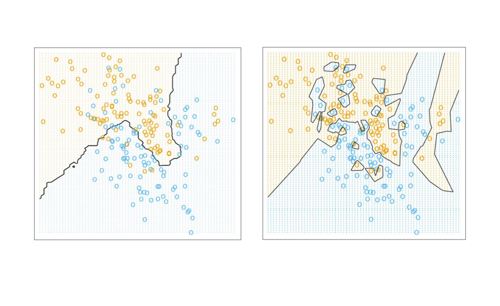

> 图源：[原课件第 15 页](../output/pdf/SDSC5001_Topic3_slides.pdf#page%3D15) · [Lumen 图示定位](obsidian://lumen-pdf?vault=guideline&file=course%2F5001%2Foutput%2Fpdf%2FSDSC5001_Topic3_slides.pdf&annotation=sdsc5001-t3-7454a80016-crop-015)。读图：15-NN 与 1-NN 的边界；右图训练拟合更细碎，却不能据此判定泛化更好。

### 深入讲解：从距离表完整算出 KNN 预测

**补充手算。**一维训练点为 $x=(0,1,3,4,8)$，二分类标签为 $y=(0,0,1,1,0)$。预测 $x_0=2.4$，采用绝对距离，五个距离分别为 $2.4,1.4,0.6,1.6,5.6$。

距离由近到远的点是 $3,1,4,0,8$，所以：1-NN 使用标签 1；3-NN 使用 $1,0,1$，正类比例为 $2/3$，仍判 1；5-NN 使用全部标签，正类比例为 $2/5$，判 0。$k$ 改变的是参与局部判断的范围，不是某个回归系数的大小。

如果响应改为连续值 $y=(0,2,6,8,16)$，同样的三个近邻给出预测 $(6+2+8)/3=16/3$。近邻集合只由特征距离确定；回归和分类的差别发生在响应的聚合方式。

**为什么高维会困难？**假设特征均匀分布在单位立方体内，边长为 $r$ 的小立方体只占总体体积 $r^p$。若想容纳约 10% 数据，一维时 $r=0.1$，十维时却需 $r=0.1^{1/10}\approx0.794$。这个体积例子忽略边界和真实分布细节，但能说明“为了找足够邻居，邻域可能扩展到很远”。

因此应先处理尺度和无关维度，再用折内验证选 $k$。不能用测试标签挑邻居，也不能用训练点自身作 1-NN 的泛化证据。

### PPT 第 15 页逐项讲解：不同邻域大小的分类边界

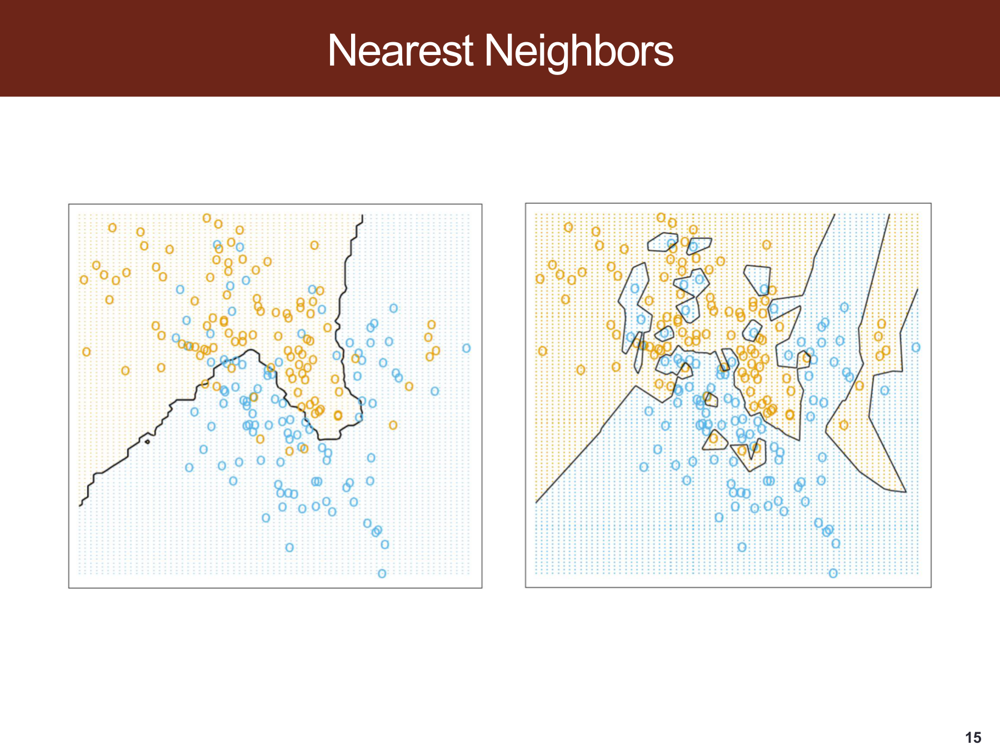

> 原课件：[第 15 页](../output/pdf/SDSC5001_Topic3_slides.pdf#page=15)。截图保留课件原貌，下面按阅读顺序解释；原页简写与笔误以正文核对为准。

**每个空心圆是训练对象，背景颜色是预测类别。**背景与圆点颜色相同表示该处训练分类一致；圆点位置是特征坐标，不是概率或预测误差。

**左图边界较平滑，右图出现小岛和细碎折线。**结合前后页的 KNN 设定，可以把它理解为较大邻域与较小邻域的灵活度对比；最近邻范围越小，越容易受单个点影响。仅凭图形不能确定未来测试准确率。

**读图时做一个动作。**任选一个靠近边界的点，问：如果它的标签改变或位置略动，哪些周围区域会改色？这把图形上的细碎程度连接到重复训练的不稳定性，而不仅是“拟合更好看”。

## 7. 为什么回归的最优目标是条件均值
> [课件第 17 页](../output/pdf/SDSC5001_Topic3_slides.pdf#page%3D17) · [Lumen 本节定位](obsidian://lumen-pdf?vault=guideline&file=course%2F5001%2Foutput%2Fpdf%2FSDSC5001_Topic3_slides.pdf&annotation=sdsc5001-t3-7454a80016-page-017) · [逐页索引](Topic3_%E8%AF%BE%E4%BB%B6%E9%80%90%E9%A1%B5%E5%AF%B9%E5%BA%94%E8%A1%A8.md)

平方损失总体风险为 $R(g)=E[(Y-g(X))^2]$。设 $m(x)=E(Y\mid X=x)$，对固定 $x$ 加减 $m(x)$：

$$E[(Y-g(x))^2\mid X=x]=\operatorname{Var}(Y\mid X=x)+[m(x)-g(x)]^2.$$

> **本式符号与读法（06）**：$g(x)$ 是任意候选预测值，$m(x)=E(Y\mid X=x)$ 是真实条件均值，$Y$ 是在当前特征下仍可能变化的响应。这里 $m$ 是均值函数记号，不是样本人数。$E[\cdot\mid X=x]$ 对该位置的响应分布平均，$\operatorname{Var}(Y\mid X=x)$ 是条件方差。中文读法：候选预测的预期平方损失等于条件噪声方差，加上候选值距真实条件均值的平方；所以最优取 $g(x)=m(x)$。

交叉项因 $E[Y-m(x)\mid X=x]=0$ 而消失。第一项不随 $g$ 变化，第二项在 $g(x)=m(x)$ 时最小，所以最优预测函数为条件均值。

这说明“最优”取决于损失：补充地，绝对误差的最优目标是条件中位数，非对称损失还会对应其他目标。不能不说明损失就说某个平均数始终最佳。

### 深入讲解：损失函数为什么会改变最优答案

**补充算例。**固定同一个特征点 $x$，假设条件响应有 90% 概率为 0、10% 概率为 10。若预测常数 $a$，平方损失条件风险为

$$R_2(a)=0.9a^2+0.1(10-a)^2=a^2-2a+10.$$

> **本式符号与读法（07）**：$a$ 是这个算例中任意连续预测值，不是类别编号。$R_2(a)$ 是选择 $a$ 后的条件平均平方损失；下标 2 表示平方损失，不能读成 $R$ 再平方。0.9 和 0.1 是响应分别为 0 和 10 的概率，$a^2$ 与 $(10-a)^2$ 是两种结果下的平方误差。中文读法：分别算两种可能响应的误差，再按其概率加权。

求导得 $2a-2=0$，最优预测为条件均值 1，风险为 9。若预测 0，平方损失风险为 10，比预测均值略差。

绝对损失则为 $R_1(a)=0.9|a|+0.1|10-a|$。在 $0\le a\le10$ 时，它等于 $1+0.8a$，因此最优为条件中位数 0。若仍预测均值 1，绝对误差风险为 $0.9+0.9=1.8$，大于预测 0 的风险 1。

> **行内符号补充**：$R_1$ 的下标 1 指一次绝对误差，$R_2$ 的下标 2 指平方误差；两者都是给定当前特征后的平均损失。$|a|$ 与 $|10-a|$ 中的竖线表示绝对值，不是条件概率竖线。$a$ 始终是准备输出的连续预测数值。

两种结论都正确，因为评价目标不同。平方损失对很大的误差增长更快；绝对损失对极端响应相对不敏感。若实际任务只惩罚漏估或高估中的某一方向，还需相应的不对称损失。

把本节与分类相连：0–1 损失下选择最大后验概率类别；错分成本不等时最小化条件预期成本。**建模之前先写清损失，才有资格讨论最优预测。**

### 外部拓展：准确率相同的两个模型，概率预测可能差很多

**课内衔接：**[本章第 7 节](#section-7) · [原课件第 17 页](../output/pdf/SDSC5001_Topic3_slides.pdf#page=17) · [复用原有 Lumen 定位](obsidian://lumen-pdf?vault=guideline&file=course%2F5001%2Foutput%2Fpdf%2FSDSC5001_Topic3_slides.pdf&annotation=sdsc5001-t3-7454a80016-page-017)

**外部拓展｜把损失函数与概率估计连接起来。**固定一个特征位置 x，真实后验记为 $\eta=P(Y=1\mid X=x)$，模型输出 q∈[0,1]。Y 为二元随机类别，取 0 或 1；q 是预测概率而非预测类别。二分类 Brier 损失为 $(Y-q)^2$，有

$$E[(Y-q)^2\mid X=x]=\eta(1-q)^2+(1-\eta)q^2
=\eta(1-\eta)+(q-\eta)^2.$$

期望对固定 x 处仍随机的 Y 平均。第一项为这个位置的固有波动，第二项为预测概率偏离真实概率的额外代价。整式说明：在总体条件风险意义下，报出 q=η 最优；星号最优解可写为 $q^*=\eta$，星号不是乘方。

**自编手算。**η=0.8，两个模型报 q=0.6 和 q=0.9，阈值都取 0.5，因此都预测正类，局部准确率都为 0.8；但 Brier 条件风险分别为 $0.16+0.04=0.20$ 和 $0.16+0.01=0.17$。分类标签相同，没有说明概率质量相同。

二元 log loss 为 $-[Y\log q+(1-Y)\log(1-q)]$，对数取自然对数，q 在 (0,1) 内。条件期望对 q 的导数为 $-\eta/q+(1-\eta)/(1-q)$，η∈(0,1) 时令其为零也得到 q=η。把错误结果报得极其自信会产生很大损失。

**校准与判别。**校准关心“报 0.8 的对象中，正类比例是否接近 0.8”；判别关心是否把正类排在负类之前。Brier 和 log loss 同时受到多个方面影响，分数更低不能单独证明校准更好。可靠性图也需要足够样本，分箱方式会影响读图。

**与后续章节连接。**Topic 6 的概率模型、Topic 8 的分类树叶子比例、Topic 9 的分数校准，都应分开比较准确率、排序和概率评分。

**外部来源与阅读定位：**[scikit-learn：概率校准与严格适当评分](https://scikit-learn.org/stable/modules/calibration.html)。本文推导与自编算例用于解释相应方法，不冒充来源中的实验结果。

## 8. 训练误差、测试误差和总体风险
> [课件第 18–20 页](../output/pdf/SDSC5001_Topic3_slides.pdf#page%3D18) · [Lumen 本节定位](obsidian://lumen-pdf?vault=guideline&file=course%2F5001%2Foutput%2Fpdf%2FSDSC5001_Topic3_slides.pdf&annotation=sdsc5001-t3-7454a80016-page-018) · [逐页索引](Topic3_%E8%AF%BE%E4%BB%B6%E9%80%90%E9%A1%B5%E5%AF%B9%E5%BA%94%E8%A1%A8.md)

$$Err_{train}=\frac1n\sum_{i=1}^n[y_i-\hat f_D(x_i)]^2,$$

> **本式符号与读法（08）**：$Err_{train}$ 是训练集上的平均平方误差，下标 train 只是“训练”的名称。$n$ 是训练记录数，$i$ 从 1 到 $n$，$(x_i,y_i)$ 是第 $i$ 条已观测记录；$D$ 是包含这些记录的训练集，$\hat f_D(x_i)$ 是模型对该记录的预测。中文读法：每条训练记录的真实值减预测值、平方，再将 $n$ 个结果平均。它与响应平方具有相同单位。

$$Err_{test}=\frac1m\sum_{j=1}^m[y_j^0-\hat f_D(x_j^0)]^2.$$

> **本式符号与读法（09）**：$Err_{test}$ 是独立测试集的平均平方误差，$m$ 是测试样本数，$j$ 从 1 到 $m$。$(x_j^0,y_j^0)$ 的上标 0 表示测试/新数据身份，不是零次幂；$\hat f_D$ 仍只由训练集 $D$ 得到。中文读法：保持训练好的模型不变，在未参与训练的 $m$ 条记录上计算平均平方误差。

训练数据参与构造函数，再用同样数据给自己打分，一般会乐观。独立测试数据模仿未来观测，但测试误差也有有限样本波动，并不等于真实风险的精确值。

测试样本需与目标应用的分布相符。模型在同分布独立测试集上有效，不保证面对时间漂移、不同设备或不同人群时仍同样准确。不断查看测试结果再调整模型，会让测试集变成事实上的验证集。

课件样条图展示低、中、高灵活度：训练曲线随复杂度上升往下，测试曲线可能先降后升。注意横轴是模型灵活度，不是样本量，也不是时间。

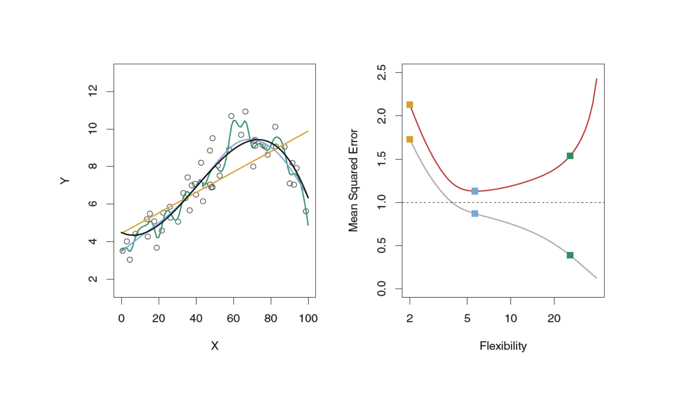

> 图源：[原课件第 20 页](../output/pdf/SDSC5001_Topic3_slides.pdf#page%3D20) · [Lumen 图示定位](obsidian://lumen-pdf?vault=guideline&file=course%2F5001%2Foutput%2Fpdf%2FSDSC5001_Topic3_slides.pdf&annotation=sdsc5001-t3-7454a80016-crop-020)。读图：样条灵活度与训练/测试误差；虚线噪声基准不是可以任意通过调参突破的训练目标。

## 9. 偏差—方差分解的完整推导
> [课件第 21–22 页](../output/pdf/SDSC5001_Topic3_slides.pdf#page%3D21) · [Lumen 本节定位](obsidian://lumen-pdf?vault=guideline&file=course%2F5001%2Foutput%2Fpdf%2FSDSC5001_Topic3_slides.pdf&annotation=sdsc5001-t3-7454a80016-page-021) · [逐页索引](Topic3_%E8%AF%BE%E4%BB%B6%E9%80%90%E9%A1%B5%E5%AF%B9%E5%BA%94%E8%A1%A8.md)

固定特征点 $x$，对训练集随机性取平均，记 $\bar f(x)=E_D\hat f_D(x)$。把估计误差写成

$$\hat f_D(x)-f(x)=[\hat f_D(x)-\bar f(x)]+[\bar f(x)-f(x)].$$

> **本式符号与读法（10）**：$x$ 固定，$f(x)$ 为真均值，$\hat f_D(x)$ 是由随机训练集 $D$ 得到的预测；$\bar f(x)=E_D[\hat f_D(x)]$ 是反复换训练集时预测的平均。横线不是对不同特征位置平均。第一对方括号表示这次预测相对其重复训练平均的波动，第二对表示重复训练平均相对真值的偏离。中文读法：总估计误差拆成随机波动加系统偏差。

平方取期望，交叉项为零，得到

$$E_D[(\hat f_D(x)-f(x))^2]=\operatorname{Var}_D[\hat f_D(x)]+\operatorname{Bias}[\hat f_D(x)]^2.$$

> **本式符号与读法（11）**：$E_D$ 和 $\operatorname{Var}_D$ 都针对训练集 $D$ 的随机抽样，当前特征 $x$ 固定。$\operatorname{Bias}[\hat f_D(x)]=E_D[\hat f_D(x)]-f(x)$ 是估计偏差，右端将它平方；$\operatorname{Var}_D$ 是重复训练预测的方差。中文读法：反复训练时，估计真均值的平均平方误差等于预测波动加平均偏离真值的平方。此式没有新响应噪声。

再加入新响应噪声：

$$E_{D,\epsilon_0}[(Y_0-\hat f_D(x))^2]=\sigma^2(x)+\operatorname{Var}_D[\hat f_D(x)]+\operatorname{Bias}[\hat f_D(x)]^2.$$

> **本式符号与读法（12）**：$Y_0=f(x)+\epsilon_0$ 是在位置 $x$ 的新响应，$\epsilon_0$ 是它自己的新噪声；$E_{D,\epsilon_0}$ 同时平均训练集随机性与新响应噪声。$\sigma^2(x)$ 是新噪声方差，后两项分别是模型的训练方差与偏差平方。中文读法：预测一个新响应时，除了估计均值的不稳定与偏差，还要承担该对象自身的随机波动；这里假定新噪声条件均值为零且与训练过程独立。

偏差看“重复拟合的平均函数离真函数多远”，方差看“重复拟合彼此多不稳定”。它们都不是一张训练集上直接可见的残差。分解中的期望对象要明确，否则很容易把固定函数的误差与训练随机性混在一起。

### 9.1 补充数值比较

假设噪声方差为 4。模型 A 的偏差为 2、方差为 1，预期测试 MSE 为 $4+2^2+1=9$；模型 B 的偏差为 1、方差为 6，MSE 为 $4+1+6=11$。B 的偏差更小，却因方差过大而总体更差。训练拟合更充分并不能单独决定最终选择。

### 9.2 对 U 形曲线的理解

U 形是本课经典的偏差—方差示意，不是任何模型、任何复杂度范围都严格成立的定理。对嵌套函数族进行精确经验风险最小化时，最小训练损失不增加；对不嵌套算法、随机优化或其他损失，并不能仅凭“更复杂”就保证每次训练误差严格下降。

### 深入讲解：偏差与方差必须通过“换训练集”理解

**补充离散实验。**固定 $x_0$，设真条件均值 $f(x_0)=5$。假设训练集只有三种等概率可能，模型 A 给出预测 $4,5,6$，模型 B 每次都给出 4。

对 A，平均预测为 5，因此偏差为 0，训练随机性引起的方差为

$$\operatorname{Var}_D[\hat f_A(x_0)]=\frac{(4-5)^2+(5-5)^2+(6-5)^2}{3}=\frac23.$$

> **本式符号与读法（13）**：A 是模型名称，$x_0$ 是固定评估位置，不是第 0 条训练记录；$\hat f_A(x_0)$ 在三种等概率训练集下分别为 4、5、6，平均为 5。下标 $D$ 指明方差来自更换训练集。分母 3 是这三种可能结果的概率平均，不是估计未知总体方差时的 $n-1$ 修正。中文读法：用每次预测距平均预测的平方衡量重复训练波动。

这里除以 3，因为我们在计算这三个等概率结果构成的**完整分布方差**，并非用三次实验估计未知方差。对 B，偏差为 $4-5=-1$，方差为 0。若新响应噪声方差为 2，则 A 的预期预测 MSE 为 $2+2/3=8/3$，B 为 $2+1=3$。

这三个预测值来自三次不同的训练过程，并不是同一模型对三个不同对象的预测。把“不同对象的拟合值差异”当作估计方差，会混淆输入变化与训练样本变化。

如果模型 C 的三种预测变成 $2,5,8$，它仍无偏，但方差为 6，预测 MSE 达到 8。可见无偏不保证好预测，稳定性也不能单独保证准确；还必须看偏差与不可约噪声。实际只有一个数据集时，真函数通常未知，不能从训练残差直接读出这三项。

### PPT 第 21 页逐项讲解：偏差—方差分解

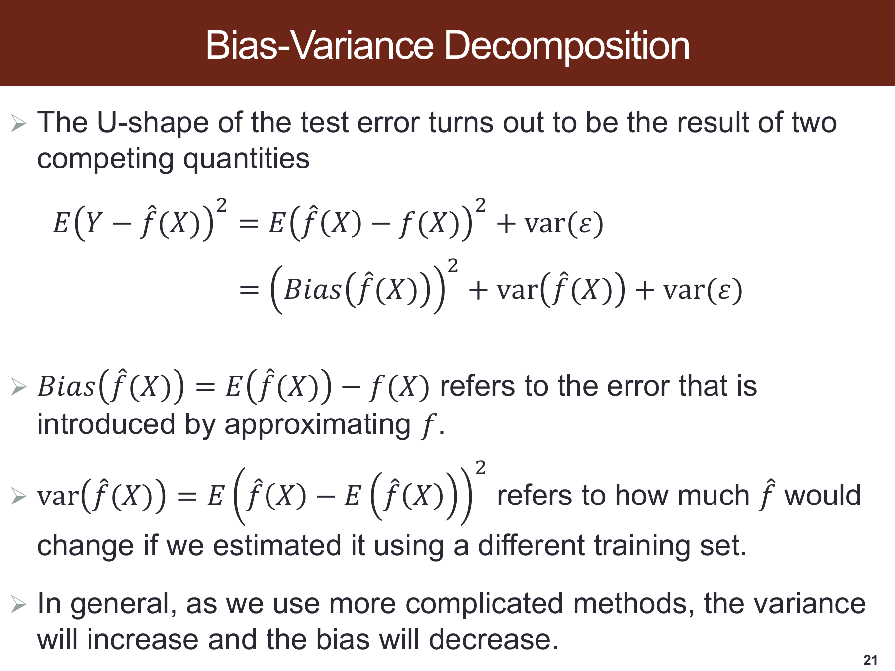

> 原课件：[第 21 页](../output/pdf/SDSC5001_Topic3_slides.pdf#page=21)。截图保留课件原貌，下面按阅读顺序解释；原页简写与笔误以正文核对为准。

**第一行先分离新响应噪声。**$Y$ 不等于真条件均值 $f(X)$，预测一个新 $Y$ 比估计 $f(X)$ 多了不可约噪声项。只比较函数拟合误差时不要再重复加入噪声。

**第二行的 Bias 要平方。**偏差可能正或负，风险中出现的是偏差平方；方差则表示更换训练集后预测的分散。下方文字中的“更复杂通常偏差下降、方差上升”是经典趋势，不是每个算法逐点严格单调的定理。

**补足期望下标。**本节推导固定特征点，对训练集随机性与新噪声分别取期望，从而避免把同一批样本里不同对象的差异误作估计方差。

### PPT 第 22 页：这张图怎样用于 LDA/QDA 作业

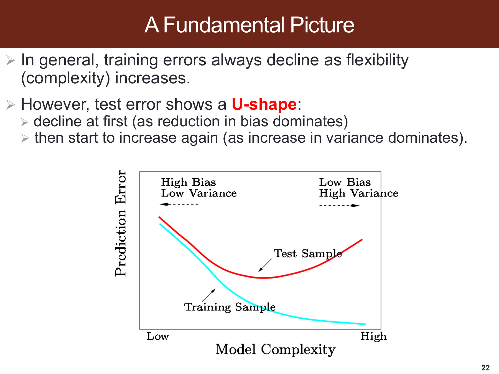

> 原始 PPTX：`SDSC5001_Topic 3 Statistical machine learning.pptx` 第 22 页；[对应 PDF 第 22 页](../output/pdf/SDSC5001_Topic3_slides.pdf#page=22) · [Lumen 原页定位](obsidian://lumen-pdf?vault=guideline&file=course%2F5001%2Foutput%2Fpdf%2FSDSC5001_Topic3_slides.pdf&annotation=sdsc5001-t3-7454a80016-page-022)。本页是一般学习原理，不是 LDA/QDA 的训练或测试实验结果。

**图与文字怎样读：**横向比较的是模型灵活度（flexibility/complexity），不是样本量。原页说明更灵活时训练拟合通常更充分；测试表现则取决于偏差降低和方差增加的竞争。bias 指平均拟合偏离真实目标的程度，variance 指更换训练集后拟合结果的波动。图中的误差量及各条曲线应按原页图例读取。

**对应到作业 2(a)：**先用 Topic 6 第 12–16 页确认 QDA 比 LDA 更灵活，再用本页解释“训练贴合更好不保证新数据更好”。真实 Bayes 边界为线性时，LDA 已具有合适形状；QDA 额外估计各类协方差可能增加估计波动。所以本题预期训练集 QDA 更好、测试集 LDA 更好。完整英文答案及每句话的来源见 [Topic 6 第 5.2 节](5001_Topic6_详细笔记.md#lda-qda-question-2a)。这里采用一般预期，不把原页 “always” 当作任意 LDA/QDA 训练错分的严格保证。

### 外部拓展：学习曲线：区分“加数据”与“改模型”的证据

**课内衔接：**[本章第 9 节](#section-9) · [原课件第 21 页](../output/pdf/SDSC5001_Topic3_slides.pdf#page=21) · [复用原有 Lumen 定位](obsidian://lumen-pdf?vault=guideline&file=course%2F5001%2Foutput%2Fpdf%2FSDSC5001_Topic3_slides.pdf&annotation=sdsc5001-t3-7454a80016-page-021)

**外部拓展｜连接偏差与方差。**原课件固定样本量，改变模型灵活度；学习曲线则固定训练流程，改变用于拟合的样本量。横轴换了，回答的问题也换了。

| 自编假想结果，均为 MSE | 50 个训练对象 | 200 个训练对象 | 800 个训练对象 |
|---|---:|---:|---:|
| 模型 A 的训练误差 | 1.0 | 2.0 | 2.6 |
| 模型 A 的验证误差 | 9.0 | 5.0 | 3.4 |
| 模型 B 的训练误差 | 7.0 | 7.2 | 7.3 |
| 模型 B 的验证误差 | 7.8 | 7.6 | 7.5 |

这些数值是教学构造，不是实际实验。A 的差距随样本增加缩小，继续加数据可能有帮助；B 的两条曲线接近且较高，提示需要检查表达能力、特征、标签质量或评价目标。单靠一张曲线不能确定唯一原因，也不能从一个平台值直接读出不可约噪声。

**怎样画得有意义。**在相同验证任务上，用多个训练子集和随机种子反复计算，记录波动；不同样本量下都要在各自训练子集拟合预处理。若要在每个样本量下重新调参，应说明画的是“含调参程序”的曲线，并为它提供外部评价。

训练误差随样本量上升是常见现象：小样本容易记住，大样本需要同时兼顾更多对象。它不是对每个算法、每次随机抽样都成立的单调定理。验证误差也可能因优化不充分或数据分布改变而不降。

**把诊断变成下一步。**差距大时，可比较更多独立对象、正则化与简化模型；两条都高时，可比较更合适的非线性结构与新信息。只有训练误差下降而隔离验证没有改善，不能据此宣布学到了更有用的规律。

**外部来源与阅读定位：**[scikit-learn：学习曲线与验证曲线](https://scikit-learn.org/stable/modules/learning_curve.html)。本文推导与自编算例用于解释相应方法，不冒充来源中的实验结果。

## 10. 分类风险与 Bayes 最优规则
> [课件第 23–25 页](../output/pdf/SDSC5001_Topic3_slides.pdf#page%3D23) · [Lumen 本节定位](obsidian://lumen-pdf?vault=guideline&file=course%2F5001%2Foutput%2Fpdf%2FSDSC5001_Topic3_slides.pdf&annotation=sdsc5001-t3-7454a80016-page-023) · [逐页索引](Topic3_%E8%AF%BE%E4%BB%B6%E9%80%90%E9%A1%B5%E5%AF%B9%E5%BA%94%E8%A1%A8.md)

固定 $x$，预测类别 $k$ 时，0–1 条件风险为

$$E[\mathbf1\{Y\ne k\}\mid X=x]=1-P(Y=k\mid X=x).$$

> **本式符号与读法（14）**：$Y$ 是真实类别，$k$ 是本次准备输出的候选类别，$X$ 是随机特征，$x$ 是当前已知取值。$\mathbf1\{Y\ne k\}$ 在分错时为 1、分对时为 0，$\ne$ 表示不等于；$E[\cdot\mid X=x]$ 对该特征条件下的真实类别平均。中文读法：固定当前特征后，选类别 $k$ 的错误概率，就是 1 减去该类的后验概率。

因此选后验概率最大的类别即可最小化风险，Bayes 错分率为

$$R^*=E_X\left[1-\max_kP(Y=k\mid X)\right].$$

> **本式符号与读法（15）**：$R^*$ 是总体最低错分概率，星号标记最优，不是乘方。$P(Y=k\mid X)$ 是随随机特征 $X$ 变化的类别后验，$\max_k$ 返回其中最大的概率值；$1-\max_k$ 是该位置仍会分错的概率，$E_X$ 再按未来特征的分布平均。中文读法：每个特征位置先采取最佳决策，再把留下的错误按人群出现频率加权。

即便知道真实概率，类别有重叠时错分率仍可大于 0。成本不等时应比较条件预期损失，最大概率规则不再自动最优。

训练和测试错分率与回归相同地分开计算，只是每个损失变成 0 或 1。课件 KNN 误差图的横轴使用 $1/k$ 代表灵活度，因此向右通常是 $k$ 更小，而不是更大。

> **Bayes 错分率专讲（2026-10-31）**：对应 PPT 第 23–25 页。下面补齐“为什么选最大后验概率、最低错分率怎样计算、怎样读 KNN 图中的 Bayes 基准线”。概率表、正态算例及教学图均为自编补充；课件截图保留原貌。外部教材只用于核对定义与理论，阅读链接见本节末。

**阅读路线：**[概念与符号](#bayes-terms) → [从局部风险推导最优规则](#bayes-proof) → [离散表手算](#bayes-discrete) → [连续分布的重叠面积](#bayes-gaussian) → [课件 KNN 曲线](#bayes-knn) → [自测](#bayes-quiz)。

### 10.1 先分清：贝叶斯公式、分类器和错分率

这里要解决的任务是：看到一个新对象的特征 $X=x$，必须输出一个类别。仅在本专讲的基本设定中，分对损失为 0，分错损失为 1，各类错分代价相同，不允许通过“拒绝预测”规避错误。

| 名称 | 在这里表示什么 | 例子 |
|---|---|---|
| 后验类别概率 $p_k(x)$ | 已知当前特征后，该对象属于第 $k$ 类的概率 | $P(Y=1\mid X=x)=0.7$ |
| Bayes 公式 | 用先验和类内分布计算后验的概率恒等式 | $p_k(x)=\pi_k f_k(x)/\sum_j\pi_jf_j(x)$ |
| Bayes 分类器 $G^*$ | 根据真实后验选择类别的最优决策规则 | 两类概率为 0.7、0.3 时，选第一类 |
| 局部 Bayes 错分率 $r^*(x)$ | 特征固定在 $x$ 时，这种最优决策仍会犯错的概率 | 选概率为 0.7 的类，仍有 0.3 的错分概率 |
| 总体 Bayes 错分率 $R^*$ | 对未来特征分布平均后的最低错分概率 | 不同特征区域的局部错误按出现频率加权 |

**“最优规则”是一种决策原则，不是某一个软件模型。**朴素 Bayes 是通过条件独立等假设来估计后验的具体方法；Logistic、KNN 等也可以估计后验并据此分类。它们不因为采用最大概率决策，就自动拥有真实后验或自动达到 Bayes 错分率。有关这一名称区别，可核对 [Basics of Statistical Learning：Bayes classifier 与 naive Bayes](https://statisticallearning.org/classification.html#bayes-classifier)。

### 10.2 先看 PPT 第 23 页：它省略了哪一步

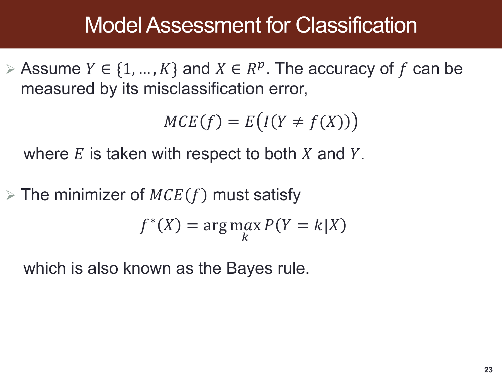

> 原课件：[第 23 页](../output/pdf/SDSC5001_Topic3_slides.pdf#page=23)。页面中的 $f$ 输出类别，正文记作 $G$，避免与前面回归的条件均值函数混淆。

第一行 $MCE(f)=E[I(Y\ne f(X))]$ 先对“错没错”计分，再对所有未来对象平均。指示函数 $I$ 只取 0 或 1，因此这个期望恰好就是错分概率，而不是误差幅度，也不是对类别编号做平方差。

原页特别写明期望涉及 $X$ 与 $Y$：未来会遇到什么特征是随机的；即便特征确定，真实类别也可能仍不确定。第二行直接给出 $\arg\max$，缺少的桥梁就是下面的“先固定 $x$，比较每种决策的条件风险，再对 $X$ 平均”。

### 10.3 从 0–1 损失一步一步推导 Bayes 分类器

固定一个特征位置 $x$，暂时不考虑其他位置。假设我们选择预测类别 $a$，则条件风险为

$$r(a;x)=E[I(Y\ne a)\mid X=x].$$

> **本式符号与读法（16）**：$r(a;x)$ 是特征固定为 $x$ 时，决定输出类别 $a$ 的局部风险；分号仅把“决策 $a$”和“已知条件 $x$”分开。$I$ 是指示函数，$I(Y\ne a)$ 在真实类别 $Y$ 与预测 $a$ 不同时记 1。$E[\cdot\mid X=x]$ 对此处的类别不确定性平均。中文读法：在这个特征条件下，坚持选 $a$，长期平均会错多少。

把可能的真实类别全部展开：
$$r(a;x)=\sum_{k=1}^K I(k\ne a)P(Y=k\mid X=x).$$

> **本式符号与读法（17）**：$K$ 是类别总数，$k=1,\ldots,K$ 遍历所有可能的真实类别；$a$ 是固定的预测类别。$P(Y=k\mid X=x)$ 是真实类别为 $k$ 的后验，$I(k\ne a)$ 是这一种真实结果是否判错的 0/1 代价。中文读法：列出每种真实类别，将其错分代价乘其出现概率，再把所有类别贡献相加。

真实类别为 $a$ 时，指示函数为 0；其余类别时均为 1。所以：
$$r(a;x)=\sum_{k\ne a}p_k(x)=1-p_a(x).$$

> **本式符号与读法（18）**：$p_k(x)$ 缩写为 $P(Y=k\mid X=x)$；$\sum_{k\ne a}$ 只累加与预测 $a$ 不同的真实类别，$p_a(x)$ 是被选中类别的后验。所有类别概率之和为 1，所以其余类别之和等于 $1-p_a(x)$。中文读法：错分概率就是除所选类别之外的全部概率。

现在比较所有允许的预测类别。想让 $1-p_a(x)$ 最小，就应让 $p_a(x)$ 最大，故：

$$\boxed{G^*(x)\in\arg\max_{a\in\{1,\ldots,K\}}p_a(x)},$$

> **本式符号与读法（19）**：$G^*(x)$ 输出在 $x$ 处最优的类别，星号表示最优；$a\in\{1,\ldots,K\}$ 指可供选择的类别范围。$\arg\max_a p_a(x)$ 返回概率最大时的类别，而不是那个概率。外面的 $\in$ 表示若存在并列最大值，$G^*(x)$ 可以选其中任意一个。中文读法：在所有合法类别中，取一个后验概率最大的类别。

$$\boxed{r^*(x)=\min_a r(a;x)=1-\max_k p_k(x).}$$

> **本式符号与读法（20）**：$r^*(x)$ 是特征位置 $x$ 的最小错分概率，$\min_a$ 是在所有候选类别 $a$ 中比较局部风险，$\max_k p_k(x)$ 是所有类别后验的最大数值。它输出 0 到 1 之间的错误概率，不输出类别。中文读法：先选最有可能的类，再把没有属于它的剩余概率作为最低局部错误。

**注意 $\arg\max$ 与 $\max$ 的输出不同。**前者输出类别编号，后者输出最大的概率值。例如概率为 $(0.15,0.70,0.15)$ 时，$G^*(x)=2$，最大概率为 0.70，局部错分率为 0.30。不能把 0.70 当作类别输出，也不能把类别编号 2 代进 $1-\max$。

若最大值并列，任选一个最大概率类别都达到相同局部风险；最优规则不必唯一。无论用什么训练算法，只要决策只能利用相同的 $x$，局部风险就不可能低于 $r^*(x)$。这一最优性与教材中的分类定理一致，见 [Wasserman，All of Statistics，§22.2，定义 22.4 与定理 22.5–22.6](https://www.stat.cmu.edu/~brian/valerie/617-2022/0%20-%20books/2004%20-%20wasserman%20-%20all%20of%20statistics.pdf#page=368)。

### 10.4 为什么知道了真实概率，还可能判断错误

设当前特征下 $P(Y=1\mid x)=0.7$、$P(Y=0\mid x)=0.3$。选 1 的错分概率为 0.3，选 0 的错分概率为 0.7，前者显然更好；但“更好”并没有把后验变成 1。

可以想象反复遇到具有这一条件分布的新对象：全部判为 1，平均每 100 个约错 30 个。30 是长期期望数量，不保证每一批恰好错 30 个。知道“这个条件下 70% 属于第一类”不等于知道“眼前这一位一定属于第一类”。

**按概率随机猜也不能改进 0–1 风险。**若以概率 $q$ 输出 1，且这个随机数不额外包含真实标签信息，错分概率为

$$r(q;x)=q(1-0.7)+(1-q)0.7=0.7-0.4q.$$

> **本式符号与读法（21）**：$q\in[0,1]$ 是我们人为设定的“输出类别 1 的概率”，不是正类真实后验；本例真实后验已固定为 0.7。$r(q;x)$ 是这种随机决策的局部错误，$q(1-0.7)$ 对应“输出 1 但真实为 0”，$(1-q)0.7$ 对应“输出 0 但真实为 1”。中文读法：两种错法各按联合概率计算后相加；随机输出必须不额外使用真实标签信息。

它在 $q=1$ 最小，值为 0.3。若照着后验取 $q=0.7$，反而错 $0.42$。概率预测是在报告不确定性；需要输出一个类别并最小化错分次数时，应选最大概率类，而不是按概率掷骰子。

这类不确定性可以来自未观察到的区分信息、测量误差、随机结果或标签本身的波动。仅凭 $R^*>0$，不能判断究竟是哪一种原因。

### 10.5 二分类：为什么是 0.5，局部错误为什么取较小者

令 $Y\in\{0,1\}$，记 $\eta(x)=P(Y=1\mid X=x)$，则另一类概率为 $1-\eta(x)$。分别预测两类：

$$r(1;x)=1-\eta(x),\qquad r(0;x)=\eta(x).$$

> **本式符号与读法（22）**：$\eta(x)$（eta）是二分类正类的真实后验 $P(Y=1\mid X=x)$，$1-\eta(x)$ 是负类后验。$r(1;x)$ 表示决定预测 1 时的局部错误，$r(0;x)$ 表示决定预测 0 时的局部错误；括号内的 0、1 是决策类别，不是索引或乘方。中文读法：预测哪一类，就会在真实属于另一类时犯错。

因此可约定

$$G^*(x)=\begin{cases}1,&\eta(x)\ge1/2,\\0,&\eta(x)<1/2,\end{cases}$$

> **本式符号与读法（23）**：$G^*(x)$ 是最优二分类输出，$\eta(x)$ 是当前特征下属于类别 1 的概率，$\ge$ 表示大于或等于。大括号表示分情况定义：概率至少为 0.5 时输出 1，否则输出 0。这里把等于 0.5 的平局约定给 1，改给 0 也具有相同风险。中文读法：在两类错分代价相同的条件下，选择概率较大的那一类。

$$\boxed{r^*(x)=\min\{\eta(x),1-\eta(x)\}=\frac12-\left|\eta(x)-\frac12\right|.}$$

> **本式符号与读法（24）**：$r^*(x)$ 是当前位置的最低错误，$\min$ 在正类与负类后验两个数中取小者；绝对值 $|\eta(x)-1/2|$ 衡量正类概率离平局点 0.5 多远。中文读法：最佳判断留下的错误，等于较小的那个类别概率；后验离 0.5 越远，最佳判断越确定。这里仅适用于二分类。

最后一种写法说明：后验越接近 0 或 1，最优决策越确定；越接近 0.5，仍然会犯错的概率越大。这里 0.5 来自两类错分代价相等，而不是所有分类任务都必须使用的阈值。

| $\eta(x)$ | 最优预测 | 局部错分率 | 解释 |
|---|---|---|---|
| 0.05 | 0 | 0.05 | 绝大多数属于 0 |
| 0.40 | 0 | 0.40 | 虽选 0，但不确定性仍高 |
| 0.50 | 任一类 | 0.50 | 没有更有利的类别 |
| 0.80 | 1 | 0.20 | 最优仍有两成概率错 |
| 1.00 | 1 | 0 | 在该条件下标签确定 |

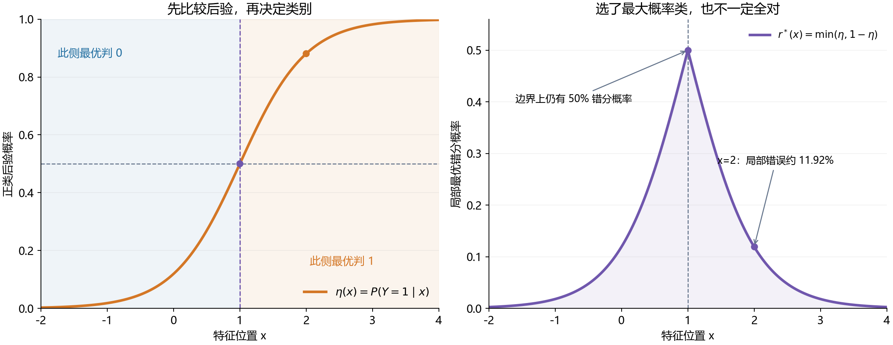

> 图为后面正态算例的自编曲线。左图在 $x=1$ 处的后验为 0.5，右图的局部错分率在那里达到 0.5。远离边界时，两类证据更容易区分。右图是局部风险曲线，还不是对 $X$ 加权平均后的总体风险。

多分类不能照搬“后验超过 0.5 才能选”。例如三类概率为 $(0.40,0.35,0.25)$，应选第一类，局部错分率为 0.60。一般有 $0\le R^*\le1-1/K$；二分类才有上界 0.5。没有任何区分信息时，最佳策略是总选先验最多的类，而非必然平均随机猜。

### 10.6 从一个位置到整个人群：外层期望在平均什么

对任一固定分类器 $G$，先条件化再平均：

$$\begin{aligned}
R(G)&=P(Y\ne G(X))\\
&=E_X\{P(Y\ne G(X)\mid X)\}\\
&=E_X[1-p_{G(X)}(X)].
\end{aligned}$$

> **本式符号与读法（25）**：$G$ 是一个固定分类规则，$R(G)$ 是它在总体上的错分概率；$G(X)$ 是随未来随机特征产生的预测，$Y$ 是真实类别。$P(\cdot\mid X)$ 先固定特征后算类别错误，$E_X$ 再对不同特征平均。$p_{G(X)}(X)$ 的下标不是另一个样本号：先算选中类别 $G(X)$，再取该类别在同一特征下的后验。中文读法：对每个未来对象算“1 减所选类别概率”，再按总体平均。

每个位置都使用局部最优选择，便得到

$$\boxed{R^*=R(G^*)=E_X\left[1-\max_kp_k(X)\right].}$$

> **本式符号与读法（26）**：$R^*=R(G^*)$ 是最优分类器 $G^*$ 的总体风险；小写 $p_k$ 是第 $k$ 类后验，$\max_k$ 在类别中取最大，$E_X$ 按特征分布平均。这里总体大写 $R^*$ 与局部小写 $r^*(x)$ 的关系是前者对后者平均。中文读法：各位置的最小错误按其在人群中出现的频率累积，得到总体最小错误。

若 $X$ 离散，写为 $\sum_x P(X=x)[1-\max_kp_k(x)]$；若有连续密度 $p_X$，写为 $\int[1-\max_kp_k(x)]p_X(x)\,dx$。连续情况下，$X=x$ 单点概率通常为 0，但仍可用条件分布/条件密度定义后验，再对区域积分。

**外层平均按未来对象出现的频率加权。**它不是把图上任取的几个位置等权平均，也不是按类别数平均；若特征分布变了，总体风险也可能改变，即使某些局部条件关系仍相同。

还可以直接证明总体最优性：

$$R(G)-R^*=E_X\left[\max_kp_k(X)-p_{G(X)}(X)\right]\ge0.$$

> **本式符号与读法（27）**：$R(G)$ 是候选规则的总体风险，$R^*$ 是同一问题的最小总体风险。方括号中，$\max_kp_k(X)$ 是最优所选类别的概率，$p_{G(X)}(X)$ 是候选规则实际所选类别的概率。$E_X$ 对未来特征平均，$\ge0$ 表示差非负。中文读法：偏离最优决策所损失的类别概率，在总体平均后就是额外错分风险。

每个位置上，最大概率不小于当前选中类别的概率，所以平均差不可能为负。**最低是对同一总体分布、同一可用特征和同一损失而言的。**没有这三项限定，就无法正确比较两个风险值。

### 10.7 完整离散手算：先选类，再加权，最后用联合概率复核

**自编总体模型。**特征 $X$ 只有 A、B、C 三种状态，下表概率是已知的真实总体设定，不是从有限样本估计的比例。

| 状态 $x$ | $P(X=x)$ | $\eta(x)=P(Y=1\mid x)$ | Bayes 预测 | 局部错分率 |
|---|---|---|---|---|
| A | 0.50 | 0.10 | 0 | 0.10 |
| B | 0.30 | 0.60 | 1 | 0.40 |
| C | 0.20 | 0.90 | 1 | 0.10 |

**第一步：每行只比较两类后验。**A 选 0，B、C 选 1。**第二步：把各行错误按状态频率加权。**

$$R^*=0.50\times0.10+0.30\times0.40+0.20\times0.10
=0.05+0.12+0.02=\boxed{0.19}.$$

> **本式符号与读法（28）**：$R^*$ 是总体最小错分率；0.50、0.30、0.20 分别是状态 A、B、C 的出现概率，0.10、0.40、0.10 是对应状态的局部最小错误。每个乘积是“落在这一状态且发生错分”的联合概率贡献。中文读法：先逐状态乘上频率，再把三种互斥状态的错误相加，得到 0.19。这里的 0.19 是概率，即 19%，不是错分人数。

例如 1,000 个独立未来对象，期望 A、B、C 分别出现 500、300、200 个，预期错分分别为 50、120、20 个，总计 190 个。B 虽然只占 30%，却贡献了最大的错分数量，因为它的后验最难区分。

**第三步：改成联合概率再算一次。**每格乘 $P(X=x)$ 得到：

| 真实类别 / 特征状态 | A | B | C | 类别先验 |
|---|---|---|---|---|
| $Y=0$ | 0.45 | 0.12 | 0.02 | 0.59 |
| $Y=1$ | 0.05 | 0.18 | 0.18 | 0.41 |
| 状态边际概率 | 0.50 | 0.30 | 0.20 | 1.00 |

每列保留最大的格子作为“可分对的概率质量”，其余是错分。正确概率为 $0.45+0.18+0.18=0.81$，所以错误为 $1-0.81=0.19$；或直接加被舍弃格子 $0.05+0.12+0.02$。

**两个常见错误：**局部错误直接平均得 $(0.1+0.4+0.1)/3=0.2$，忽略三种状态频率不同；先把后验平均成 $P(Y=1)=0.41$ 再总选 0，会得到错误 0.41，丢掉 $X$ 的区分信息。因此 $E_X[\max_kp_k(X)]$ 不能换成 $\max_kE_X[p_k(X)]$。

### 10.8 如果题目给的是类内分布，怎样连接 Bayes 公式

记先验 $\pi_k=P(Y=k)$，$f_k(x)$ 为 $X\mid Y=k$ 的类内条件密度。连续变量的密度值不是单点概率；边际密度为 $p_X(x)=\sum_k\pi_kf_k(x)$。在边际密度为正的位置，

$$p_k(x)=\frac{\pi_kf_k(x)}{p_X(x)}.$$

> **本式符号与读法（29）**：$p_k(x)=P(Y=k\mid X=x)$ 是第 $k$ 类后验；$\pi_k=P(Y=k)$（pi）是见到特征前的类别先验；$f_k(x)$ 是给定第 $k$ 类时特征的条件密度；$p_X(x)$ 是混合总体中的特征边际密度。注意本式的 $f_k$ 是密度，前面回归的 $f$ 是均值函数。中文读法：第 $k$ 类产生当前特征的先验加权密度，除以所有类别产生当前特征的总密度，得到后验；要求分母为正。

对同一个 $x$，所有类别分母相同，因此只需比较 $\pi_kf_k(x)$。只有先验相等时，才可进一步只比较 $f_k(x)$。这与 [CMU 教材 Analysis of Neural Data，§4.3.4 的 Bayes 分类定理](https://www.stat.cmu.edu/~kass/sam/all/heidiAPR12/all.pdf#page=136) 的判定形式一致。

代入总体错误积分后，分母与 $p_X(x)$ 相消，得到

$$R^*=\int\left[\sum_k\pi_kf_k(x)-\max_k\pi_kf_k(x)\right]dx.$$

> **本式符号与读法（30）**：$R^*$ 是最小总体错误，$\pi_k f_k(x)$ 是第 $k$ 类对特征位置 $x$ 的先验加权密度贡献。$\sum_k$ 加总所有类别，$\max_k$ 保留最可能类别的贡献，二者相减留下错分贡献；$\int\cdot dx$ 对连续特征的整个支持区域积分。中文读法：在每个位置舍弃除最佳类别外的概率质量，再把它累积起来。密度有单位，乘 $dx$ 积分后才得到无单位概率。

二分类时，“两项相加减最大项”等于较小项，所以

$$\boxed{R^*=\int\min\{\pi_0f_0(x),\pi_1f_1(x)\}\,dx.}$$

> **本式符号与读法（31）**：下标 0、1 是两种真实类别；$\pi_0,\pi_1$ 为类别先验，$f_0,f_1$ 为类内特征密度。$\min$ 在每个位置取两条先验加权密度中较小者，$dx$ 表示对特征位置的积分微元。中文读法：将两类在每个位置无法同时判对的较小概率贡献积分相加。该简式只用于二分类，并不是对所有多分类密度两两求重叠。

这就是两条**按先验加权后的密度曲线下方较小面积**。不要直接对未加权的两条密度取重叠面积；例如先验各为 $1/2$ 时，$R^*=\tfrac12\int\min(f_0,f_1)dx$，仍有这个 $1/2$ 因子。

离散特征则把积分换成求和，上一小节联合表就是同一计算方法。多分类仍用“全部质量减去最大项”，不能把各类别两两重叠简单相加，否则会重复计数。

### 10.9 连续手算：两个正态总体重叠时，最低会错多少

**自编模型。**先验相等，$\pi_0=\pi_1=1/2$；$X\mid Y=0\sim N(0,1)$，$X\mid Y=1\sim N(2,1)$。这里第二个参数是方差。

**第一步：比较类内密度。**相同方差和相同先验使公共系数抵消，

$$\log\frac{\pi_1f_1(x)}{\pi_0f_0(x)}
=-\frac12(x-2)^2+\frac12x^2=2x-2.$$

> **本式符号与读法（32）**：$\log$ 为自然对数，$\pi_1f_1(x)/(\pi_0f_0(x))$ 比较两类产生当前特征的先验加权密度，本例先验均为 $1/2$。$x$ 是同一个新对象的特征值，类 0 与类 1 的均值分别为 0、2，共同方差为 1，故平方项分别来自正态密度指数。中文读法：算出类别 1 相对类别 0 的对数证据，正数倾向 1、负数倾向 0、零为平局。

所以 $x>1$ 时判 1，$x<1$ 时判 0，边界 $x=1$ 两类等可能。由 odds 转回后验还得到 $\eta(x)=1/(1+e^{-(2x-2)})$，这就是前面教学图所画曲线。

**第二步：分别统计两种错法。**真实为 0，却落到 $x>1$；或者真实为 1，却落到 $x<1$。总体错误为

$$R^*=\frac12P(X>1\mid Y=0)+\frac12P(X<1\mid Y=1).$$

> **本式符号与读法（33）**：$R^*$ 是总体错误，$P(X>1\mid Y=0)$ 是在真实类别 0 内落到错误决策侧的比例，$P(X<1\mid Y=1)$ 是真实类别 1 内落到错误决策侧的比例。两个 $1/2$ 是两类各自的先验，不是尾概率自身的一部分。中文读法：两类分别算错判比例，各乘该类在人群中的比例，再相加。阈值 1 来自上一步求出的决策边界。

标准化后，两侧尾概率都是 $\Phi(-1)\approx0.158655$，因此

$$\boxed{R^*=\tfrac12\Phi(-1)+\tfrac12\Phi(-1)=0.158655\approx15.87\%.}$$

> **本式符号与读法（34）**：$\Phi(t)=P(Z\le t)$ 是标准正态变量 $Z\sim N(0,1)$ 的累积分布函数，$\Phi(-1)$ 是标准化后低于 $-1$ 的左尾概率。两个 $1/2$ 仍是类别先验，$R^*$ 是两种错误的加权和。中文读法：每类的条件尾概率约 0.158655，各占总体一半，加权后总体错误仍为 0.158655，即约 15.87%。这里 $\Phi$ 不是正态密度。

**不要把两项直接相加成 31.73%。**每个条件尾概率来自不同类别，必须各乘该类的先验。这个 31.73% 恰是本例未加权两条密度的重叠系数，不是整个混合总体的错误率。

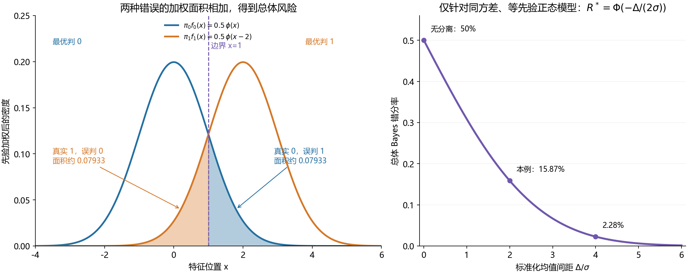

> 蓝线和橙线分别为 $0.5f_0(x)$、$0.5f_1(x)$。边界右侧的蓝色尾部是“真实 0 判成 1”，左侧的橙色尾部是“真实 1 判成 0”；两块面积相加为 0.158655。右图改变两类均值间距，展示同方差、等先验这一特定模型中分离越明显，Bayes 错分率越低。
>
> **图中符号**：图例的小写 $\phi$（phi）是标准正态密度函数，大写 $\Phi$ 是标准正态累计概率；密度高度与累计概率不是同一个量。$\pi_0,\pi_1$ 是两类先验，$\Delta$（delta）是两类均值差的绝对值，$\sigma$（sigma）是共同标准差，所以横轴 $\Delta/\sigma$ 表示用共同波动尺度标准化后的分离程度。

**第三步：区分局部与总体。**恰在边界 $x=1$，局部最优错误为 50%；但整个人群的错误约为 15.87%，因为许多对象处在更容易区分的位置。不能把“边界上最难”推广成“总体有一半分错”。连续分布下边界单点本身也没有正概率质量。

更一般地，若等先验、共同标准差为 $\sigma$、均值差绝对值为 $\Delta$，则 $R^*=\Phi[-\Delta/(2\sigma)]$。该公式只针对这套正态、同方差、等先验设定；先验或方差改变后，要重新求边界再积分，不能直接沿用。

### 10.10 “不可约”相对于什么：增加样本与增加信息不同

**什么时候可以完全不分错？**由于 $1-\max_kp_k(X)$ 非负，$R^*=0$ 当且仅当 $\max_kp_k(X)=1$ 对几乎所有可能出现的特征成立。也就是当前特征已经能确定标签；允许在总体概率为零的位置仍有歧义。某个罕见但有正概率的区域只要后验不确定，仍会贡献正的总体风险。

固定特征 $X$ 和真实总体分布，收集更多同类训练样本通常能帮助我们更准确地估计后验，但不会改变真实 $p_k(x)$ 本身。因此它可以减少模型距 Bayes 基准的差距，却不会单靠增加训练量降低同一问题的 $R^*$。

若增加有用的新特征 $Z$，问题就变成基于 $(X,Z)$ 决策。理论上，使用更多信息的最佳分类器可以选择忽略 $Z$，故

$$R^*_{X,Z}\le R^*_X.$$

> **本式符号与读法（35）**：$X$ 是原有输入，$Z$ 是新增可观测特征，不是本节前面用于定义标准正态 CDF 的辅助变量。$R^*_X$ 表示仅使用 $X$ 的最小总体风险，$R^*_{X,Z}$ 表示可同时使用两者时的最小风险。$\le$ 表示不大于。中文读法：理论上信息更多时，最佳规则至少可以忽略新增信息，因此最低可达到的错误不会更大；这不保证任意有限样本模型都变好。

这是最优可达到风险的关系，不保证有限样本训练的任何模型加变量后都会更好；新变量也可能带来估计困难或噪声。

**沿离散表继续算。**假设 B 内增加一个可观测特征，分成各占总体 0.15 的 B0、B1，两者正类后验分别为 0.2、1。平均仍为 $(0.2+1)/2=0.6$，所以原来的 B 行没有变。但现在 B0 可判 0、B1 判 1，B 的错误贡献从 $0.3\times0.4=0.12$ 降为 $0.15\times0.2+0.15\times0=0.03$。A、C 不变，总体最优错误从 0.19 降至 0.10。

因此“Bayes 错分率是下限”不表示未来测量更丰富后仍不能提高；它只约束当前信息条件下的分类器。

### 10.11 实际模型差在哪里：Bayes 风险与超额风险

先固定一次训练得到的分类器 $\hat G_D$，用独立未来对象评价。它的总体风险可分成

$$R(\hat G_D)=R^*+\underbrace{[R(\hat G_D)-R^*]}_{\text{超额风险，非负}}.$$

> **本式符号与读法（36）**：$D$ 是这一次已经取得的训练集，$\hat G_D$ 是由它拟合的分类器，帽号表示估计，$R(\hat G_D)$ 是该固定模型对独立未来对象的总体错误。$R^*$ 是相同特征、总体与损失下的理论最小错误，下划括号标出二者的非负差，称为超额风险。中文读法：实际模型错误等于当前问题的最低错误，加上尚未达到最优的那部分差距。

Bayes 项来自当前信息下的类别不确定性；后面的差距来自实际决策没有达到最优，可能涉及模型空间限制、有限样本估计、优化或不适当的决策阈值。它不是直接套用平方损失的“偏差平方加方差”公式。

**二分类还有一个可直接解释的恒等式：**

$$R(G)-R^*=E_X\left[|2\eta(X)-1|\,I\{G(X)\ne G^*(X)\}\right].$$

> **本式符号与读法（37）**：$\eta(X)$ 是随机特征处的正类真实后验，$|2\eta(X)-1|$ 表示两类后验证据的差距。$I\{G(X)\ne G^*(X)\}$ 在候选与最优规则决策不同时记 1，否则记 0；$E_X$ 再按特征分布加权。中文读法：只有做出非最优决策的位置才贡献额外风险，贡献大小等于该处两类概率差。该恒等式用于二分类、0–1 损失。

推导只需分情况。若 $\eta\ge0.5$，最优判 1；模型也判 1，差为 0，模型判 0，差为 $\eta-(1-\eta)=2\eta-1$。若 $\eta<0.5$，相反决策的差为 $1-2\eta$。合并即上式；后验恰为 0.5 时，不同的平局决策也不会增加风险。

在 $\eta=0.51$ 处选错最优类别，额外局部风险只有 0.02；在 $\eta=0.95$ 处反着选，额外风险为 0.90。所以偏离最优规则的区域大小不是唯一因素，还要看这些区域的类别证据强弱和出现频率。

沿离散表，若某模型 A 判 0、B 错判 0、C 判 1，则错误为 $0.05+0.18+0.02=0.25$，比 Bayes 的 0.19 多 0.06。用恒等式计算也得 $P(X=B)|2(0.6)-1|=0.3\times0.2=0.06$。

### 10.12 对照 PPT 第 24–25 页：三种误差不能混着读

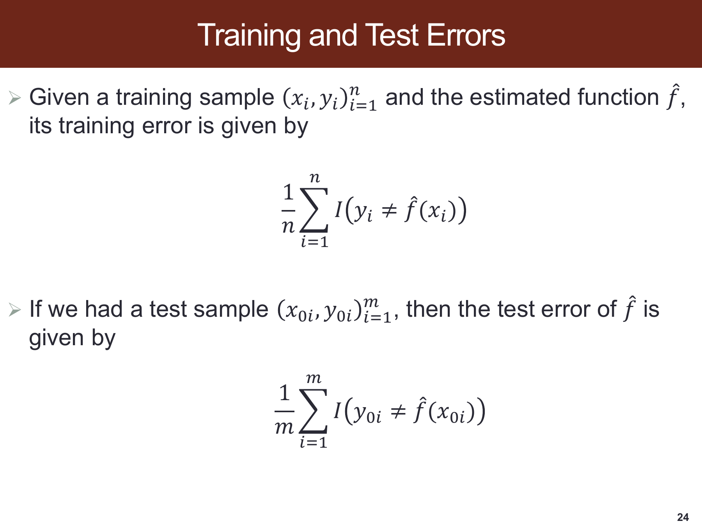

> 原课件：[第 24 页](../output/pdf/SDSC5001_Topic3_slides.pdf#page=24)。上下两个式子都是在一批有限记录上数错点再除以人数，但是否参与训练决定了它们的解释。

**训练错分率**在参与构造 $\hat G_D$ 的数据上计分；**测试错分率**在独立有限数据上计分；**总体风险**则是对真实未来分布的期望。Bayes 下限约束的是最后这个期望，而不是每一批有限数据上观测到的比例。

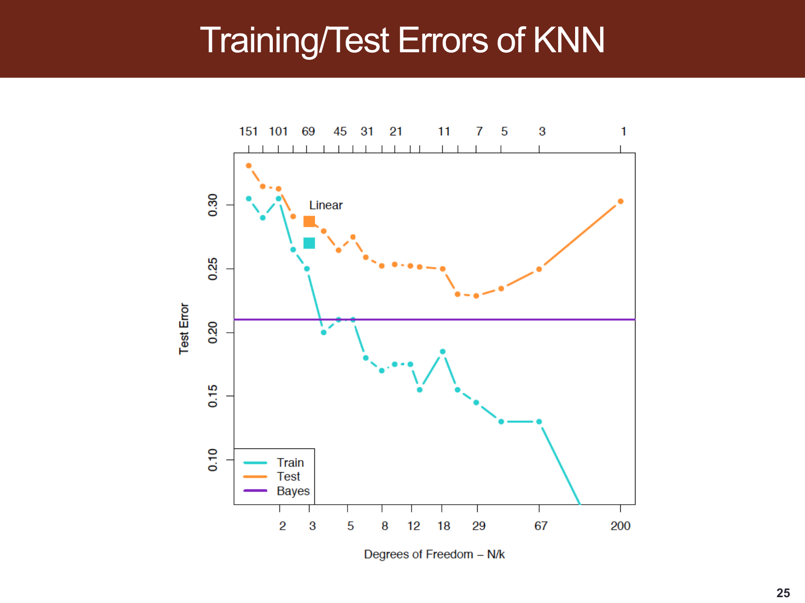

> 原课件：[第 25 页](../output/pdf/SDSC5001_Topic3_slides.pdf#page=25)。按图例识别青色 Train、橙色 Test、紫色 Bayes，不能只凭曲线高低猜含义。

1. **先看横轴。**底部为 $N/k$，顶部标 $k$；固定 $N$ 时向右意味着 $k$ 变小、模型更局部。本文前面用 $1/k$ 说明方向，与此只差固定比例，不能反过来读成“向右邻居更多”。
2. **再看青线。**近邻很少时，训练点可能用自身预测，训练错分接近 0。这不违反 Bayes 下限，因为重复使用训练标签得到的成绩不是独立未来风险。
3. **再看橙线。**它描述当前有限测试样本上的 KNN 表现：邻域过大可能太平滑，过小又可能不稳定。图中中间位置较好，不代表所有总体都必须出现严格 U 形。
4. **最后看紫线。**总体分布、可用特征和损失固定，所以 $R^*$ 不随 KNN 的 $k$ 改变。它是这个问题的理论参照，不是另一个需要通过 $k$ 拟合的模型曲线，也不是从所有橙点里取最低值画出来的线。

**为什么 1-NN 训练为零，测试还会错？**作一个局部理想化演算：假设查询对象和足够近邻的标签，在给定局部条件后分别独立地以 0.8 概率为 1。1-NN 复制邻居标签，二者不同的概率为 $0.8\times0.2+0.2\times0.8=0.32$；知道真实后验后总判 1，却只错 0.20。这个自编演算说明复制一个带随机性的标签不等于利用真实后验最优决策，不是声称所有有限数据的 1-NN 都恰好错 32%。

**真实任务通常不知道紫线的精确高度。**只有掌握真实生成分布，或在指定模拟模型中进行解析/足够精确的数值计算，才可算出相应 Bayes 风险。拿估计后验算 $\frac1m\sum_i[1-\max_k\hat p_k(x_i)]$，得到的是依赖模型假设和概率质量的代入量，不自动等于真实下限。交叉验证主要评价整个学习流程的表现，也不会凭空给出真实 Bayes 错分率。

### 10.13 一批测试数据低于 Bayes 错分率，是否矛盾

不一定。设已知某个总体的 $R^*=0.20$，用真正的 Bayes 分类器预测 10 个 iid 测试对象，错点数 $M\sim Binomial(10,0.20)$。完全没有错的概率为

$$P(M=0)=(1-0.20)^{10}=0.8^{10}\approx0.1074.$$

> **本式符号与读法（38）**：$M$ 是 10 个 iid 测试对象中分错的个数，$P(M=0)$ 是整批一个也没错的概率；这里每个对象错误概率为已知 $R^*=0.20$，分对概率为 0.8。幂次 10 表示十次独立“分对”概率相乘。中文读法：即使总体平均会错两成，一批十个人全部分对仍有约 10.74% 的概率；0.1074 是这件事发生的概率，不是本批的错分率。

也就是说，有限测试集可能得到 0% 的观测错分率，而总体最低期望仍为 20%。实际模型的观测测试比例也可能由于抽样波动低于某个理论基准，不能单凭一次较低比例宣称打破下限。

反过来，若在同一真实分布、相同输入信息和相同损失下，一个固定规则的**真实总体风险**严格小于已证明的 $R^*$，才构成矛盾；此时应重新核对所谓下限的计算及比较条件。改变人群、增加输入、改变成本或把测试标签泄漏给算法，都已改变了原比较前提。

### 10.14 错分代价不同，最优规则与“最低成本”要重新定义

设误报 $0\to1$ 的代价为 $c_{FP}$，漏报 $1\to0$ 的代价为 $c_{FN}$，分对成本为 0。固定 $x$，预测 1 的预期成本为 $c_{FP}(1-\eta)$，预测 0 的成本为 $c_{FN}\eta$。应预测 1 当且仅当

$$c_{FP}(1-\eta)<c_{FN}\eta
\iff \eta>\frac{c_{FP}}{c_{FP}+c_{FN}}.$$

> **本式符号与读法（39）**：$c_{FP}$ 是真实为 0 却预测为 1 的单次误报成本，$c_{FN}$ 是真实为 1 却预测为 0 的单次漏报成本，均按同一成本单位计且总和为正。$\eta=P(Y=1\mid X=x)$ 是当前正类概率，$\iff$ 表示左右条件等价。左边比较预测 1 与预测 0 的条件预期成本，右边是相应概率阈值。中文读法：只有预测正类的期望成本更低时才判正，成本相等时另作平局约定。

例如 $\eta=0.3$、$c_{FP}=1$、$c_{FN}=9$，预测 1 的成本为 0.7，预测 0 为 2.7。因此最低成本决策会判 1，即使多数概率属于 0；它减少的是预期成本，不是普通错分次数。

此时相应最小风险是 $E_X[\min\{c_{FN}\eta(X),c_{FP}(1-\eta(X))\}]$，单位是成本，不能与原来的无单位 0–1 错分率直接比较。PPT 的最大后验规则与 $1-\max$ 公式使用的是等错分代价设定。

### 10.15 自测：能否从一个概率表完整解释错分

1. 三类后验为 $(0.35,0.40,0.25)$，应选哪一类？局部错误是多少？
2. 二分类 $\eta(x)=0.8$，为什么最优错误为 0.2，而不是 0？
3. 两个区域出现概率为 0.9、0.1，局部最优错误为 0.05、0.45，总体错误是多少？
4. 如果只给两类先验为 0.8、0.2，能直接断定 Bayes 错分率等于 0.2 吗？
5. 为什么连续正态例子不能把两侧的 0.158655 直接相加？
6. 样本中的最佳测试分数能否直接叫 Bayes 错分率？
7. 为什么新增有用测量可以降低下限，而只增加同类训练样本通常不能改变原问题的下限？
8. $\eta=0.51$ 与 $\eta=0.95$ 两处做出非最优决策，额外局部风险分别是多少？

> **参考答案与理由。**1. 选第二类，错误为 $1-0.40=0.60$，多分类不要求最大后验超过 0.5。2. 最大概率类仍未占全部条件概率。3. $0.9(0.05)+0.1(0.45)=0.09$，必须按区域频率加权。4. 不能；总选先验多数类给出风险 0.2，所以只说明 $R^*\le0.2$，有用特征可让它更低。5. 每侧是给定真实类别的条件概率，还要各乘先验。6. 不能，既有模型限制又有有限测试波动。7. 前者改变可用信息，后者主要改善真实后验的估计。8. 分别为 0.02 和 0.90，再按这些位置/区域的出现概率计入总体。

**做题顺序：**确认损失和可用特征；算各类后验或先验加权密度；在每个位置选最大类；剩余概率是局部错误；最后对特征分布加权。若计算结果与范围、极端情况不符，先检查条件概率与联合概率是否混用。

### 10.16 网络阅读与来源说明

本专讲以本地 PPT 第 23–25 页为主线，对其中省略的推导作独立展开。概率表、数值比较、两类正态参数、图形和自测均为配套教学例子，未当作课件实验结果。网络资料在 2026-10-31 核对：

- [Wasserman，All of Statistics，§22.2（书页 351–352，PDF 第 368–369 页）](https://www.stat.cmu.edu/~brian/valerie/617-2022/0%20-%20books/2004%20-%20wasserman%20-%20all%20of%20statistics.pdf#page=368)：核对真实风险、经验错误、二分类与多分类最优规则；该节也区分 Bayes 分类规则与参数的贝叶斯推断。
- [Kass 等，Analysis of Neural Data，§4.3.4（书页 116 起，PDF 第 136 页起）](https://www.stat.cmu.edu/~kass/sam/all/heidiAPR12/all.pdf#page=136)：核对“先验 × 类内密度”的分类条件与多分类推广。
- [Basics of Statistical Learning，§6.5–6.6](https://statisticallearning.org/classification.html#bayes-classifier)：核对 Bayes 分类器、总体 Bayes 错分率、估计概率分类器及其与朴素 Bayes 的区别。

## 11. 验证集法与模型选择
> [课件第 26–27 页](../output/pdf/SDSC5001_Topic3_slides.pdf#page%3D26) · [Lumen 本节定位](obsidian://lumen-pdf?vault=guideline&file=course%2F5001%2Foutput%2Fpdf%2FSDSC5001_Topic3_slides.pdf&annotation=sdsc5001-t3-7454a80016-page-026) · [逐页索引](Topic3_%E8%AF%BE%E4%BB%B6%E9%80%90%E9%A1%B5%E5%AF%B9%E5%BA%94%E8%A1%A8.md)

当没有一个巨大独立测试集时，可在开发数据内留出验证部分：对每个候选复杂度在训练部分拟合，在验证部分计损失，再选择验证损失较小者。优点是直观、成本低，缺点是一次切分的结果可能波动，而且少用了一部分训练数据。

模型选择与最终评价是不同步骤。若拿多个候选在同一验证集上比，最优候选的验证成绩也受到选择影响。最终表现可用始终未参与选择的测试集，或嵌套 CV 来评估完整选择流程。

课件提到 AIC、BIC、协方差惩罚等训练误差修正法，具体内容在第 5 章。它们依赖模型假设与复杂度定义，不是随便给所有机器学习算法的训练损失加一个相同常数。

## 12. 留一交叉验证 LOOCV
> [课件第 28–30 页](../output/pdf/SDSC5001_Topic3_slides.pdf#page%3D28) · [Lumen 本节定位](obsidian://lumen-pdf?vault=guideline&file=course%2F5001%2Foutput%2Fpdf%2FSDSC5001_Topic3_slides.pdf&annotation=sdsc5001-t3-7454a80016-page-028) · [逐页索引](Topic3_%E8%AF%BE%E4%BB%B6%E9%80%90%E9%A1%B5%E5%AF%B9%E5%BA%94%E8%A1%A8.md)

每次留一条记录验证，其余 $n-1$ 条训练，共拟合 $n$ 次：

$$CV_{LOO}=\frac1n\sum_{i=1}^n L(y_i,\hat f^{(-i)}(x_i)).$$

> **本式符号与读法（40）**：$CV_{LOO}$ 是留一交叉验证平均损失，$n$ 是开发数据条数，$i=1,\ldots,n$ 依次成为留出的验证对象，$(x_i,y_i)$ 是这条记录。$\hat f^{(-i)}$ 的括号上标表示训练时排除了第 $i$ 条记录，不是函数的负次幂；$L(y_i,\hat f^{(-i)}(x_i))$ 是这次未见自身训练的预测损失。中文读法：轮流留出每一条，用其余数据训练，算留出对象的损失，再对全部对象平均。

回归可取 $L=(y-\hat y)^2$，分类取错分指示。每个点都得到一次未使用自身标签训练的预测。它利用几乎全部样本训练，因训练样本偏小带来的偏差通常比单次较大比例留出更小。

LOOCV 的训练集高度重叠，各折误差相关，方差不等于独立误差平均后的简单 $1/n$ 缩减。课件第 30 页的“波动较小”是在对照单次验证；第 34 页在对照常用 K 折时，又说明 LOOCV 的方差可能更高。比较结论要连同参照方法一起理解。

对某些模型有快速公式，例如固定设计的 OLS 留一残差 $e_i/(1-h_{ii})$，但一般算法可能需要完整重拟合。不能因为一个方法叫 LOOCV，就一律假设计算很慢或一律能一步算完。

> **行内符号补充**：$e_i=y_i-\hat y_i$ 是第 $i$ 条记录在完整 OLS 拟合中的残差，$h_{ii}$ 是帽子矩阵第 $i$ 个对角元素，称为杠杆值；两个 $i$ 是矩阵行列都取第 $i$ 项。$e_i/(1-h_{ii})$ 才是该记录被留出训练时的预测残差，适用时要求 $h_{ii}\ne1$。这里 OLS 指普通最小二乘，LOOCV 指留一交叉验证。

## 13. K 折交叉验证与计算细节
> [课件第 31–34 页](../output/pdf/SDSC5001_Topic3_slides.pdf#page%3D31) · [Lumen 本节定位](obsidian://lumen-pdf?vault=guideline&file=course%2F5001%2Foutput%2Fpdf%2FSDSC5001_Topic3_slides.pdf&annotation=sdsc5001-t3-7454a80016-page-031) · [逐页索引](Topic3_%E8%AF%BE%E4%BB%B6%E9%80%90%E9%A1%B5%E5%AF%B9%E5%BA%94%E8%A1%A8.md)

将开发数据分成不交叠的 $A_1,\ldots,A_K$，每次用其余折训练，再预测当前折。按每个样本平均：

$$CV=\frac1n\sum_{k=1}^K\sum_{i\in A_k}L(y_i,\hat f^{(-k)}(x_i)).$$

> **本式符号与读法（41）**：这里 $K$ 是交叉验证折数，不是前文的类别总数；$k$ 是当前验证折编号，$A_k$ 是这一折的样本索引集合，$i\in A_k$ 遍历其记录。$n$ 是全部开发样本数，$\hat f^{(-k)}$ 表示排除整折 $A_k$ 后训练的模型，括号上标不是乘方；$L$ 是预先指定的单个预测损失。中文读法：每折用其余折训练、给当前折逐条记损失，再将所有折的损失总和除以总人数。

若折大小不同，不能随意把每折平均损失等权再平均；应按 $|A_k|/n$ 加权。课件第 31 页在一般损失 $L$ 外又写平方，若 $L$ 已定义为平方损失就会成为四次损失。本笔记采用上式统一记号，单个损失只计算一次。

### 13.1 补充手算

五折 MSE 分别为 $4,5,3,6,2$，各折大小相同，则 CV MSE 为 4。若两折大小为 2 和 8、MSE 为 1 和 9，正确汇总为 $(2\times1+8\times9)/10=7.4$，不是 $(1+9)/2=5$。

### 13.2 怎样避免数据泄漏

1. 先拆折，再在训练折拟合插补、缩放、特征选择、PCA 等步骤。
2. 用训练折处理器转换验证折，禁止在全数据上先算均值和主成分。
3. 所有候选使用相同划分，减少比较中无关的随机波动。
4. 同一人、同一设备或同一机构的关联记录按组划分。
5. 预测未来时保留时间顺序，训练不得看到未来。
6. 选定参数后在全部开发数据上重新训练，再评价保留测试集。

课件推荐常用的 5 折或 10 折作为实用折中。这是经验选择，不是对极小样本、时序依赖与特殊稀有事件都自动适用的固定规则。图中的 CV 曲线接近测试曲线，说明该模拟下估计有参考价值，不保证任何一次 CV 都精确定位真实最优复杂度。

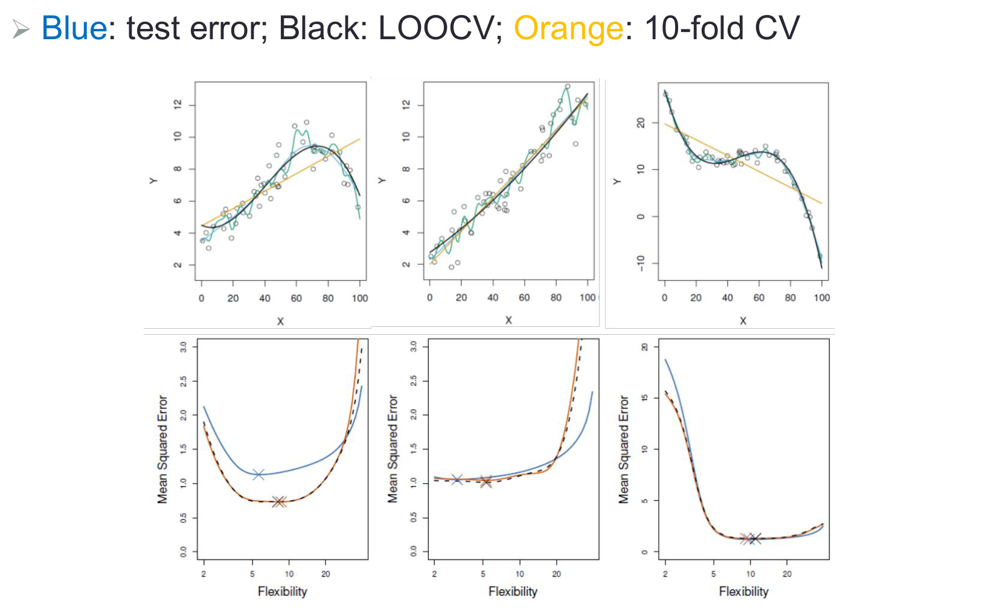

> 图源：[原课件第 33 页](../output/pdf/SDSC5001_Topic3_slides.pdf#page%3D33) · [Lumen 图示定位](obsidian://lumen-pdf?vault=guideline&file=course%2F5001%2Foutput%2Fpdf%2FSDSC5001_Topic3_slides.pdf&annotation=sdsc5001-t3-7454a80016-crop-033)。读图：三组模拟中的测试、LOOCV 与 10 折曲线；比较整体趋势，也观察估计曲线的波动。

### 深入讲解：一次完整的调参、重拟合与最终评价

设有 120 条独立观测。先固定留出 20 条作为最终测试，剩余 100 条用于开发。对候选 $k\in\{1,3,5,9\}$ 做相同的五折划分：每轮 80 条训练、20 条验证。每个候选在五轮中产生共 100 个折外预测，再统一计算损失。四个候选需要 20 次 KNN 流程拟合，所有缩放步骤也包含在每次拟合中。

假设折内比较后选出 $k=5$。下一步是**在全部 100 条开发数据上重新拟合预处理和模型**，然后只对始终保留的 20 条测试样本评价。最终交付模型不能只保留五折中的某一个 80 条样本模型，除非任务本来就要求折模型集成。

**补充：one-standard-error 选择。**若最小平均验证 MSE 为 4.0，出现在 $k=3$，该点的标准误估计为 0.3，则阈值为 4.3。若 $k=5$、9 的平均 MSE 为 4.1、4.25，可在该阈值内选择更平滑的 $k=9$。这是用相近成绩换较简单模型的经验准则，不是证明它与最优模型完全等效。

常用 $s_{fold}/\sqrt K$ 描述折分数均值的不确定性，但各折训练数据重叠，分数并非严格独立，该量不自动给出精确置信区间。需要严谨比较时，应采用与重采样依赖和任务结构相符的方法。

> **行内符号补充**：$K$ 是折数，$s_{fold}$ 是这 $K$ 个验证折分数的样本标准差，fold 只是“折”的文字下标，$\sqrt K$ 表示折数的平方根。$s_{fold}/\sqrt K$ 借用独立平均的标准误形式；本节明确提醒，折间依赖会限制这个近似的严格解释。MSE 是平均平方误差，CV 是交叉验证，SE 是标准误。

若没有独立测试集，可用外层 CV 评价整个“内层调参再重拟合”的算法。外层验证折不得参与内层的特征筛选、参数选择或阈值选择。嵌套 CV 评价的是选择流程，最终仍需在可用开发数据上完成一次参数选择与拟合。

### PPT 第 31 页逐项讲解：K 折交叉验证的求和对象

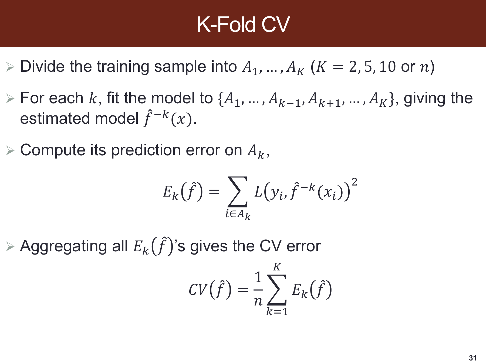

> 原课件：[第 31 页](../output/pdf/SDSC5001_Topic3_slides.pdf#page=31)。截图保留课件原貌，下面按阅读顺序解释；原页简写与笔误以正文核对为准。

**第一步把开发数据分成不重叠的折。**每次只拿其中一折验证，其余折训练。$\hat f^{-k}$ 的上标表示未使用第 $k$ 折，而不是把普通模型数值作一次减法。

**公式先折内求和，再除以全体样本数。**因此各折大小不同时仍然是每条观测等权，不能不加说明就平均各折 MSE。正文的 2 条与 8 条算例对应这一细节。

**原页的 $L$ 后又写了平方，需要统一损失定义。**若 $L$ 表示残差，可平方；若 $L$ 本身已经是平方损失，就不能再平方成四次损失。笔记采用 $\sum L(y_i,\hat f^{-k}(x_i))/n$，并单独说明选用的 $L$。

### 外部拓展：嵌套交叉验证评估的是“选择模型的程序”

**课内衔接：**[本章第 13 节](#section-13) · [原课件第 31 页](../output/pdf/SDSC5001_Topic3_slides.pdf#page=31) · [复用原有 Lumen 定位](obsidian://lumen-pdf?vault=guideline&file=course%2F5001%2Foutput%2Fpdf%2FSDSC5001_Topic3_slides.pdf&annotation=sdsc5001-t3-7454a80016-page-031)

**外部拓展｜进一步处理调参偏差。**若同时试很多 k、λ 或模型类型，再把最好的那一个 CV 分数当作最终性能，就在噪声中进行了挑选。即使每个候选的 CV 都按训练折正确拟合，最优候选分数仍可能偏乐观。

**自编示意。**三个配置真实误差恰好相同，都是 0.20，但本次 CV 读到 0.18、0.21、0.23。挑出 0.18 合理地完成了选择，却不能据此认定所选程序未来误差就是 0.18。这个例子用于解释选择效应，不是假定实际各模型等效。

外层 K 折中，第 k 折仅用于评价；其余数据内部再做调参，得到 $\hat\lambda^{(-k)}$，然后用该参数在整个外层训练部分重拟合。记该预测器为 $\hat f^{(-k)}_{\hat\lambda^{(-k)}}$，则

$$\widehat R_{nested}=\frac1n\sum_{k=1}^K\sum_{i\in A_k}
L\left(y_i,\hat f^{(-k)}_{\hat\lambda^{(-k)}}(x_i)\right).$$

n 是被外层分折的总观测数，$A_k$ 是第 k 个外层测试集合，L 为事先选定的损失；上标 (−k) 表示排除第 k 折，绝不是负指数。帽号表示从有限数据估计的风险或参数。读作：每次把一折完全隔离，在其余部分完成整套选择和训练，再把所有隔离预测的损失按样本平均。

预处理、特征筛选、阈值与概率校准，只要是依据数据选择的，都属于相应训练内部的流程。外层得到不同 λ 并不奇怪，评价对象是“给一批新训练数据后如何选模型”的程序，不是某一个预先固定 λ 的唯一模型。

**最后如何部署。**报告外层分数后，用全部开发数据再运行同一选择规则并重拟合。外层训练量小于最终训练量，因此该分数也不是对最终全量模型性能的精确等式。若反复根据外层结果改程序，外层也逐渐承担了验证集角色。

折间损失并不独立，直接用“折标准差/√K”当作严格置信区间通常缺乏依据。分组与时间数据还须在内外层都匹配目标切分。

**外部来源与阅读定位：**[scikit-learn：嵌套与非嵌套交叉验证](https://scikit-learn.org/stable/auto_examples/model_selection/plot_nested_cross_validation_iris.html)。本文推导与自编算例用于解释相应方法，不冒充来源中的实验结果。

## 14. 应用场景与方法选择

数据量较大、候选数较少时，一次合理划分的训练/验证/测试流程通常较容易执行。数据较少时可采用 K 折，但应保留分组和时间结构。高维基因数据最需要把筛选放进折内，邮件数据要关注类别比例和时间变化，Wage 数据则要注明适用人群与关联解释。

当解释是核心目标，应核对模型假设、系数稳定性及不确定性；当预测是核心目标，应围绕目标损失、代表性测试样本和真实使用条件比较模型。二者都需要说明泛化范围，不能用高训练准确率替代证据。

## 15. 自测与参考答案

1. $f(X)=E(Y\mid X)$ 需要误差与 $X$ 完全独立吗？
2. 为什么平方损失的最优函数是条件均值？
3. 训练 1-NN 错分率为 0 的条件是什么？
4. KNN 中 $k$ 增大通常使边界更平滑还是更曲折？
5. 偏差平方、方差和不可约误差各来自哪里？
6. 类别有重叠时，Bayes 分类是否保证零错分？
7. CV 选出的最好分数是否就是整个选择流程无偏的最终成绩？
8. LOOCV 为什么可能比 10 折估计方差更大？
9. 先做全数据基因筛选再交叉验证，哪里有问题？
10. 每折样本数不同时如何平均验证损失？
11. 同一设备多次观测怎样切分更合理？
12. 课件 U 形是否是所有算法严格满足的形状？

> [!success]- 参考答案
> 1. 条件均值为零即可，独立更强。2. 条件风险等于条件方差加与条件均值的距离平方。3. 自身参与近邻、不同训练点无矛盾重复等。4. 通常更平滑。5. 平均估计偏离、训练集变化、给定特征后的新响应噪声。6. 不保证。7. 不是，选择会带来乐观效应。8. 训练集高度重叠，验证误差相关。9. 验证标签已参与筛选。10. 按样本数加权。11. 根据部署目标按设备分组或按时间划分。12. 不是，它是经典情形的示意与权衡解释。

---

[返回课程总目录](README.md) · [34 页课件索引](Topic3_%E8%AF%BE%E4%BB%B6%E9%80%90%E9%A1%B5%E5%AF%B9%E5%BA%94%E8%A1%A8.md)
