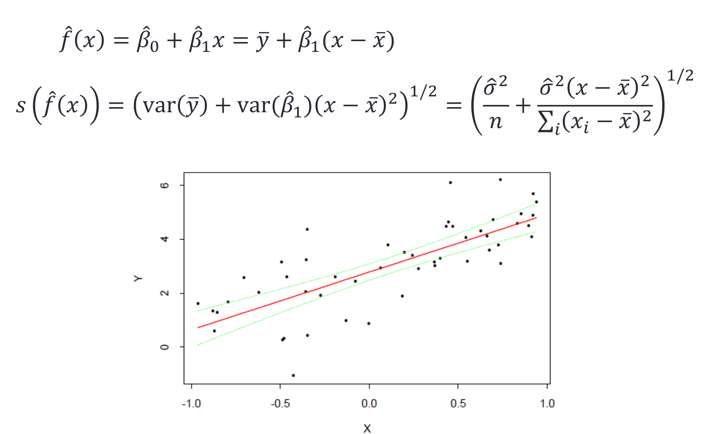
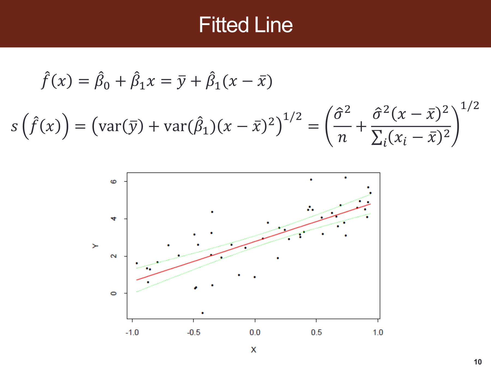
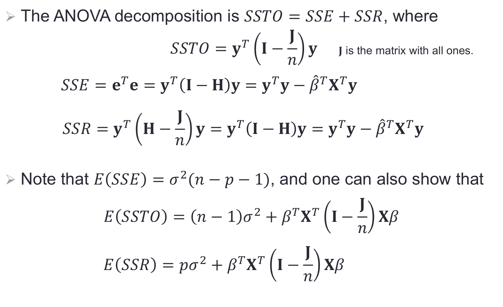
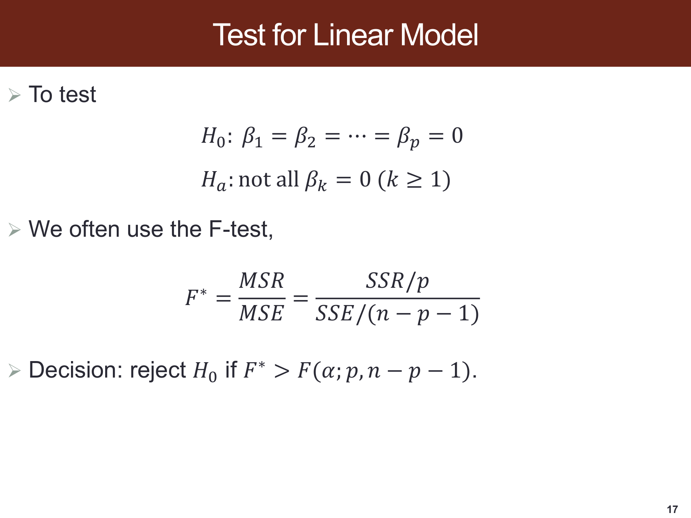
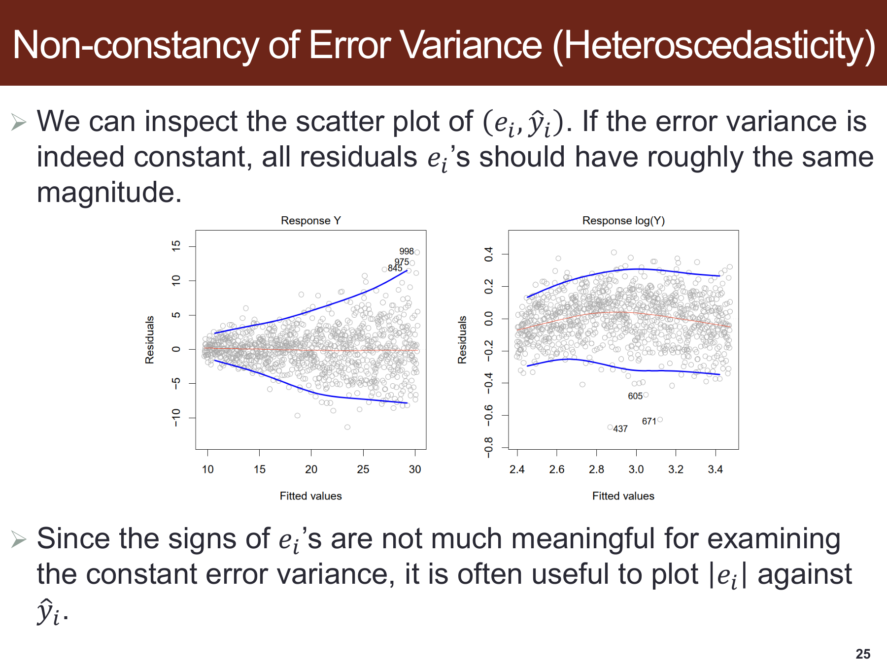
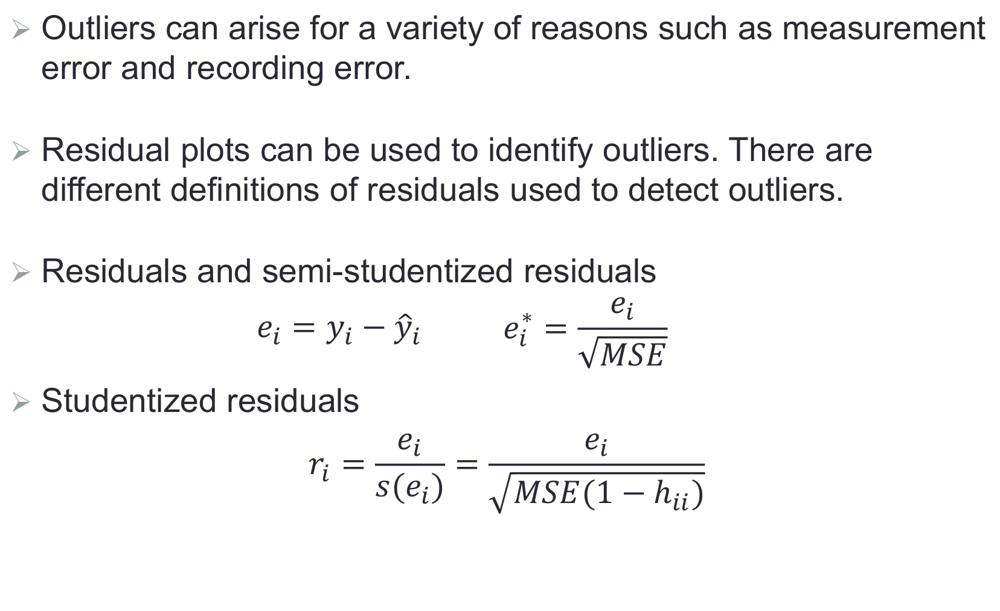

# SDSC5001 Topic 4：线性回归详细笔记

[课程总目录](README.md) · [逐页对应表](Topic4_%E8%AF%BE%E4%BB%B6%E9%80%90%E9%A1%B5%E5%AF%B9%E5%BA%94%E8%A1%A8.md) · [离线 HTML 阅读版](5001_Topic4_%E8%AF%A6%E7%BB%86%E7%AC%94%E8%AE%B0.html)

> 来源：本地 `SDSC5001_Topic 4 Linear regression.pptx`，共 43 页，PDF 页序与幻灯片页序一致。按课件顺序讲解，补充推导、手算、应用与自测；补充内容和课件表述核对均在正文注明。
>
> Lumen 用法：在 Obsidian 的 guideline 笔记库点击“Lumen 本节定位”或“Lumen 图示定位”，可回到原 PDF 标记区域；标记备注可返回对应中文小节。图片为原课件局部截图，公式保留为可编辑 LaTeX。

## 阅读导航

- [0. 模型、符号与本章路线](#section-0)
- [1. 简单回归的最小二乘推导](#section-1)
- [2. 估计量的分布与 BLUE](#section-2)
- [3. 残差方差、标准误与系数区间](#section-3)
- [4. 均值响应的区间与新观测预测区间](#section-4)
- [5. 多元回归的矩阵解与几何解释](#section-5)
- [6. 残差方差与自由度为什么是 $n-p-1$](#section-6)
- [7. ANOVA 分解与原页公式核对](#section-7)
- [8. $R^2$、调整 $R^2$ 与总体 F 检验](#section-8)
- [9. 多元系数的标准误、检验与解释](#section-9)
- [10. 模型诊断的四个层次](#section-10)
- [11. 异方差、相关误差与非正态](#section-11)
- [12. Y 异常、X 杠杆与影响：三个概念](#section-12)
- [13. 删除残差与外部学生化残差](#section-13)
- [14. 杠杆值与共线性](#section-14)
- [15. 变量变换与 Box–Cox 的规范形式](#section-15)
- [16. 偏差—方差权衡与正则化连接](#section-16)
- [17. 定性变量、基准组与交互项](#section-17)
- [18. 一个完整的补充手算](#section-18)
- [19. 自测与参考答案](#section-19)

> **深化阅读（2026-10-31）：**本章新增 4 组分节详解与 3 张 PPT 完整截图。新增推导与手算均为配套补充，截图旁附逐项解读，沿用原有课件定位。
>
> [每一层回归结论分别需要什么条件](#deep-t4-s2) · [部分 F 检验怎样比较一组新增变量](#deep-t4-s8) · [把残差图现象连接到具体处理](#deep-t4-s10) · [沿三点算例继续算区间、PRESS 和影响](#deep-t4-s18)

> **外部资料强化（2026-11-01）：**本章在对应知识点内加入以下拓展，所有数值算例与教学图明确区分于课件原始内容。外部来源在小节末就近提供。
>
> [“控制其他变量”可以通过两次残差化精确实现](#ext-t4-fwl) · [异方差稳健标准误修正哪一部分，为什么不能修复遗漏变量](#ext-t4-hc3) · [对数回归取指数后，得到的是均值还是中位数](#ext-t4-retransform)

## 0. 模型、符号与本章路线
> [课件第 1–3 页](../output/pdf/SDSC5001_Topic4_slides.pdf#page%3D1) · [Lumen 本节定位](obsidian://lumen-pdf?vault=guideline&file=course%2F5001%2Foutput%2Fpdf%2FSDSC5001_Topic4_slides.pdf&annotation=sdsc5001-t4-1f738d1a21-page-001) · [逐页索引](Topic4_%E8%AF%BE%E4%BB%B6%E9%80%90%E9%A1%B5%E5%AF%B9%E5%BA%94%E8%A1%A8.md)

线性回归首先建模条件均值 $f(x)=E(Y\mid X=x)$。简单回归写成 $Y_i=\beta_0+\beta_1x_i+\epsilon_i$；多元回归为 $Y=X\beta+\epsilon$。本笔记统一用 $p$ 表示不含截距的特征数，$q=p+1$ 表示包含截距的参数数目，$X\in\mathbb R^{n\times q}$ 的第一列为 1。

必须区分三个对象：未知真误差 $\epsilon_i$、从数据算出的残差 $e_i=y_i-\hat y_i$、一个未来对象的预测误差 $Y_0-\hat y_0$。它们的分布与方差不同，不能把残差当成独立的新噪声样本。

全章从最小二乘解开始，建立标准误、区间与检验，再进入残差诊断、异常/杠杆、共线性、变换和分类变量。课件 TV 与销售散点只展示当前样本的条件关系，不能单凭拟合直线解释广告的因果效应。

## 1. 简单回归的最小二乘推导
> [课件第 4 页](../output/pdf/SDSC5001_Topic4_slides.pdf#page%3D4) · [Lumen 本节定位](obsidian://lumen-pdf?vault=guideline&file=course%2F5001%2Foutput%2Fpdf%2FSDSC5001_Topic4_slides.pdf&annotation=sdsc5001-t4-1f738d1a21-page-004) · [逐页索引](Topic4_%E8%AF%BE%E4%BB%B6%E9%80%90%E9%A1%B5%E5%AF%B9%E5%BA%94%E8%A1%A8.md)

目标为 $SSE(\beta_0,\beta_1)=\sum_i(y_i-\beta_0-\beta_1x_i)^2$。分别对两个参数求导：

$$\sum_i(y_i-\hat\beta_0-\hat\beta_1x_i)=0,$$

$$\sum_i x_i(y_i-\hat\beta_0-\hat\beta_1x_i)=0.$$

第一式给 $\hat\beta_0=\bar y-\hat\beta_1\bar x$。代回第二式，记 $S_{xx}=\sum_i(x_i-\bar x)^2$、$S_{xy}=\sum_i(x_i-\bar x)(y_i-\bar y)$，得到

$$\hat\beta_1=\frac{S_{xy}}{S_{xx}},\qquad \hat\beta_0=\bar y-\hat\beta_1\bar x.$$

需要 $S_{xx}>0$，否则所有 $x_i$ 相同，无法区分截距和斜率。拟合线一定通过 $(\bar x,\bar y)$；有截距的 OLS 满足 $\sum_i e_i=0$、$\sum_i x_ie_i=0$。这些是最小二乘的代数性质，不要求误差正态。

**单位解释。**斜率的单位是“$Y$ 的单位/$X$ 的单位”，表示条件均值每增加一单位 $X$ 的模型变化。截距对应 $X=0$，若零点远离实际样本范围，其数值可能没有直接业务含义。

## 2. 估计量的分布与 BLUE
> [课件第 5–6 页](../output/pdf/SDSC5001_Topic4_slides.pdf#page%3D5) · [Lumen 本节定位](obsidian://lumen-pdf?vault=guideline&file=course%2F5001%2Foutput%2Fpdf%2FSDSC5001_Topic4_slides.pdf&annotation=sdsc5001-t4-1f738d1a21-page-005) · [逐页索引](Topic4_%E8%AF%BE%E4%BB%B6%E9%80%90%E9%A1%B5%E5%AF%B9%E5%BA%94%E8%A1%A8.md)

在固定 $X$、正确线性均值、$E(\epsilon\mid X)=0$、$\operatorname{Cov}(\epsilon\mid X)=\sigma^2I$ 下，OLS 无偏，且

$$\operatorname{Var}(\hat\beta_1\mid X)=\frac{\sigma^2}{S_{xx}},$$

$$\operatorname{Var}(\hat\beta_0\mid X)=\sigma^2\left(\frac1n+\frac{\bar x^2}{S_{xx}}\right),\quad \operatorname{Cov}(\hat\beta_0,\hat\beta_1\mid X)=-\frac{\sigma^2\bar x}{S_{xx}}.$$

若再加独立正态误差，估计量精确服从相应正态分布。正态性并不是求 OLS 解、无偏性或 Gauss–Markov 最优性所必需的条件，而是本课精确小样本 $t/F$ 推断的依据。

BLUE 中的 linear 指估计量是响应向量 $Y$ 的线性函数；best 指在所有线性无偏估计量中方差最小。它没有宣称 OLS 优于所有有偏估计，也没有宣称真实关系一定线性。$S_{xx}$ 大意味着设计覆盖更分散，在模型正确时通常降低斜率方差，但盲目外推和极端杠杆仍是另一回事。

### 深入讲解：每一层回归结论分别需要什么条件

把 OLS 公式、无偏、最优和精确检验分开，可以避免把所有假设混成一句“数据服从正态分布”。固定设计矩阵 $X$，先令 $A=(X^TX)^{-1}X^T$，则 $\hat\beta=AY$。代入 $Y=X\beta+\epsilon$：

$$\hat\beta=\beta+A\epsilon,\qquad
E(\hat\beta\mid X)=\beta+A E(\epsilon\mid X).$$

因此，满列秩使上述系数公式成立，条件均值为零使无偏性成立；这一步不要求正态性，也不要求解释变量彼此独立。

若误差协方差为一般的 $\Omega$，则

$$\operatorname{Cov}(\hat\beta\mid X)=A\Omega A^T.$$

只有 $\Omega=\sigma^2I$ 时，才简化为 $\sigma^2(X^TX)^{-1}$，并具有相应 Gauss–Markov 最优性。异方差本身不必导致系数有偏，但会破坏这套同方差标准误；若存在 $E(\epsilon\mid X)\ne0$，只改标准误也不能修复均值偏差。

独立正态误差进一步给出精确小样本的正态、卡方、$t/F$ 分布。这里正态的是给定 $X$ 后的误差，不要求原始响应 $Y$ 在不同 $X$ 混合后的直方图也正态，更不要求 $X$ 本身正态。

**答题顺序：**先说明设计是否可识别，再说明均值模型，再说明误差协方差，最后说明所用推断的分布条件。回归诊断也应沿这四层寻找问题。

## 3. 残差方差、标准误与系数区间
> [课件第 7–9 页](../output/pdf/SDSC5001_Topic4_slides.pdf#page%3D7) · [Lumen 本节定位](obsidian://lumen-pdf?vault=guideline&file=course%2F5001%2Foutput%2Fpdf%2FSDSC5001_Topic4_slides.pdf&annotation=sdsc5001-t4-1f738d1a21-page-007) · [逐页索引](Topic4_%E8%AF%BE%E4%BB%B6%E9%80%90%E9%A1%B5%E5%AF%B9%E5%BA%94%E8%A1%A8.md)

简单回归拟合了两个参数，因此残差自由度为 $n-2$：

$$s^2=MSE=\frac{SSE}{n-2},\quad SE(\hat\beta_1)=\frac{s}{\sqrt{S_{xx}}},$$

$$SE(\hat\beta_0)=s\sqrt{\frac1n+\frac{\bar x^2}{S_{xx}}}.$$

正态误差下，$(n-2)s^2/\sigma^2\sim\chi^2_{n-2}$，而系数估计与 $s^2$ 独立，所以

$$\frac{\hat\beta_j-\beta_j}{SE(\hat\beta_j)}\sim t_{n-2}.$$

双侧置信区间为 $\hat\beta_j\pm t_{1-\alpha/2,n-2}SE(\hat\beta_j)$。检验 $H_0:\beta_j=\beta_{j,0}$ 时，把分子换成 $\hat\beta_j-\beta_{j,0}$。

**原页核对：第 9 页对双侧备择写拒绝条件时，应比较 $|t^*|$ 与临界值，不能只看正方向的 $t^*$。**否则很大的负斜率也可能被错误地当成不显著。统计显著性随样本量变化，效应大小还需结合单位、区间与任务意义解释。

## 4. 均值响应的区间与新观测预测区间
> [课件第 10 页](../output/pdf/SDSC5001_Topic4_slides.pdf#page%3D10) · [Lumen 本节定位](obsidian://lumen-pdf?vault=guideline&file=course%2F5001%2Foutput%2Fpdf%2FSDSC5001_Topic4_slides.pdf&annotation=sdsc5001-t4-1f738d1a21-page-010) · [逐页索引](Topic4_%E8%AF%BE%E4%BB%B6%E9%80%90%E9%A1%B5%E5%AF%B9%E5%BA%94%E8%A1%A8.md)

在 $x_0$ 处的拟合条件均值为

$$\hat f(x_0)=\bar y+\hat\beta_1(x_0-\bar x),$$

$$SE[\hat f(x_0)]=s\sqrt{\frac1n+\frac{(x_0-\bar x)^2}{S_{xx}}}.$$

均值响应的点态置信区间使用上式乘 $t$ 临界值。若目标是一个独立的新观测，则还包含该对象自己的噪声：

$$\hat f(x_0)\pm t_{1-\alpha/2,n-2}s\sqrt{1+\frac1n+\frac{(x_0-\bar x)^2}{S_{xx}}}.$$

因此预测区间通常更宽。在样本中心附近估计均值更精确，远离中心时斜率的不确定性放大。点态 95% 区间并不自动形成整条曲线同时 95% 覆盖的置信带。

> 图源：[原课件第 10 页](../output/pdf/SDSC5001_Topic4_slides.pdf#page%3D10) · [Lumen 图示定位](obsidian://lumen-pdf?vault=guideline&file=course%2F5001%2Foutput%2Fpdf%2FSDSC5001_Topic4_slides.pdf&annotation=sdsc5001-t4-1f738d1a21-crop-010)。读图：拟合线及其不确定性；区间随预测位置远离样本中心而加宽。

### PPT 第 10 页逐项讲解：拟合均值曲线及其不确定性

> 原课件：[第 10 页](../output/pdf/SDSC5001_Topic4_slides.pdf#page=10)。截图保留课件原貌，下面按阅读顺序解释；原页简写与笔误以正文核对为准。

**红色拟合线通过样本中心，绿色边界在两端扩张。**均值估计的标准误中含 $(x-\bar x)^2$，离设计中心越远，斜率的不确定性贡献越大。

**公式描述的是拟合均值的标准误。**截图公式没有独立新对象的噪声项，所以不能直接当作单个新观测的预测标准误。预测区间的根号里需再加 1。

**图中散点不要求大多落在均值置信边界内。**它们是各自带噪声的响应，不是同一个均值参数。区间的置信水平还需结合临界值和构造方法，不能仅凭图中两条线认定为某个精确水平。

## 5. 多元回归的矩阵解与几何解释
> [课件第 11–13 页](../output/pdf/SDSC5001_Topic4_slides.pdf#page%3D11) · [Lumen 本节定位](obsidian://lumen-pdf?vault=guideline&file=course%2F5001%2Foutput%2Fpdf%2FSDSC5001_Topic4_slides.pdf&annotation=sdsc5001-t4-1f738d1a21-page-011) · [逐页索引](Topic4_%E8%AF%BE%E4%BB%B6%E9%80%90%E9%A1%B5%E5%AF%B9%E5%BA%94%E8%A1%A8.md)

最小化 $\|y-X\beta\|_2^2$ 的一阶条件为 $X^TX\hat\beta=X^Ty$。满列秩时：

$$\hat\beta=(X^TX)^{-1}X^Ty,\quad \hat y=Hy,\quad H=X(X^TX)^{-1}X^T.$$

$H$ 是帽子矩阵，将 $y$ 正交投影到 $X$ 的列空间。它对称、幂等，$H^T=H$、$H^2=H$，且秩与迹都等于 $q$。残差 $e=(I-H)y$ 与每一列 $X_j$ 正交，即 $X^Te=0$。

若 $X$ 不满列秩，系数可能不唯一；投影到列空间的拟合值仍可唯一确定。数值计算宜用 QR 或 SVD，强共线性时显式求 $X^TX$ 的逆容易放大误差。

在正确同方差模型下：

$$E(\hat\beta\mid X)=\beta,\quad \operatorname{Cov}(\hat\beta\mid X)=\sigma^2(X^TX)^{-1},\quad \operatorname{Cov}(\hat y\mid X)=\sigma^2H.$$

多元斜率 $\beta_j$ 表示在模型中其他变量保持不变时的条件均值变化。它通常不同于只用 $X_j$ 的简单回归斜率，因为控制变量改变了比较方式。

## 6. 残差方差与自由度为什么是 $n-p-1$
> [课件第 14 页](../output/pdf/SDSC5001_Topic4_slides.pdf#page%3D14) · [Lumen 本节定位](obsidian://lumen-pdf?vault=guideline&file=course%2F5001%2Foutput%2Fpdf%2FSDSC5001_Topic4_slides.pdf&annotation=sdsc5001-t4-1f738d1a21-page-014) · [逐页索引](Topic4_%E8%AF%BE%E4%BB%B6%E9%80%90%E9%A1%B5%E5%AF%B9%E5%BA%94%E8%A1%A8.md)

$$E(e\mid X)=0,\qquad \operatorname{Cov}(e\mid X)=\sigma^2(I-H).$$

正确均值下，利用迹运算：

$$E(e^Te\mid X)=\operatorname{tr}[\sigma^2(I-H)]=\sigma^2(n-q).$$

所以 $s^2=SSE/(n-q)=SSE/(n-p-1)$ 无偏。自由度减少的不是“变量列名的数量”，而是独立估计方向的数量；若有秩亏，应以实际秩处理。饱和拟合没有剩余自由度，就不能沿用这个公式估计噪声方差。

一个重要区别是 $\operatorname{Var}(e_i)=\sigma^2(1-h_{ii})$。高杠杆点的原始残差天然更容易被拟合压小，因此不同对象的原始残差不能直接按同一尺度比较。

## 7. ANOVA 分解与原页公式核对
> [课件第 15 页](../output/pdf/SDSC5001_Topic4_slides.pdf#page%3D15) · [Lumen 本节定位](obsidian://lumen-pdf?vault=guideline&file=course%2F5001%2Foutput%2Fpdf%2FSDSC5001_Topic4_slides.pdf&annotation=sdsc5001-t4-1f738d1a21-page-015) · [逐页索引](Topic4_%E8%AF%BE%E4%BB%B6%E9%80%90%E9%A1%B5%E5%AF%B9%E5%BA%94%E8%A1%A8.md)

有截距 OLS 的中心化平方和满足

$$SST=\sum_i(y_i-\bar y)^2=SSR+SSE,$$

$$SSR=\sum_i(\hat y_i-\bar y)^2,\qquad SSE=\sum_i(y_i-\hat y_i)^2.$$

令 $J=\mathbf1\mathbf1^T$，则

$$SST=y^T(I-J/n)y,\quad SSE=y^T(I-H)y,$$

$$SSR=y^T(H-J/n)y=\hat\beta^TX^Ty-n\bar y^2.$$

**第 15 页的 SSR 行在第一个等号后误抄了 SSE 的表达式。** $y^T(I-H)y$ 是 SSE，不能同时是 SSR；可用 $SSR=SST-SSE$ 立即核验。该页对正确模型的期望结果可保留：

$$E(SST\mid X)=(n-1)\sigma^2+\beta^TX^T(I-J/n)X\beta,$$

$$E(SSR\mid X)=p\sigma^2+\beta^TX^T(I-J/n)X\beta.$$

几何上，中心化响应被分成拟合变化与正交残差，勾股关系产生平方和分解。无截距模型的常见中心化 $R^2$/分解需另行检查，不能原封不动套用。

> 图源：[原课件第 15 页](../output/pdf/SDSC5001_Topic4_slides.pdf#page%3D15) · [Lumen 图示定位](obsidian://lumen-pdf?vault=guideline&file=course%2F5001%2Foutput%2Fpdf%2FSDSC5001_Topic4_slides.pdf&annotation=sdsc5001-t4-1f738d1a21-crop-015)。读图：ANOVA 原页，SSR 行后半段重复了 SSE；正文给出一致的修正式。

## 8. $R^2$、调整 $R^2$ 与总体 F 检验
> [课件第 16–17 页](../output/pdf/SDSC5001_Topic4_slides.pdf#page%3D16) · [Lumen 本节定位](obsidian://lumen-pdf?vault=guideline&file=course%2F5001%2Foutput%2Fpdf%2FSDSC5001_Topic4_slides.pdf&annotation=sdsc5001-t4-1f738d1a21-page-016) · [逐页索引](Topic4_%E8%AF%BE%E4%BB%B6%E9%80%90%E9%A1%B5%E5%AF%B9%E5%BA%94%E8%A1%A8.md)

$$R^2=1-\frac{SSE}{SST},\qquad R_{adj}^2=1-\frac{SSE/(n-p-1)}{SST/(n-1)}.$$

含截距、训练样本内的 OLS，$R^2$ 在 $[0,1]$ 内，新增变量时不会下降。调整 $R^2$ 用残差自由度惩罚复杂度，可能下降，也可能为负。测试集 $R^2$ 也可能为负，表示比按相应基准均值预测更差。

总体检验的原假设是所有斜率为 0，备择为至少一个非零：

$$F=\frac{SSR/p}{SSE/(n-p-1)}\sim F_{p,n-p-1}\quad(H_0).$$

它检验变量组的整体贡献，不表示拒绝后每一个变量都显著。对简单回归，检验斜率为零时有 $F=t^2$；这可以作为计算核对。F 显著而个别 t 不显著，在共线性存在时完全可能。

补充：比较嵌套的约束模型 R 与完整模型 F，可用

$$F_{partial}=\frac{(SSE_R-SSE_F)/(q_F-q_R)}{SSE_F/(n-q_F)}.$$

需模型嵌套且使用相同响应与样本，并满足相应误差条件。不能对不同样本、不同响应变换后的 SSE 机械相减。

### 深入讲解：部分 F 检验怎样比较一组新增变量

**补充手算。**同一份 $n=30$ 的数据，约束模型含截距和 1 个斜率，故 $q_R=2$、$SSE_R=140$；完整模型含截距和 3 个斜率，故 $q_F=4$、$SSE_F=100$。想检验新增的两个斜率同时为零：

$$H_0:\beta_2=\beta_3=0,\qquad
F=\frac{(140-100)/(4-2)}{100/(30-4)}=5.2.$$

分子自由度为新增的 2 个独立方向，分母自由度为完整模型剩余的 26。正态同方差条件下，原假设对应 $F_{2,26}$，5% 上尾临界值约为 3.369，因此本例拒绝新增项整体无贡献的假设。

这不等于两个新增项各自都显著：它们可能共享信息，单个系数检验仍不稳定。也不等于完整模型未来一定预测更好，因为这里评价的是给定模型假设下的样本内贡献，预测选择还应看独立验证。

如果只增加一个系数，部分 F 与该系数在完整模型中的双侧 t 检验满足 $F=t^2$。若增加一整组哑变量，检验的是整组而非随意挑出其中一个编码系数，这对比较类别变量尤其有用。

**不能直接比较的情况：**两个模型使用不同的缺失值删除样本、一个用 $Y$ 而另一个用 $\log Y$、或两个模型的设计空间不嵌套。先确保同一响应、同一观测集合和嵌套关系，再计算 SSE 差。

### PPT 第 17 页逐项讲解：总体 F 检验

> 原课件：[第 17 页](../output/pdf/SDSC5001_Topic4_slides.pdf#page=17)。截图保留课件原貌，下面按阅读顺序解释；原页简写与笔误以正文核对为准。

**先读原假设，而不是先套 F 公式。**这里同时检验所有斜率为零，保留截距；备择是至少一个斜率非零。拒绝不表示每个变量都有独立显著贡献。

**分子是每个回归自由度的解释平方和，分母是残差均方。**它们在原假设下估计同一个噪声尺度，才形成相应 F 比值。分子自由度为 $p$，分母为 $n-p-1$，其中 $p$ 不含截距。

**区分总体与部分检验。**本轮手算进一步把“全零斜率”推广到“新增的一组系数全零”，用约束与完整模型的 SSE 差构造分子。二者共用嵌套模型比较思路。

## 9. 多元系数的标准误、检验与解释
> [课件第 18–19 页](../output/pdf/SDSC5001_Topic4_slides.pdf#page%3D18) · [Lumen 本节定位](obsidian://lumen-pdf?vault=guideline&file=course%2F5001%2Foutput%2Fpdf%2FSDSC5001_Topic4_slides.pdf&annotation=sdsc5001-t4-1f738d1a21-page-018) · [逐页索引](Topic4_%E8%AF%BE%E4%BB%B6%E9%80%90%E9%A1%B5%E5%AF%B9%E5%BA%94%E8%A1%A8.md)

估计协方差矩阵为 $s^2(X^TX)^{-1}$，第 $j$ 个系数的标准误是其**对角元素的平方根**：

$$SE(\hat\beta_j)=\sqrt{s^2[(X^TX)^{-1}]_{jj}}.$$

课件第 18 页描述对角元素时容易把标准差与方差混淆。系数区间为 $\hat\beta_j\pm t_{1-\alpha/2,n-p-1}SE(\hat\beta_j)$，双侧检验同样比较 $|t_j|$，第 19 页也应补上绝对值。

系数大小不能直接跨单位比较。例如面积以平方米还是平方厘米记录，会改变斜率数值，却不会改变同一模型的预测。显著性还依赖其他已纳入变量、噪声与样本量；筛选之后的普通 p 值也不能自动当作整个自适应选择过程的有效推断。

### 外部拓展：“控制其他变量”可以通过两次残差化精确实现

**课内衔接：**[本章第 9 节](#section-9) · [原课件第 18 页](../output/pdf/SDSC5001_Topic4_slides.pdf#page=18) · [复用原有 Lumen 定位](obsidian://lumen-pdf?vault=guideline&file=course%2F5001%2Foutput%2Fpdf%2FSDSC5001_Topic4_slides.pdf&annotation=sdsc5001-t4-1f738d1a21-page-018)

**外部拓展｜连接多元回归系数解释。**考虑 $y=\beta_x x+Z\gamma+\epsilon$：y、x 都是 n 维列向量，Z 是 n×q 矩阵，包含截距及需要控制的其他变量；β_x 是 x 的系数，γ 是 q 维其他系数，ε 为误差。假定 Z 满列秩，且 x 不在 Z 的列空间中。

定义 $M_Z=I-Z(Z^TZ)^{-1}Z^T$。I 是 n×n 单位矩阵，上标 T 表示转置，逆矩阵要求相应列独立。$M_Z$ 的作用是从一个向量中减掉能被 Z 最小二乘解释的部分。令 $\tilde x=M_Zx$、$\tilde y=M_Zy$，波浪线在这里表示残差化后的向量，不再表示中位数。则

$$\hat\beta_x=\frac{\tilde x^T\tilde y}{\tilde x^T\tilde x}.$$

**推导思路。**固定 β_x 时，对 γ 的最优拟合就是把 y−β_xx 投影到 Z；剩余目标为 $\|M_Zy-\beta_xM_Zx\|^2$。对 β_x 求导为零，就得到上式。这是 Frisch–Waugh–Lovell 残差化结论的单变量形式。

**自编手算。**四条记录的 z=[−1,−1,1,1]，x=[0,2,2,4]，y=[1,5,3,7]，Z 包含常数列和 z。分别减掉每个 z 组的均值，得到 $\tilde x=[-1,1,-1,1]^T$、$\tilde y=[-2,2,-2,2]^T$，所以系数为 8/4=2。直接做 y 对 x 的简单回归，斜率却为 1.5；完整拟合为 $\hat y=2x-z$。

**重要界限。**这里“控制”是样本线性投影的精确定义。它不自动保证因果效应：遗漏混杂、测量误差、反向因果和不合适的控制变量都可能改变解释。部分回归图的斜率能对应多元系数，但点坐标是残差，不是原始 x、y。

**自测。**如果 x 完全由 Z 线性表示，分母为何为零？因为残差化后没有 x 的独立变化，无法识别其单独系数。

**外部来源与阅读定位：**[statsmodels：部分回归图及残差化](https://www.statsmodels.org/stable/generated/statsmodels.graphics.regressionplots.plot_partregress.html)。本文推导与自编算例用于解释相应方法，不冒充来源中的实验结果。

## 10. 模型诊断的四个层次
> [课件第 20–24 页](../output/pdf/SDSC5001_Topic4_slides.pdf#page%3D20) · [Lumen 本节定位](obsidian://lumen-pdf?vault=guideline&file=course%2F5001%2Foutput%2Fpdf%2FSDSC5001_Topic4_slides.pdf&annotation=sdsc5001-t4-1f738d1a21-page-020) · [逐页索引](Topic4_%E8%AF%BE%E4%BB%B6%E9%80%90%E9%A1%B5%E5%AF%B9%E5%BA%94%E8%A1%A8.md)

需要检查条件均值是否正确、误差方差是否稳定、误差是否独立、误差分布是否支持所用推断。另需检查异常、杠杆和共线性。拟合前假设正确不等于拟合后已经得到证明。

| 图或检查 | 主要观察 | 可能提示 | 下一步 |
|---|---|---|---|
| 残差对拟合值 | 曲线、分段趋势 | 线性均值遗漏结构 | 变换、样条、交互 |
| 残差对未纳入变量 | 系统模式 | 可能遗漏信息 | 结合任务与验证评估 |
| 残差绝对值对拟合值 | 漏斗形 | 异方差 | 变换、加权、稳健标准误 |
| 残差对时间/位置 | 趋势、周期、邻近性 | 相关误差或遗漏结构 | 相关误差模型、时间划分 |
| QQ 图 | 系统偏离直线 | 尾部/偏态等差异 | 检查异常、误差模型 |

残差不是原误差：即使 $\epsilon_i$ 独立，$\operatorname{Cov}(e_i,e_j)=-\sigma^2h_{ij}$ 一般不为零。第 22 页“$n$ 大就近似独立”的说法还需杠杆与设计条件；如果少数点有高杠杆，单看样本量并不够。

残差对某变量有模式，说明值得检查模型，并不自动证明该变量具有因果作用，也不能保证简单加入一个线性项就解决了问题。可视诊断是形成证据的一步，仍要考虑数据来源与独立评价。

### 深入讲解：把残差图现象连接到具体处理

残差诊断可以按“看到了什么、它提示什么、怎样验证和处理”记录。残差对拟合值呈 U 形，优先检查均值结构是否遗漏非线性；呈漏斗形，优先检查条件方差；随时间长段同号，检查序列依赖；仅个别点突出，则检查原始记录、杠杆与影响。

同一现象也可能有多种原因。例如漏掉一个分组变量，既可能造成曲线，也可能造成方差不均。应先核对变量和采集机制，再比较候选模型；加入平方项或取对数后仍需重新诊断。

**加权最小二乘的理由。**若已知各对象误差方差与 $v_i>0$ 成比例，较高噪声的对象应得到较低权重。最小化

$$\sum_i\frac{(y_i-x_i^T\beta)^2}{v_i}$$

相当于先将每条方程除以 $\sqrt{v_i}$，使变换后误差具有共同尺度。令 $W=\operatorname{diag}(1/v_i)$，满秩时解为 $(X^TWX)^{-1}X^TWy$。权重针对误差方差，而不是因为某点残差大就事后任意降低其权重。

稳健标准误则保持原 OLS 系数，改变不确定性估计；它不自动修复非线性均值、遗漏变量或外推错误。QQ 图也主要检查误差形状，不能单独替代均值、独立性和方差诊断。

实际报告可保留一张处理前后对照图，再用相同验证划分比较预测。避免只因为图变得好看就宣称模型问题已经解决。

## 11. 异方差、相关误差与非正态
> [课件第 25–27 页](../output/pdf/SDSC5001_Topic4_slides.pdf#page%3D25) · [Lumen 本节定位](obsidian://lumen-pdf?vault=guideline&file=course%2F5001%2Foutput%2Fpdf%2FSDSC5001_Topic4_slides.pdf&annotation=sdsc5001-t4-1f738d1a21-page-025) · [逐页索引](Topic4_%E8%AF%BE%E4%BB%B6%E9%80%90%E9%A1%B5%E5%AF%B9%E5%BA%94%E8%A1%A8.md)

**异方差。**若 $\operatorname{Var}(\epsilon_i\mid X)$ 随对象变化，同方差标准误可能错误。只要均值外生等条件保持，OLS 系数仍可无偏，但不再一般具有同方差 Gauss–Markov 效率。已知相对方差可考虑加权最小二乘，或使用适合条件的异方差稳健协方差估计。

**相关误差。**时间序列或空间邻近对象的误差可能相关；普通随机切分会夸大模型泛化。可观察残差时间图、相关图，结合数据机制建立更合适的误差与评估结构。独立性的问题不会仅通过把响应取对数而自动消失。

**非正态。**直方图、箱线图、经验 CDF 与 QQ 图提供不同视角。QQ 图接近直线表示分位数与某个正态位置尺度形状相符，并非证明所有假设成立。非正态不自动使最小二乘失效，但小样本精确 $t/F$ 推断条件会受影响；大样本近似也需要额外正则条件。

### PPT 第 25 页逐项讲解：异方差与响应变换

> 原课件：[第 25 页](../output/pdf/SDSC5001_Topic4_slides.pdf#page=25)。截图保留课件原貌，下面按阅读顺序解释；原页简写与笔误以正文核对为准。

**左图横轴是拟合值，纵轴是残差。**随着拟合值上升，残差垂直散布扩大，呈漏斗形，提示条件方差可能增加。重点是散布宽度，并非每个残差应有相同大小。

**右图使用对数响应，整体散布较稳定。**两图响应尺度不同，不能按纵轴数值大小直接宣称误差降低了多少。对数变换可能有助于稳定方差，也改变了条件均值的解释。

**页面最后建议看绝对残差。**取绝对值可减少正负号遮掩方差模式，但不会自动消除异常点或修正均值。若对数后均值仍有曲线，应继续检查均值形式；若误差有时间相关，也不会因取对数就自动独立。

### 外部拓展：异方差稳健标准误修正哪一部分，为什么不能修复遗漏变量

**课内衔接：**[本章第 11 节](#section-11) · [原课件第 25 页](../output/pdf/SDSC5001_Topic4_slides.pdf#page=25) · [复用原有 Lumen 定位](obsidian://lumen-pdf?vault=guideline&file=course%2F5001%2Foutput%2Fpdf%2FSDSC5001_Topic4_slides.pdf&annotation=sdsc5001-t4-1f738d1a21-page-025)

**外部拓展｜连接同方差协方差矩阵。**令 X 为 n×d 的满列秩设计矩阵，包含截距，y 为 n 维响应。OLS 系数为 $\hat\beta=(X^TX)^{-1}X^Ty$。若条件均值正确且观测误差条件不相关，但方差随对象改变，真实条件协方差为

$$\operatorname{Var}(\hat\beta\mid X)=(X^TX)^{-1}X^T\Omega X(X^TX)^{-1}.$$

Ω 是 n×n 的误差条件协方差矩阵，此处为对角矩阵，第 i 项为 $\sigma_i^2$；d 是包含截距的系数数目。Var 研究的是固定 X、反复产生响应时系数的波动。两边的逆矩阵像面包，中间包含误差方差，故常称 sandwich 协方差。

实际看不到真实 ε_i，可用残差 e_i 估计。HC3 使用

$$\widehat\Omega_{ii}=\frac{e_i^2}{(1-h_{ii})^2},\qquad
h_{ii}=[X(X^TX)^{-1}X^T]_{ii}.$$

h_ii 是第 i 个观测的杠杆值，方括号下标 ii 表示第 i 行第 i 列；HC3 考虑高杠杆点的残差被拟合压小。把估计 Ω 代回 sandwich，再对其对角项开平方得到稳健标准误；系数本身仍是同一个 OLS 解。

**自编数值核对。**x=[0,1,2,3]，y=[0,1,2,6]，含截距拟合的斜率为 1.9；通常同方差斜率标准误约 0.5196，HC3 约 1.0960。这个极小样本只演示计算，不意味着 HC3 在四条记录上有可靠的渐近检验精度，也不意味着稳健标准误必定更大。

**不能混为一谈。**HC3 不会让错误的均值模型变正确，不修复内生性或遗漏混杂；有时间相关或组内相关时，对角 Ω 也不合适，应研究 HAC 或按簇协方差及其样本条件。稳健标准误不等于对离群值稳健的回归估计。

**外部来源与阅读定位：**[statsmodels：HC3 异方差稳健标准误](https://www.statsmodels.org/stable/generated/statsmodels.regression.linear_model.OLSResults.HC3_se.html)。本文推导与自编算例用于解释相应方法，不冒充来源中的实验结果。

## 12. Y 异常、X 杠杆与影响：三个概念
> [课件第 28–29 页](../output/pdf/SDSC5001_Topic4_slides.pdf#page%3D28) · [Lumen 本节定位](obsidian://lumen-pdf?vault=guideline&file=course%2F5001%2Foutput%2Fpdf%2FSDSC5001_Topic4_slides.pdf&annotation=sdsc5001-t4-1f738d1a21-page-028) · [逐页索引](Topic4_%E8%AF%BE%E4%BB%B6%E9%80%90%E9%A1%B5%E5%AF%B9%E5%BA%94%E8%A1%A8.md)

响应方向异常通常指给定 $X_i$ 后 $Y_i$ 远离模型预测，表现为大残差；高杠杆指 $X_i$ 在设计空间中远离主要样本区域；有影响的点指删掉它后拟合结果明显变化。一个点可以高杠杆但残差小，也可以残差大而杠杆低。

半学生化残差只除以共同噪声尺度：$e_i/s$。内部学生化残差进一步考虑杠杆：

$$r_i=\frac{e_i}{s\sqrt{1-h_{ii}}}.$$

大杠杆点的残差方差较小，因此只看 $e_i$ 可能漏掉问题。对异常的标记用于进一步调查，而不是自动删除。应保留数据来源、拟合前后差异，以及结论对处理选择的敏感性。

> 图源：[原课件第 29 页](../output/pdf/SDSC5001_Topic4_slides.pdf#page%3D29) · [Lumen 图示定位](obsidian://lumen-pdf?vault=guideline&file=course%2F5001%2Foutput%2Fpdf%2FSDSC5001_Topic4_slides.pdf&annotation=sdsc5001-t4-1f738d1a21-crop-029)。读图：原始、半学生化和学生化残差的分母区别；杠杆修正是重要的一步。

## 13. 删除残差与外部学生化残差
> [课件第 30–32 页](../output/pdf/SDSC5001_Topic4_slides.pdf#page%3D30) · [Lumen 本节定位](obsidian://lumen-pdf?vault=guideline&file=course%2F5001%2Foutput%2Fpdf%2FSDSC5001_Topic4_slides.pdf&annotation=sdsc5001-t4-1f738d1a21-page-030) · [逐页索引](Topic4_%E8%AF%BE%E4%BB%B6%E9%80%90%E9%A1%B5%E5%AF%B9%E5%BA%94%E8%A1%A8.md)

删掉第 $i$ 条后拟合，留出的预测残差为 $d_i=y_i-\hat y_i^{(-i)}$。OLS 有快速关系：

$$d_i=\frac{e_i}{1-h_{ii}}.$$

它比原残差更接近“该对象未参与训练时会预测得怎样”。当 $h_{ii}$ 很大，原残差可能被自身拉小，删除残差会放大这种隐藏的预测困难。

记删点模型方差估计为 $s_{(-i)}^2$，则

$$\widehat{\operatorname{Var}}(d_i)=\frac{s_{(-i)}^2}{1-h_{ii}},\qquad t_i=\frac{e_i}{s_{(-i)}\sqrt{1-h_{ii}}}.$$

正常误差、正确模型等条件下，$t_i\sim t_{n-p-2}$。可由完整模型计算：

$$s_{(-i)}^2=\frac{SSE-e_i^2/(1-h_{ii})}{n-p-2}.$$

若同时扫描 $n$ 个对象，简单逐点 5% 阈值会累积假阳性。Bonferroni 双侧筛查可采用 $|t_i|>t_{1-\alpha/(2n),n-p-2}$。这依赖自由度和模型条件，并不保证标记点都是录入错误。

补充算例：$e_i=2$、$h_{ii}=0.8$，则删除残差为 10；同样原残差 2、但杠杆 0.1 时，删除残差仅约 2.222。原始残差相同，未参与训练时的预测难度可能完全不同。

## 14. 杠杆值与共线性
> [课件第 33–36 页](../output/pdf/SDSC5001_Topic4_slides.pdf#page%3D33) · [Lumen 本节定位](obsidian://lumen-pdf?vault=guideline&file=course%2F5001%2Foutput%2Fpdf%2FSDSC5001_Topic4_slides.pdf&annotation=sdsc5001-t4-1f738d1a21-page-033) · [逐页索引](Topic4_%E8%AF%BE%E4%BB%B6%E9%80%90%E9%A1%B5%E5%AF%B9%E5%BA%94%E8%A1%A8.md)

$$h_{ii}=x_i^T(X^TX)^{-1}x_i,\quad 0\le h_{ii}\le1,\quad \sum_i h_{ii}=p+1.$$

平均杠杆为 $(p+1)/n$。第 33 页用 $2(p+1)/n$ 作经验筛查阈值，它不是严格显著性检验。简单回归中 $h_{ii}=1/n+(x_i-\bar x)^2/S_{xx}$，直观体现距设计中心越远，杠杆越高。

多重共线性是设计列之间存在精确或近似线性关系。它不限于一对变量相关很高，多个变量组合也会造成问题。第 34 页把解释变量理想化为相互独立，并非 OLS 必要条件；“独立变量”这个名称不能当作统计独立假设。

共线性使某些系数方向估计不稳定、标准误增大、符号容易改变，单个 t 检验可能不显著。它不必使训练范围内的所有预测都很差：高度相关变量的某些线性组合仍可能估计良好。

对每个 $X_j$ 用其他解释变量回归，得到 $R_j^2$：

$$VIF_j=\frac1{1-R_j^2}.$$

$R_j^2=0.9$ 时 VIF 为 10，表示相对于相同变量离散程度但与其他列正交的设计，系数方差被放大 10 倍。课件的 10 是经验阈值。中心化可以改善截距与多项式项的数值关系，但不能消除真实信息的冗余；应结合变量定义、数据收集与正则化处理。

补充影响度量 Cook 距离：$D_i=[e_i^2/(q s^2)]h_{ii}/(1-h_{ii})^2$。它同时结合残差和杠杆，说明为什么“高杠杆”和“有影响”不能直接画等号。

## 15. 变量变换与 Box–Cox 的规范形式
> [课件第 37 页](../output/pdf/SDSC5001_Topic4_slides.pdf#page%3D37) · [Lumen 本节定位](obsidian://lumen-pdf?vault=guideline&file=course%2F5001%2Foutput%2Fpdf%2FSDSC5001_Topic4_slides.pdf&annotation=sdsc5001-t4-1f738d1a21-page-037) · [逐页索引](Topic4_%E8%AF%BE%E4%BB%B6%E9%80%90%E9%A1%B5%E5%AF%B9%E5%BA%94%E8%A1%A8.md)

变换可用于改善均值形式、方差稳定性或分布形状，但变换后研究的是新响应尺度。$E(\log Y\mid X)$ 不是 $\log E(Y\mid X)$，把对数预测直接取指数通常不等于原尺度条件均值。

标准 Box–Cox 变换对 $y>0$ 定义为

$$g_\lambda(y)=\begin{cases}(y^\lambda-1)/\lambda,&\lambda\ne0,\\ \log y,&\lambda=0.\end{cases}$$

课件用 $y^\lambda$ 并约定 $\lambda=0$ 取对数，是一种简写，但跨不同 $\lambda$ 比较似然时还必须考虑变换的 Jacobian。在高斯变换响应模型下，原响应尺度的对数似然包含

$$\ell=-\frac n2\log(2\pi\sigma^2)-\frac1{2\sigma^2}\sum_i[g_\lambda(y_i)-x_i^T\beta]^2+(\lambda-1)\sum_i\log y_i.$$

最后一项不能在比较 $\lambda$ 时丢掉。标准 Box–Cox 的 $\lambda$ 可以为负，课件只写 $\lambda\ge0$ 是限制后的范围。对零值或负值不能直接套这个定义；任何平移或替代变换都需要说明。

### 外部拓展：对数回归取指数后，得到的是均值还是中位数

**课内衔接：**[本章第 15 节](#section-15) · [原课件第 37 页](../output/pdf/SDSC5001_Topic4_slides.pdf#page=37) · [复用原有 Lumen 定位](obsidian://lumen-pdf?vault=guideline&file=course%2F5001%2Foutput%2Fpdf%2FSDSC5001_Topic4_slides.pdf&annotation=sdsc5001-t4-1f738d1a21-page-037)

**外部拓展｜连接 Box–Cox 与响应变换。**假设 Y>0，并在给定特征 x 后有 $\log Y=m(x)+\epsilon$，其中 m(x) 为对数尺度条件均值，$E(\epsilon\mid x)=0$。对数使用自然对数。

由于 $Y=e^{m(x)}e^\epsilon$，所以

$$E(Y\mid x)=e^{m(x)}E(e^\epsilon\mid x).$$

期望对给定 x 后的误差分布平均；它不是把单个预测数字简单取指数。如果进一步假设 $\epsilon\mid x\sim N(0,\sigma^2)$，σ² 是对数尺度的条件误差方差，则 $E(e^\epsilon\mid x)=e^{\sigma^2/2}$，因此

$$E(Y\mid x)=e^{m(x)+\sigma^2/2},\qquad
\operatorname{Median}(Y\mid x)=e^{m(x)}.$$

正态零均值误差的中位数也是零，且指数严格递增，才得到后一条中位数结论；只有零均值假设而无中位数条件时不能直接这样说。

**自编手算。**m(x)=2、σ²=0.4 时，直接取指数得到 7.3891，正态模型下的条件均值为 $e^{2.2}\approx9.0250$。差异来自原尺度分布的右偏，不是 OLS 计算错误。若目标是总成本或总能耗，均值与中位数的区别会影响汇总。

误差非正态时，可研究残差 smearing：用训练残差指数的平均 $\hat c=n^{-1}\sum_{i=1}^n e^{\hat\epsilon_i}$ 估计乘数，预测 $e^{\hat m(x)}\hat c$。这里帽号表示拟合估计，n 是训练样本数；使用全局乘数需要误差指数矩在不同 x 处足够稳定等条件，异方差时可能需要条件化处理。

**边界。**σ²/(2) 的正态修正针对误差分布，不能自动囊括模型参数估计的不确定性；预测区间还需要单独构造。评估原尺度均值预测时，也应在原尺度上计算对应损失，而不只报告对数 RMSE。

**外部来源与阅读定位：**[Hyndman 与 Athanasopoulos：变换预测的偏差调整](https://otexts.com/fpp3/toolbox.html#bias-adjustments)。本文推导与自编算例用于解释相应方法，不冒充来源中的实验结果。

## 16. 偏差—方差权衡与正则化连接
> [课件第 38–39 页](../output/pdf/SDSC5001_Topic4_slides.pdf#page%3D38) · [Lumen 本节定位](obsidian://lumen-pdf?vault=guideline&file=course%2F5001%2Foutput%2Fpdf%2FSDSC5001_Topic4_slides.pdf&annotation=sdsc5001-t4-1f738d1a21-page-038) · [逐页索引](Topic4_%E8%AF%BE%E4%BB%B6%E9%80%90%E9%A1%B5%E5%AF%B9%E5%BA%94%E8%A1%A8.md)

估计真实均值函数的 MSE 为 $E[(\hat f(x)-f_0(x))^2]=\operatorname{Var}[\hat f(x)]+\operatorname{Bias}[\hat f(x)]^2$。若预测的是新响应，还要加上条件噪声方差。

正确线性模型下 OLS 的 BLUE 性质没有排除有偏方法取得更小 MSE。Ridge 收缩系数会引入偏差，但可减小共线性造成的方差；模型选择减少变量也涉及这一权衡。若真实函数不是线性，则即使样本无限大，限制在线性函数族也可能留下近似偏差。

## 17. 定性变量、基准组与交互项
> [课件第 40–43 页](../output/pdf/SDSC5001_Topic4_slides.pdf#page%3D40) · [Lumen 本节定位](obsidian://lumen-pdf?vault=guideline&file=course%2F5001%2Foutput%2Fpdf%2FSDSC5001_Topic4_slides.pdf&annotation=sdsc5001-t4-1f738d1a21-page-040) · [逐页索引](Topic4_%E8%AF%BE%E4%BB%B6%E9%80%90%E9%A1%B5%E5%AF%B9%E5%BA%94%E8%A1%A8.md)

设 $D=1$ 对应 $M_1$、$D=0$ 对应 $M_2$。模型 $E(Y\mid X_1,D)=\beta_0+\beta_1X_1+\beta_2D$ 给出平行线：基准组截距为 $\beta_0$，另一组为 $\beta_0+\beta_2$，共同斜率为 $\beta_1$。

$\beta_2$ 是**在相同 $X_1$ 下**的条件均值差，不一般等于不控制 $X_1$ 时的两组总体均值差。第 41 页把条件表达省略后容易造成这一误读。

加入交互 $\beta_3X_1D$ 后：

$$E(Y\mid X_1,D=0)=\beta_0+\beta_1X_1,$$

$$E(Y\mid X_1,D=1)=(\beta_0+\beta_2)+(\beta_1+\beta_3)X_1.$$

组差变成 $\beta_2+\beta_3X_1$，而 $\beta_2$ 只表示 $X_1=0$ 处的差。中心化 $X_1$ 可以让该比较发生在更有意义的参考位置。

五个无序类别通常使用四个哑变量配合截距，留一类作基准。截距加全部五个哑变量会完全共线，因为五个指标之和恒为 1。直接用 1–5 编码则强加线性等距关系。第 43 页还提出其他对比编码；换编码后系数含义变化，但只要设计空间相同、满秩，拟合值可以不变。

## 18. 一个完整的补充手算

取 $x=(0,1,2)$、$y=(1,2,2)$，则 $\bar x=1$、$\bar y=5/3$、$S_{xx}=2$、$S_{xy}=1$。因此 $\hat\beta_1=1/2$、$\hat\beta_0=7/6$，拟合值为 $(7/6,5/3,13/6)$，残差为 $(-1/6,1/3,-1/6)$。

$$SSE=1/6,\quad SST=2/3,\quad SSR=1/2,\quad R^2=3/4.$$

只有 $n-2=1$ 个残差自由度，故 $s^2=1/6$，斜率标准误为 $\sqrt{1/12}$，$t=\sqrt3$，总体 $F=3=t^2$。高 $R^2$ 配合极小样本，并不保证区间很窄或系数显著。

三个杠杆为 $(5/6,1/3,5/6)$，删除残差为 $(-1,1/2,-1)$。这也说明端点的原始残差虽然较小，留一预测误差却更大。这个例子是自编算例，不是课件的 TV 数据结果。

### 深入讲解：沿三点算例继续算区间、PRESS 和影响

沿用本节 $x=(0,1,2)$、$y=(1,2,2)$ 的补充数据。已知 $s^2=1/6$、$\bar x=1$、$S_{xx}=2$。在中心 $x_0=1$，预测均值为 $5/3$，估计均值的标准误为

$$SE_{mean}=\sqrt{\frac16\times\frac13}=\sqrt{\frac1{18}}\approx0.2357.$$

若预测一个独立新对象，需要加入新误差方差，标准误变为 $SE_{pred}=\sqrt{(1/6)(1+1/3)}=\sqrt{2/9}\approx0.4714$。两者的差别是预测目标，不能通过选择较窄的区间来“提高精度”。

这里仅有 1 个残差自由度，$t_{0.975,1}\approx12.706$，所以 95% 均值区间约为 $(-1.328,4.662)$，预测区间约为 $(-4.323,7.656)$。训练 $R^2=0.75$ 看似不错，区间却很宽，直接显示极小样本的推断限制。

留一残差为 $(-1,1/2,-1)$，因此

$$PRESS=\sum_i\left(\frac{e_i}{1-h_{ii}}\right)^2=1+\frac14+1=\frac94,$$

$$CV_{LOO}=PRESS/3=\frac34.$$

训练平均平方误差却只有 $SSE/n=1/18$。两者相差很大，是因为端点参与训练时会拉动自己的拟合位置。不要把 $SSE/(n-q)=1/6$ 的噪声方差估计与这两个预测评分混为一谈。

用本节完整模型的 $q=2$ 代入 Cook 距离，两个端点均为 2.5，中点为 0.25。端点虽然原残差小，却更能改变拟合。删点后只剩两点、残差自由度为 0，因此不能继续计算通常的外部学生化残差检验。

## 19. 自测与参考答案

1. OLS 求解是否要求正态误差？2. BLUE 中“线性”针对谁？
3. 为什么估计噪声方差需要 $n-p-1$ 而不是 $n$？
4. 正确 SSR 矩阵式是什么？怎样核验？
5. 双侧 t 检验为何需要绝对值？6. F 显著是否说明每个变量都显著？
7. 均值响应区间与新对象预测区间差哪个项？
8. 独立误差是否意味着残差独立？9. 高杠杆是否一定有大残差？
10. 删除残差与原残差有什么关系？11. VIF=10 是否意味着标准误放大 10 倍？
12. $\log Y$ 的条件均值取指数是否自动得到 $Y$ 的条件均值？
13. Box–Cox 选 $\lambda$ 时为什么要有 Jacobian？
14. 加交互后，类别系数是否仍表示恒定组差？

> [!success]- 参考答案
> 1. 不需要，精确小样本推断才使用正态条件。2. 对响应向量的线性函数。3. 拟合消耗了 $p+1$ 个独立方向。4. $y^T(H-J/n)y$，用 $SST-SSE$ 核验。5. 两个方向都与双侧原假设冲突。6. 不说明。7. 预测区间根号中多 1。8. 不意味着，协方差为 $\sigma^2(I-H)$。9. 不一定。10. $d_i=e_i/(1-h_{ii})$。11. 方差放大 10 倍，标准误约放大 $\sqrt{10}$ 倍。12. 不能，非线性变换与期望不可直接交换。13. 才是在相同原数据尺度上比较密度。14. 组差为 $\beta_2+\beta_3X_1$，随变量变化。

---

[返回课程总目录](README.md) · [43 页课件索引](Topic4_%E8%AF%BE%E4%BB%B6%E9%80%90%E9%A1%B5%E5%AF%B9%E5%BA%94%E8%A1%A8.md)
