# SDSC5001 Topic 5：模型选择与正则化详细笔记

> 课程：Statistical Machine Learning I。来源为本地 `SDSC5001_Topic 5 Model selection and regularization.pptx`，共 36 页。本笔记覆盖 Topic 5；同目录现已提供 Topic 1–9 的配套笔记。  
> [图片内嵌阅读版](5001_Topic5_详细笔记.html) · [课件 PDF](../output/pdf/SDSC5001_Topic5_slides.pdf) · [逐页对应表](Topic5_课件逐页对应表.md) · [公式与易错点速查](Topic5_公式与易错点速查.md)

本文保持课件主题顺序，按相邻页面合并讲解。公式推导、数值算例、代码和自测是补充学习材料；原课件的个别符号或表述问题在相应位置说明。

阅读导航：[变量选择](#section-1)、[最优子集与选择准则](#section-2)、[逐步选择](#section-3)、[预处理](#section-4)、[Ridge](#section-5)、[Lasso](#section-6)、[正交特例](#section-7)、[Bridge/Garrote](#section-8)、[扩展惩罚](#section-9)、[PCA](#section-10)、[PP](#section-11)、[PCR](#section-12)、[PLS](#section-13)、[综合比较](#section-14)、[代码](#section-15)、[自测](#section-16)、[课件表述核对](#section-17)。

> **深化阅读（2026-10-31）：**本章新增 4 组分节详解与 3 张 PPT 完整截图。新增推导与手算均为配套补充，截图旁附逐项解读，沿用原有课件定位。
>
> [标准化系数怎样恢复到原单位](#deep-t5-s4) · [一般设计下 Lasso 的一次坐标更新](#deep-t5-s6) · [从二维协方差矩阵手算 PCA](#deep-t5-s10) · [两条观测完整演示 PLS 得分与残差化](#deep-t5-s13)


> **外部资料强化（2026-11-01）：**本章在对应知识点内加入以下拓展，所有数值算例与教学图明确区分于课件原始内容。外部来源在小节末就近提供。
>
> [Ridge 没删变量，为什么有效自由度仍会下降](#ext-t5-ridge_df) · [Elastic Net 的分组效应：先从两列完全相同的特例推导](#ext-t5-elastic) · [最小 CV 误差与 one-standard-error 规则怎样选](#ext-t5-onese)

<a id="section-0"></a>

## 0. 本讲主线与符号

这讲要解决的问题是：**候选变量很多时，怎样得到预测可靠、复杂度适当的回归模型？** 三条路线分别改变原模型的不同部分。

| 路线 | 主要操作 | 本讲方法 |
|---|---|---|
| 变量选择 | 决定保留哪些原始变量 | 最优子集、前向/后向选择 |
| 收缩与正则化 | 对系数施加惩罚，限制模型自由度 | Ridge、Lasso、Bridge、Garrote 及扩展 |
| 降维回归 | 先构造较少的线性组合，再回归 | PCR、PLS；PCA、PP 提供相关降维思想 |

统一记 $n$ 为样本数，$p$ 为候选变量数，$X\in\mathbb R^{n\times p}$ 为设计矩阵，$y\in\mathbb R^n$ 为响应，$\beta\in\mathbb R^p$ 为斜率，$\beta_0$ 为截距。$x_j$ 表示 $X$ 的第 $j$ 列，$x_i^T$ 表示第 $i$ 行。

残差平方和记为

$$SSE=RSS=\|y-\beta_0\mathbf1-X\beta\|_2^2.$$

课件混用 SSE/RSS 时，两者在本讲表达相同的量。$\lambda\ge0$ 是正则化参数；PCA 特征值另记为 $\ell_j$，避免与 $\lambda$ 混淆。$(u)_+=\max(u,0)$。

**全讲最需要核对的约定：** $RSS+\lambda P(\beta)$、$\frac12RSS+\lambda P(\beta)$ 和 $\frac1{2n}RSS+\lambda P(\beta)$ 的同一个数值 $\lambda$ 不代表同样惩罚强度。解题应从写出的目标函数推导。

<a id="section-1"></a>

## 1. 稀疏回归与变量选择的目的

> 对应第 [1](../output/pdf/SDSC5001_Topic5_slides.pdf#page=1)、[2](../output/pdf/SDSC5001_Topic5_slides.pdf#page=2)、[3](../output/pdf/SDSC5001_Topic5_slides.pdf#page=3)、[4](../output/pdf/SDSC5001_Topic5_slides.pdf#page=4) 页。

### 1.1 稀疏性假设

课件假设候选变量虽有 $p$ 个，真正有作用的只有 $p_0\ll p$ 个。把有效变量暂时重排到前面后，模型写作

$$y_i=\beta_0+\sum_{j=1}^{p_0}\beta_jx_{ij}+\epsilon_i.$$

更一般地定义真实支持集 $A^*=\{j:\beta_j\ne0\}$。变量选择希望从全部候选中恢复它；写成 $A^*=\{1,\ldots,p_0\}$ 只是方便说明，实际数据不会告诉我们哪些变量排在前面。

稀疏描述的是所选表示下有少数非零系数。若加入大量交互项或变换后的特征，支持集也随之改变。课件最后提到非线性关系的检测，本讲实际讨论仍集中在线性模型，不能把这句话理解为没有任何非线性特征选择方法。

### 1.2 为什么不直接保留全部变量

**多重共线性。** 当若干列近似线性相关时，$X^TX$ 接近奇异。经典同方差模型下，若可逆，

$$\operatorname{Var}(\hat\beta^{OLS}\mid X)=\sigma^2(X^TX)^{-1}.$$

很小的特征值对应很大的估计方差，导致系数对数据扰动敏感、标准误大。某个变量的显著性弱，不必然说明它完全没有预测信息，它可能与其他变量携带重叠信息。

**过拟合。** 增加变量可以拟合更多真实结构，也能拟合样本噪声。训练误差下降并不保证新样本误差下降。$p$ 接近或超过 $n$ 时，普通 OLS 的唯一解和稳定估计还会遇到秩问题。

**解释成本。** 很多无关项使结论难理解、测量成本变高，也可能令模型在不同训练样本间不稳定。

### 1.3 预测与支持恢复需要分开评价

预测好不保证找到了唯一的“真实变量集合”。若两个变量高度相关，选任何一个都可能预测很好，却无法仅凭有限数据稳定地区分谁才有直接作用。变量选择也不等于因果识别。

本讲出现的“更简单”通常指更少变量、更小有效自由度或更少主成分；必须说清是哪一种复杂度。

<a id="section-2"></a>

## 2. 最优子集选择与训练误差修正

> 对应第 [5](../output/pdf/SDSC5001_Topic5_slides.pdf#page=5)、[6](../output/pdf/SDSC5001_Topic5_slides.pdf#page=6)、[7](../output/pdf/SDSC5001_Topic5_slides.pdf#page=7)、[8](../output/pdf/SDSC5001_Topic5_slides.pdf#page=8) 页。第 6 页只有标题，以下误差修正推导为补充。

### 2.1 最优子集的两层选择

先在每个固定规模内比较，再跨规模比较。

1. $M_0$ 为只有截距的空模型，预测值是训练响应均值。
2. 对 $d=1,\ldots,p$，拟合全部 $\binom pd$ 个含 $d$ 个变量的模型，以最小训练 RSS 选出该规模的 $M_d$。
3. 在 $M_0,\ldots,M_p$ 之间，用验证误差、CV 或含复杂度惩罚的准则选最终规模。

所有子集合计 $\sum_{d=0}^p\binom pd=2^p$。例如 $p=20$ 已有 1,048,576 个候选子集。称为“最优”时，指搜索范围与指定准则下的最优，不能推出最小真实测试误差或一定恢复真实支持。

### 2.2 为什么跨规模不能只比较训练 RSS

对嵌套 OLS 模型，新增系数取 0 就能复现旧模型，因此最小训练 RSS 不会上升。对固定规模最优子集也有 $RSS_{d+1}\le RSS_d$。普通 $R^2=1-RSS/TSS$ 因而不会下降。

如果始终按训练 RSS 最小选择，通常就会选最大的可拟合模型。模型搜索本身还会利用训练噪声，导致被选模型的训练表现过于乐观。

### 2.3 补充推导：为什么要加复杂度项

先考虑**事先固定**的正确线性模型，设计矩阵固定、包含真实均值，独立同方差误差方差为 $\sigma^2$。令帽子矩阵为 $H$，秩为 $k$，包含截距在内的估计参数有效维数为 $k$，则

$$\hat y=Hy,\qquad E(RSS\mid X)=(n-k)\sigma^2.$$

若在相同 $X$ 处取得独立的新响应 $y^{new}=\mu+\epsilon^{new}$，则

$$E\big[\|y^{new}-\hat y\|^2\mid X\big]=(n+k)\sigma^2.$$

两者相差 $2k\sigma^2$，所以 $RSS/n+2k\sigma^2/n$ 能在这些条件下修正训练误差的乐观程度。若均值未落在模型空间中，两边还会包含相应偏差项。

这一推导解释了惩罚的来源。先自适应搜索许多模型再选择，会引入额外选择效应；不能把固定模型的结果直接当作整个搜索流程都无偏估计的证明。

### 2.4 课件中的 $C_p$、AIC、BIC

按第 7 页，$d$ 为斜率变量个数：

$$C_p(d)=\frac{RSS_d+2d\hat\sigma^2}{n},$$

$$AIC_{slide}(d)=\frac{RSS_d+2d\hat\sigma^2}{n\hat\sigma^2},$$

$$BIC_{slide}(d)=\frac{RSS_d+\log(n)d\hat\sigma^2}{n\hat\sigma^2}.$$

**三者都取较小值。** 当 $\hat\sigma^2$ 在模型间固定，课件的 AIC 与 $C_p$ 只差同一正常数因子，模型排序相同。若每个模型都有同一截距，把 $d$ 改为 $d+1$ 只增加共同项，不改变排序；自由度推导时仍应计入截距。

若 $n>e^2\approx7.39$，$\log n>2$，BIC 对每个新增参数惩罚更强，因此通常倾向较简单模型。具体选几个变量仍需比较拟合改善，不能断言 BIC 必定每次严格选得更少。

常见教材或软件也可能采用

$$C_p^{classic}=RSS_d/\hat\sigma^2-n+2k,$$

或一般似然定义

$$AIC=-2\log L(\hat\theta)+2k,\qquad BIC=-2\log L(\hat\theta)+k\log n.$$

高斯回归中若每个模型都重新估计方差，常出现 $n\log(RSS/n)$ 加惩罚的形式。**这些公式不能直接混用数值。** 课件第 7 页对应固定噪声方差估计下的缩放形式；解题先按题目定义。

通常可从足够大的、合理的完整模型用 $\hat\sigma^2=RSS_{full}/(n-k_{full})$ 估计噪声，但要求存在残差自由度及相应建模条件。在 $p\ge n$、模型饱和等情况，不能机械使用这一分母。

### 2.5 调整后的 $R^2$

对于含截距和 $d$ 个斜率、$n>d+1$ 的模型：

$$R^2_{adj}=1-\frac{RSS/(n-d-1)}{TSS/(n-1)}.$$

它取**较大值**，用残差自由度修正普通 $R^2$。新增变量虽能降低 RSS，但若改善不足以抵消自由度损失，调整后的 $R^2$ 反而下降。

第 8 页三图分别画 $C_p$、BIC 和调整 $R^2$，前两幅找最低点，后一幅找最高点。图中各准则的最优位置可以不同，不应把某张曲线的选择当作数据的唯一真实维数。

*课件第 8 页：不同准则的最优位置*

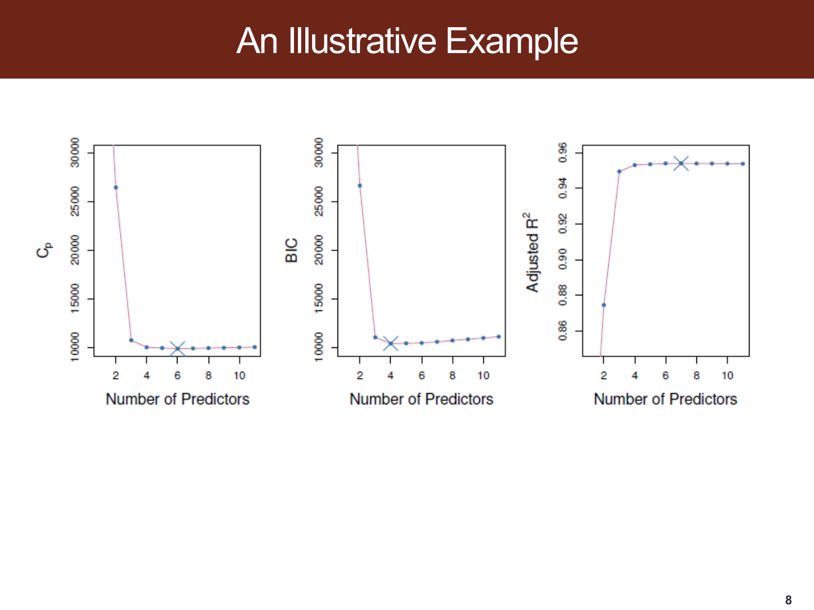


### 2.6 补充算例：BIC 怎样拒绝额外变量

令 $n=100$、固定 $\hat\sigma^2=4$。两模型为：A 有 2 个斜率、RSS=380；B 有 3 个斜率、RSS=370。

| 模型 | $C_p$ | 课件 AIC | 课件 BIC |
|---|---|---|---|
| A | $(380+16)/100=3.96$ | $396/400=0.99$ | $[380+8\log100]/400\approx1.0421$ |
| B | $(370+24)/100=3.94$ | $394/400=0.985$ | $[370+12\log100]/400\approx1.0632$ |

$C_p$/AIC 选 B，BIC 选 A。新增变量降低 10 单位 RSS，超过 AIC 的边际惩罚 $2\hat\sigma^2=8$，却没超过 BIC 的 $\log(100)\hat\sigma^2\approx18.42$。

### 2.7 验证集与交叉验证

验证集法将模型拟合与比较放在不同数据上，直接估计未参与拟合样本的预测损失。K 折 CV 对每个候选复杂度重复训练 K 次，将留出折的损失汇总：

$$CV=\frac1n\sum_{i=1}^n(y_i-\hat f^{(-fold(i))}(x_i))^2.$$

变量选择、标准化、PCA 和任何由数据估计的处理都应在训练折内重做。若先用全部样本找最佳变量，再只对固定变量做 CV，验证折已经参与筛选，会低估整个建模流程的预测误差。

选择超参数之后，可在全部训练数据上重新拟合；最终测试集用于评价，不反复参与调参。需要评价整个选择过程时可另做外层验证/嵌套 CV。时间序列还应采用尊重时间顺序的切分。

<a id="section-3"></a>

## 3. 前向、后向与混合逐步选择

> 对应第 [9](../output/pdf/SDSC5001_Topic5_slides.pdf#page=9)、[10](../output/pdf/SDSC5001_Topic5_slides.pdf#page=10) 页。

### 3.1 前向选择

从 $M_0$ 出发，每一步将每个尚未入选变量分别加到当前模型中，比较 $p-d$ 个候选，保留拟合最好的那个形成 $M_{d+1}$。最后仍要用 CV/信息准则在路径上选择规模，不能默认一直加到最后。

候选拟合数约为 $1+p+(p-1)+\cdots+1=1+p(p+1)/2$，比 $2^p$ 小得多。它只能在已走出的路径上继续：早期错误选择可能令后面错过更好的组合。

### 3.2 后向选择

从完整模型出发，每步尝试删去一个变量，保留删除后表现最好的模型。传统版本要求起始完整模型可以合理拟合；$p\ge n$ 或设计矩阵秩不足时，普通唯一 OLS 起点有问题。

后向选择能在开始时考察变量的联合条件作用，前向选择先考察边际改善；两者都可能因共线性、抑制效应和局部选择而走向不同模型，没有统一的优胜方法。

### 3.3 混合选择与术语

第 9 页把交替加入和删除称为 “Stagewise selection”。本文按课件理解为混合的逐步筛选；其他资料中的 forward stagewise 常特指很小步长的系数更新算法，不能只看词形就认定完全相同。

逐步选择提高计算效率，但不保证找到所有子集中的最优组合。做完筛选后直接套用“模型事先固定”的普通显著性检验，还会忽略选择过程影响。

<a id="section-4"></a>

## 4. 收缩模型、中心化与标准化

> 对应第 [11](../output/pdf/SDSC5001_Topic5_slides.pdf#page=11) 页。

一般目标为

$$\min_{\beta_0,\beta}\sum_{i=1}^n(y_i-\beta_0-x_i^T\beta)^2+\lambda J(\beta).$$

第一项要求贴合样本，第二项限制系数。截距一般不惩罚，否则连响应的整体水平也会被向 0 拉动。

对截距求导可得

$$\hat\beta_0=\bar y-\sum_j\bar x_j\hat\beta_j.$$

令 $y_i^c=y_i-\bar y$、$x_{ij}^c=x_{ij}-\bar x_j$，则只需在中心化数据上估计斜率。预测新样本时再使用训练集均值恢复截距。

**中心化与标准化不同。** 中心化使均值为零；标准化还按训练集标准差缩放。若某变量单位很大，达到同样预测影响所需的系数可能很小，因而受到更轻的系数惩罚。Ridge/Lasso 通常应先统一尺度，让惩罚的比较更合理。

训练时保存 $\mu_j,s_j$，新样本用 $(x_j-\mu_j)/s_j$，不能对测试集另算一套均值和尺度。常量列的标准差为 0，需先处理。


<a id="deep-t5-s4"></a>

### 深入讲解：标准化系数怎样恢复到原单位

若训练时使用 $z_{ij}=(x_{ij}-\mu_j)/s_j$，模型为 $\hat y=a+\sum_j\gamma_jz_j$，展开可得

$$\hat\beta_j=\frac{\gamma_j}{s_j},\qquad
\hat\beta_0=a-\sum_j\frac{\gamma_j\mu_j}{s_j}.$$

**补充手算。**一维特征训练均值为 10、标准差为 2，标准化模型 $\hat y=5+3z$。原尺度斜率为 $3/2=1.5$，截距为 $5-3\times10/2=-10$；新对象 $x=12$ 时两种形式都预测 8。若测试时重新计算均值和标准差，这种等价性就被破坏。

为何缩放影响正则化？因为 $\gamma_j=s_j\beta_j$，标准化空间的 Ridge 惩罚为 $\lambda\sum_j s_j^2\beta_j^2$，Lasso 惩罚为 $\lambda\sum_j s_j|\beta_j|$。这让原单位不同的系数按其带来的预测变化进行较合理的比较。若存在领域指定的惩罚权重，也可以采用其他明确的尺度方案。

还须检查目标函数常数。课件 Lasso 为 $RSS+\lambda\|\beta\|_1$，若另一个实现使用 $RSS/(2n)+\alpha\|\beta\|_1$，对整个目标乘 $2n$ 后得到 $\lambda=2n\alpha$。若 Ridge 实现使用 $RSS+\alpha\|\beta\|_2^2$，则又是另一套换算。比较参数前应把损失和惩罚完整写出。


<a id="ppt-t5-p11"></a>

### PPT 第 11 页逐项讲解：收缩方法与中心化

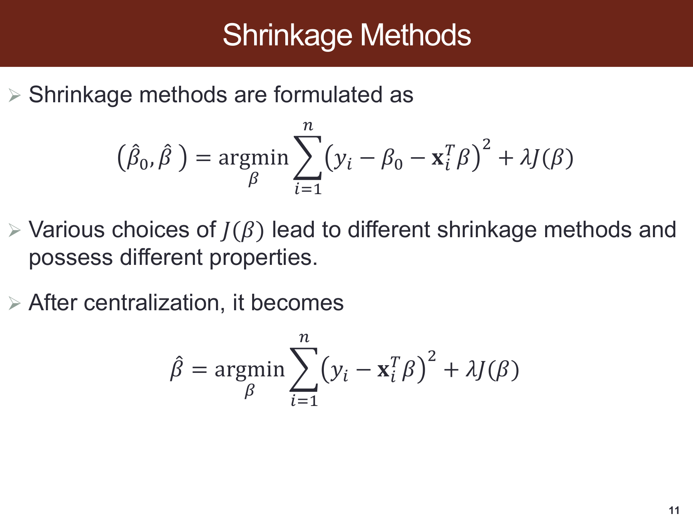

> 原课件：[第 11 页](../output/pdf/SDSC5001_Topic5_slides.pdf#page=11)。截图保留课件原貌，下面按阅读顺序解释；原页简写与笔误以正文核对为准。

**上式保留截距，下式先做中心化。**对截距求导得到 $\hat\beta_0=\bar y-\bar x^T\hat\beta$，代回后可只对中心化的斜率优化。因此下式没有显式截距，不表示预测时忽略整体水平。

**$J(\beta)$ 决定收缩方式。**平方 $L_2$ 给 Ridge，$L_1$ 给 Lasso；前面的 $\lambda$ 在误差与惩罚之间权衡。若损失从总和换成平均，同一数值的 $\lambda$ 强度会不同。

**Centralization 不等于标准化。**本页主要消去均值，正文还需按训练尺度缩放，才能合理比较不同单位的系数惩罚。恢复原单位的公式已在补充手算中给出。


<a id="section-5"></a>

## 5. Ridge 回归：解、收缩与偏差方差

> 对应第 [12](../output/pdf/SDSC5001_Topic5_slides.pdf#page=12)、[13](../output/pdf/SDSC5001_Topic5_slides.pdf#page=13)、[14](../output/pdf/SDSC5001_Topic5_slides.pdf#page=14)、[15](../output/pdf/SDSC5001_Topic5_slides.pdf#page=15) 页。

### 5.1 目标与闭式解

在中心化数据上，课件使用

$$\hat\beta^{ridge}=\arg\min_\beta\{\|y-X\beta\|^2+\lambda\|\beta\|_2^2\}.$$

展开、求导：

$$\nabla Q=-2X^Ty+2X^TX\beta+2\lambda\beta.$$

令其为 0，得到

$$\boxed{\hat\beta^{ridge}=(X^TX+\lambda I_p)^{-1}X^Ty.}$$

当 $\lambda>0$，任意非零 $v$ 都有 $v^T(X^TX+\lambda I)v=\|Xv\|^2+\lambda\|v\|^2>0$，因此可逆，斜率解唯一。这解释了它为什么能缓解共线性以及在 $p>n$ 时仍求出解。

$\lambda=0$ 时退回 OLS 问题；若 $X$ 不满列秩，不能继续直接写 $(X^TX)^{-1}$。$\lambda\to\infty$ 时斜率趋于 0，原尺度预测趋向训练响应均值，而非自动趋向数值 0。

### 5.2 惩罚形式与约束形式

对应约束问题为 $\min RSS$，使 $\|\beta\|_2^2\le s$。某些教材写 $\|\beta\|_2\le t$，只需令 $s=t^2$。

约束更紧通常对应更大的惩罚参数；$s$ 是半径预算，$\lambda$ 是拉格朗日乘子，它们不是简单相等。给定数据与解路径后，才能建立相应对应关系。

### 5.3 补充：SVD 解释 Ridge 的收缩

令紧 SVD 为 $X=UDV^T$，非零奇异值为 $d_j$，则

$$\hat y^{ridge}=U\operatorname{diag}\left(\frac{d_j^2}{d_j^2+\lambda}\right)U^Ty.$$

较小 $d_j$ 方向更不稳定，也受到更强相对收缩；大 $d_j$ 方向保留更多信号。一般设计下，各原始坐标的系数路径可受相关性影响，**不保证每一个系数绝对值都随 $\lambda$ 单调下降**。第 14 页 Rating 路径正提示读者别把整体收缩理解为逐坐标固定比例缩小。

有效自由度可补充写为

$$df(\lambda)=\sum_j\frac{d_j^2}{d_j^2+\lambda}.$$

它随 $\lambda$ 增大而下降，通常不是整数，也不等于“非零系数个数”。

这里计算的是中心化后斜率部分的自由度；若计入另行估计且不惩罚的截距，总有效自由度还应加 1。

### 5.4 偏差、方差与预测误差

在固定 $X$、线性均值正确的条件下：

$$E(\hat\beta^{ridge}\mid X)=(X^TX+\lambda I)^{-1}X^TX\beta,$$

因此相对真实 $\beta$ 的偏差为 $-\lambda(X^TX+\lambda I)^{-1}\beta$。其协方差为

$$\sigma^2(X^TX+\lambda I)^{-1}X^TX(X^TX+\lambda I)^{-1}.$$

收缩引入偏差，同时减少不稳定估计的方差。在合适 $\lambda$ 下，总 MSE 可比 OLS 小；并非任意 $\lambda>0$ 都更好。

新点预测误差的经典分解为

$$E[(Y_0-\hat f(x_0))^2]=\sigma^2+Bias^2[\hat f(x_0)]+Var[\hat f(x_0)],$$

这里假设新噪声独立、条件均值和方差适当定义。第 15 页平方误差分解中的黑线应理解为平方偏差贡献，绿线是方差，粉紫线为测试 MSE；不可约误差提供底限。

*课件第 14～15 页：系数路径与偏差方差*

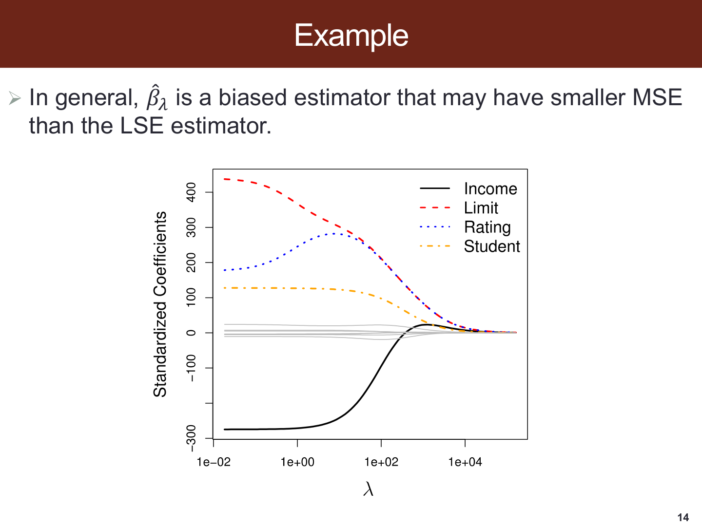

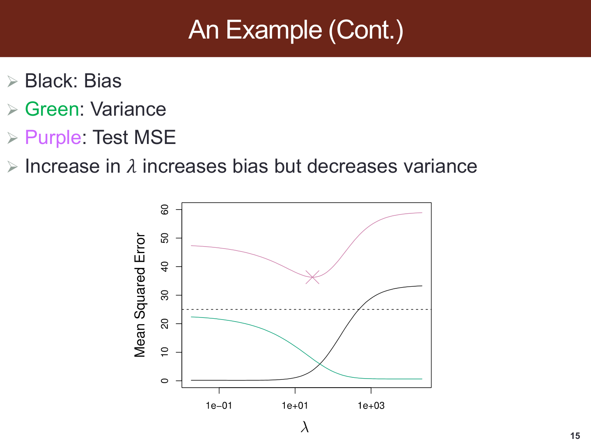


### 5.5 Ridge 是否做变量选择

Ridge 通常把系数拉近 0，却不会系统地令一批系数恰好为 0。特殊数据结构可以产生零系数，因此准确说法是“Ridge 不以稀疏化为主要机制”，而不是“任何系数永远不可能为零”。

当很多弱信号共同贡献预测，或相关变量希望一起保留时，Ridge 常值得考虑。最终效果仍应通过验证比较。


<a id="ext-t5-ridge_df"></a>

### 外部拓展：Ridge 没删变量，为什么有效自由度仍会下降

**课内衔接：**[本章第 5 节](#section-5) · [原课件第 12 页](../output/pdf/SDSC5001_Topic5_slides.pdf#page=12)

**外部拓展｜把收缩与“模型复杂度”连接起来。**先中心化数据，截距不参与惩罚。X 是 n×p 特征矩阵，y 是 n 维中心化响应，目标为 $\|y-X\beta\|^2+\lambda\|\beta\|^2$，λ≥0。β 为 p 维系数。

令 X 的紧致奇异值分解为 $X=UDV^T$：秩 r 个非零奇异值为 d_j，D 为 r×r 对角矩阵，U、V 的列正交。拟合向量可写成

$$\hat y=S_\lambda y,\quad
S_\lambda=U\operatorname{diag}\left(\frac{d_j^2}{d_j^2+\lambda}\right)U^T,\quad
df(\lambda)=\operatorname{tr}(S_\lambda)=\sum_{j=1}^{r}\frac{d_j^2}{d_j^2+\lambda}.$$

S 是 n×n 线性平滑矩阵，diag 把 r 个收缩因子放在对角线上，tr 是矩阵对角项之和。df 描述拟合值对响应扰动的总敏感度，通常可为非整数，不等于非零系数个数。该定义针对固定 λ 的线性拟合；如果 λ 由数据选择，还包含额外选择效应。

**自编手算。**三个平方奇异值为 9、1、0.1，λ=1 时，三个方向分别保留 0.9、0.5、0.0909，有效自由度为 1.4909；未惩罚截距若单独拟合，总自由度再加 1。λ→0 时斜率部分趋于 r，λ→∞ 时趋于 0。

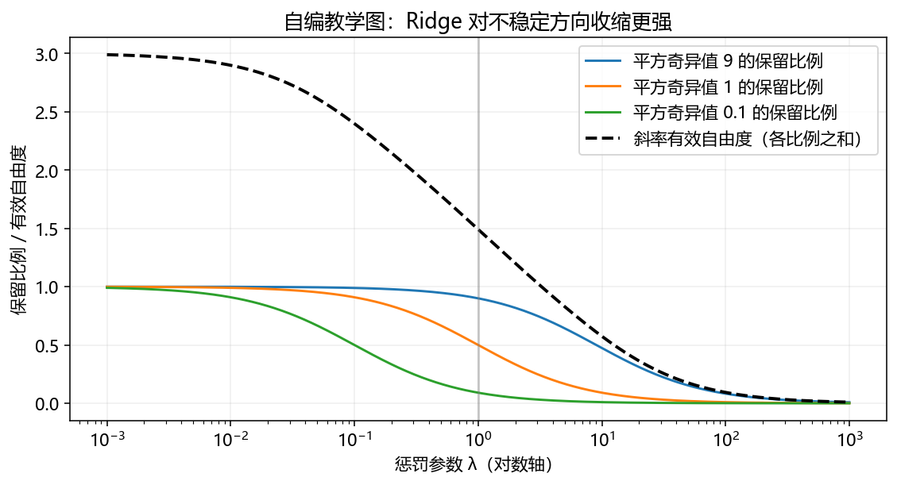

**读图。**横轴用对数尺度表示 λ，纵轴同时给出三个方向的保留比例与它们的和。最小奇异值方向先被压缩，这对应原模型最不稳定的方向；不能把每条曲线当作某个原始变量的单独系数路径。

**连接 Topic 7。**平滑样条同样可以用平滑矩阵的迹度量复杂度；惩罚增大通常降低对训练响应的追随程度，但具体极限取决于哪些方向未受惩罚。

**外部来源与阅读定位：**[scikit-learn：Ridge 的目标与奇异值分解](https://scikit-learn.org/stable/modules/linear_model.html#ridge-regression-and-classification)。本文推导与自编算例用于解释相应方法，不冒充来源中的实验结果。

<a id="section-6"></a>

## 6. Lasso、稀疏几何与系数路径

> 对应第 [16](../output/pdf/SDSC5001_Topic5_slides.pdf#page=16)、[17](../output/pdf/SDSC5001_Topic5_slides.pdf#page=17)、[18](../output/pdf/SDSC5001_Topic5_slides.pdf#page=18)、[19](../output/pdf/SDSC5001_Topic5_slides.pdf#page=19)、[20](../output/pdf/SDSC5001_Topic5_slides.pdf#page=20) 页。

### 6.1 定义与优化

课件目标为

$$\hat\beta^{lasso}=\arg\min_\beta\{\|y-X\beta\|^2+\lambda\|\beta\|_1\},\quad\|\beta\|_1=\sum_j|\beta_j|.$$

约束形式为 $\min RSS$，使 $\|\beta\|_1\le s$。目标是凸的，但绝对值在 0 不可导，需要次梯度或适合的算法。一般没有像 Ridge 那样的统一矩阵闭式解，常用坐标下降、LARS 或 QP 等方法。

### 6.2 为什么会出现恰好为零的系数

二维下，$L_1$ 约束是菱形，角落落在坐标轴上；RSS 等高线向外扩展，与约束域首次相切时，较容易碰到角落，产生一个或多个零坐标。$L_2$ 约束边界光滑，通常产生非零坐标。

几何图解释倾向，不保证每次一定碰角落。更严格的补充条件，令 $r=y-X\hat\beta$，课件目标的 KKT 条件是

$$2x_j^Tr=\lambda\operatorname{sign}(\hat\beta_j)\quad(\hat\beta_j\ne0),$$

$$|2x_j^Tr|\le\lambda\quad(\hat\beta_j=0).$$

因为绝对值在零点的次梯度为整个区间 $[-1,1]$，一定范围内的残差相关可以由零系数满足最优条件。

*课件第 17 页：Lasso 菱形与 Ridge 圆形约束*

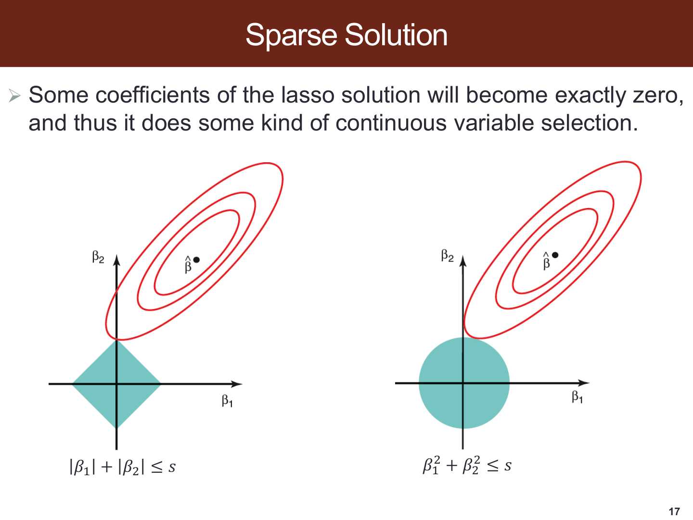


### 6.3 前列腺癌示例的读法

第 18 页列 8 个临床预测变量和响应 `lpsa`。第 19 页左为 Ridge、右为 Lasso 的系数路径。

原页的输入列名依次为 `lcavol`、`lweight`、`age`、`lbph`、`svi`、`lcp`、`gleason`、`pgg45`；输出列为 `lpsa`。课件把输入概括为临床测量，把输出概括为前列腺特异性抗原水平。这一例用连续响应比较回归系数路径。

每条线对应一个变量。左图横轴为 $df(\lambda)$，向右表示复杂度增加、通常是正则化变弱；右图横轴为收缩预算比例 $s$，向右同样放宽约束。**它们不是统一的“向右 $\lambda$ 增大”坐标。**

Ridge 路径较密集地离开零附近，Lasso 在较紧约束时仍有多条线留在零轴。虚线标出示例中的某个选择位置，课件未给出足以重建全部调参过程的数据，不能据图编造 CV 误差或变量的统计显著性。

*课件第 19 页：Ridge 与 Lasso 的路径*

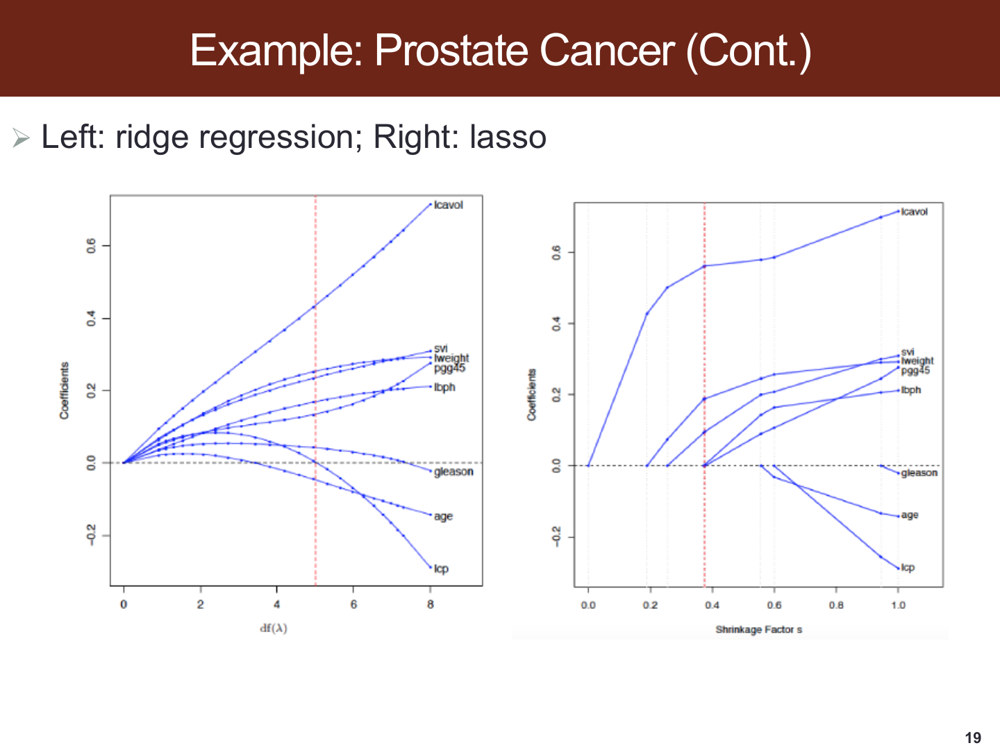


### 6.4 与 Ridge 的比较

两者都能以一定偏差换稳定性，Lasso 额外提供变量筛选与较稀疏解释。相关变量很强时，Lasso 的选择可能不稳定；Ridge 通常更平滑地共享系数权重。

真关系很稀疏时 Lasso 可能适合，很多变量都有作用时 Ridge 可能适合，但这只是建模依据。第 20 页明确指出预测精度没有普遍优胜者。


<a id="deep-t5-s6"></a>

### 深入讲解：一般设计下 Lasso 的一次坐标更新

正交例子有闭式解，一般设计可逐个系数更新。固定除第 $j$ 项以外的系数，定义部分残差

$$r_j=y-\sum_{k\ne j}x_k\beta_k.$$

注意它没有扣掉第 $j$ 项。需要最小化 $\|r_j-x_jb\|^2+\lambda|b|$。令 $a_j=x_j^Tx_j>0$、$c_j=x_j^Tr_j$，展开后只与 $b$ 有关的部分为 $a_jb^2-2c_jb+\lambda|b|$，于是

$$\beta_j^{new}=\frac{S(c_j,\lambda/2)}{a_j},\qquad
S(c,t)=\operatorname{sign}(c)(|c|-t)_+.$$

**补充手算。**若 $x_j^Tx_j=4$、$x_j^Tr_j=3$、$\lambda=2$，则更新为 $(3-1)/4=0.5$。若部分残差相关改为 0.8，因为 $|0.8|\le1$，本轮系数更新为 0。零系数来自次梯度可行区间，并非最后随便把小数截断。

完成一项后要更新相应残差，再循环其他坐标，直到目标或最优性条件满足容差。相关变量会改变彼此的部分残差，所以一轮更新通常不够，也解释了某个系数为何会在路径上进出模型。

若两列完全相同，目标有时只确定它们的系数之和，Lasso 系数可能不唯一，但拟合值仍可相同。不能把一次求解中被保留的那一列直接解释为“唯一真正重要变量”；应检查变量定义、相关结构及重采样下选择稳定性。


<a id="section-7"></a>

## 7. 正交特例：推导 Ridge 与 Lasso

> 对应第 [21](../output/pdf/SDSC5001_Topic5_slides.pdf#page=21) 页。该页设 $n=p$、$X=I_p$，视为无截距的独立代数例子；它不是同时要求前面所有中心化条件的实际设计。

### 7.1 Ridge 是比例收缩

此时 OLS 解为 $\hat\beta_j^{OLS}=y_j$，每维独立优化 $(y_j-b)^2+\lambda b^2$。求导得

$$2(b-y_j)+2\lambda b=0,\qquad\boxed{\hat\beta_j^{ridge}=\frac{y_j}{1+\lambda}.}$$

只有在这种正交同尺度特例下，各坐标共享相同比例。更一般 $X^TX=\operatorname{diag}(a_j)$ 时，比例为 $a_j/(a_j+\lambda)$。

### 7.2 Lasso 是软阈值

每维优化 $q(b)=(y_j-b)^2+\lambda|b|$。分三种情况：

1. 若 $b>0$，求导得 $b=y_j-\lambda/2$，要求 $y_j>\lambda/2$。
2. 若 $b<0$，得 $b=y_j+\lambda/2$，要求 $y_j<-\lambda/2$。
3. 若 $|y_j|\le\lambda/2$，零点满足次梯度最优条件。

合并为

$$\boxed{\hat\beta_j^{lasso}=\operatorname{sign}(y_j)(|y_j|-\lambda/2)_+.}$$

软阈值既会把小值清零，也会把保留的大值往零方向减去常量。它与“只要不清零就完全不改变”的硬阈值不同。

### 7.3 同一算例比较

取 $y=(3,0.4,-2)^T$、课件目标下 $\lambda=2$：

| 方法 | 解 |
|---|---|
| OLS | $(3,0.4,-2)$ |
| Ridge | $(1,0.1333,-0.6667)$ |
| Lasso | $(2,0,-1)$ |

若把 Lasso 换成 $\frac12RSS+\lambda\|\beta\|_1$，阈值变为 $\lambda$；换成软件常见 $\frac1{2n}RSS+\alpha\|\beta\|_1$，在 $X^TX=I$ 的本例阈值为 $n\alpha$。必须检查设计矩阵尺度和损失归一化。

<a id="section-8"></a>

## 8. Bridge 惩罚与非负 Garrote

> 对应第 [22](../output/pdf/SDSC5001_Topic5_slides.pdf#page=22)、[23](../output/pdf/SDSC5001_Topic5_slides.pdf#page=23)、[24](../output/pdf/SDSC5001_Topic5_slides.pdf#page=24) 页。

### 8.1 Bridge 的统一形式

对有限 $r>0$，课件定义 $L_r(\beta)=\sum_j|\beta_j|^r$，并最小化 $RSS+\lambda L_r(\beta)$。这里 $L_r$ 是惩罚记号，未必等于通常范数本身：例如 $L_2$ 是平方范数。

| 情况 | 特性 |
|---|---|
| $r=0$，按非零计数定义 | $\lVert\beta\rVert_0=\#\{j:\beta_j\ne0\}$，组合选择 |
| $0<r<1$ | 非凸，零附近促进稀疏，同时增加优化难度 |
| $r=1$ | Lasso，凸且零点不光滑 |
| $r=2$ | Ridge，光滑凸惩罚 |
| $r>2$ | 更强约束大系数，边界形状变化 |

标准 $L_\infty$ 范数为 $\max_j|\beta_j|$。第 22 页写作 $\max_j\beta_j$，漏了绝对值；不能照这个式子作为无穷范数定义。有限 $r$ 的和式若要取 $r\to\infty$ 得到最大范数，还需取 $1/r$ 次方，不能直接对未经开方的和式取极限。

第 23 页展示 $r>2$、$r=2$、$r=1$、$r<1$ 的约束形状。$0<r<1$ 的集合非凸，多个局部最优可能使结果依赖算法与初始化。

### 8.2 补充：$L_0$ 与硬阈值

在 $X=I$ 下，每维比较非零解 $b=y$ 的成本 $\lambda$ 与零解的成本 $y^2$：若 $|y|>\sqrt\lambda$，保留 $b=y$；若小于阈值，令 $b=0$；等号处两者并列。

这正是硬阈值。一般相关设计下，$L_0$ 问题不能直接逐坐标硬阈值 OLS，而要处理变量组合。

### 8.3 Nonnegative Garrote 的思路

先取得初始估计 $\tilde\beta$，再给每个系数一个非负乘子 $c_j$：

$$\min_{c_j\ge0}\frac12\left\|y-\sum_jc_j\tilde\beta_jx_j\right\|^2+\lambda\sum_jc_j,\qquad\hat\beta_j^{NG}=\hat c_j\tilde\beta_j.$$

$c_j\ge0$ 表示不会把初始系数翻转符号，并不表示最终系数都非负。若初始系数为 0，相乘后也无法重新激活；方法依赖初始估计，传统 OLS 初始值在高维下还需要另行处理。

### 8.4 第 24 页公式的条件与常数

课件给出 $\hat\beta_j^{NG}=(1-\lambda/(2\tilde\beta_j^2))_+\tilde\beta_j$，但这类逐坐标解只在正交等特殊设计下成立；一般设计不能直接这么算。

以 $X=I$、$\tilde\beta_j=y_j$ 为例，按本页写出的 $\frac12RSS$ 目标，每维求导为

$$\frac{\partial Q}{\partial c_j}=y_j^2(c_j-1)+\lambda.$$

因此一致的解应为

$$\boxed{\hat\beta_j^{NG}=\left(1-\frac{\lambda}{y_j^2}\right)_+y_j.}$$

该式按 $y_j\ne0$ 写出；$y_j=0$ 时初始系数为 0，最终系数直接为 0，不代入分母。

若目标没有前面的 $1/2$，才会得到分母 $2y_j^2$。这说明课件该页的目标和解相差一个参数缩放；记录两种约定，避免无声更改公式。

大系数上的改变量约为 $\lambda/y_j$，比 Lasso 的常量偏移更小；小系数则可清零。“大系数近乎无偏”是这种性质的直观说法，不能当成任意样本下严格无偏的定理。

<a id="section-9"></a>

## 9. Group Lasso、Elastic Net 与 Fused Lasso

> 对应第 [25](../output/pdf/SDSC5001_Topic5_slides.pdf#page=25) 页。这页写得很紧凑，以下按惩罚对象逐项展开。

### 9.1 Group Lasso：整组选择

将变量分为 $G$ 组，系数子向量为 $\beta_g$：

$$\min_\beta\frac12\|y-X\beta\|^2+\lambda\sum_{g=1}^G\|\beta_g\|_2.$$

组内使用 $L_2$ 范数，组间求和促进整个组归零。它通常不在已经保留的组内继续产生大量坐标稀疏；若需要组间和组内同时筛选，需额外稀疏惩罚。

例如分类变量的一组虚拟变量、某个原始量的多项式基函数，可作为一组统一决定是否保留。实际常用 $w_g$ 校正组规模，写成 $\sum_gw_g\|\beta_g\|_2$，这是补充形式。课件把组数称为 $J$，公式上限却仍写 $p$；本文以 $G$ 统一，求和应遍历各组。

### 9.2 Elastic Net：同时施加 $L_1$ 和平方 $L_2$

$$\min_\beta\frac12\|y-X\beta\|^2+\lambda_1\|\beta\|_1+\lambda_2\|\beta\|_2^2.$$

$L_1$ 保留稀疏机制，平方 $L_2$ 改善相关变量下的稳定性，并使相关变量更可能一起进入模型。若 $\lambda_2>0$，系数目标严格凸，能解决纯 Lasso 在某些秩不足设计下的多解问题。

两个极端分别退回 Lasso 与 Ridge 的相应损失缩放形式。软件常用总强度和混合比例重新参数化，不能把 `l1_ratio` 直接当 $\lambda_1$。

### 9.3 Fused Lasso：鼓励相邻系数相同

课件给出的形式为

$$\min_\beta\frac12\|y-X\beta\|^2+\lambda\sum_{j=2}^p|\beta_j-\beta_{j-1}|.$$

惩罚对象是相邻差，因此希望形成相邻相等、分段平坦的系数。这里的相邻必须具有实际顺序意义，不能任意重排变量后还当成同一个问题。

只惩罚差分，不必把整体水平拉到 0。例如所有系数相等时差分惩罚为 0，即使它们都很大。更一般的 fused lasso 还会加 $\lambda_1\|\beta\|_1$，同时鼓励系数稀疏与相邻融合；课件列出的则是仅差分版本。


<a id="ext-t5-elastic"></a>

### 外部拓展：Elastic Net 的分组效应：先从两列完全相同的特例推导

**课内衔接：**[本章第 9 节](#section-9) · [原课件第 25 页](../output/pdf/SDSC5001_Topic5_slides.pdf#page=25)

**外部拓展｜连接 Lasso 与共线性。**使用中心化数据并固定目标约定：

$$\frac1{2n}\|y-X\beta\|^2+\lambda_1\sum_{j=1}^p|\beta_j|
+\frac{\lambda_2}{2}\sum_{j=1}^p\beta_j^2.$$

n 为样本数，p 为变量数，λ₁≥0 控制稀疏惩罚，λ₂>0 控制平方惩罚，截距已通过中心化处理。这里使用两个独立系数，不能直接拿数值去替换其他软件中 λ 与 α 的另一套记法。

**自编特例。**若两列完全一样 $x_1=x_2$，固定其余系数后，预测只取决于 $s=\beta_1+\beta_2$。当 s>0，取 β₁、β₂ 非负且和为 s，L1 惩罚恒为 λ₁s：Lasso 对 [s,0]、[s/2,s/2] 等很多分配并不区分。

平方项则满足

$$\beta_1^2+\beta_2^2=\frac{s^2}{2}+\frac{(\beta_1-\beta_2)^2}{2}.$$

右侧第一项由总和固定，第二项在 β₁=β₂ 时最小。故加入正的 L2 惩罚后，这两列会均分系数。自编数值：s=2 时，[2,0] 的平方和为 4，[1,1] 为 2；预测和 L1 相同，平方惩罚偏好后者。

对高度相关但不完全相同的变量，作者原文研究了相应分组倾向；特例帮助理解机制，却不能推出所有相关变量都严格同进同出。标准化方式、响应关系和调参都会影响结果。

**解释边界。**一组代理变量共同入模，不等于识别了多个独立因果来源。要比较预测、选择稳定性与测量成本；如果目标是按先验给定的变量组整体选择，则还应区分 Group Lasso 的组惩罚。

**外部来源与阅读定位：**[Zou 与 Hastie：Elastic Net 原文，第 2 节](https://web.stanford.edu/~hastie/Papers/elasticnet.pdf#page=5)。本文推导与自编算例用于解释相应方法，不冒充来源中的实验结果。

<a id="section-10"></a>

## 10. PCA：最大方差方向与特征分解

> 对应第 [26](../output/pdf/SDSC5001_Topic5_slides.pdf#page=26)、[27](../output/pdf/SDSC5001_Topic5_slides.pdf#page=27)、[28](../output/pdf/SDSC5001_Topic5_slides.pdf#page=28) 页。

### 10.1 问题定义

设随机向量 $X$ 已中心化、协方差为 $\Sigma$。沿单位方向 $a$ 投影得 $U=a^TX$，其方差为

$$Var(U)=a^T\Sigma a.$$

单位长度约束不可缺少，否则把 $a$ 成倍放大就能任意增大方差。第一主成分找 $\max_{a^Ta=1}a^T\Sigma a$，后续再找与前面成分不相关的最大方差方向。

第 27 页散点中，沿点云伸展方向的投影变异最大，垂直方向变异较小。PCA 拟合的是 $X$ 的分布结构，不是把某一横轴变量回归到纵轴变量的普通回归线。

### 10.2 补充推导：为什么是特征向量

拉格朗日函数 $\mathcal L=a^T\Sigma a-\ell(a^Ta-1)$，对 $a$ 求导得 $\Sigma a=\ell a$。在单位特征向量上，投影方差就是对应特征值。

令 $\ell_1\ge\ell_2\ge\cdots\ge\ell_p\ge0$，相应正交单位特征向量为 $e_j$，则

$$U_j=e_j^TX,\quad Var(U_j)=\ell_j,\quad Cov(U_j,U_l)=0\ (j\ne l).$$

相同特征值对应的子空间内，单个主方向可不唯一；特征向量整体换符号也不改变主成分子空间。**不相关一般不意味着独立**，除非再有联合高斯等条件。

### 10.3 解释方差与选维数

第 $j$ 成分解释方差比例为 $\ell_j/\sum_l\ell_l$。给定 $0<\alpha<1$，取满足

$$\frac{\sum_{j=1}^k\ell_j}{\sum_{j=1}^p\ell_j}\ge\alpha$$

的最小 $k$。若特征值为 $(9,3,2,1)$，总方差 15，前两项 80%，前三项约 93.33%；以 90% 为门槛选 3 维。

这是保存 $X$ 方差的规则，不能保证保存同样比例的响应预测信息。PCR 的维数更应按预测 CV 选择。

### 10.4 样本实现与标准化

中心化样本矩阵的样本协方差 $S=X^TX/(n-1)$，载荷向量 $q_j$ 是 $S$ 的单位特征向量，样本得分 $z_j=Xq_j$。载荷有 $p$ 个元素，得分有 $n$ 个元素，两者维数不同。

若不同变量单位、量级差异很大，按协方差做 PCA 可能主要捕捉大尺度变量。标准化后相当于基于相关结构比较，但是否标准化仍取决于变量量纲的科学含义。所有拟合都放在训练数据内完成。


<a id="deep-t5-s10"></a>

### 深入讲解：从二维协方差矩阵手算 PCA

**补充算例。**设已中心化变量的协方差矩阵为

$$\Sigma=\begin{pmatrix}4&3\\3&4\end{pmatrix}.$$

解特征方程 $(4-\lambda)^2-9=0$，得到 $\lambda_1=7$、$\lambda_2=1$。对应单位方向可取 $q_1=(1,1)^T/\sqrt2$、$q_2=(1,-1)^T/\sqrt2$，所以第一主成分保留 $7/(7+1)=87.5\%$ 的总方差。

一个中心化对象 $x=(2,0)^T$ 的得分为 $z_1=q_1^Tx=\sqrt2$、$z_2=q_2^Tx=\sqrt2$。若只保留第一项，重构为

$$\hat x=q_1z_1=(1,1)^T,\qquad
x-\hat x=(1,-1)^T.$$

单个对象重构平方误差为 2。总体平均的丢弃方向方差则为 $\lambda_2=1$，两者不是同一个量；个体误差不必恰等于总体平均损失。

把 $q_1$ 改成 $-q_1$ 时，得分同时变号，但 $q_1z_1$ 不变，所以不同软件载荷符号相反不一定表示结果有错。若特征值相同，对应特征子空间内的基还可以旋转，也不能只按逐项载荷比较。

最后区分三件事：载荷是方向，得分是对象在方向上的坐标，解释方差比例是该方向保留的输入变异。87.5% 不是分类准确率，也不是对 $Y$ 的解释比例。PCR 还需下一步把得分与响应建立关系。


<a id="ppt-t5-p28"></a>

### PPT 第 28 页逐项讲解：PCA 的特征值、载荷与解释方差

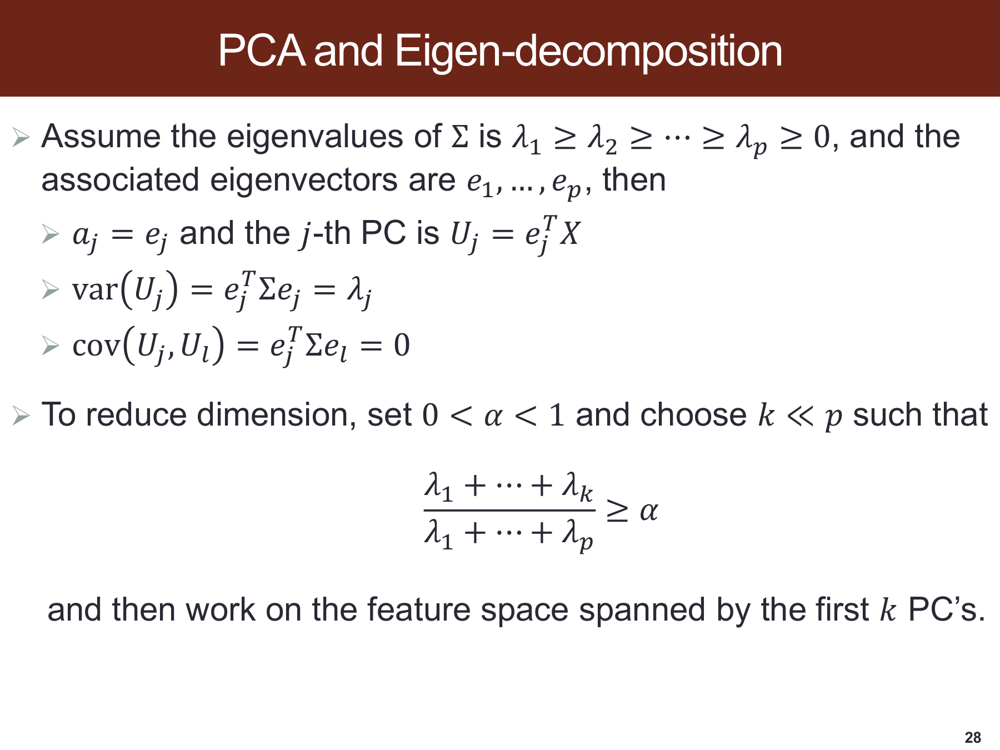

> 原课件：[第 28 页](../output/pdf/SDSC5001_Topic5_slides.pdf#page=28)。截图保留课件原貌，下面按阅读顺序解释；原页简写与笔误以正文核对为准。

**先按特征值从大到小排列方向。**第 $j$ 个得分是 $e_j^TX$，其方差为 $\lambda_j$；不同主成分协方差为零。零相关通常不等于独立，除非再有合适分布条件。

**底部不等式决定保留多少输入变异。**分子是前 $k$ 个方向的方差，分母是总方差。阈值 $\alpha$ 在这一页是保留比例，与正则化软件中的惩罚参数同名但含义不同。

**沿二维算例核对。**$7,1$ 的特征值给出 87.5% 的第一方向保留比例，但它没有使用响应，所以不能由此推出 PCR 预测也保留 87.5% 的有效信号。


<a id="section-11"></a>

## 11. Projection Pursuit：寻找非正态结构

> 对应第 [29](../output/pdf/SDSC5001_Topic5_slides.pdf#page=29)、[30](../output/pdf/SDSC5001_Topic5_slides.pdf#page=30) 页。第 30 页仅有标题。

### 11.1 为什么最大方差可能错过有趣结构

课件令 $X_1\sim N(0,100)$；$X_2$ 以等概率来自均值为 $+1$ 或 $-1$、条件方差为 $0.01$ 的两群。在补充假设二者不相关时，$Var(X_2)=1+0.01=1.01$。

未经标准化的 PCA 会优先选方差为 100 的 $X_1$，但 $X_2$ 的双峰结构可能更有利于识别群体。“有信息”在此指暴露非高斯/分群结构，并非课件已给定一个响应 $Y$ 并证明预测最优。

### 11.2 PP 的目标与投影指标

Projection Pursuit 搜索让投影指标较大的方向：

$$\hat a=\arg\max_{a\in\mathcal A}I(a^TX).$$

第 29 页简写了约束；实际应固定方向尺度，常在标准化/白化数据上取单位向量，或选择尺度不变指标。否则某些指标可仅靠放大 $a$ 改变数值。

课件的指标包括 $I_1(z)=|\kappa_m(z)|/\kappa_2(z)^{m/2}$，以及 $I_2(z)=\kappa_3(z)^2+\kappa_4(z)^2/4$，后者须结合标准化来理解尺度。其中 $\kappa_m$ 为第 $m$ 阶累积量，

$$\kappa_2=Var(z),\quad\kappa_3=E[(z-Ez)^3],\quad\kappa_4=E[(z-Ez)^4]-3Var(z)^2.$$

高斯分布三阶及更高阶累积量为 0。用四阶累积量时要减去 $3Var^2$，不能把原始四阶矩当作高斯下为 0 的量。对称双峰的偏度也可为 0，因此只看三阶指标可能错过它。

PCA 最大化方差，PP 这里最大化非正态性，它们关注的结构不同。PP 在课件此处是无监督投影思想，不能直接等同于有响应的投影寻踪回归。

<a id="section-12"></a>

## 12. PCR：在主成分上做回归

> 对应第 [31](../output/pdf/SDSC5001_Topic5_slides.pdf#page=31)、[32](../output/pdf/SDSC5001_Topic5_slides.pdf#page=32)、[33](../output/pdf/SDSC5001_Topic5_slides.pdf#page=33) 页。

### 12.1 算法与正确系数

对训练预测变量中心化并按需要标准化，做 PCA 得载荷 $q_1,\ldots,q_K$，构造 $Z=XQ_K$，再拟合 $y=Z\gamma+\epsilon$。

由于 $Z$ 各列正交，中心化响应 $y_c$ 的回归系数是

$$\boxed{\hat\gamma_j=\frac{z_j^Ty_c}{z_j^Tz_j}.}$$

因此

$$\hat y^{PCR}=\bar y\mathbf1+\sum_{j=1}^K\hat\gamma_jz_j,\qquad\hat\beta^{PCR}=Q_K\hat\gamma.$$

第 31 页把 $\hat\gamma_j$ 称为 correlation coefficient；通常这里应是**回归斜率**。相关系数与斜率满足 $\hat\gamma_j=r(y,z_j)s_y/s_{z_j}$，只有适当标准化后才数值相同。

### 12.2 为什么能缓解共线性

主成分彼此正交，回归不再直接使用强相关的原始变量。截取前 $K$ 个成分，丢掉某些小方差、估计不稳定的方向，从而降低方差。

然而载荷通常混合许多原始变量，$\hat\beta=Q_K\hat\gamma$ 通常仍是稠密向量。PCR 选择的是方向数量，并没有一般意义上筛掉原始变量。

### 12.3 PCR 与 Ridge 的 SVD 比较

若 $X=UDV^T$，PCR 的拟合为 $\hat y^{PCR}=U_KU_K^Ty_c$。它保留前 $K$ 个奇异方向、将其余方向完全删除，是对方向的硬截断。

Ridge 对方向乘 $d_j^2/(d_j^2+\lambda)$，是连续收缩。二者都偏向稳定的大方差方向，但截断与平滑收缩不同，预测效果要依赖信号分布。

### 12.4 低方差方向也可能是预测关键

**补充反例：** 若 $X_1$ 方差 100、$X_2$ 方差 1、两者不相关，而 $Y=X_2+\epsilon$，只取第一主成分就保留 $X_1$，会丢掉有用信号。

所以 PCR 成功需要前几个 PC 同时捕捉主要 $X$ 变异和与 $Y$ 的关系。第 32 页两种模拟中的最优主成分数不同，说明不存在普遍有效的固定保留数量。

*课件第 32 页：成分数改变偏差、方差与测试误差*

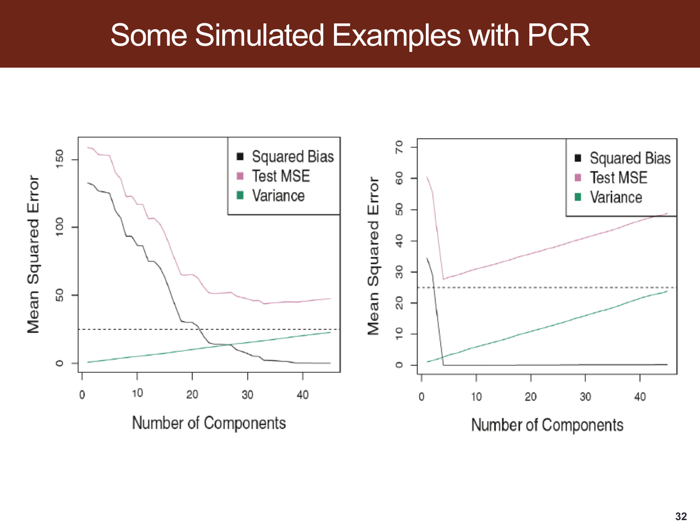


### 12.5 选择成分数与恢复 OLS 的条件

$K$ 通常由 CV 选择，且每折内重做标准化、PCA 和回归。最终模型使用训练集学得的载荷投影新样本，不可对测试集重新做 PCA。

若保留全部非零奇异值对应的方向，PCR 恢复 OLS 的投影拟合值；只有在满列秩等条件下，才谈得上与唯一 OLS 系数完全一致。$p>n$ 或秩不足时，不能机械说“取 $K=p$ 就恢复唯一 OLS”。

<a id="section-13"></a>

## 13. PLS：利用响应构造降维方向

> 对应第 [34](../output/pdf/SDSC5001_Topic5_slides.pdf#page=34)、[35](../output/pdf/SDSC5001_Topic5_slides.pdf#page=35)、[36](../output/pdf/SDSC5001_Topic5_slides.pdf#page=36) 页。

### 13.1 与 PCR 的区别

PCR 构造方向时只看 $X$，之后才用 $y$ 回归；PLS 从构造方向时就利用 $X$ 和 $y$，倾向保留与响应相关的变化。因此 PCR 的同一套 PC 载荷可以服务不同响应，而 PLS 方向通常随响应改变。

利用 $y$ 不意味着必然优于 PCR，也使避免数据泄漏更重要：验证折的响应不能参与方向学习。

### 13.2 第一方向：课件的逐步构造

设 $y$ 和各预测列已中心化。先分别做 $y$ 对 $x_j$ 的单变量回归，斜率为

$$\gamma_j=\frac{x_j^Ty}{x_j^Tx_j}.$$

构造得分 $z_1=\sum_j\gamma_jx_j=X\gamma$。若各列已标准化为相同平方长度，$\gamma$ 与 $X^Ty$ 成比例，即较强的单变量响应关联在方向中获得较大权重。

再回归 $y$ 对 $z_1$，得到 $b_1=z_1^Ty/(z_1^Tz_1)$，对应响应残差 $r_1=y-b_1z_1$。对每个预测列做残差化：

$$\theta_j=\frac{z_1^Tx_j}{z_1^Tz_1},\qquad x_j^*=x_j-\theta_jz_1.$$

于是 $z_1^Tx_j^*=0$，下一方向不会重复第一方向已解释的预测列成分。随后用 $r_1$ 与残差化预测变量继续构造下一方向。

### 13.3 补充：简化的迭代记法

令 $X^{(0)}=X$、$r^{(0)}=y$。第 $m$ 步按课件思想计算各残差列对当前响应残差的单变量斜率组成 $w_m$，并设

$$t_m=X^{(m-1)}w_m,\qquad b_m=\frac{t_m^Tr^{(m-1)}}{t_m^Tt_m},$$

$$p_m=\frac{(X^{(m-1)})^Tt_m}{t_m^Tt_m},$$

$$r^{(m)}=r^{(m-1)}-b_mt_m,\qquad X^{(m)}=X^{(m-1)}-t_mp_m^T.$$

得分长度为零时应停止，不能继续除以零。PLS 有不同归一化和算法版本，以上用于解释课件的 deflation 思路，不宣称任意软件输出都逐项采用同一权重数值。

### 13.4 成分数、秩与预测

采用少量 PLS 得分回归实现监督降维，$K$ 仍由 CV 选择。方向多了拟合更灵活，也可能引入噪声。

课件说取 $K=p$ 得到 OLS，应补上独立方向存在、设计秩足够和算法未提前退化等条件。更稳妥的表述是：当所构造的得分完整张成 $X$ 的列空间时，能恢复 OLS 投影拟合；在秩不足情形系数未必唯一。

### 13.5 第 36 页的读图方式

图中 PC 与 PLS 第一方向不同，原因是它们使用的信息不同：PC 优先保留预测变量变化，PLS 还考虑响应关联。图不能证明 PLS 在所有数据上预测误差更小。

*课件第 36 页：PC 与 PLS 的第一方向*

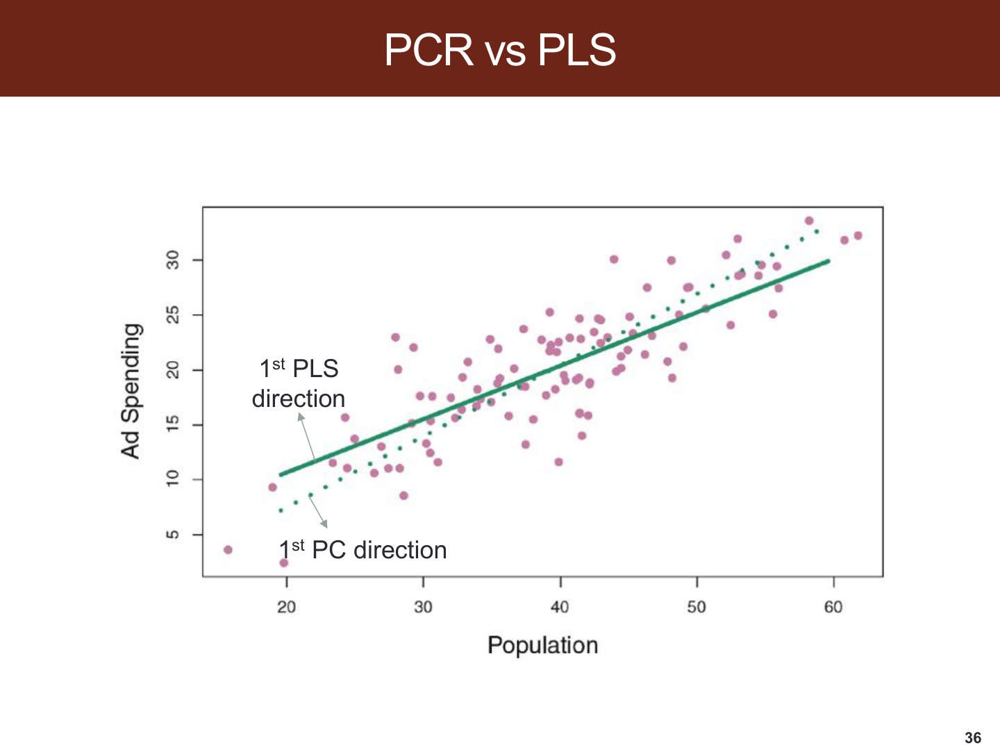


<a id="deep-t5-s13"></a>

### 深入讲解：两条观测完整演示 PLS 得分与残差化

**补充代数算例。**取已中心化的两列 $x_1=(-1,1)^T$、$x_2=(-1,1)^T$，响应 $y=(-2,2)^T$。按本节课件的单变量斜率构造：

$$\gamma_1=\gamma_2=\frac{x_j^Ty}{x_j^Tx_j}=\frac42=2,$$

$$z_1=2x_1+2x_2=(-4,4)^T.$$

再将 $y$ 对 $z_1$ 回归，得 $b_1=(z_1^Ty)/(z_1^Tz_1)=16/32=1/2$，所以 $\hat y=b_1z_1=y$，响应残差为 0。

每列的得分载荷 $\theta_j=z_1^Tx_j/(z_1^Tz_1)=8/32=1/4$，残差化后 $x_j^*=x_j-(1/4)z_1=0$。因此算法应停止：虽然原始列数为 2，但矩阵秩只有 1，并没有第二个独立信息方向。

第一项对应原特征系数 $b_1\gamma=(1,1)^T$。给一个已按训练参数中心化的新对象 $(a,b)$，预测是 $a+b$。由于训练中两列完全重合，很多系数组合都能拟合训练数据；这个例子不能证明这种列外变化也能预测正确，更不能用两点的零训练误差评价泛化。

多成分时，新对象还要按训练所得的载荷逐轮残差化，再计算后续得分。把每轮在残差矩阵上求出的权重直接并排后乘原始 $X$，一般不是完整的预测规则。使用软件时应保存完整拟合变换或其恢复到原坐标的回归系数。


<a id="ppt-t5-p35"></a>

### PPT 第 35 页逐项讲解：PLS 的迭代方向与秩条件

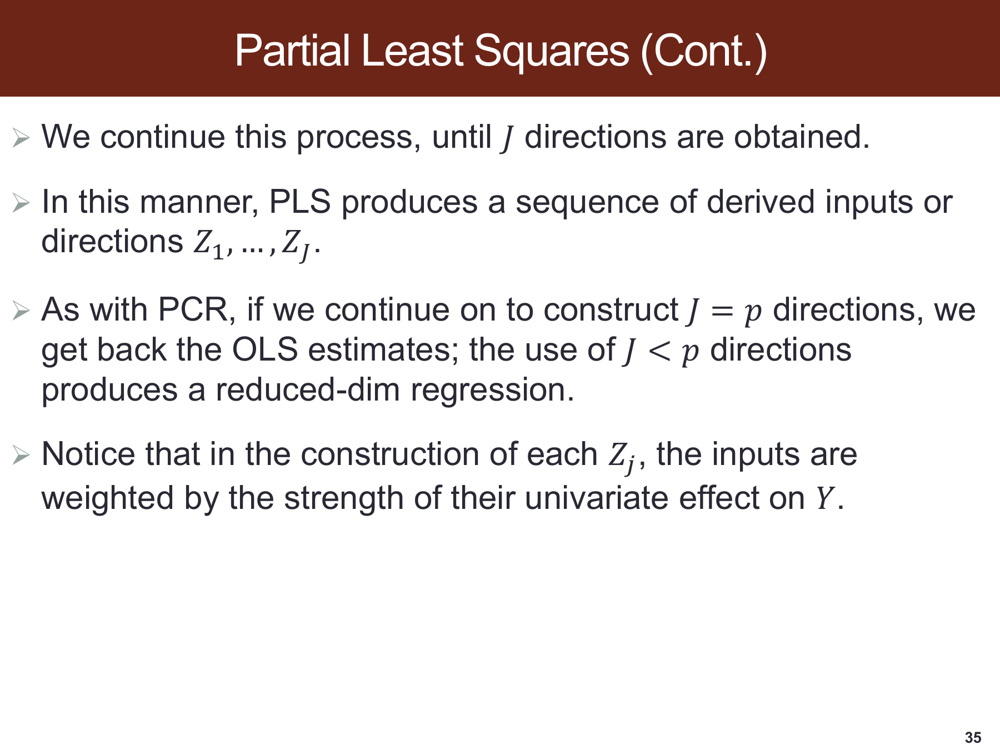

> 原课件：[第 35 页](../output/pdf/SDSC5001_Topic5_slides.pdf#page=35)。截图保留课件原貌，下面按阅读顺序解释；原页简写与笔误以正文核对为准。

**“继续得到 $J$ 个方向”指在残差化后的信息中继续找方向。**新方向不应机械重复已经解释的得分，因而每轮要更新输入残差与响应残差。

**“$J=p$ 恢复 OLS”需要方向确实存在并张成输入列空间。**两列完全相同的补充例子只有一个独立方向，第二轮输入已经归零，不能为了凑列数继续除以零。

**最后一句解释 PLS 与 PCR 的区别。**PLS 方向的构造使用变量对响应的单变量关联；PCR 找方向时只看输入方差。利用响应使 PLS 可能更贴近预测目标，也要求把这一过程完整放入训练折。


<a id="section-14"></a>

## 14. 方法比较与建模流程

以下为综合复习，将课件各部分放到同一比较表中。

| 方法 | 控制复杂度的方式 | 原始变量稀疏 | 构造方向时用响应 | 主要调节量 |
|---|---|---|---|---|
| 最优子集 | 显式搜索变量集合 | 是 | 选择时使用 | 子集、规模/准则 |
| 前向/后向 | 在逐步路径上选择集合 | 是 | 是 | 停止规模/准则 |
| Ridge | 平方 $L_2$ 收缩 | 通常否 | 直接拟合使用 | $\lambda$ |
| Lasso | $L_1$ 收缩及清零 | 是 | 直接拟合使用 | $\lambda$ |
| Group Lasso | 组范数求和 | 组层面 | 直接拟合使用 | $\lambda$、分组 |
| Elastic Net | $L_1$ 与平方 $L_2$ | 可产生 | 直接拟合使用 | 强度与混合比例 |
| 差分/Fused 惩罚 | 相邻系数融合 | 差分可为零 | 直接拟合使用 | 强度、相邻结构 |
| PCR | 截取 PCA 方向 | 通常否 | 否 | 成分数 $K$ |
| PLS | 构造响应相关得分 | 通常否 | 是 | 成分数 $K$ |

对预测问题可采用同一套流程：先保留独立测试集；在训练集交叉验证内拟合预处理、筛选/降维和回归；按相同折及指标比较方法；选定后在训练集重拟合；最后测试一次并报告指标与模型复杂度。

若主要目标是解释变量，应同时关注支持稳定性、共线性和选择后的不确定性，避免仅凭某一次 Lasso 非零就作因果结论。若目标是预测，不必因为 Ridge 保留变量多就认定它更差。


<a id="ext-t5-onese"></a>

### 外部拓展：最小 CV 误差与 one-standard-error 规则怎样选

**课内衔接：**[本章第 14 节](#section-14) · [相关课件第 5 页](../output/pdf/SDSC5001_Topic5_slides.pdf#page=5)

**外部拓展｜连接模型选择的实际取舍。**设 λ 是正则化强度，$\widehat R_{CV}(\lambda)$ 是指定 K 折方案得到的平均验证损失。首先找到其最小点 $\hat\lambda_{min}$，帽号表示这个点也是由有限数据选出来的。

one-standard-error 规则在“误差不超过最小误差加该最小点估计标准误”的候选里，选择较简单模型。对沿 λ 增大而收缩更强的正则化路径，常写成

$$\hat\lambda_{1SE}=\max\left\{\lambda:\widehat R_{CV}(\lambda)
\le\widehat R_{CV}(\hat\lambda_{min})+\widehat{SE}_{CV}(\hat\lambda_{min})\right\}.$$

max 是在已搜索的候选 λ 集合中取最大，不是向连续范围任意外推；SE 是 CV 误差估计的标准误，不是原响应的标准差。glmnet 将此区别体现在 `lambda.min` 与 `lambda.1se` 中。

**自编手算。**λ 依次为 0.01、0.1、1、10，对应 CV MSE 为 1.05、1.00、1.03、1.20，最小点的 SE=0.04。允许门槛是 1.04，因此候选 0.1、1 都合格；选择 λ=1。它牺牲一点本次估计拟合性能，换取更强收缩，不保证真实风险一定更低。

**常见误读。**“一个标准误以内”不是两模型差异不显著的严格检验；折训练集重叠，折误差有依赖，SE 的估计方式需要说明。比较树深、主成分数等复杂度时，“较简单”也需另行定义，不能机械取参数最大值。

如果同时选择 α、λ、特征集或多个模型，规则要在训练内部执行，再由独立测试或嵌套外层评价整个程序。只挑一组看起来稀疏的系数，不能证明支持集稳定；可额外报告不同重抽样中的入选频率，但不要把它直接称为变量为真的后验概率。

**外部来源与阅读定位：**[glmnet 作者文档：lambda.min 与 lambda.1se](https://glmnet.stanford.edu/reference/cv.glmnet.html)。本文推导与自编算例用于解释相应方法，不冒充来源中的实验结果。

<a id="section-15"></a>

## 15. 补充代码：用 Pipeline 避免预处理泄漏

下面是使用者提供训练/测试数据后的流程示意，课件未提供原始数据，因此它不是前列腺癌示例的数值复现。假设 `X_train`、`y_train` 与独立 `X_test` 已定义，任务适合随机 K 折。

```python
import numpy as np
from sklearn.pipeline import Pipeline
from sklearn.preprocessing import StandardScaler
from sklearn.linear_model import Ridge, Lasso, LinearRegression
from sklearn.decomposition import PCA
from sklearn.cross_decomposition import PLSRegression
from sklearn.model_selection import GridSearchCV, KFold

cv = KFold(n_splits=5, shuffle=True, random_state=5001)

ridge = Pipeline([
    ("scale", StandardScaler()),
    ("model", Ridge()),
])
ridge_search = GridSearchCV(
    ridge, {"model__alpha": np.logspace(-4, 4, 60)},
    scoring="neg_mean_squared_error", cv=cv,
)
ridge_search.fit(X_train, y_train)
ridge_pred = ridge_search.predict(X_test)

lasso = Pipeline([
    ("scale", StandardScaler()),
    ("model", Lasso(max_iter=20000)),
])
lasso_search = GridSearchCV(
    lasso, {"model__alpha": np.logspace(-5, 1, 60)},
    scoring="neg_mean_squared_error", cv=cv,
)
lasso_search.fit(X_train, y_train)

# 对 PCA，所有候选 K 均应不超过最小训练折的可用矩阵维数。
min_train_rows = min(len(tr) for tr, _ in cv.split(X_train, y_train))
kmax = min(X_train.shape[1], min_train_rows - 1)
components = list(range(1, min(kmax, 20) + 1))
pcr = Pipeline([
    ("scale", StandardScaler()),
    ("pca", PCA()),
    ("model", LinearRegression()),
])
pcr_search = GridSearchCV(
    pcr, {"pca__n_components": components},
    scoring="neg_mean_squared_error", cv=cv,
)
pcr_search.fit(X_train, y_train)

# PLS 自带训练折内的中心化/缩放，无需先用全体样本处理。
pls_search = GridSearchCV(
    PLSRegression(scale=True), {"n_components": components},
    scoring="neg_mean_squared_error", cv=cv,
)
pls_search.fit(X_train, y_train)
```

上述示意还要求足够样本、非退化预测变量和合理的参数网格。若有效秩更低，应再缩减成分候选；CV 在所有模型上采用相同划分便于比较。

**软件参数换算：** scikit-learn `Ridge(alpha)` 使用 $RSS+\alpha\|\beta\|_2^2$，与本讲主要 Ridge 约定相同。`Lasso(alpha)` 使用 $RSS/(2n)+\alpha\|\beta\|_1$，因此在同一训练数据尺度下，课件的 $\lambda=2n\alpha$。这解释了两个模型的 `alpha` 不能直接作同一强度的比较。

<a id="section-16"></a>

## 16. 自测题与答案要点

以下为补充自测，不是课件原题。先遮住答案，能写出理由比只记选择更有用。

**1. 为什么加入变量后训练 RSS 不增，但测试误差可能增？** 新模型包含旧模型可行解，训练最优值不增；额外自由度可能拟合噪声、增加估计方差，损害泛化。

**2. $C_p$ 和课件 AIC 为什么选出同一模型？** 若使用同一个正的 $\hat\sigma^2$，两者只差正常数因子。重新估计每模型方差并换用一般似然 AIC 时不能直接这样说。

**3. $n=100$ 时 BIC 的每个新增斜率惩罚与 AIC 相比如何？** 在同一未缩放口径中分别为 $\hat\sigma^2\log100$ 与 $2\hat\sigma^2$，前者约是后者的 2.30 倍。

**4. Ridge 在 $p>n$ 时为何仍有唯一斜率解？** 当 $\lambda>0$，$X^TX+\lambda I$ 正定。若 $\lambda=0$ 则失去这一保证。

**5. 课件 Lasso 的阈值为何为 $\lambda/2$？** 因为平方误差前没有 $1/2$，求导产生因子 2。换损失缩放，阈值也随之变化。

**6. $X=I$、$y=(-0.8,2.5)$、$\lambda=2$ 时 Ridge、Lasso 解是什么？** Ridge 为 $(-0.2667,0.8333)$，Lasso 为 $(0,1.5)$。

**7. 标准化是否只影响优化速度？** 否。系数惩罚依赖尺度，标准化改变各变量相对受到的惩罚，可能改变被选变量和预测结果。

**8. 为什么 Group Lasso 整组清零，Ridge 通常不清零？** 前者对组 $L_2$ 范数再求和，组零点处有不光滑结构；Ridge 惩罚的是所有系数平方和，光滑且没有相同的阈值机制。

**9. 只惩罚 $\sum|\beta_j-\beta_{j-1}|$ 能否保证所有系数接近 0？** 不能，全部系数相等时差分惩罚为零，整体水平没有被这一项惩罚。

**10. PCA 主成分不相关是否说明相互独立？** 一般不能，联合高斯等附加条件下才可作相应结论。

**11. 保留 95% 的 $X$ 方差能否保证保留 95% 的预测能力？** 不能，响应信号可能位于低方差方向，PCR 应按预测表现选择成分数。

**12. PCR 和 PLS 的主要区别是什么？** PCR 先按 $X$ 变异构造方向，PLS 在构造方向时就利用 $y$。两者的最终回归都需要响应。

**13. 在全部数据上先做 PCA，再 CV 回归会怎样？** 验证折参与了载荷与尺度估计，评估流程发生信息泄漏。应把 PCA 与预处理放入每折的训练流程。

**14. Lasso 留下一个变量就能说明它有因果作用吗？** 不能，惩罚选择仍是指定特征与样本下的统计结果，可能受相关性、混杂和稳定性影响。

<a id="section-17"></a>

## 17. 本地课件中需要核对的表述

| 页码 | 原文情况 | 本笔记处理 |
|---|---|---|
| 6、30 | 仅标题，无补充正文 | 明确相关解释为补充，不假称逐字来自该页 |
| 7 | $C_p$/AIC/BIC 使用缩放的 RSS 形式 | 保留课件公式，另解释与一般似然形式、参数计数的区别 |
| 9 | 用 Stagewise 指混合加入/删除 | 按页内定义解释，并区分其他资料中的小步长 stagewise |
| 15 | 黑线标为 Bias，但纵轴与加和是平方误差 | 解释为平方偏差贡献，不把 Bias 直接与方差相加 |
| 21 | $X=I$ 的特例 | 独立作为无截距代数例子，阈值按本页 RSS 约定 |
| 22 | $L_\infty$ 漏写绝对值 | 说明标准范数为 $\max_j\lvert\beta_j\rvert$ |
| 24 | $\frac12RSS$ 与解中分母 2 不匹配，未说明正交条件 | 展示按目标推导的解及另一缩放，并注明适用条件 |
| 25 | 分组称为 $J$，求和上限写 $p$ | 统一以组数 $G$ 表示；差分惩罚按本页版本说明 |
| 29 | 投影优化简写方向约束，指标涉及尺度 | 补充单位方向/标准化条件与累积量定义 |
| 31 | 把 PCR 回归系数称为 correlation coefficient | 给出正确斜率及其与相关系数的关系 |
| 35 | 说 $K=p$ 恢复 OLS，未列秩条件 | 补充张成列空间、有效秩与拟合/系数唯一性的条件 |

这些是对本地课件的学习核对，不代表授课教师公布的正式勘误。遇到课程作业或考试中的特定定义，应先写出题目给定的目标函数和参数约定，再进行一致的推导。
