# SDSC5001 Topic 6：分类详细笔记

> 来源：本地 `SDSC5001_Topic 6 Classification.pptx`，共 47 页，课程为 Statistical Machine Learning I。本文按课件顺序分节整理。
>
> [图片内嵌阅读版](5001_Topic6_详细笔记.html) · [概念意义与应用指南](#section-19) · [课件 PDF](../output/pdf/SDSC5001_Topic6_slides.pdf) · [逐页对应表](Topic6_课件逐页对应表.md) · [公式速查](Topic6_公式与易错点速查.md)

各节标明对应课件页码。补充推导、数值算例、实现建议与自测用于帮助理解，不作为课件原句或原始实验结果。原页存在的符号问题另行注明。

各主题末尾的“意义与应用场景”及第 19 节为新增应用补充。业务例子用于说明选择依据，不代表课件提供了相应数据或验证结果。

阅读导航：[基本概念](#section-1)、[最小二乘分类](#section-2)、[Bayes](#section-3)、[LDA](#section-4)、[QDA](#section-5)、[Naïve Bayes](#section-6)、[Logistic](#section-7)、[MLE/IRLS](#section-8)、[多分类与 Probit](#section-9)、[Logistic 与 LDA](#section-10)、[超平面几何](#section-11)、[最大间隔](#section-12)、[对偶与支持向量](#section-13)、[评价指标](#section-14)、[课件算例](#section-15)、[方法对比](#section-16)、[自测](#section-17)、[原文核对](#section-18)。

> **深化阅读（2026-10-31）：**本章新增 4 组分节详解与 3 张 PPT 完整截图。新增推导与手算均为配套补充，截图旁附逐项解读，沿用原有课件定位。
>
> [LDA 是在什么几何尺度上比较距离](#deep-t6-s4) · [朴素 Bayes 的乘积、对数与零频数](#deep-t6-s6) · [只含截距时看清 Newton 为什么要迭代](#deep-t6-s8) · [一组分数同时算阈值指标与 AUC](#deep-t6-s14)

> **作业定位：**[第 2(a) 题：线性 Bayes 边界时 LDA/QDA 的训练与测试比较](#lda-qda-question-2a)，附英文答案、逐句课件依据与原图。

> **外部资料强化（2026-11-01）：**本章在对应知识点内加入以下拓展，所有数值算例与教学图明确区分于课件原始内容。外部来源在小节末就近提供。
>
> [只改变正类发生率，原来的预测概率为什么也要调整](#ext-t6-prior_shift) · [Logistic 完全分离时，训练正确为何反而没有有限 MLE](#ext-t6-separation) · [类别越稀有，为什么相同 ROC 点仍可能产生很低的 Precision](#ext-t6-pr)

## 0. 本讲主线与统一符号

上一讲的回归预测连续响应；本讲预测离散类别。主线是：先明确分类的最优目标，再分别用概率模型和几何边界构造分类器，最后评价预测结果。

| 符号                                                | 含义                 |
| ------------------------------------------------- | ------------------ |
| $n,p,K$                                           | 样本数、特征数、类别数        |
| $x\in\mathbb R^p$                                 | 一条观测的特征向量          |
| $Y\in\{1,\ldots,K\}$                              | 多分类标签，数值通常只是类别名字   |
| $p_k(x)=P(Y=k\mid X=x)$                           | 后验类别概率             |
| $\pi_k=P(Y=k)$                                    | 类别先验概率             |
| $f_k(x)=f_{X\mid Y=k}(x)$                         | 第 $k$ 类内的特征密度/概率质量 |
| $h_k(x),\delta_k(x)$                              | 分类分数、判别函数，不一定是概率   |
| $G(x)$                                            | 最终类别预测             |
| $\beta_0,\beta$                                   | 截距、斜率向量            |
| $\tilde x=(1,x^T)^T,\ \theta=(\beta_0,\beta^T)^T$ | 包含截距的特征与参数         |

概率模型部分二分类用 $Y\in\{0,1\}$；超平面和间隔部分用 $Y\in\{-1,+1\}$。切换标签时应重新说明规则。

## 1. 分类、分数与决策边界

> 对应课件第 1～5 页。

### 1.1 问题与应用

第 2 页列出交易欺诈识别、DNA 与疾病研究、糖尿病类型判断等例子。它们都可包含根据特征判断类别的任务；疾病相关特征的分类作用本身不能证明因果关系。

分类器是映射

$$G:\mathbb R^p\longrightarrow\{1,\ldots,K\}.$$

在每种错分损失均为 1 的条件下，目标是降低

$$err(G)=P(Y\ne G(X))=E[\mathbf1\{Y\ne G(X)\}].$$

这是总体风险。训练误差、测试误差分别是在有限训练样本和独立测试样本上的估计，不能把低训练误差直接等同于低总体风险。

### 1.2 分类函数与最终预测

为每类定义一个实值分数 $h_k(x)$，取

$$G(x)=\arg\max_k h_k(x).$$

可以令 $h_k=p_k$，也可使用与概率排序相同的对数分数，例如 LDA 判别函数。分类分数可以为负或大于 1，只要没有宣称它本身就是概率。

第 4 页把两类边界写成 $h_k(x)=h_l(x)$。**多分类时还需这两个分数同时达到最大值**，才是最终决策区域的交界：

$$h_k(x)=h_l(x)\ge h_m(x),\qquad\text{对所有 }m.$$

如果第三类分数更大，前两类虽然相等，也不会决定该点的预测。完全并列时需约定稳定的打破平局规则。

### 1.3 二分类两套常用编码

- 对 $0/1$ 编码，若 $h(x)$ 估计正类概率，常取 $G(x)=\mathbf1\{h(x)>0.5\}$。
- 对 $-1/+1$ 编码，若 $h(x)$ 是有符号分数，取 $G(x)=\operatorname{sign}(h(x))$。

概率阈值 0.5 与分数阈值 0 不冲突。Logistic 中 $p(x)=\sigma(\eta(x))$，由于 $\sigma(0)=0.5$，两者正好等价。若使用其他成本或阈值，就要修改规则。

### 1.4 意义与应用场景：把证据变成行动

分类分数用于比较，概率用于表达事件发生可能性，类别标签用于执行决策。区分它们，可以让同一个模型服务不同任务。例如银行可以用违约分数排序人工复核对象，用校准后的违约概率计算预期损失，再按业务阈值决定是否触发复核。只保存最终 0/1 标签，就会丢掉重新排序和调整阈值所需的信息。

决策边界表示“哪些特征变化会让模型改变判断”。例如两项检测指标的组合跨过某条边界，模型从低风险改判高风险。它能帮助理解预测规则，但边界附近的类别差异不自动代表生物学上存在清晰分界。

类别编码则是为了让计算表达任务：$0/1$ 便于 Bernoulli 概率建模，$-1/+1$ 便于用一个乘积统一表示分对还是分错。编码变化没有改变病人或交易本身。

## 2. 为什么不直接用普通线性回归分类

> 对应课件第 6～9 页。

### 2.1 任意数字编码给类别强加了距离

课件将三种糖尿病类型依次编码为 1、2、3，再拟合 $Y=\beta_0+X^T\beta+\epsilon$。这样做隐含“1 到 2”和“2 到 3”同样远，并让误差平方依赖编号。

对无序类别，交换类别名字不应改变问题实质；但重新编号后，最小二乘拟合和预测可能改变。问题出在把类别编号当作具有数值间距的量。

### 2.2 哑变量响应矩阵

第 8 页用 one-hot/indicator 编码避免给类别强加顺序。例如

$$y=\begin{pmatrix}3\\2\\1\end{pmatrix}\quad\longrightarrow\quad
Y_{dummy}=\begin{pmatrix}0&0&1\\0&1&0\\1&0&0\end{pmatrix}.$$

分别对每列做线性回归，得到 $\hat h_k(x)$，最终选最大分数类。重排类别只会重排响应列，不再改变类别间的人为距离。

### 2.3 哑变量回归仍有两个问题

**概率越界。** 因为 $E[\mathbf1\{Y=k\}\mid X=x]=p_k(x)$，对哑变量回归的自然解释是拟合类别概率。但线性预测可以小于 0 或大于 1，因而不是有效概率。即使模型含截距使各列拟合值相加为 1，也不能保证每列非负。

**Masking（遮蔽）。** 第 9 页图中三团点大致沿同一方向排列，某一类的线性拟合分数可能在相关区域内始终不占最大值，使本应被识别的类别被其他类“盖住”。one-hot 修复了编号问题，没有保证线性最小二乘具有合适的多类决策区域。

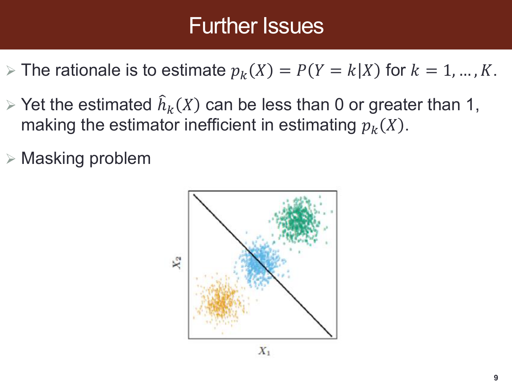

二分类线性概率模型可以作为一种模型使用，课件指出的是其概率约束与拟合性质的局限，不能推成“任何线性分数都不能做分类”。

### 2.4 意义与应用场景：为什么响应编码要匹配任务

若要识别三种产品缺陷，类别 A、B、C 只是名称，不能因为编码为 1、2、3 就把 C 当成 A 的三倍。one-hot 响应把问题改写为“是否属于每一类”，适合表达无序多分类，并为后续多项分布/softmax 建模作准备。

这里的 one-hot 是对**输出类别**的表示；实践中对地区、职业等**输入特征**做 one-hot，是让模型使用离散预测变量。两者操作相似，作用位置不同。若标签确实有等级含义，如轻度、中度、重度，是否采用有序分类模型应由任务决定，不能仅因能编号就直接做连续回归。

学习最小二乘分类的意义，是理解“预测得分可以用于分类”与“得分可被解释为有效概率”之间的条件差别。需要风险概率时，越界会直接妨碍期望损失计算，因此应使用合适的概率模型或另行约束。

## 3. Bayes 分类器与判别分析的出发点

> 对应课件第 10～11 页。

### 3.1 为什么选择最大后验概率

固定 $x$，若预测为 $k$，在 0–1 损失下条件错分风险为

$$R(k\mid x)=\sum_{l\ne k}p_l(x)=1-p_k(x).$$

因此条件风险最小的规则是

$$\boxed{G^*(x)=\arg\max_k p_k(x).}$$

进一步积分得到 Bayes 最小错分率

$$err^*=E_X[1-\max_k p_k(X)].$$

后一个公式和证明是补充解释。即使概率已完全已知，只要类别分布重叠，Bayes 错分率也可能大于 0。

### 3.2 判别分析：先建模类内特征分布

利用 Bayes 公式

$$p_k(x)=\frac{\pi_k f_k(x)}{\sum_{l=1}^K\pi_lf_l(x)}.$$

对同一个 $x$，分母不依赖待比较的类别，因此

$$\arg\max_k p_k(x)=\arg\max_k\pi_kf_k(x)
=\arg\max_k\{\log\pi_k+\log f_k(x)\}.$$

关键是**先验与密度一起比较**。只比较类内密度，等于忽略不同类别发生频率。密度值可以超过 1，只有最终后验概率需要落在 $[0,1]$ 内。

LDA、QDA 与 Naïve Bayes 对 $f_k$ 施加不同假设；Logistic 直接建模 $p_k(x)$。第 10 页还列出树、深度网络、SVM、Boosting、Bagging 等方法作为概览；Boosting/Bagging 是组合学习框架，具体实现也可输出分数或概率，不能据该页把方法永久划成互斥类别。

### 3.3 补充：错分成本不对称时

设误报成本为 $c_{FP}$，漏报成本为 $c_{FN}$，正确分类成本为 0。二分类预测为 1 的条件风险为 $c_{FP}(1-p)$，预测为 0 的风险为 $c_{FN}p$。因此选择正类的条件为

$$p(x)>\frac{c_{FP}}{c_{FP}+c_{FN}}.$$

漏报代价越大，合理阈值越低。这个推导假定 $p(x)$ 对应部署人群的后验概率；更换类别比例后也要关注概率与先验的适配。

### 3.4 意义与应用场景：整合基础发生率、证据和成本

先验 $\pi_k$ 表示看到当前特征之前，该人群中类别有多常见；类内密度 $f_k(x)$ 表示“如果属于这一类，这样的特征是否常见”；后验 $p_k(x)$ 表示合并两者后对当前个体的判断。罕见疾病筛查中，一个检测结果即使更常见于患者，也不能跳过基础患病率直接解释为很高的患病概率。

Bayes 规则提供了一个判断标准：在后验概率已知、损失已指定时，怎样作出风险最小的决策。现实中未知的是概率，LDA、QDA、NB、Logistic 等方法是在估计这一步；Bayes 最优并不意味着实际估计出的分类器自动最优。

成本敏感规则适合漏诊、欺诈漏报和人工审核等代价不对称的场景。例如一笔交易的欺诈概率为 2%，误报成本设为 1、漏报成本设为 99，则“标记复核”的期望成本为 0.98，“不标记”的期望成本为 1.98。按该简化成本设定应复核，即使欺诈不是概率最大的类别。例中成本仅为说明，不是实际业务参数。

## 4. LDA：共享协方差产生线性边界

> 对应课件第 12～15 页。

### 4.1 类内高斯与相同协方差

LDA 假设

$$X\mid Y=k\sim N_p(\mu_k,\Sigma),\qquad k=1,\ldots,K.$$

各类均值不同，但共用一个正定协方差矩阵。正确的多元正态密度为

$$f_k(x)=\frac{1}{(2\pi)^{p/2}|\Sigma|^{1/2}}
\exp\left[-\frac12(x-\mu_k)^T\Sigma^{-1}(x-\mu_k)\right].$$

**原页核对：** 第 12 页将 $(2\pi)$ 的指数写为 $1/2$；对 $p$ 维正态应为 $p/2$。该项对所有类相同，所以不影响后续分类比较，但密度定义需修正。

### 4.2 展开后为什么二次项消失

忽略与类别无关的常数，

$$\log\pi_kf_k(x)=\log\pi_k-\frac12x^T\Sigma^{-1}x
+x^T\Sigma^{-1}\mu_k-\frac12\mu_k^T\Sigma^{-1}\mu_k+const.$$

由于 $\Sigma$ 相同，$-\tfrac12x^T\Sigma^{-1}x$ 对所有类相同，可以在取最大值时删除。于是定义

$$\boxed{\delta_k(x)=x^T\Sigma^{-1}\mu_k-\frac12\mu_k^T\Sigma^{-1}\mu_k+\log\pi_k.}$$

最终规则为 $G(x)=\arg\max_k\delta_k(x)$。两类之差为

$$\delta_k(x)-\delta_l(x)
=x^T\Sigma^{-1}(\mu_k-\mu_l)
-\frac12(\mu_k+\mu_l)^T\Sigma^{-1}(\mu_k-\mu_l)
+\log\frac{\pi_k}{\pi_l}.$$

这是 $x$ 的仿射函数，所以两类边界是超平面。多分类时，每个区域由多个这样的比较不等式共同决定。

#### PPT 第 12 页原图：本题为什么认为 LDA 适合线性边界

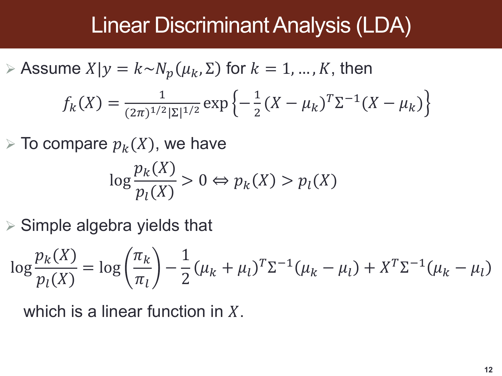

> 原始 PPTX：`SDSC5001_Topic 6 Classification.pptx` 第 12 页；[对应 PDF 第 12 页](../output/pdf/SDSC5001_Topic6_slides.pdf#page=12)。PDF 由这份 PPTX 导出，页码对应；两者是同一份课件的不同格式。

**原页明确给出的事实：**LDA 假设各类共享协方差，推导后写明 “which is a linear function in X”。第 13 页进一步说明，相同协方差使二次项在类间比较时消去。这里 $X$ 是输入特征向量，$\Sigma$（Sigma）是各类共用的协方差矩阵，描述特征在各类内部的方差和相关关系。

**用于作业的推论：**题目给定真实 Bayes 决策边界为线性时，LDA 的边界形状已经与目标相符，无需为了表达这条边界额外引入二次项。完整的 training/test 比较见[第 5.2 节](#lda-qda-question-2a)。原页密度常数的排印问题沿用本节前面的核对说明。

### 4.3 从训练数据估计参数

记 $n_k=\sum_i\mathbf1\{y_i=k\}$，课件使用

$$\hat\pi_k=\frac{n_k}{n},\qquad
\hat\mu_k=\frac1{n_k}\sum_{i:y_i=k}x_i,$$

$$\boxed{\hat\Sigma=\frac1{n-K}\sum_{i=1}^n
(x_i-\hat\mu_{y_i})(x_i-\hat\mu_{y_i})^T.}$$

这是合并的**类内协方差**，不能拿所有点相对总体均值计算的协方差替换，否则会混入类间均值差。

分母 $n-K$ 是该页的无偏估计约定；高斯联合似然下协方差 MLE 可用 $n$，两者不应在做题时无声混换。矩阵求逆还要求足够有效秩；高维或强共线性下可用收缩协方差等扩展处理。

### 4.4 补充算例：类别先验怎样移动边界

一维两类满足 $X\mid Y=0\sim N(0,1)$、$X\mid Y=1\sim N(2,1)$。则

$$\log\frac{p_1(x)}{p_0(x)}=2x-2+\log\frac{\pi_1}{\pi_0}.$$

先验相等时，预测 1 的条件为 $x>1$。若正类先验只有 0.1，则

$$x>1+\frac12\log9\approx2.0986.$$

少见类别需要更强特征证据才会在等错分成本下被选中。更改先验和更改错分成本都可能移动边界，但概念上应分别说明。

### 4.5 第 15 页读图

原图用三类相同协方差、不同均值的正态分布展示 95% 密度轮廓。虚线是已知总体参数时的 Bayes 边界，实线是有限样本估计出的 LDA 边界。模型假设正确时仍会有估计误差，因此两条线不必完全重合。

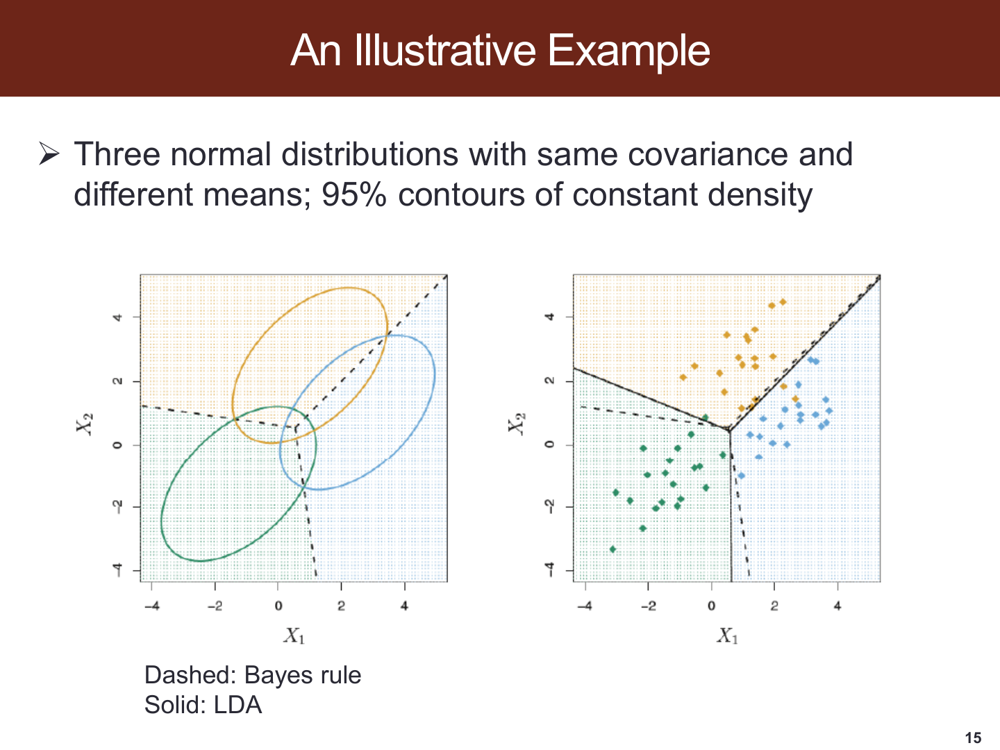

### 4.6 意义与应用场景：用较少参数描述类间差异

LDA 将分类证据压缩为一个线性分数。以两项相关的连续检测指标为例，两类人群的均值可能不同，但指标的波动幅度和相关结构近似相同。共享协方差能描述“两个指标共同变化”的方向，避免把高度重复的证据简单相加；$\Sigma^{-1}(\mu_1-\mu_0)$ 因而不只是原始均值差。

当特征不太多、每类样本有限，且共享协方差假设大致合理时，LDA 可作为容易解释、参数较少的候选基线。它以共享结构降低估计方差；若各类分布形状明显不同，这一简化也可能增加偏差，需与 QDA 或其他方法验证比较。

另一个相关应用是**监督降维**：多类 LDA 可利用类间差异构造至多 $K-1$ 个判别方向，用于可视化或后续分析。这是课件分类公式的延伸；上一讲 PCA 按总体方差找方向，不使用类别，因此最大方差方向未必最能分开类别。

### 深入讲解：LDA 是在什么几何尺度上比较距离

将判别分数补回被忽略的共同二次项，等价于比较

$$\delta_k'(x)=-\frac12(x-\mu_k)^T\Sigma^{-1}(x-\mu_k)+\log\pi_k.$$

当先验相等时，选择 Mahalanobis 距离最小的类别；当 $\Sigma=\sigma^2I$ 时，进一步退化为欧氏最近均值。一般情况下，它会按类内噪声和相关性调整距离，并不是每一坐标都原样贡献平方差。

**补充手算。**设 $\mu_0=(0,0)^T$、$\mu_1=(2,2)^T$、$\Sigma=\operatorname{diag}(1,4)$，先验相等。两类判别差为

$$\delta_1(x)-\delta_0(x)=2x_1+0.5x_2-2.5.$$

因此边界为 $2x_1+0.5x_2=2.5$。第二个变量的类内方差更大，均值差相同时，其证据权重更低。对象 $(1,2)$ 得分差为 0.5，判为类别 1。

若正类先验改为 0.1，差值还需加上 $\log(0.1/0.9)=-\log9$，同一对象的差变为约 $-1.697$，改判为类别 0。这不是特征变化，而是类别基础频率改变了决策。

也可先作白化变换 $z=\Sigma^{-1/2}x$，让类内协方差成为单位矩阵，再理解最近中心。实际 $\Sigma$ 需要估计，高维或相关性强时其逆可能不稳定；共享一个矩阵减少参数，但不会自动保证估计可靠。

### PPT 第 13 页逐项讲解：LDA 的类均值与合并类内协方差

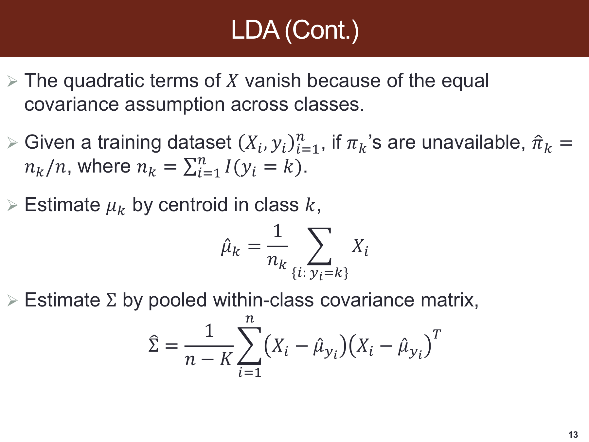

> 原课件：[第 13 页](../output/pdf/SDSC5001_Topic6_slides.pdf#page=13)。截图保留课件原貌，下面按阅读顺序解释；原页简写与笔误以正文核对为准。

**最上方说明边界为何线性。**各类共享协方差，使展开后的共同二次项在类别比较中抵消；不同类均值仍保留在线性部分。

**中间求类内中心，底部围绕所属类别中心计算偏差。**每个对象减去 $\hat\mu_{y_i}$，不是所有对象都减总体均值。因此它估计的是类内波动，避免把类别间距离算成噪声。

**分母为 $n-K$。**每类分别估一个均值向量，共损失对应的类均值自由度；这是此页的无偏协方差约定，与高斯 MLE 使用的 $n$ 不同。若高维导致秩不足，不能仅因写出了公式就假设矩阵可逆。

## 5. QDA：允许各类有不同协方差

> 对应课件第 16～17 页。

QDA 假设

$$X\mid Y=k\sim N_p(\mu_k,\Sigma_k).$$

去除共同常数后的判别函数为

$$\boxed{\delta_k^{QDA}(x)=\log\pi_k-\frac12\log|\Sigma_k|
-\frac12(x-\mu_k)^T\Sigma_k^{-1}(x-\mu_k).}$$

**第 16 页核对：** 原式在最后的 $1/2$ 前出现两个连续负号。按高斯对数密度，该项应为负的 Mahalanobis 距离平方，上式保留一个负号。距离均值更远不会因此得到更高密度。

因为 $\Sigma_k^{-1}$ 随类别变化，比较时 $x^T\Sigma_k^{-1}x$ 通常无法相消，所以边界可以是二次曲线/曲面。若各类协方差恰相同，就退回 LDA 型边界。

课件使用每类样本协方差：

$$\hat\Sigma_k=\frac1{n_k-1}\sum_{i:y_i=k}
(x_i-\hat\mu_k)(x_i-\hat\mu_k)^T.$$

一个无约束对称协方差有 $p(p+1)/2$ 个参数。LDA 共享一套，QDA 有 $K$ 套；QDA 更灵活，也更需要每类有足够样本。单类有效样本量不足或特征线性相关时，协方差可能不可逆。

#### PPT 第 16 页原图：QDA 的额外灵活度来自哪里

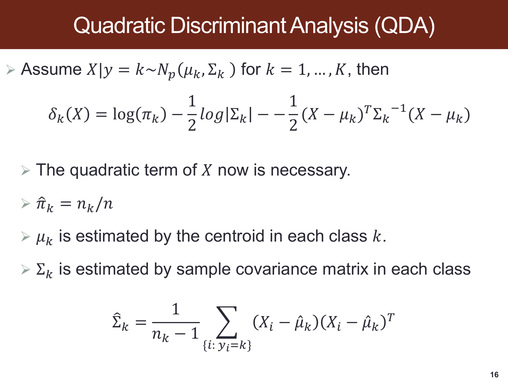

> 原始 PPTX：`SDSC5001_Topic 6 Classification.pptx` 第 16 页；[对应 PDF 第 16 页](../output/pdf/SDSC5001_Topic6_slides.pdf#page=16)。截图保留原页负号排印，正确公式以本节上方核对为准。

**原页明确给出的事实：**页面写明 “The quadratic term of X now is necessary”，并说明协方差由每一类的样本分别估计。$X$ 是特征向量，$\Sigma_k$ 是第 $k$ 类的协方差矩阵；下标 $k$ 表示类别，因此不同类别可以有不同的矩阵。

**用于作业的推论：**QDA 允许更丰富的边界形状，同时需要估计更多量；在有限样本中，这些估计可能更不稳定。这里的“更高方差”指更换训练集后拟合规则的波动，不是说 QDA 假设每个类别的观测方差都更大。

第 17 页紫线为 Bayes、黑线为 LDA、绿线为 QDA。若真实边界接近直线，多估计的协方差可能增加方差；若真实边界弯曲，QDA 可能减少模型偏差。不能只凭“更复杂”认定预测更好。

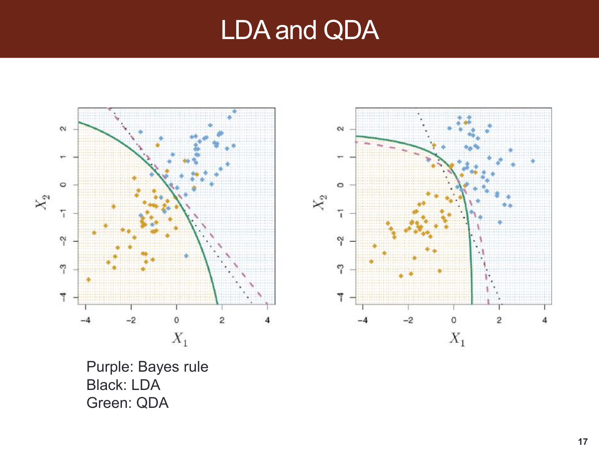

### 5.1 意义与应用场景：类别差别也可能在波动方式上

QDA 允许模型利用类内方差、相关方向和分布伸展形状的差异。例如正常设备与异常设备的传感器均值可能接近，但异常状态波动更大。在一维、均值相同、先验相等而方差不同的理想高斯例子中，QDA 可以将中心附近和两端极值分给不同类别；仅靠均值差的 LDA 无法利用这类差异。

因此，当各类点云有明显不同的尺度或方向、而每类都有足够数据估计协方差时，QDA 是值得比较的候选。其灵活性来自更多参数；特征多、少数类样本很少时，这些参数反而可能主要拟合噪声。采用 QDA 应有数据和验证支持，不能仅因为图形能弯曲就选它。

### 5.2 作业 2(a)：线性 Bayes 边界下，训练集和测试集分别选谁

> **Question:** If the Bayes decision boundary is linear, do we expect LDA or QDA to perform better on the training set? On the test set?
>
> 题目来源：[Assignment 2，第 2(a) 题](../assignment/HW2/SDSC5001+Assignment+2-1.docx)。这里的 perform better 按较低的分类错误率理解；题目问的是 expected tendency（预期趋势），不是对每一份样本的严格保证。

#### 先列课件依据，再组织答案

| 要说明的结论 | 原始 PPT / 对应 PDF 页 | 原页实际提供了什么 | 如何用于这题 |
|---|---|---|---|
| LDA 与线性边界相匹配 | Topic 6，第 [12](../output/pdf/SDSC5001_Topic6_slides.pdf#page=12)–[13](../output/pdf/SDSC5001_Topic6_slides.pdf#page=13) 页 | 共享协方差；二次项消去；判别比较对输入为线性 | 已知最优边界是直线时，LDA 的形状约束是合适的 |
| QDA 更灵活，也估计更多量 | Topic 6，第 [16](../output/pdf/SDSC5001_Topic6_slides.pdf#page=16) 页 | 每类分别估计协方差，保留二次项 | 解释 QDA 为什么更能贴近训练数据，也更容易受样本波动影响 |
| 不同边界形状的直观对比 | Topic 6，第 [17](../output/pdf/SDSC5001_Topic6_slides.pdf#page=17) 页；[本节原图](#lda-qda-ppt17) | 紫色 Bayes、黑色 LDA、绿色 QDA 的边界图 | 左图 Bayes 近线性，可看出额外曲率未必更接近真实边界；图中没有训练/测试错误率数值 |
| 复杂模型可能有很低训练误差 | Topic 3，第 [18](../output/pdf/SDSC5001_Topic3_slides.pdf#page=18) 页；Lumen：[原页定位](obsidian://lumen-pdf?vault=guideline&file=course%2F5001%2Foutput%2Fpdf%2FSDSC5001_Topic3_slides.pdf&annotation=sdsc5001-t3-7454a80016-page-018) | 原页指出复杂模型可有很小甚至为零的训练误差 | 支持 “QDA is generally expected to fit the training data more closely” 的一般学习原理；该页本身不是 LDA/QDA 实验 |
| 灵活度与偏差、方差的关系 | Topic 3，第 [21](../output/pdf/SDSC5001_Topic3_slides.pdf#page=21) 页；Lumen：[原页定位](obsidian://lumen-pdf?vault=guideline&file=course%2F5001%2Foutput%2Fpdf%2FSDSC5001_Topic3_slides.pdf&annotation=sdsc5001-t3-7454a80016-page-021) | 更复杂的方法一般偏差较低、方差较高 | 真实边界已线性时，额外灵活度未必有实质的偏差收益，却会增加估计波动 |
| 训练提升不保证测试提升 | Topic 3，第 [22](../output/pdf/SDSC5001_Topic3_slides.pdf#page=22) 页；Lumen：[原页定位](obsidian://lumen-pdf?vault=guideline&file=course%2F5001%2Foutput%2Fpdf%2FSDSC5001_Topic3_slides.pdf&annotation=sdsc5001-t3-7454a80016-page-022) | 训练误差随灵活度下降的经典示意；测试误差受偏差和方差竞争影响 | 把前面几条合起来，得到本题预期的 training/test 对比 |

以上位置已核对原始 PPTX 文本与相应 PDF；PDF 是课件导出版。**原页并没有逐字给出这道题的完整答案，下面英文是结合这些页面整理出的答题解释。**

#### English answer

> **Training set:** We generally expect QDA to have a lower training error because it is more flexible than LDA. By estimating a separate covariance matrix for each class, QDA can adapt more closely to the observed training data, including random noise.
>
> **Test set:** We generally expect LDA to have a lower test error when the Bayes decision boundary is linear. LDA can represent an appropriate linear boundary while estimating fewer covariance parameters. QDA's additional flexibility offers little benefit in representing the true boundary, but estimating more parameters can increase variance and the risk of overfitting. LDA is therefore expected to generalize better.

#### 每一句英文为什么可以这样写

1. **“QDA is more flexible.”** 对应 Topic 6 第 12–13、16 页：LDA 使用各类共用的协方差，QDA 允许每类不同。两个方法都要估类均值和先验，主要增加的是协方差估计的自由度。
2. **“QDA can fit the training data more closely.”** 对应 Topic 3 第 18、22 页的一般灵活度原理，再应用到本题。模型有更多可调整的形状，通常更容易贴近已经看过的样本，其中也可能包括偶然噪声。
3. **“The linear boundary is appropriate for LDA.”** 题设直接给出 Bayes 边界为线性。LDA 已能表达这种形状，QDA 额外允许弯曲，并不是表达题设目标所必需。
4. **“More estimation can increase variance.”** 对应 Topic 6 第 16 页的分别估计，加上 Topic 3 第 21 页对训练集变化的讨论。方差在这里描述换一批训练样本后，估计参数与分类规则可能变动得更多。
5. **“LDA is expected to generalize better.”** 综合边界形状和估计稳定性：有限样本下，QDA 的额外估计波动可能超过其收益，因此预期 LDA 对新对象的错误较少。这是题目要求的通常判断，不是对所有分布与样本量的无条件定理。

#### 用参数个数理解“多估计了什么”

这里 $p$ 是输入特征数，$K$ 是类别数，$\Sigma$ 是 LDA 共用的协方差，$\Sigma_k$ 是 QDA 第 $k$ 类的协方差。一个对称协方差矩阵有 $p(p+1)/2$ 个独立元素：$p$ 个对角方差，以及 $p(p-1)/2$ 个不重复的协方差。因而 LDA 在协方差部分估一套，QDA 估 $K$ 套。

例如两个特征、两个类别，即 $p=2,K=2$：LDA 的共享协方差有 3 个独立元素，QDA 的两个协方差共 6 个。这里的 3 和 6 只计协方差部分，不是整个模型的参数总数。更多参数需要更多样本支持，不能单凭训练结果贴合就判断它们估得准确。

#### 两个需要保留的限定

- **Training error 的结论用 “generally expect”。**LDA/QDA 通常按高斯模型估计参数，不是直接在全部线性/二次分类器里最小化训练错分数。因此，QDA 模型更丰富不意味着其实际拟合训练错分率在每份数据上必定不高于 LDA。Topic 3 第 22 页中的 “always decline” 是经典复杂度示意的简写，不应扩张成这两个估计过程之间的逐样本保证。
- **偏差—方差是此题的解释框架。**Topic 3 第 21 页展示的是回归平方损失的分解；这里借用其“额外灵活度与估计波动”的思想解释分类，不能把那个平方损失公式不加修改地称为分类 0–1 错分率的恒等式。仅知道边界线性，也不等于已经证明全部 LDA 分布假设成立。

## 6. Naïve Bayes：条件独立简化密度估计

> 对应课件第 18～20 页。

### 6.1 假设是给定类别后的独立

朴素贝叶斯假设在每一类内，各预测变量相互独立：

$$f_k(x)=\prod_{j=1}^p f_{kj}(x_j).$$

于是分类规则可写成

$$G(x)=\arg\max_k\left\{\log\pi_k+\sum_{j=1}^p\log f_{kj}(x_j)\right\}.$$

取对数避免大量小概率相乘造成数值下溢，也把乘积变为求和。

**条件独立不等于总体独立。** 两个特征即使在各类内部独立，混合不同类别后仍可能相关；反过来，总体不相关也不能证明类内独立。这里要求的是联合分解，不只是两两相关系数为零。

### 6.2 不必统一假设为高斯

课件强调，Naïve Bayes 的核心不是固定分布族，而是条件独立。实际仍要选择或估计每个 $f_{kj}$：连续变量可用高斯或非参数密度；二元变量可用 Bernoulli；文本计数可用相应离散模型。

补充的 Gaussian Naïve Bayes 分数为

$$\delta_k(x)=\log\pi_k-\frac12\sum_j\left[
\log(2\pi\sigma_{kj}^2)+\frac{(x_j-\mu_{kj})^2}{\sigma_{kj}^2}\right].$$

它相当于对类内协方差采用对角结构；如果每类方差也不同，边界仍可含二次项。Naïve Bayes 不是天然的线性分类器。

对于离散特征，训练样本中没出现的特征–类别组合会产生零概率，可使用加性平滑。例如二元特征的补充估计为 $(n_{kj,1}+a)/(n_k+2a)$，$a>0$。这是实践补充，原课件未展开具体平滑公式。

### 6.3 为什么假设不完全成立仍可能有效

课件第 20 页用偏差–方差权衡解释：忽略特征依赖会引入模型偏差，却显著减少需要估计的关联参数，因此在 $n$ 相对 $p$ 不大时可能更稳定。

分类只需要最大分数类正确，不要求所有后验概率都非常准确。因此分类准确率不错也不代表概率已良好校准。高度重复的证据可能被重复计入，令概率过度极端。

### 6.4 意义与应用场景：把难估的联合分布拆成许多小问题

朴素贝叶斯适合作为高维、数据相对有限时的快速基线。例如垃圾邮件分类中，输入可以包含大量词汇特征。逐类估计完整词汇联合分布很困难，NB 则分别学习各词在每类邮件中的出现倾向，再汇总证据。词之间显然有依赖，它仍可能提供有用的分类排序，但效果需要实测。

特征表示决定具体版本：词是否出现可考虑 Bernoulli NB，词频计数可考虑 Multinomial NB，连续传感器读数可考虑 Gaussian NB。不能只看到“贝叶斯”就把同一种单变量分布套到所有输入。

条件独立的意义是减少估计量，而不是证明现实特征无关。若同时加入“总金额”和几乎相同的派生金额，可能重复计入证据。需要用概率作成本决策时，还应单独检查校准，不能只以分类准确率验收。

### 深入讲解：朴素 Bayes 的乘积、对数与零频数

**补充算例。**两项二元特征为是否含“优惠” $W$ 和是否有附件 $A$。设垃圾邮件先验为 0.2，且

$$P(W=1\mid S)=0.6,\quad P(A=1\mid S)=0.5,$$

$$P(W=1\mid S^c)=0.1,\quad P(A=1\mid S^c)=0.2.$$

假设给定类别后两特征独立，观察到 $W=A=1$ 时，两类未归一化分数分别为 $0.2\times0.6\times0.5=0.06$ 和 $0.8\times0.1\times0.2=0.016$。因此

$$P(S\mid W=1,A=1)=\frac{0.06}{0.06+0.016}=\frac{15}{19}\approx0.7895.$$

若给定类别后两特征仍相关，这个乘积就不再等于真实联合概率。重复放入同一证据还可能让模型过度自信，即使分类准确率未明显变差，也需要另外核对概率校准。

很多特征相乘容易下溢，实际比较 $\log\pi_k+\sum_j\log P(X_j=x_j\mid Y=k)$。取对数不会改变大小顺序；计算后验时仍须对所有类别归一化，不能把原始对数分数直接叫概率。

若某类训练样本从未出现一个词，频率估计会给出 0，使整类乘积变成 0。Bernoulli 特征使用加一平滑时，若该类有 $n_k$ 条记录、出现次数为 $c$，估计为 $(c+1)/(n_k+2)$，因为可能结果有出现/不出现两种。多项式词频模型的分母则涉及词汇表大小，不能混用两种模型。

## 7. 二分类 Logistic 回归、Logit 与 Odds Ratio

> 对应课件第 21～24 页。

### 7.1 直接建模后验概率

令 $Y\in\{0,1\}$、$\eta(x)=\beta_0+x^T\beta$。Logistic 回归规定

$$\boxed{p(x)=P(Y=1\mid x)=\frac{e^{\eta(x)}}{1+e^{\eta(x)}}
=\frac1{1+e^{-\eta(x)}}.}$$

对有限 $\eta$，数学上严格有 $0<p<1$，只在极限接近端点。第 21 页写映到 $[0,1]$，作为概率范围的描述可以理解，但精确值域是 $(0,1)$。

Logistic 的概率是 S 形，**线性的是 log-odds**：

$$\boxed{\operatorname{logit}(p)=\log\frac{p}{1-p}=\beta_0+x^T\beta.}$$

第 23 页左图为 logit，把 $(0,1)$ 映到实数；右图为其逆函数 logistic，把实数映回 $(0,1)$。

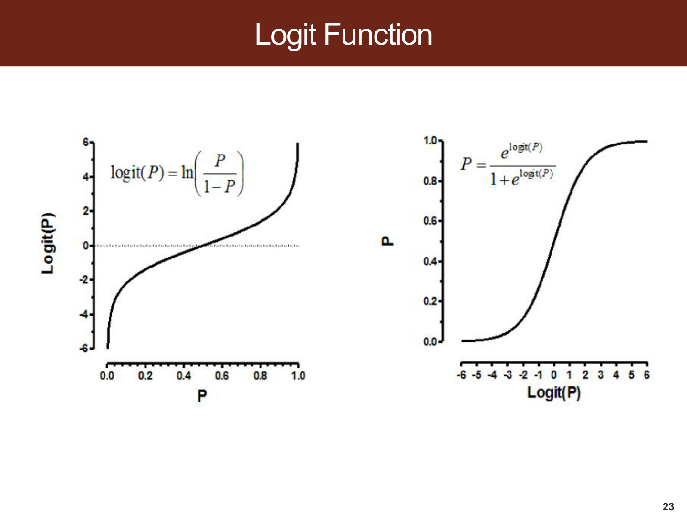

### 7.2 Odds、概率和 Odds Ratio 的区别

$$odds(x)=\frac{p(x)}{1-p(x)}=e^{\eta(x)}.$$

保持其他特征不变，$x_j$ 增加一个单位：

$$OR_j=\frac{odds(x_j+1)}{odds(x_j)}=e^{\beta_j}.$$

更一般地增加 $\Delta$ 单位时，OR 为 $e^{\Delta\beta_j}$。若模型含交互项或非线性变换，对应的变化应从完整线性预测子重新计算，不能只看一个主效应系数。

**补充算例：** 原概率 $p=0.2$，odds 为 0.25。若某变化对应 $OR=2$，新 odds 为 0.5，新概率为 $0.5/(1+0.5)=1/3$。因此 odds 翻倍并不意味着概率从 0.2 变成 0.4。

### 7.3 分类阈值与线性边界

阈值为 0.5 时，

$$p(x)>0.5\iff\beta_0+x^T\beta>0.$$

一般阈值 $t\in(0,1)$ 对应

$$p(x)>t\iff\beta_0+x^T\beta>\log\frac{t}{1-t}.$$

改变阈值会平移决策超平面，而不会把概率函数改成另一套已拟合的系数。若加入非线性特征，边界在原始输入空间也可以是弯曲的。

第 24 页用信用卡 Balance 与 Default 比较线性概率拟合和 Logistic。前者在某些区域越过概率下界，后者保持合法范围并呈现非线性概率变化。

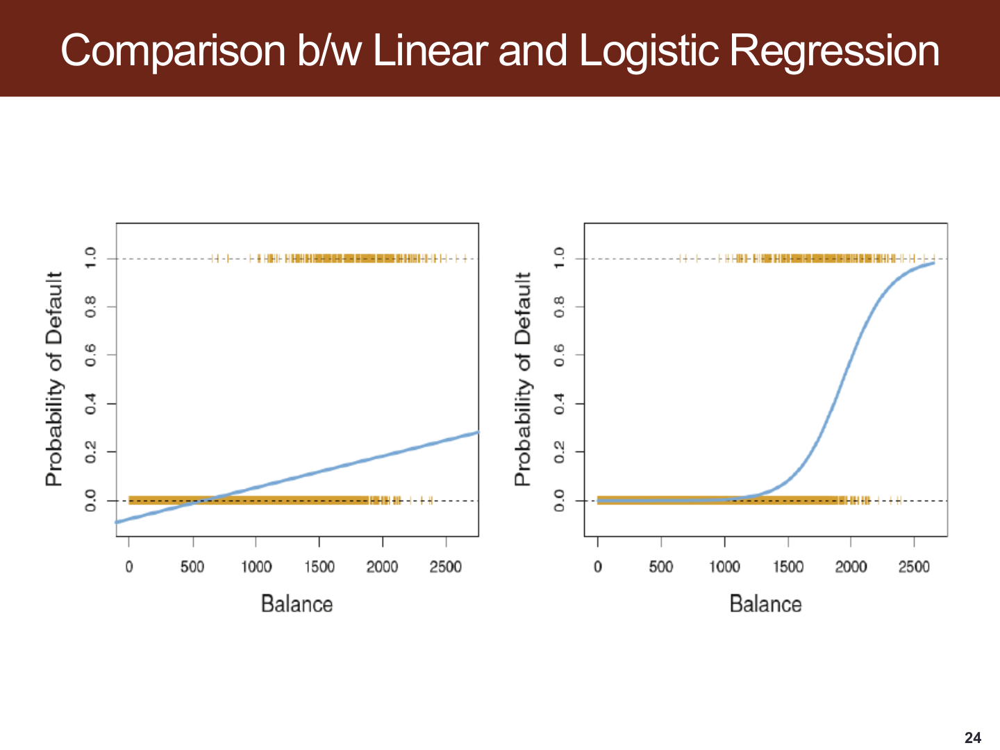

### 7.4 意义与应用场景：既预测风险，也解释条件关联

Logistic 适合二元结果的风险建模，例如是否违约、是否点击、设备是否故障。输入可包含连续变量和适当编码的类别变量；它不要求各类特征服从高斯分布。模型给出的概率可用于风险排序、预期成本计算和不同阈值的决策，前提是概率在目标人群中具有足够可靠性。

Logit 的作用是把受 $0<p<1$ 限制的概率变成可用线性结构建模的实数。OR 则把一个系数翻译为“其他模型项固定时，odds 变化多少倍”，适合报告条件关联。例如年龄系数对应的 OR 应同时注明年龄单位，以及模型中是否存在年龄的平方项或交互项。

如果主要关系强烈非线性，可加入合适变换或比较更灵活模型；如果特征很多或共线性强，可结合上一讲的正则化。OR 易解释不等于具有因果含义，预测准确也不保证每个系数都估计稳定。

### 外部拓展：只改变正类发生率，原来的预测概率为什么也要调整

**课内衔接：**[本章第 7 节](#section-7) · [原课件第 21 页](../output/pdf/SDSC5001_Topic6_slides.pdf#page=21)

**外部拓展｜连接 Bayes 与 Logistic odds。**设训练分布为 tr，部署分布为 te，特征为 X、二元类别为 Y。假设只有类别先验改变，即 $P_{te}(X\mid Y)=P_{tr}(X\mid Y)$，但正类比例 $\pi_{tr}=P_{tr}(Y=1)$ 与 $\pi_{te}=P_{te}(Y=1)$ 不同。这叫 label/prior shift，不代表所有分布变化。

若训练模型给出真实或足够可靠的后验 $q_{tr}(x)$，由 Bayes odds 可得

$$\frac{q_{te}(x)}{1-q_{te}(x)}=
\frac{q_{tr}(x)}{1-q_{tr}(x)}
\frac{\pi_{te}/(1-\pi_{te})}{\pi_{tr}/(1-\pi_{tr})}.$$

q_te 是目标部署后验；竖线 X|Y 表示给定类别看特征分布。读作：从训练后验 odds 中除去旧先验 odds，再乘新先验 odds，类内证据不变。这里要求两个先验均在 (0,1) 内，也要求输入的训练概率可用。

**自编手算。**训练集人为正负各半，π_tr=0.5；部署正类仅 0.1。某对象 q_tr=0.8，训练 odds=4，新旧先验倍率=(1/9)/1=1/9；部署 odds=4/9，故 q_te=(4/9)/(1+4/9)=4/13≈0.3077。原先的 0.8 不能直接当成部署风险。

对 Logistic 的线性 logit，固定这些假设时，修正可以表现为截距平移：加上两种先验 log-odds 之差，斜率不变。这是条件结论；若设备、医院或用户行为让 $P(X\mid Y)$ 也变化，只改截距未必有效。

**如何使用。**新先验若来自有代表性的标签样本，需报告估计不确定性；若没有部署标签，估计新先验还需要额外可识别性与模型条件。类别重采样、类权重与真实风险概率之间也不能默认相等。

**外部来源与阅读定位：**[Lipton 等：Detecting and Correcting for Label Shift](https://arxiv.org/abs/1802.03916)。本文推导与自编算例用于解释相应方法，不冒充来源中的实验结果。

## 8. Logistic 的极大似然、Newton 更新与 IRLS

> 对应课件第 25～27 页。以下用 $\theta$ 表示含截距参数，对应原页的 $\tilde\beta$。

### 8.1 从 Bernoulli 似然到交叉熵

独立样本给定特征后，$Y_i\sim Bernoulli(p_i)$，其中 $p_i=\sigma(\tilde x_i^T\theta)$。似然为

$$L(\theta)=\prod_i p_i^{y_i}(1-p_i)^{1-y_i}.$$

取对数并代入 logistic：

$$\ell(\theta)=\sum_i[y_i\log p_i+(1-y_i)\log(1-p_i)]$$

$$=\sum_i\left[y_i\tilde x_i^T\theta-\log(1+e^{\tilde x_i^T\theta})\right].$$

最大化 $\ell$ 等价于最小化二元交叉熵/负对数似然。这里原课件使用求和形式；软件可能再除以 $n$，加入正则化时应核对缩放。

### 8.2 梯度与 Hessian

由于 $dp_i/d\eta_i=p_i(1-p_i)$，令 $\tilde X$ 为含截距列的设计矩阵、$p=(p_1,\ldots,p_n)^T$，得到

$$\boxed{\nabla\ell(\theta)=\tilde X^T(y-p),}$$

$$\boxed{\nabla^2\ell(\theta)=-\tilde X^TW\tilde X,\qquad
W=\operatorname{diag}\{p_i(1-p_i)\}.}$$

对任意 $v$，$v^T\nabla^2\ell\,v=-\sum_iw_i(\tilde x_i^Tv)^2\le0$，所以对数似然为凹函数。满列秩且权重为正时在有限参数处严格凹，但这不自动保证存在有限最大值。

**补充条件：** 完全分离或准完全分离时，未正则化 Logistic 可能令系数不断变大，似然逼近上确界却没有有限 MLE。高维秩不足也可能失去参数唯一性。加惩罚是常见处理，不能用“数值迭代停了”代替存在性判断。

### 8.3 Newton–Raphson 更新

对最大化问题，Newton 更新为 $\theta^{new}=\theta^{old}-H^{-1}g$，代入负 Hessian：

$$\boxed{\theta^{new}=\theta^{old}+
(\tilde X^TW\tilde X)^{-1}\tilde X^T(y-p).}$$

所有 $p,W$ 都在当前 $\theta^{old}$ 处计算。实现时通常解线性方程求更新，不显式形成逆矩阵；必要时使用步长控制避免不稳定更新。

### 8.4 为什么称为迭代重加权最小二乘

定义工作响应

$$z=\tilde X\theta^{old}+W^{-1}(y-p).$$

则

$$\theta^{new}=(\tilde X^TW\tilde X)^{-1}\tilde X^TWz.$$

这正是以 $z$ 为响应、$W$ 为权重的一次加权最小二乘更新。每次参数变化都会改变概率，从而改变权重和工作响应，所以是 **Iteratively Reweighted Least Squares**。

IRLS 的最小二乘是求解 Logistic MLE 的数值步骤，不是最开始直接把二元 $y$ 当连续响应做一次 OLS。概率接近端点时权重很小，工作响应和矩阵求解都需要数值保护。

### 8.5 补充手算：第一次更新

取单个特征 $x=(-1,0,1)^T$、$y=(0,0,1)^T$，初始截距与斜率都为 0。此时 $p_i=0.5$、$W=I/4$，

$$\tilde X^T(y-p)=\begin{pmatrix}-0.5\\1\end{pmatrix},\qquad
\tilde X^TW\tilde X=\begin{pmatrix}0.75&0\\0&0.5\end{pmatrix}.$$

第一次更新得到 $\theta^{new}=(-2/3,2)^T$，预测概率约为 $(0.0650,0.3392,0.7914)$。这个小数据可以完全分离，因此本例只演示第一次 Newton 更新，不宣称继续迭代会得到有限未正则化 MLE。

### 8.6 意义与应用场景：分清模型、学习准则和求解算法

Logistic 是概率模型，极大似然说明用什么标准选择参数，Newton/IRLS 说明怎样数值求出参数。这三层分开后，才能理解为什么同一个模型可以用不同优化器拟合，也能理解 IRLS 中出现最小二乘并没有把任务改成普通线性回归。

梯度表示当前参数在哪个方向还可提高似然，Hessian 表示局部曲率；IRLS 把这些信息整理成可反复求解的加权回归。它适合用来推导和实现 Logistic 等广义线性模型，但不是每一种软件、数据规模都必须使用的算法。

实际看到系数极大、标准误很大或迭代不收敛时，这些概念有助于定位分离、共线性、尺度或数值问题。增加迭代次数只能解决部分优化不足，不能修复本身不存在有限 MLE 的问题。

### 深入讲解：只含截距时看清 Newton 为什么要迭代

**补充手算。**10 个二元响应中有 6 个为 1，只拟合截距 $\theta$。所有对象的概率相同，为 $p=1/(1+e^{-\theta})$。对数似然为 $\ell(\theta)=6\theta-10\log(1+e^\theta)$，梯度为 $6-10p$，Hessian 为 $-10p(1-p)$。

从 $\theta^{(0)}=0$ 开始，$p^{(0)}=0.5$，梯度为 1，负 Hessian 为 2.5，所以

$$\theta^{(1)}=0+\frac1{2.5}=0.4,\qquad p^{(1)}\approx0.598688.$$

这已经很接近样本比例 0.6，但还不是精确极大值。第二轮用新的概率重算曲率：

$$\theta^{(2)}=0.4+\frac{6-10(0.598688)}{10(0.598688)(1-0.598688)}
\approx0.405462.$$

解析最优值为 $\hat\theta=\log(0.6/0.4)=\log1.5\approx0.405465$。这说明 Newton 使用的是当前位置的局部二次近似，不是把初始权重一直固定到底。

从 IRLS 看，第一轮 $W=0.25I$、工作响应 $z_i=4(y_i-0.5)$，成功者为 2、失败者为 $-2$。其加权平均为 $(6\times2-4\times2)/10=0.4$，与 Newton 完全一致。实际有特征时，这个平均推广为加权最小二乘。

若 10 个响应全是 1，最优概率趋向 1、截距趋向正无穷，没有有限未惩罚 MLE。参数变化很小或迭代次数很多本身不能代替存在性与收敛检查。

### PPT 第 27 页逐项讲解：Newton 更新如何变为 IRLS

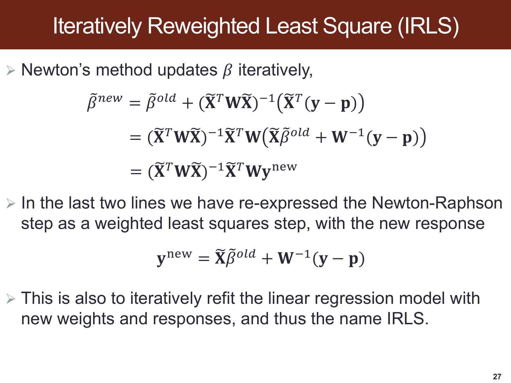

> 原课件：[第 27 页](../output/pdf/SDSC5001_Topic6_slides.pdf#page=27)。截图保留课件原貌，下面按阅读顺序解释；原页简写与笔误以正文核对为准。

**第一行是最大化对数似然的 Newton 步。**负 Hessian 为 $\tilde X^TW\tilde X$，梯度为 $\tilde X^T(y-p)$，因此写成加号；若换成最小化负似然，符号要随定义一致改变。

**中间两行只是在整理同一个更新。**把旧参数项并入一个工作响应，得到 $z=\tilde X\theta^{old}+W^{-1}(y-p)$，再做以 $W$ 为权重的最小二乘。

**每轮 $p,W,z$ 都要重新计算。**这不是直接对二元响应做一次普通 OLS。正文只含截距的十次试验展示第一轮 0.4、第二轮约 0.405462 如何逐步逼近解析解。

### 外部拓展：Logistic 完全分离时，训练正确为何反而没有有限 MLE

**课内衔接：**[本章第 8 节](#section-8) · [原课件第 25 页](../output/pdf/SDSC5001_Topic6_slides.pdf#page=25)

**外部拓展｜连接 Newton 与 Hessian。**自编一维数据为 x=[−2,−1,1,2]，y=[0,0,1,1]。取截距为 0、斜率为 b，模型为 $p_b(x)=1/(1+e^{-bx})$。x 为特征值，y 为观测标签，b 是待优化实数。

当 b→∞，负 x 处概率趋于 0，正 x 处趋于 1。每条记录的已发生结果概率都趋于 1，所以对数似然趋于 0；但任何有限 b 都无法让这些概率严格等于 0 或 1。似然上确界存在，有限最大化参数却不存在。

使用 y∈{0,1} 编码，单条负对数似然写成 $\ell_i(b)=\log(1+e^{bx_i})-y_i bx_i$。这里 log 是自然对数，i 为记录索引；合计损失 $\sum_i\ell_i(b)$ 沿分离方向不断下降。训练准确率早已达到 100%，并不能据此判断参数估计已经稳定。

**为什么迭代会出问题。**IRLS 权重为 $p_i(1-p_i)$；概率越接近两端，权重越小，Hessian 可能越来越病态，参数和标准误可能很大。优化器显示某种收敛提示，也需要检查参数路径、分离警告和概率分布。

加入正的 L2 惩罚可限制本例斜率无限增大，在有限点取得折中；但要明确目标已经变成惩罚估计，不能继续原封不动引用未惩罚 MLE 的推断解释。稀有事件、小样本和过多特征也值得检查，必要时研究偏差修正等专门方法。

**连接 SVM。**同一组可分数据下，Logistic 未惩罚似然偏好越来越大的尺度；硬间隔 SVM 则用约束固定分类尺度，再最小化系数范数。两者都可产生线性边界，优化目标却不同。

**外部来源与阅读定位：**[statsmodels：极大似然与完全分离陷阱](https://www.statsmodels.org/stable/pitfalls.html)。本文推导与自编算例用于解释相应方法，不冒充来源中的实验结果。

## 9. 多分类 Logistic 与 Probit

> 对应课件第 28～29 页。

### 9.1 基准类别与 Softmax

课件选择第 $K$ 类作基准，令

$$\log\frac{p_k(x)}{p_K(x)}=\tilde x^T\theta_k,\qquad k=1,\ldots,K-1.$$

补充整理成显式概率：

$$p_k(x)=\frac{e^{\tilde x^T\theta_k}}
{1+\sum_{l=1}^{K-1}e^{\tilde x^T\theta_l}},\qquad k<K,$$

$$p_K(x)=\frac1{1+\sum_{l=1}^{K-1}e^{\tilde x^T\theta_l}}.$$

各类概率非负且和为 1。选基准类是为消除不可识别性；若给所有类别分数同时加同一个函数，softmax 概率不变。换基准会改系数表示，不应改变等价模型的概率。

以 one-hot 响应 $y_{ik}$ 写出多项分布对数似然 $\ell=\sum_i\sum_k y_{ik}\log p_k(x_i)$，用 MLE 估计。两个类别的对数概率比为仿射函数，所以原始线性特征下的两类边界仍为超平面。

### 9.2 Probit 使用标准正态分布函数

Probit 规定

$$p(x)=\Phi(\beta_0+x^T\beta),$$

其中 $\Phi$ 为标准正态 CDF。它与 Logistic 都是把线性预测子映为 S 形概率的模型，但链接函数和系数尺度不同，不能直接互换数值。

若阈值为 0.5，因 $\Phi(0)=0.5$，线性 Probit 也以 $\beta_0+x^T\beta=0$ 为边界。第 29 页图说明两条 S 曲线形状相近，不证明任何数据上预测完全相同。

### 9.3 意义与应用场景：互斥类别与潜在阈值模型

多分类 Logistic 适合一条观测只能属于一个类别的任务，例如将请求分派到销售、技术、账务中的一个部门。softmax 将各类相对分数转换为总和为 1 的概率，便于同时比较多个备选类别。基准类别是参数表示的参照，不表示它在业务上更重要。

若一封邮件可以同时带“促销”和“财务”两个标签，则属于多标签问题，不应直接套用互斥的单一 softmax。是否互斥是任务定义的一部分，不能仅根据类别名称个数选择模型。

Probit 常用于具有潜在连续倾向的二元选择解释：假设潜在变量 $Y^*=\eta+\epsilon$、$\epsilon\sim N(0,1)$，并观察 $Y=\mathbf1\{Y^*>0\}$，就得到 $P(Y=1)=\Phi(\eta)$。例如是否接受某方案可用这种阈值模型表述。它与 Logistic 是不同链接假设，Probit 系数一般不能用 $e^{\beta_j}$ 解释为恒定 OR。

## 10. Logistic 与 LDA 的联系和区别

> 对应课件第 30 页。

二类共享协方差高斯模型下，令 $\pi=P(Y=1)$，由 LDA 推导得到

$$\log\frac{p(x)}{1-p(x)}=c_0+x^Tc_1,$$

$$\boxed{c_1=\Sigma^{-1}(\mu_1-\mu_0),}$$

$$\boxed{c_0=\log\frac{\pi}{1-\pi}
-\frac12(\mu_1+\mu_0)^T\Sigma^{-1}(\mu_1-\mu_0).}$$

**原文核对：** 第 30 页 $c_0$ 的最后一个括号写成 $\mu_1+\mu_0$；按第 12 页推导应为差 $\mu_1-\mu_0$。例如两均值相同、先验相等时，正确的 log-odds 应恒为 0，这也可检验符号。

两者都可以得到线性 log-odds，但建模和估计方式不同：

| 比较 | LDA | Logistic |
|---|---|---|
| 直接建模 | $X\mid Y$ 与类别先验 | $Y\mid X$ |
| 基本假设 | 类内高斯，共享协方差 | log-odds 对给定特征为线性 |
| 主要估计对象 | 类均值、共享协方差、先验 | 条件似然中的回归系数 |
| 对 $X$ 分布的要求 | 有明确类内分布假设 | 不必假设类内 $X$ 为高斯 |

第 30 页“只在拟合过程上不同”应在共同的线性 log-odds 形式下理解。两者的分布假设、错误设定时的行为和有限样本估计也有差别；边界形式相同不意味着样本拟合相同。

### 10.1 意义与应用场景：同一边界形式可以来自不同假设

如果研究者相信各类连续测量近似高斯且共享协方差，LDA 可以通过较结构化的分布估计学习分类规则。如果更愿意直接规定“给定这些特征，log-odds 近似线性”，则 Logistic 更贴近这一建模目标。实际通常将二者作为候选，用相同验证划分比较。

这一对比也说明：仅看画出来是一条直线，无法判断模型用什么数据分布假设、怎样估计参数，以及何处可能失效。高维下 LDA 需要处理协方差，Logistic 也可能需要正则化；选择其中一个不代表自动消除了小样本或共线性问题。

## 11. 超平面的几何：法向量、距离与分离

> 对应课件第 31～38 页。

### 11.1 特征空间与超平面

训练数据在 $p$ 维特征空间中是 $n$ 个点，位置由输入特征确定，颜色由标签确定。课件这部分研究线性分隔；一般分类器并不都需要超平面。

超平面为

$$L=\{x:f(x)=\beta_0+x^T\beta=0\},\qquad\beta\ne0.$$

维数为 $p-1$：二维中是一条直线，三维中是一个平面。严格说它是仿射子空间，不必经过原点；$\beta_0=0$ 才经过原点。

### 11.2 法向量和带符号距离

若 $x_1,x_2$ 都在平面上，$(x_1-x_2)^T\beta=0$，所以 $\beta$ 垂直于超平面。单位法向量为 $\beta^*=\beta/\lVert\beta\rVert_2$。

取 $x_0\in L$，由 $x_0^T\beta=-\beta_0$ 得

$$\boxed{d_{signed}(x,L)=(x-x_0)^T\beta^*
=\frac{\beta_0+x^T\beta}{\lVert\beta\rVert_2}.}$$

不带符号的几何距离为

$$\boxed{d(x,L)=\frac{|\beta_0+x^T\beta|}{\lVert\beta\rVert_2}.}$$

分母只含斜率向量，不把截距算进法向量长度。分子 $f(x)$ 本身会随参数整体缩放变化，因此不能直接当几何距离。

**补充算例：** 对课件第 33 页的直线 $1+2x_1+3x_2=0$，点 $(1,1)$ 的 $f=6$，距离为 $6/\sqrt{13}\approx1.6641$，位于正侧。把所有系数乘 10 后分数为 60，几何距离不变。

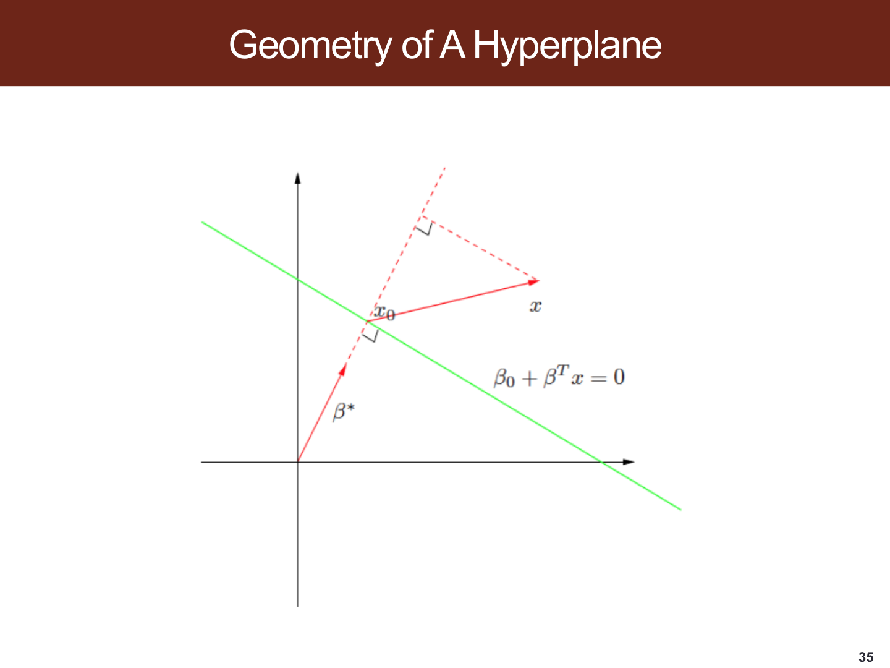

### 11.3 完全分离与新点预测

标签改为 $y_i\in\{-1,+1\}$，完全正确分离等价于

$$y_i f(x_i)>0,\qquad i=1,\ldots,n.$$

新点用 $\hat y=\operatorname{sign}(f(x))$。第 38 页显示满足训练分离的直线可能有无穷多条，需要额外原则决定选择哪一条。

第 37 页把离边界较远与“更有信心”联系起来。这里应区分：$|f(x)|/\lVert\beta\rVert$ 表示几何距离；$y f(x)/\lVert\beta\rVert$ 在已知真实标签时还反映是否分对。预测时真实标签未知，不能用它作为输入；远离边界也不自动等于高准确率或已校准的后验概率。

### 11.4 意义与应用场景：判断规则的方向与局部敏感性

法向量指出让线性分数增加最快的方向；点到边界的距离则描述在当前特征单位和欧氏度量下，至少需要多大的输入移动才可能跨过边界。这对理解线性分类器、检查边界附近的样本以及设立人工复核区域很有帮助。

例如把靠近边界的设备状态送给人工复核，可以将有限精力集中在模型区分较弱的区域。但复核规则仍要在验证数据上评估，因为距离小不保证预测一定错，距离大也不保证不会遇到分布外异常。

距离依赖特征尺度：金额按元还是万元记录，会影响未经标准化的欧氏几何。讨论“最近的样本”或“最大间隔”之前，应先明确各轴的单位和缩放方式。

## 12. 最大间隔分类器与硬间隔原问题

> 对应课件第 39～42 页。

### 12.1 函数间隔与几何间隔

对已正确分离的训练点，函数间隔为 $y_i f(x_i)$；几何间隔为

$$\gamma_i=\frac{y_i(\beta_0+x_i^T\beta)}{\lVert\beta\rVert_2}.$$

课件第 39 页把距离决策面最近的训练点距离定义为间隔 $M=\min_i\gamma_i$。第 41 页用字母 $C$ 表示同一类距离量，本文统一为 $M$。

最大间隔就是在所有完全分离面中，使最靠近边界的点也尽量远：

$$\max_{\beta_0,\beta,M}M,\qquad
\frac{y_i(\beta_0+x_i^T\beta)}{\lVert\beta\rVert_2}\ge M.$$

这里两边都是几何量；单纯放大系数无法让真实间隔增加。

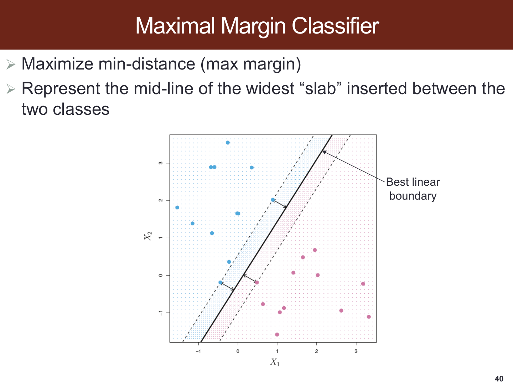

### 12.2 固定尺度得到标准约束

给定分离面，把 $\beta_0,\beta$ 同乘正常数不会改变边界。可选择规范化，使

$$\min_i y_i(\beta_0+x_i^T\beta)=1.$$

此时最近点到中线的距离为 $1/\lVert\beta\rVert$，最大化它等价于

$$\boxed{\min_{\beta_0,\beta}\frac12\lVert\beta\rVert_2^2
\quad\text{s.t.}\quad y_i(\beta_0+x_i^T\beta)\ge1.}$$

这就是课件推导的硬间隔线性最大间隔问题。两条支持平面分别是 $f(x)=+1$ 和 $f(x)=-1$；**单侧间隔是 $1/\lVert\beta\rVert$，整个分隔带宽度是 $2/\lVert\beta\rVert$**。

### 12.3 条件、优点与范围

硬间隔需要训练样本可线性分离。不可分时约束不可行；可分时也可能对极端点敏感。大间隔有助于控制模型复杂度，但不保证每一份测试数据上都优于所有其他分离面。

特征缩放会改变空间距离和最优分隔面，实际比较距离类方法时需关注训练集标准化。

**补充联系：** 软间隔会引入松弛变量与惩罚参数，核方法会改变内积/特征空间。本地课件此处推导的是硬间隔线性版本；第 41 页的 $C$ 是距离，不是软件 SVM 中常见的软间隔惩罚参数。

### 12.4 意义与应用场景：在许多训练正确的规则中作选择

最大间隔解决的问题是：训练数据已被多条直线完全分开，仍需一个原则决定用哪条。它选择离最近训练点也较远的边界，给局部扰动留出几何余量；在已经确定特征度量的条件下，这比只要求训练零错误提供了更多约束。

硬间隔适合作为可分数据的理想模型和理解支持向量方法的起点，例如两组经验证能线性分开的实验测量。实际的邮件、疾病、交易数据通常含有重叠和标签噪声，应比较允许错分的软间隔等模型。一个极端点就可能大幅限制硬间隔，因此“大间隔”不能直接等同于“对离群点不敏感”。

## 13. 拉格朗日对偶、支持向量与 QP

> 对应课件第 42～44 页。

### 13.1 拉格朗日函数

把约束写成 $1-y_i(\beta_0+x_i^T\beta)\le0$，取乘子 $\alpha_i\ge0$：

$$\mathcal L(\beta,\beta_0,\alpha)=\frac12\lVert\beta\rVert_2^2
-\sum_i\alpha_i[y_i(\beta_0+x_i^T\beta)-1].$$

拉格朗日函数本身依赖三组变量。对 $\beta,\beta_0$ 取下确界得到对偶函数，然后对满足条件的 $\alpha$ 最大化；第 42 页的写法把函数与取最小步骤写在一起，学习时分开更清楚。

### 13.2 驻点条件

$$\frac{\partial\mathcal L}{\partial\beta}=\beta-\sum_i\alpha_i y_ix_i=0
\quad\Longrightarrow\quad\boxed{\beta=\sum_i\alpha_iy_ix_i},$$

$$\frac{\partial\mathcal L}{\partial\beta_0}=-\sum_i\alpha_iy_i=0
\quad\Longrightarrow\quad\boxed{\sum_i\alpha_i y_i=0}.$$

斜率由训练点的加权组合构成。截距没有平方惩罚，因此它的驻点产生了等式约束。

### 13.3 代回得到对偶问题

利用驻点条件消去 $\beta,\beta_0$：

$$\boxed{\max_{\alpha}\sum_i\alpha_i-
\frac12\sum_i\sum_j\alpha_i\alpha_jy_iy_jx_i^Tx_j}$$

$$\boxed{\text{s.t.}\quad\alpha_i\ge0,\qquad\sum_i\alpha_iy_i=0.}$$

对偶只使用样本内积。其二次矩阵 $Q_{ij}=y_iy_jx_i^Tx_j$ 半正定，因此最大化目标是凹二次函数；等价最小化形式是凸 QP。课件第 44 页用 LP/QP 的一般形式说明可用优化软件求解，线性约束并不使整个问题成为 LP。

### 13.4 补充 KKT：哪些点决定边界

互补松弛给出

$$\alpha_i[y_i f(x_i)-1]=0.$$

所以 $\alpha_i>0$ 的点一定在支持平面上，满足 $y_i f(x_i)=1$。这些非零权重点参与最终预测：

$$f(x)=\beta_0+\sum_i\alpha_i y_i x_i^Tx.$$

若已找到一个 $\alpha_s>0$ 的支持点，可用 $\beta_0=y_s-x_s^T\beta$ 恢复截距。退化配置中，落在间隔边界上的点也可能有零乘子，因此不要把逆命题当作无条件成立。

### 13.5 补充一维算例

只有两点：$x_1=-1,y_1=-1$；$x_2=1,y_2=1$。原问题约束为 $\beta-\beta_0\ge1$ 和 $\beta+\beta_0\ge1$，最优为 $\beta=1,\beta_0=0$。

决策点为 0，单侧间隔为 1，分隔带宽为 2。对偶等式要求 $\alpha_1=\alpha_2=a$，目标为 $2a-2a^2$，最优 $a=1/2$；由 $\beta=\sum\alpha_i y_i x_i=1$ 得到相同解。

### 13.6 意义与应用场景：找到真正约束边界的样本

支持向量是对最优分隔面起作用的边界样本，并非最接近类别平均值的“典型样本”。检查它们可以帮助发现哪些近邻类别或可疑标注正在约束分类规则；在硬间隔可分问题中，远离间隔且乘子为零的点不直接出现在最终斜率表达中。

对偶将求解改写为样本内积之间的关系，是理解核方法的重要入口：若用合法的核函数代替内积，可以在隐式特征空间中构造边界。这一核扩展超出本地课件的线性推导，但解释了为什么要学习对偶，而不只记住原问题。

QP 则说明可以调用哪类优化工具。原问题主要有 $p+1$ 个参数，对偶有 $n$ 个乘子；对偶并不在所有数据规模上更快，样本数很大时也有存储和计算成本。

## 14. 分类评价：混淆矩阵、ROC、AUC 与阈值

> 对应课件第 45～46 页。

### 14.1 先确定谁是正类

设关注的事件为正类，例如违约或患病。本节矩阵采用“行是真实，列是预测”，与部分课件表的方向不同；计算时先看标签，不凭位置背公式。

| 真实类别 / 预测类别 | 预测负类 | 预测正类 | 真实总数 |
|---|---|---|---|
| 真实负类 | TN | FP | $N=TN+FP$ |
| 真实正类 | FN | TP | $P=FN+TP$ |

$P^*=TP+FP$ 是预测正类总数，和真实正类数 $P$ 不同。

### 14.2 各指标的分母决定问题含义

$$Error=\frac{FP+FN}{n},\qquad Accuracy=\frac{TP+TN}{n}.$$

$$Sensitivity=Recall=TPR=\frac{TP}{TP+FN},$$

$$Specificity=TNR=\frac{TN}{TN+FP},\qquad FPR=\frac{FP}{TN+FP}=1-Specificity,$$

$$Precision=PPV=\frac{TP}{TP+FP},$$

$$\boxed{F_1=\frac{2\,Precision\cdot Recall}{Precision+Recall}
=\frac{2TP}{2TP+FP+FN}.}$$

Recall 在“真实正类”中问抓住多少，Precision 在“预测正类”中问有多少是真的。F1 不直接使用 TN，所以不能完整描述全部错误类型；相应分母为零时应说明采用的软件约定或标为不可定义。

### 14.3 ROC 是一条随阈值变化的曲线

让概率或连续分数从高阈值逐渐降低，得到不同 $(FPR,TPR)$ 点，横轴为 FPR，纵轴为 TPR。

- 低阈值更容易判为正类，通常提高 Recall，同时增加 FPR。
- 阈值高于所有分数时全判负，对应 $(0,0)$；低于所有分数时全判正，对应 $(1,1)$。
- 靠近左上角表示在较低误报率下保留较高检出率。对角线对应无区分能力的随机排序基准。

ROC 需要一系列阈值的连续分数。只把最终 0/1 预测交给 ROC/AUC 会丢失排序信息，不能得到模型完整的阈值权衡。

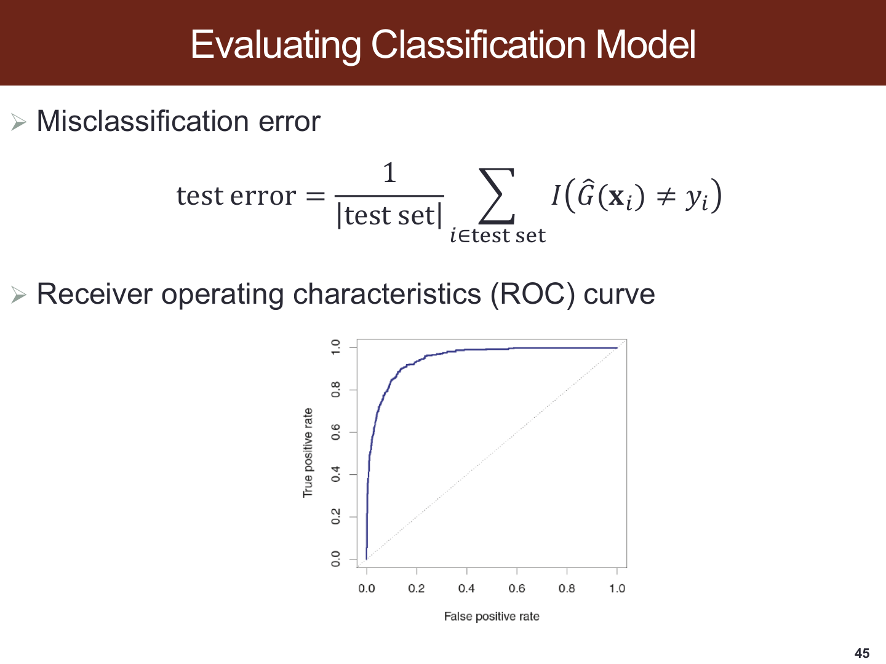

### 14.4 AUC 衡量排序，不等于准确率或校准

补充的概率解释为

$$AUC=P(s(X^+)>s(X^-))+\frac12P(s(X^+)=s(X^-)).$$

即随机抽取一正一负，模型把正类分数排得更高的概率，并对并列计半分。严格递增变换不改变排序，故不改变 AUC，却可能改变概率校准和固定数值阈值的分类结果。

AUC 高不保证阈值 0.5 下 Recall 高，也不说明预测的 0.8 就有约 80% 的实际发生率。正类罕见时，还应关注 Precision–Recall 等与部署目的直接相关的指标；这是对课件评价部分的实践补充。

### 14.5 Youden 指数与阈值选择

课件给出

$$J=Sensitivity+Specificity-1=TPR-FPR.$$

最大化 $J$ 相当于找 ROC 上离对角线垂直差最大的点。这是一种阈值准则，但没有自动纳入真实错分成本、处理能力或类别患病率带来的总体成本。

模型调参和阈值选择都应使用训练/验证数据，最终独立测试集用于一次评价；不能用测试集寻找最佳阈值后再把同一结果当作未参与选择的评估。

### 14.6 意义与应用场景：指标对应不同业务问题

| 概念 | 它帮助回答什么 | 适用场景举例 | 同时需要核对 |
|---|---|---|---|
| 混淆矩阵 | 错误分别落在哪些人/事件上 | 汇报漏诊、误报、漏拦交易的数量 | 正类定义、真实/预测轴、人群规模 |
| Accuracy / Error | 总体有多少分对/分错 | 错分成本接近、类别比例合理时的整体比较 | 类别不平衡下的简单基线 |
| Recall / Sensitivity | 真正的目标事件找到了多少 | 初筛疾病、召回潜在故障 | 误报量和后续处理能力 |
| Precision | 发出的告警中有多少是真的 | 人工反欺诈复核、工单升级 | 是否漏掉太多真实正类 |
| Specificity / FPR | 正常对象有多少被错误打扰 | 避免正常交易频繁被拦、减少无病人群复查 | 真实负类数量，低 FPR 也可能产生大量误报 |
| F1 | Precision 与 Recall 如何折中 | 两者都重要、需要同时报告一个概括值 | 不包含 TN，未表达具体错分成本 |
| ROC / AUC | 模型能否把正类普遍排在负类前 | 尚未确定业务阈值时比较排序能力 | 实际使用的低 FPR 区域、PR 表现和校准 |
| Youden $J$ | 哪个阈值让 TPR−FPR 最大 | 需要一个统计上的平衡候选阈值 | 是否符合实际成本及资源约束 |
| 概率校准 | 预测 20% 的对象中，发生率是否约 20% | 计算预期损失、分配随访资源 | 排序好并不自动校准好 |

例如有 100 万个真实负类，即使 FPR 只有 1%，也意味着约 1 万次误报。因而 FPR、Precision 和审核工作量必须结合人群规模理解。相反，只盯 Precision 也可能通过几乎不发告警来牺牲 Recall。

指标不能脱离行动：医疗初筛和最终确诊可能使用不同阈值；反欺诈的“进入复核”和“自动拒绝”也可能有不同成本。应先定义模型输出将触发什么，再确定评价和选阈值的方式。

### 深入讲解：一组分数同时算阈值指标与 AUC

**补充手算。**五个对象按分数从高到低排列为：$0.9(+),0.8(-),0.6(+),0.3(-),0.1(-)$，正类共 2 个、负类共 3 个。约定分数大于等于阈值即判正。

阈值取 0.7 时，只有前两个对象判正，故 $TP=1,FP=1,FN=1,TN=2$，Recall 为 $1/2$、Precision 为 $1/2$、Accuracy 为 $3/5$。阈值降至 0.5 时，前三个判正，变为 $TP=2,FP=1,FN=0,TN=2$，Recall 为 1、Precision 为 $2/3$、Accuracy 为 $4/5$。

本次降低阈值使 Precision 上升，因为新纳入的恰好是正类；更低阈值再纳入负类时它又会下降。因此 Recall 随阈值降低不减，但 Precision 不一定单调变化。

AUC 比较全部 $2\times3=6$ 对正负样本：分数 0.9 的正类胜过 3 个负类，分数 0.6 的正类胜过 0.3、0.1 两个负类，总共赢 5 对，没有并列，因此 $AUC=5/6\approx0.8333$。改变最终阈值不会改变这一组固定分数的 AUC。

**基础比例为何影响 Precision？**若部署正类比例为 $\pi$，在固定阈值的 TPR、FPR 下，

$$Precision=\frac{\pi\,TPR}{\pi\,TPR+(1-\pi)FPR}.$$

例如 TPR=0.8、FPR=0.1，$\pi=0.5$ 时 Precision 约为 0.889；$\pi=0.01$ 时仅约为 0.0748。这里假定类别内分数分布不变，仅改先验比例；更一般分布变化下，TPR/FPR 也可能变化。最终应在目标人群中验证，而非沿用平衡测试集的告警精度。

### PPT 第 46 页逐项讲解：混淆矩阵与分类指标

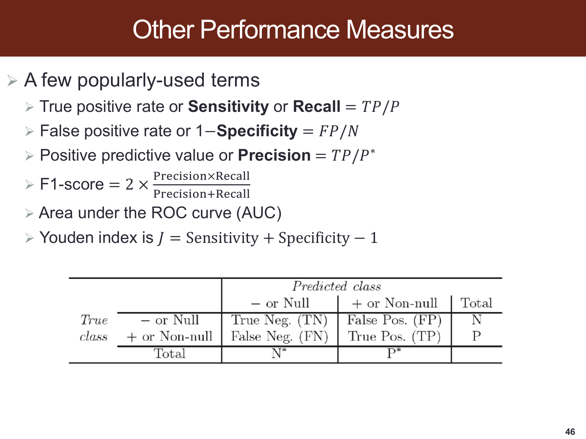

> 原课件：[第 46 页](../output/pdf/SDSC5001_Topic6_slides.pdf#page=46)。截图保留课件原貌，下面按阅读顺序解释；原页简写与笔误以正文核对为准。

**先读矩阵方向。**行是真实类别，列是预测类别；$P$ 是真实正类总数，$N$ 是真实负类总数，$P^*$ 是预测正类总数。Recall、FPR、Precision 的不同分母决定它们回答不同问题。

**F1 的分母是 Precision 与 Recall 之和。**原页给出的公式为 $2\,Precision\,Recall/(Precision+Recall)$，正文进一步化为 $2TP/(2TP+FP+FN)$。加号使它成为两者的调和平均；例如 Precision 与 Recall 都为 0.5 时，F1 也为 0.5。

**AUC 和 Youden 不等同于一个阈值下的准确率。**AUC 比较排序，Youden 为 $TPR-FPR$；它们都不能自动替代部署成本与人工复核能力。用同一组五个分数分别算阈值指标和正负配对 AUC，可把这些对象区分清楚。

### 外部拓展：类别越稀有，为什么相同 ROC 点仍可能产生很低的 Precision

**课内衔接：**[本章第 14 节](#section-14) · [原课件第 45 页](../output/pdf/SDSC5001_Topic6_slides.pdf#page=45)

**外部拓展｜把混淆矩阵与发生率连起来。**固定阈值，令 π=P(Y=1) 为正类比例，t=TPR 为召回率，f=FPR 为假阳性率。按总体概率计算：

$$Precision=\frac{\pi t}{\pi t+(1-\pi)f}.$$

分子是对象既为正类又被判正的概率，分母是所有被判正的概率。π、t、f 都是无单位比例；分母为零时 Precision 无通常定义，需要在软件中明确处理。

**自编手算。**同样 t=0.8、f=0.05，π=0.5 时 Precision=0.4/(0.4+0.025)≈0.9412；π=0.01 时则为 0.008/(0.008+0.0495)≈0.1391。若有 10,000 人，后者对应 80 个真正例、495 个假正例。ROC 坐标一样，工作量与判正可信度差很多。

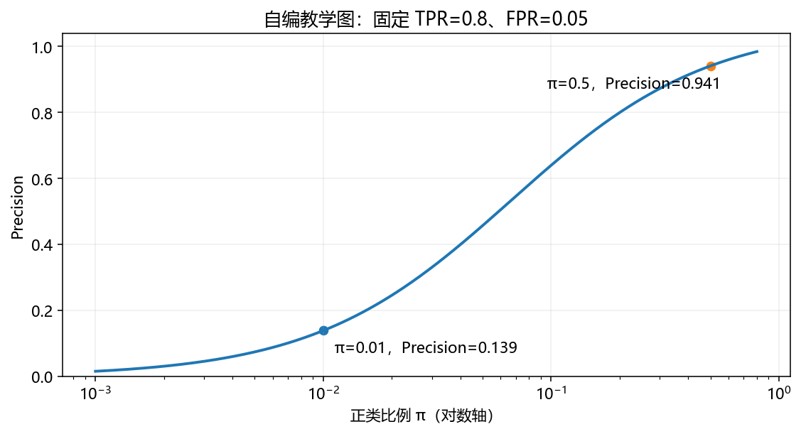

**读图。**横轴是正类发生率，纵轴是判正对象中的真正类比例；曲线并非某个模型在所有人群中的实际实测表现。它固定了两个类内错误率，仅展示基础发生率的数学影响。

PR 曲线画召回率对 Precision。若评分与标签独立，其总体随机基线为正类比例；有限样本曲线会波动。Average Precision 常按召回增量加权各阈值 Precision：$AP=\sum_k(R_k-R_{k-1})P_k$，k 是按召回递增整理的阈值位置，R_k、P_k 是该位置召回与精确率。它不一定等于用梯形法计算的 PR 面积。

**比较时要说清。**换人群、改变评测正负抽样比例，会改变 PR 的解释；只在类内分数分布保持不变时，ROC 才在总体上不因先验改变而改变。最终阈值仍应根据漏报成本、误报成本和处理容量，在训练/验证流程中决定。

**外部来源与阅读定位：**[scikit-learn：Precision–Recall 与 Average Precision](https://scikit-learn.org/stable/auto_examples/model_selection/plot_precision_recall.html)。本文推导与自编算例用于解释相应方法，不冒充来源中的实验结果。

## 15. 逐项复算课件信用卡违约示例

> 对应课件第 47 页。以下原始计数直接来自该页，新增指标标为补充。

课件的表是“行是预测，列是真实”。为保留对应关系，这里沿用原表方向：

| 预测违约 / 真实违约 | No（负类） | Yes（正类） | 合计 |
|---|---|---|---|
| No | 9644（TN） | 252（FN） | 9896 |
| Yes | 23（FP） | 81（TP） | 104 |
| 合计 | 9667 | 333 | 10000 |

课件已列出的结果：

$$Error=\frac{252+23}{10000}=2.75\%,$$

$$Sensitivity=\frac{81}{333}\approx24.32\%,$$

$$Specificity=\frac{9644}{9667}\approx99.7621\%,$$

$$FPR=\frac{23}{9667}\approx0.2379\%.$$

从同一表还可补充计算：

$$Precision=\frac{81}{104}\approx77.88\%,\qquad
F_1=\frac{162}{437}\approx37.07\%,$$

$$Accuracy=97.25\%,\qquad J\approx0.2409.$$

看似有 97.25% 准确率，但 333 名真实违约者中漏掉 252 名，漏报比例约 75.68%。若把所有人都判为不违约，准确率已有 $9667/10000=96.67\%$，说明类别不平衡时单看准确率很不充分。

现有阈值下，模型预测为违约的 104 人中约 78% 确实违约，但只找到了约四分之一的真实违约者。是否合适要看漏报与误报成本；表中没有连续分数，因此**无法仅用这一张混淆矩阵求出完整 ROC/AUC**。

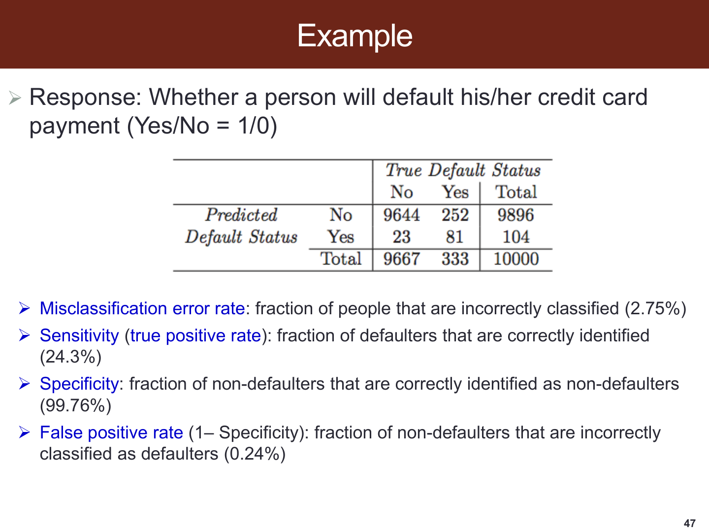

### 15.1 应用解释：这张表能支持哪些决定

如果业务把预测正类送去复核，当前规则会产生 104 个待处理对象，其中 81 个是真实违约者、23 个是误报；这描述复核量和目标命中情况。如果目标是覆盖更多违约者，252 个漏报说明还需检查召回不足，而不能只以 97.25% 准确率评价。

降低阈值可能找回部分漏报，也可能显著增加审核量，具体变化需要原始连续分数和验证数据。本表不能推算“把 Recall 提高到某数值需要多少人力”，也不能由预测违约直接推定是否应拒贷；后者还需要业务行动的收益与成本设定。

## 16. 方法对照与实际建模流程

| 方法 | 主要学习对象 | 关键假设/限制 | 原始线性特征下的边界 |
|---|---|---|---|
| LDA | 类均值、共享协方差、先验 | 类内高斯、共享协方差；逆矩阵需可处理 | 线性 |
| QDA | 类均值、各类协方差、先验 | 类内高斯；各类需更多数据 | 通常二次 |
| Naïve Bayes | 各类各特征的分布、先验 | 类别给定后的特征独立 | 取决于单变量分布与方差结构 |
| Logistic | 条件类别概率的 log-odds | 指定特征下 log-odds 线性 | 线性 |
| Probit | 正态 CDF 下的条件概率 | 指定特征下 probit 链接线性 | 线性 |
| 硬间隔最大间隔 | 直接学习分离超平面 | 训练集线性可分；对几何尺度敏感 | 线性 |

“线性边界”不意味着模型训练使用最小二乘；Logistic 使用条件似然，LDA 使用类内分布估计，最大间隔使用约束二次规划。

实践时先确定正类与评价目标，再保留独立测试集；在训练折内完成缺失处理、标准化、特征选择和参数估计。分类任务通常用分层划分保持各折类别构成；若存在同一病人多条记录、时间顺序或群组结构，则应按问题设计划分，不能机械随机切分。

按相同验证划分比较候选模型，使用适合任务的连续分数评价 AUC，并在验证数据上选择业务阈值；最后在独立测试集报告混淆矩阵、Recall、Precision、Specificity、F1 及需要的排序/校准指标。只有输出分数的模型也可以做 ROC，分数不必已经是概率。

与上一讲的联系：LDA 的协方差可收缩，Logistic 可加入 L1/L2 正则化，超平面方法也可通过惩罚控制复杂度。它们都需要用独立验证来权衡拟合和泛化。

## 17. 自测题与答案要点

以下是补充自测，不是课件原题。

**1. 为什么最大后验概率最小化错分率？** 预测为 $k$ 的条件 0–1 风险是 $1-p_k(x)$，所以选最大 $p_k$。成本不对称时要比较条件期望成本。

**2. 多分类 $h_1=h_2$ 一定是最终边界吗？** 不是。如果 $h_3$ 更大，两者相等不会改变预测；还需它们达到最大分数。

**3. LDA 的二次项为什么消失？** 因各类共用 $\Sigma$，$x^T\Sigma^{-1}x$ 对类别相同，在比较时抵消。

**4. QDA 的 $-\tfrac12\log|\Sigma_k|$ 可以删除吗？** 一般不能，协方差随类别变化，它参与比较。

**5. Naïve Bayes 要求预测变量在总体中独立吗？** 要求的是给定类别后的条件独立，总体独立与否不能直接替代这一假设。

**6. Logistic 中 $\beta_j=\log2$，特征增加 1 后概率翻倍吗？** 是 odds 翻倍。若原概率 0.2，则新概率为 $1/3$。

**7. Logistic 阈值从 0.5 改成 0.2，对应的线性分数阈值是多少？** 从 0 改为 $\log(0.2/0.8)=\log0.25\approx-1.3863$。

**8. Logistic 对数似然凹，是否必有有限唯一 MLE？** 不保证；还要考虑分离、有效秩与存在性等条件。

**9. IRLS 每次是对原始 $y$ 直接做普通 OLS 吗？** 不是。它用当前概率生成工作响应 $z$ 和权重 $W$，执行加权最小二乘更新。

**10. $f(x)$ 越大就表示离平面越远吗？** 只有固定参数尺度下才有相应关系；几何距离是 $|f(x)|/\lVert\beta\rVert$，正缩放不改变它。

**11. 规范化硬间隔下，单侧间隔与全带宽各多少？** 分别为 $1/\lVert\beta\rVert$ 与 $2/\lVert\beta\rVert$。

**12. 若 $\alpha_i>0$，该点满足什么？** 根据 KKT，$y_if(x_i)=1$，在支持平面上。逆命题在退化情况下不必成立。

**13. Recall 与 Precision 分母分别是什么？** 真实正类数 $TP+FN$ 和预测正类数 $TP+FP$。

**14. 严格递增变换分类分数会改变 AUC 吗？** 不改变排序则不改变 AUC，但概率校准和指定数值阈值的行为可能改变。

**15. 第 47 页 97.25% 准确率是否说明违约识别全面？** 不说明。Recall 仅约 24.32%，大多数违约被漏报；应同时看基线、错分类型和成本。

**16. 能否在测试集上最大化 Youden 指数再报告同一测试结果？** 这样测试数据参与了阈值选择，结果不再是独立评价。应在验证阶段选阈值。

## 18. 课件原文中需要核对的地方

| 页码 | 原页表述/符号 | 本笔记处理 |
|---|---|---|
| 4 | 以两类分数相等定义边界 | 多分类实际边界还要求并列最高 |
| 10 | 把若干组合学习方法列为直接估计类别 | 按概览理解，补充其也可输出分数/概率 |
| 12 | 多元正态密度写 $(2\pi)^{1/2}$ | 改为 $(2\pi)^{p/2}$，注明共同常数不影响分类比较 |
| 16 | 二次距离项前有两个负号 | 按高斯对数密度保留一个负号 |
| 21 | Logistic 写映到闭区间 $[0,1]$ | 有限线性预测子的精确值域为 $(0,1)$ |
| 30 | LDA 截距的最后一个均值括号写为和 | 应为 $\mu_1-\mu_0$，与第 12 页一致 |
| 30 | Logistic 与 LDA 只在拟合过程不同 | 说明共有线性 log-odds 形式，也有不同分布假设 |
| 37 | 以 $y^*f(x^*)$ 远离零表达预测信心 | 区分真实标签、预测标签、几何距离和概率校准 |
| 39、41 | 最小距离分别用 $M$、$C$ | 统一说明为单侧间隔，与软间隔软件参数区分 |
| 42 | 拉格朗日函数记号内同时写 min | 区分函数、对原变量求下确界和对偶最大化 |
| 46、47 | 混淆矩阵方向不同 | 逐表标明真实/预测轴，再按 TP/FP/FN/TN 计算 |

这是针对本地课件的学习核对，不代表教师发布的正式勘误。解题时先列清标签、目标函数和约定，再保持一致地推导。

## 19. 概念意义与应用指南：把一讲知识连成流程

> 本节为应用补充。具体任务的候选模型、成本和阈值都需通过实际数据验证；以下例子说明如何提出问题。

### 19.1 先明确模型输出将用来做什么

| 使用目的 | 需要保留的输出 | 对应概念与检查 |
|---|---|---|
| 判断属于哪一类 | 类别标签及其决策依据 | 分类器、边界、混淆矩阵 |
| 从高到低优先处理 | 连续分数 | 排序、ROC/AUC、给定处理量下的命中情况 |
| 估计风险并计算成本 | 对目标人群可靠的概率 | 后验概率、先验、校准、成本敏感阈值 |
| 理解哪些特征关联结果 | 系数、分布参数与不确定性 | Logistic OR、LDA 类均值/协方差、模型假设 |

同一模型可以承担多种用途，但检验目标不同。排序好不保证概率可靠，系数易解释不保证因果成立，训练分得开不保证测试准确。

### 19.2 场景一：信用卡违约与有限复核资源

**任务定义：** 正类为真实违约，输入为决策当时已可用的客户和账户特征。应先问模型用于风险排序、分配复核，还是直接触发某项行动，因为不同用途有不同的代价。

**候选方法：** Logistic 可提供可解释的风险基线；若连续特征的类内分布大致满足相应假设，也可比较 LDA/QDA。不能仅凭任务名字指定最优模型。

**概念如何起作用：** 后验概率衡量个体风险；成本决定是否值得复核；Recall 表示覆盖了多少违约者；Precision 表示复核对象中目标事件比例；实际复核数决定资源是否足够。若只能处理固定数量，应在验证数据上按分数排序并检查该处理量下的 Recall、Precision 和成本。

**与原文连接：** [第 7 节](#section-7)理解概率与 OR，[第 14 节](#section-14)选择评价目标，[第 15 节](#section-15)复算原课件的 104 个预测正类。

### 19.3 场景二：疾病初筛与后续复查

**任务定义：** 正类为患病，模型用于决定是否进入后续检查。筛查对象的基础患病率影响后验概率；同一种检测结果在不同人群中不能无条件解释为相同风险。

**候选方法：** 若若干连续测量的类内形状相近，可将 LDA 作为候选；若不同类别的方差结构差异明显、样本也足够，可比较 QDA。希望直接建模风险且不作类内高斯假设时，可考虑 Logistic；三个互斥疾病类型则可考虑多分类模型。

**概念如何起作用：** 若漏诊成本较高，可考虑较低的筛查阈值，同时检查 Specificity、Precision、复查数量和实际成本。高 Recall 的筛查结果表示“建议进一步检查”，不应自动当成最终诊断。阈值选择还应符合真实使用流程。

**与原文连接：** [第 3 节](#section-3)理解先验与成本，[第 4～5 节](#section-4)比较分布假设，[第 9 节](#section-9)区分二类与多类任务。

### 19.4 场景三：垃圾邮件分类与高维词汇

**任务定义：** 正类为垃圾邮件，输入是词是否出现、词频或其他邮件特征。常有很多候选词，特征之间也有明显依赖。

**候选方法：** NB 通过分解类内分布，能提供适合比较的简单基线；带正则化的 Logistic 或线性支持向量方法也可作为候选。真实邮件通常有重叠、噪声，不宜直接要求课件的硬间隔完全分离。

**概念如何起作用：** 词汇表示决定使用哪类 NB；重复词证据提醒我们检查条件独立假设带来的影响；把正常邮件误送垃圾箱和漏掉垃圾邮件的成本不同，因此要结合阈值、Precision、Recall 及错误样本检查。边界分数可用于排序，但不能直接当作已校准概率。

**与原文连接：** [第 6 节](#section-6)理解 NB 的简化，[第 11～13 节](#section-11)理解分数、间隔和支持向量，[第 14 节](#section-14)区分误报与漏报。

### 19.5 复习时用四个问题检查是否真正理解

1. **它解决哪一步？** 标签表示、概率建模、参数求解、决策选择，还是结果评价？例如 MLE 是学习准则，IRLS 是求解算法，AUC 是评价指标。
2. **它靠什么假设获得简化？** 共享协方差、条件独立、线性 log-odds 或完全可分，分别让哪些估计与优化变得容易？
3. **在这个场景中，假设哪里可能失效？** 样本不足、类内形状不同、特征重复、类别重叠或人群变化，都可能改变选择。
4. **怎样用未参与选择的数据检验它有用？** 同时看适合行动的指标、错误类型、参数/阈值选择过程及基线表现。
