# SDSC5001 Topic 7：超越线性详细笔记

[课程总目录](README.md) · [逐页对应表](Topic7_%E8%AF%BE%E4%BB%B6%E9%80%90%E9%A1%B5%E5%AF%B9%E5%BA%94%E8%A1%A8.md) · [离线 HTML 阅读版](5001_Topic7_%E8%AF%A6%E7%BB%86%E7%AC%94%E8%AE%B0.html)

> 来源：本地 `SDSC5001_Topic 7 Moving beyond linearity.pptx`，共 26 页，PDF 页序与幻灯片页序一致。按课件顺序讲解，补充推导、手算、应用与自测；补充内容和课件表述核对均在正文注明。
>
> Lumen 用法：在 Obsidian 的 guideline 笔记库点击“Lumen 本节定位”或“Lumen 图示定位”，可回到原 PDF 标记区域；标记备注可返回对应中文小节。图片为原课件局部截图，公式保留为可编辑 LaTeX。

## 阅读导航

- [0. 超越线性：改变函数形状，保留可估计结构](#section-0)
- [1. 多项式回归为何仍是线性模型](#section-1)
- [2. 多项式 Logistic：线性的是 log-odds](#section-2)
- [3. 阶梯函数：用分箱替代一条全局曲线](#section-3)
- [4. 交互项：一个变量的效应依赖另一个](#section-4)
- [5. 分段多项式与连续性约束](#section-5)
- [6. 基函数统一视角](#section-6)
- [7. 三次样条与截断幂基](#section-7)
- [8. 自然样条与结点选择](#section-8)
- [9. 平滑样条：用曲率惩罚控制复杂度](#section-9)
- [10. 平滑参数、有效自由度与极端情况](#section-10)
- [11. 局部线性回归：每个预测点拟一条局部直线](#section-11)
- [12. GAM：多个可解释曲线的相加](#section-12)
- [13. 方法对照与选择逻辑](#section-13)
- [14. 自测与参考答案](#section-14)

> **深化阅读（2026-10-31）：**本章新增 4 组分节详解与 3 张 PPT 完整截图。新增推导与手算均为配套补充，截图旁附逐项解读，沿用原有课件定位。
>
> [中心化改变系数含义，但不改变多项式空间](#deep-t7-s1) · [在结点左右逐项验证三次样条](#deep-t7-s7) · [边界处局部平均为什么会偏](#deep-t7-s11) · [GAM 回拟合究竟在减掉什么](#deep-t7-s12)

> **外部资料强化（2026-11-01）：**本章在对应知识点内加入以下拓展，所有数值算例与教学图明确区分于课件原始内容。外部来源在小节末就近提供。
>
> [“natural”边界条件不一定意味着软件自动线性外推](#ext-t7-extrapolate) · [平滑样条为什么也是一个带惩罚的线性代数问题](#ext-t7-smooth) · [可加的非线性仍然不能自动表示交互](#ext-t7-gam_interaction)

## 0. 超越线性：改变函数形状，保留可估计结构
> [课件第 1 页](../output/pdf/SDSC5001_Topic7_slides.pdf#page%3D1) · [Lumen 本节定位](obsidian://lumen-pdf?vault=guideline&file=course%2F5001%2Foutput%2Fpdf%2FSDSC5001_Topic7_slides.pdf&annotation=sdsc5001-t7-a74ccc0f51-page-001) · [逐页索引](Topic7_%E8%AF%BE%E4%BB%B6%E9%80%90%E9%A1%B5%E5%AF%B9%E5%BA%94%E8%A1%A8.md)

本章回答：当 $E(Y\mid X=x)$ 不是一条直线时，怎样拟合更合理的函数？主要路线是全局多项式、分箱阶梯函数、分段多项式与样条、局部回归，以及把多个单变量曲线组合起来的 GAM。

统一记 $n$ 为样本数，$x_i$ 为一维特征，$y_i$ 为响应，$K$ 为内部结点数或在相应小节明确说明的基函数数，$\lambda$ 为平滑惩罚参数，$s$ 为局部拟合邻域的大小。不同方法中“自由度”的含义可能不同，不能仅按公式里写了几个字母比较复杂度。

学习的核心是分清：哪些部分预先固定、哪些部分从数据学习；局部拟合之间怎样连接；调参控制的是结点、平滑程度还是邻域；模型在边界与数据稀疏区怎样表现。

## 1. 多项式回归为何仍是线性模型
> [课件第 2–3 页](../output/pdf/SDSC5001_Topic7_slides.pdf#page%3D2) · [Lumen 本节定位](obsidian://lumen-pdf?vault=guideline&file=course%2F5001%2Foutput%2Fpdf%2FSDSC5001_Topic7_slides.pdf&annotation=sdsc5001-t7-a74ccc0f51-page-002) · [逐页索引](Topic7_%E8%AF%BE%E4%BB%B6%E9%80%90%E9%A1%B5%E5%AF%B9%E5%BA%94%E8%A1%A8.md)

$$Y_i=\beta_0+\beta_1x_i+\beta_2x_i^2+\cdots+\beta_dx_i^d+\epsilon_i.$$

它对 $x$ 非线性，但对未知系数 $\beta$ 线性。设计矩阵每行为 $(1,x_i,x_i^2,\ldots,x_i^d)$，所以可以用第 4 章的最小二乘、标准误与检验。一个 $d$ 次多项式含 $d+1$ 个系数，并不需要非线性优化来估计这些系数。

高次幂可能高度相关且数值尺度很大。使用中心化 $u_i=x_i-\bar x$、适当缩放或正交多项式可改善数值条件。中心化不保证不同次幂互相正交，也不会自动消除过拟合。

### 1.1 为什么次数不宜只按训练误差选

低次多项式可能欠拟合，高次可能在样本稀疏的边界大幅摆动；全局多项式中，一个局部变化可能影响整条曲线。次数应结合验证误差、数据覆盖和任务解释决定。课件说常用 2、3、4 次，是实用倾向，不是数学上禁止更高次。

### 1.2 曲线的区间

设 $z(x_0)=(1,x_0,\ldots,x_0^d)^T$，则 $\hat f(x_0)=z(x_0)^T\hat\beta$，其均值估计方差为 $\sigma^2z(x_0)^T(X^TX)^{-1}z(x_0)$。区间变宽可能来自边界缺数据，而不只是曲线高低。

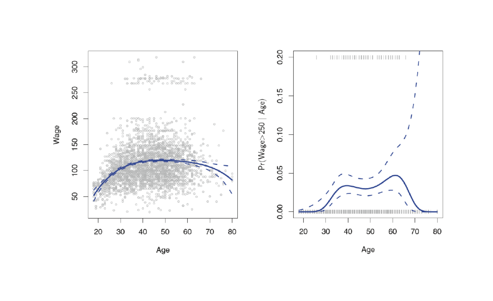

> 图源：[原课件第 3 页](../output/pdf/SDSC5001_Topic7_slides.pdf#page%3D3) · [Lumen 图示定位](obsidian://lumen-pdf?vault=guideline&file=course%2F5001%2Foutput%2Fpdf%2FSDSC5001_Topic7_slides.pdf&annotation=sdsc5001-t7-a74ccc0f51-crop-003)。读图：四次多项式拟合 Wage 及高工资概率；边界处虚线区间明显变宽。

### 深入讲解：中心化改变系数含义，但不改变多项式空间

**补充推导。**对二次模型 $f(x)=\beta_0+\beta_1x+\beta_2x^2$，令 $u=x-c$，即 $x=u+c$，代入并整理：

$$f(x)=(\beta_0+\beta_1c+\beta_2c^2)
+(\beta_1+2c\beta_2)u+\beta_2u^2.$$

新的截距是 $f(c)$，新的线性项是 $f'(c)$，二次项不变。这说明中心化后的一次项不再表示原点附近的斜率，而是参考位置 $c$ 附近的变化率。

例如 $f(x)=1+2x+0.5x^2$，选 $c=2$，模型变为 $7+4u+0.5u^2$。在 $x=2$，函数值为 7、局部斜率为 4；从 $x=2$ 增至 3 的实际变化是 4.5，而不是 4，因为二次曲率也参与这一整单位变化。

一般二次曲线的变化率为 $\beta_1+2\beta_2x$，所以不能只把 $\beta_1$ 当作“所有位置上每增一单位的效应”。Logistic 多项式还要继续经过链接函数：$dp/dx=p(1-p)\,d\eta/dx$，概率变化率既依赖多项式斜率，也依赖当前位置的概率。

无惩罚、相同次数且满秩的 OLS 中，中心化前后张成相同列空间，拟合值相同。若对新旧系数直接施加同一个数值的惩罚，优化问题未必仍等价，因为惩罚本身也随坐标变换改变。

## 2. 多项式 Logistic：线性的是 log-odds
> [课件第 4 页](../output/pdf/SDSC5001_Topic7_slides.pdf#page%3D4) · [Lumen 本节定位](obsidian://lumen-pdf?vault=guideline&file=course%2F5001%2Foutput%2Fpdf%2FSDSC5001_Topic7_slides.pdf&annotation=sdsc5001-t7-a74ccc0f51-page-004) · [逐页索引](Topic7_%E8%AF%BE%E4%BB%B6%E9%80%90%E9%A1%B5%E5%AF%B9%E5%BA%94%E8%A1%A8.md)

把高收入定义为 $Y^*=\mathbf1\{Wage>250\}$，课件的 Wage 以千美元为尺度，对应年收入 250,000 美元。多项式 Logistic 写成

$$\eta(x)=\beta_0+\sum_{j=1}^d\beta_jx^j,\qquad P(Y^*=1\mid x)=\frac{e^{\eta(x)}}{1+e^{\eta(x)}}.$$

多项式放在 logit 尺度上，概率仍位于 $(0,1)$。不能把同一多项式直接当作概率，否则可能越界。其系数用 Bernoulli 似然估计，不是直接套普通 OLS。

一幅图似乎出现“两群工资”只能提出进一步分析的想法，不足以证明总体确实由两个独立分布组成。阈值 250 是任务定义的一部分，调整阈值就改变了分类目标。

## 3. 阶梯函数：用分箱替代一条全局曲线
> [课件第 5–7 页](../output/pdf/SDSC5001_Topic7_slides.pdf#page%3D5) · [Lumen 本节定位](obsidian://lumen-pdf?vault=guideline&file=course%2F5001%2Foutput%2Fpdf%2FSDSC5001_Topic7_slides.pdf&annotation=sdsc5001-t7-a74ccc0f51-page-005) · [逐页索引](Topic7_%E8%AF%BE%E4%BB%B6%E9%80%90%E9%A1%B5%E5%AF%B9%E5%BA%94%E8%A1%A8.md)

给定切点 $c_1<\cdots<c_K$，构造 $K+1$ 个区间指示函数 $C_0,\ldots,C_K$。例如 $C_0(x)=\mathbf1\{x<c_1\}$，$C_K(x)=\mathbf1\{x\ge c_K\}$，中间各项对应半开区间。每个 $x$ 恰好属于一箱，所以 $\sum_{k=0}^KC_k(x)=1$。

带截距时删去一个基准箱：

$$Y_i=\beta_0+\sum_{k=1}^K\beta_k C_k(x_i)+\epsilon_i.$$

基准箱拟合均值为 $\beta_0$，第 $k$ 箱为 $\beta_0+\beta_k$。若无其他变量、平方损失且每箱非空，该模型在每箱的预测就是该箱样本均值。截距加全部 $K+1$ 个指示变量会完全共线。

**补充手算。**切点为 30 和 50，若拟合系数为 $(\beta_0,\beta_1,\beta_2)=(80,20,10)$，则三个年龄区间预测依次为 80、100、90。中间箱相对基准高 20，而第三箱并不是在中间箱上再加 10。

阶梯模型易解释，但在切点跳跃，箱内所有差异被抹平。切点两侧 49.9 与 50.1 的对象可能得到明显不同预测。分箱位置和数量是建模选择，需要验证；按数据分位数选切点时也应在训练部分确定。

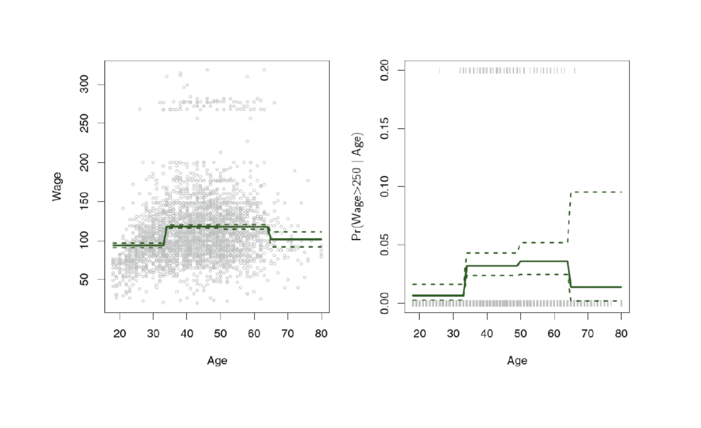

> 图源：[原课件第 7 页](../output/pdf/SDSC5001_Topic7_slides.pdf#page%3D7) · [Lumen 图示定位](obsidian://lumen-pdf?vault=guideline&file=course%2F5001%2Foutput%2Fpdf%2FSDSC5001_Topic7_slides.pdf&annotation=sdsc5001-t7-a74ccc0f51-crop-007)。读图：阶梯函数拟合；箱内常数、边界跳变是模型结构，而非绘图误差。

## 4. 交互项：一个变量的效应依赖另一个
> [课件第 8 页](../output/pdf/SDSC5001_Topic7_slides.pdf#page%3D8) · [Lumen 本节定位](obsidian://lumen-pdf?vault=guideline&file=course%2F5001%2Foutput%2Fpdf%2FSDSC5001_Topic7_slides.pdf&annotation=sdsc5001-t7-a74ccc0f51-page-008) · [逐页索引](Topic7_%E8%AF%BE%E4%BB%B6%E9%80%90%E9%A1%B5%E5%AF%B9%E5%BA%94%E8%A1%A8.md)

$$E(Y\mid x_1,x_2)=\beta_0+\beta_1x_1+\beta_2x_2+\beta_{12}x_1x_2.$$

对 $x_1$ 的局部变化率为 $\partial f/\partial x_1=\beta_1+\beta_{12}x_2$。因此 $\beta_1$ 是 $x_2=0$ 时的斜率；如果零点缺乏实际意义，可先中心化解释变量。

补充算例：$f=10+2x_1+3x_2+0.5x_1x_2$，当 $x_2=0$ 时 $x_1$ 增加一单位，均值增加 2；当 $x_2=4$ 时增加 4。交互描述条件关系，观察数据中的这一项仍不自动具有因果意义。

交互模型与加性模型的区别在于，前者允许两个变量的联合组合产生超出各自单独贡献之和的变化。这一思想会在 GAM 的限制与扩展中再次出现。

## 5. 分段多项式与连续性约束
> [课件第 9–12 页](../output/pdf/SDSC5001_Topic7_slides.pdf#page%3D9) · [Lumen 本节定位](obsidian://lumen-pdf?vault=guideline&file=course%2F5001%2Foutput%2Fpdf%2FSDSC5001_Topic7_slides.pdf&annotation=sdsc5001-t7-a74ccc0f51-page-009) · [逐页索引](Topic7_%E8%AF%BE%E4%BB%B6%E9%80%90%E9%A1%B5%E5%AF%B9%E5%BA%94%E8%A1%A8.md)

在结点 $c$ 左右分别拟合一个三次多项式，未经连接约束时共 8 个系数。第 10 页的曲线在年龄 50 处跳跃，说明分开拟合不能保证合理连接。

若要求函数连续，有 $f_-(c)=f_+(c)$ 一条约束；再要求一阶导连续，增加 $f_-'(c)=f_+'(c)$；要求二阶导连续，再增加一条。于是两段三次曲线有 $8-3=5$ 个自由系数。

这些约束分别控制数值无跳跃、切线无折角、弯曲程度的连接。三阶导数可以在结点跳变，所以三次样条仍能在不同区域改变形状。若每个结点都要求三阶导也连续，分段三次就会退化为同一条全局三次曲线。

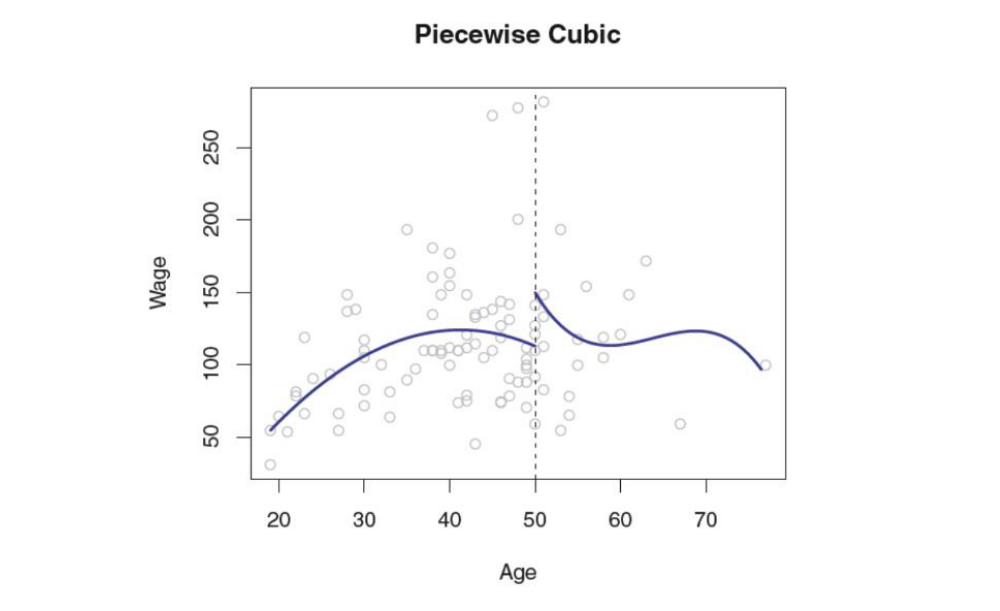

> 图源：[原课件第 10 页](../output/pdf/SDSC5001_Topic7_slides.pdf#page%3D10) · [Lumen 图示定位](obsidian://lumen-pdf?vault=guideline&file=course%2F5001%2Foutput%2Fpdf%2FSDSC5001_Topic7_slides.pdf&annotation=sdsc5001-t7-a74ccc0f51-crop-010)。读图：两段独立三次多项式在结点处出现跳跃。

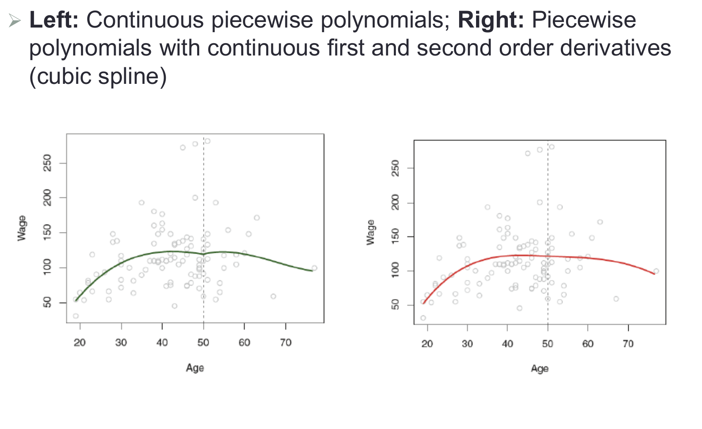

> 图源：[原课件第 12 页](../output/pdf/SDSC5001_Topic7_slides.pdf#page%3D12) · [Lumen 图示定位](obsidian://lumen-pdf?vault=guideline&file=course%2F5001%2Foutput%2Fpdf%2FSDSC5001_Topic7_slides.pdf&annotation=sdsc5001-t7-a74ccc0f51-crop-012)。读图：仅函数连续与函数及前两阶导数连续的对比，理解不同约束的作用。

## 6. 基函数统一视角
> [课件第 13 页](../output/pdf/SDSC5001_Topic7_slides.pdf#page%3D13) · [Lumen 本节定位](obsidian://lumen-pdf?vault=guideline&file=course%2F5001%2Foutput%2Fpdf%2FSDSC5001_Topic7_slides.pdf&annotation=sdsc5001-t7-a74ccc0f51-page-013) · [逐页索引](Topic7_%E8%AF%BE%E4%BB%B6%E9%80%90%E9%A1%B5%E5%AF%B9%E5%BA%94%E8%A1%A8.md)

把固定已知的函数 $b_j$ 作为新特征：

$$Y_i=\beta_0+\sum_{j=1}^M\beta_jb_j(x_i)+\epsilon_i.$$

多项式用 $x,x^2,\ldots$，阶梯函数用区间指标，样条用能表达分段与平滑约束的基。拟合时对参数仍是线性的；复杂度来自基的数量、位置和惩罚方式。

“基函数固定”是相对于本次系数拟合而言。若结点位置或标准化参数从数据中估计，那么它们也是学习流程的一部分，交叉验证时需要放进训练折。不同基可以张成同一个函数空间，系数数值可能不同，拟合曲线却相同。

## 7. 三次样条与截断幂基
> [课件第 14 页](../output/pdf/SDSC5001_Topic7_slides.pdf#page%3D14) · [Lumen 本节定位](obsidian://lumen-pdf?vault=guideline&file=course%2F5001%2Foutput%2Fpdf%2FSDSC5001_Topic7_slides.pdf&annotation=sdsc5001-t7-a74ccc0f51-page-014) · [逐页索引](Topic7_%E8%AF%BE%E4%BB%B6%E9%80%90%E9%A1%B5%E5%AF%B9%E5%BA%94%E8%A1%A8.md)

给定 $K$ 个内部结点 $\xi_1,\ldots,\xi_K$，三次样条可写成

$$f(x)=\beta_0+\beta_1x+\beta_2x^2+\beta_3x^3+\sum_{k=1}^K\theta_k(x-\xi_k)_+^3.$$

其中 $(u)_+=\max(u,0)$。结点左侧对应项为 0，右侧为三次多项式。该项的一阶导是 $3(x-\xi)_+^2$，二阶导是 $6(x-\xi)_+$，在结点两侧都连续；三阶导发生跳变。因此基的形式自动满足样条连接条件。

一般三次回归样条共有 $K+4$ 个系数，包括截距。也可从计数推导：$K+1$ 段各四个系数，减去每个结点的三条约束，得 $4(K+1)-3K=K+4$。

**补充例子。**$f(x)=1+2x+0.1x^3-0.1(x-3)_+^3$。在 $x<3$ 时截断项不起作用，在 $x>3$ 时开始修正三次项；在 $x=3$ 处值、一阶导、二阶导接得上。这个算例展示“局部改变形状”，不是课件数据的拟合结果。

### 深入讲解：在结点左右逐项验证三次样条

沿用补充函数 $f(x)=1+2x+0.1x^3-0.1(x-3)_+^3$。在结点左侧，$f_-(x)=1+2x+0.1x^3$；右侧展开为

$$f_+(x)=1+2x+0.1x^3-0.1(x^3-9x^2+27x-27)
=3.7-0.7x+0.9x^2.$$

结点处左值为 $1+6+2.7=9.7$，右值为 $3.7-2.1+8.1=9.7$。左导数 $2+0.3x^2$ 在 3 处为 4.7，右导数 $-0.7+1.8x$ 在 3 处也为 4.7。左二阶导 $0.6x$ 和右二阶导 1.8 在结点处仍相等。

但是左三阶导为 0.6、右三阶导为 0，因此曲线可在不破坏前两阶平滑性的前提下改变弯曲方式。这就是截断三次幂基自动满足连接约束的具体过程。

注意右侧在本例恰好降为二次，是系数选择造成的，并不表示每条三次样条在结点右边都降次；也不表示它是自然样条。自然样条还需要边界条件，本例右侧二阶导始终为 1.8，不能作为线性尾部延伸。

若有 3 个内部结点，一般三次样条含 $3+4=7$ 个自由系数；同一固定边界下增加两个自然约束后为 5。先写结点数是否含边界，再数约束，比记忆孤立的自由度公式可靠。

### PPT 第 12 页逐项讲解：从连续分段曲线到三次样条

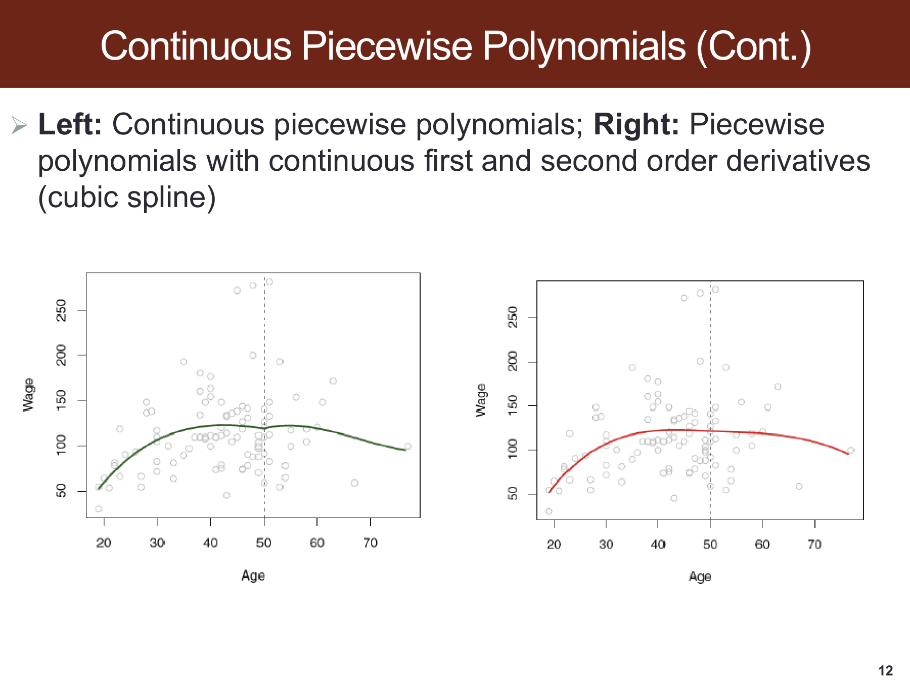

> 原课件：[第 12 页](../output/pdf/SDSC5001_Topic7_slides.pdf#page=12)。截图保留课件原貌，下面按阅读顺序解释；原页简写与笔误以正文核对为准。

**两图都把年龄区域在结点附近连接起来。**左图只保证函数值接上，仍可能在连接位置出现切线或弯曲程度的不协调；右图增加一阶、二阶导连续条件。

**连续不是同一种平滑要求。**值相等避免跳跃，一阶导相等避免折角，二阶导相等使曲率变化更协调。这三条约束解释了为什么两段三次的 8 个系数减少为 5。

**图形用于建立直觉，导数才是检验。**补充函数已经在结点 3 两侧分别代入值、一阶导和二阶导，不需要靠肉眼判断“看起来平滑”来证明连接条件。图中的年龄结点与自编手算结点不同。

## 8. 自然样条与结点选择
> [课件第 15–16 页](../output/pdf/SDSC5001_Topic7_slides.pdf#page%3D15) · [Lumen 本节定位](obsidian://lumen-pdf?vault=guideline&file=course%2F5001%2Foutput%2Fpdf%2FSDSC5001_Topic7_slides.pdf&annotation=sdsc5001-t7-a74ccc0f51-page-015) · [逐页索引](Topic7_%E8%AF%BE%E4%BB%B6%E9%80%90%E9%A1%B5%E5%AF%B9%E5%BA%94%E8%A1%A8.md)

自然三次样条在边界外作线性延伸，常用边界条件为端点二阶导数为 0。相比一般三次曲线，它对两端作额外约束，通常能减少边界处的摆动和方差，但并不能保证在任意远处外推都正确。

数自由度时必须说明结点约定：若 $K$ 是固定边界 $a,b$ 之间的内部结点数，一般三次样条有 $K+4$ 个系数，两个自然边界约束后为 $K+2$。若教材把边界也计入“结点数”，表达会变，不能只记一个孤立的 $K$。

结点可等距放置，也可按分位数使各段有较接近的数据量。课件举 25%、50%、75% 的年龄分位数。结点越多通常越灵活，但需要足够数据支持；CV 可以选择数量或整个复杂度方案。

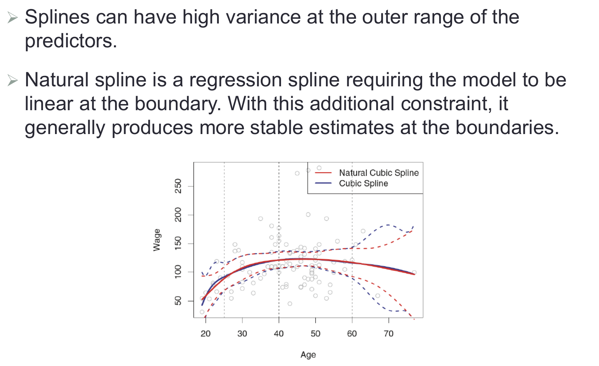

> 图源：[原课件第 15 页](../output/pdf/SDSC5001_Topic7_slides.pdf#page%3D15) · [Lumen 图示定位](obsidian://lumen-pdf?vault=guideline&file=course%2F5001%2Foutput%2Fpdf%2FSDSC5001_Topic7_slides.pdf&annotation=sdsc5001-t7-a74ccc0f51-crop-015)。读图：一般三次样条与自然样条的边界区间，额外线性约束有助于稳定尾部。

### 外部拓展：“natural”边界条件不一定意味着软件自动线性外推

**课内衔接：**[本章第 8 节](#section-8) · [原课件第 15 页](../output/pdf/SDSC5001_Topic7_slides.pdf#page=15) · [复用原有 Lumen 定位](obsidian://lumen-pdf?vault=guideline&file=course%2F5001%2Foutput%2Fpdf%2FSDSC5001_Topic7_slides.pdf&annotation=sdsc5001-t7-a74ccc0f51-page-015)

**外部拓展｜核对统计定义与软件对象的区别。**本节讨论的统计自然样条基通常在边界外按线性尾部延伸。但某些三次插值器的 `bc_type="natural"` 只规定两端二阶导数为零，默认外推仍延长最外侧的三次多项式。端点处曲率为零，不等于端点之外处处曲率为零。

**自编精确例子。**对三个点 (0,0)、(1,1)、(2,0)，用 SciPy `CubicSpline(...,bc_type="natural")` 插值。右端写作 x=2+t，其中 t 是超出边界的距离，该对象最右段延伸为

$$s(2+t)=-\frac32t+\frac12t^3.$$

s 是插值函数，此处小写 s 不是残差标准差。端点 t=0 时，s=0、$s'=-3/2$、$s''=0$；但 t>0 后二阶导为 3t，不再为零。x=3 时 s=−1，x=4 时 s=1，出现回弯。若另按端点切线线性延伸，则对应值为 −1.5、−3。

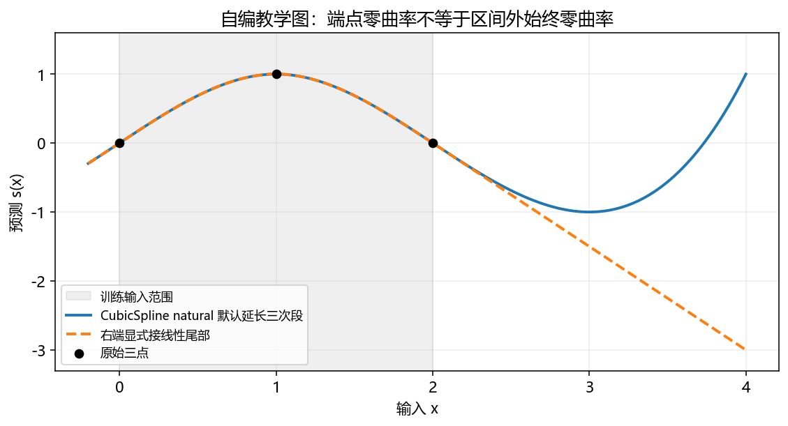

**读图。**灰色区域为训练输入覆盖的 [0,2]，两条线在区间内完全一致；在区间外，蓝线继续最外三次段，橙线显式接端点切线。原始三点、边界和延伸规则都标在图中，不能只凭方法名判断外推形状。

**实际使用。**明确使用的是回归样条、平滑样条还是插值器，检查预测 API 的边界处理；对超过训练范围的输入，决定拒绝、限制范围、使用物理规律或明确尾部模型。普通区间内随机 CV 不能充分评价很远处外推。

**自测。**两端二阶导等于零，是否能推出两端之外函数为直线？不能；还需要在区间外施加线性形式或全程零二阶导等约束。本例就是反例。

**外部来源与阅读定位：**[SciPy：CubicSpline 边界条件与外推](https://docs.scipy.org/doc/scipy/tutorial/interpolate/extrapolation_examples.html#cubicspline-extend-the-boundary-conditions)。本文推导与自编算例用于解释相应方法，不冒充来源中的实验结果。

## 9. 平滑样条：用曲率惩罚控制复杂度
> [课件第 17–18 页](../output/pdf/SDSC5001_Topic7_slides.pdf#page%3D17) · [Lumen 本节定位](obsidian://lumen-pdf?vault=guideline&file=course%2F5001%2Foutput%2Fpdf%2FSDSC5001_Topic7_slides.pdf&annotation=sdsc5001-t7-a74ccc0f51-page-017) · [逐页索引](Topic7_%E8%AF%BE%E4%BB%B6%E9%80%90%E9%A1%B5%E5%AF%B9%E5%BA%94%E8%A1%A8.md)

平滑样条不先固定一个很小的函数族，而考虑

$$\min_g\left\{\sum_{i=1}^n[y_i-g(x_i)]^2+\lambda\int[g''(t)]^2dt\right\}.$$

平方误差鼓励贴近数据，二阶导平方积分惩罚弯曲。直线的二阶导为 0，所以截距和线性部分不被该惩罚限制。曲率平方还使正负弯曲都增加代价，不能通过符号相互抵消。

在标准条件下，$\lambda>0$ 的解是自然三次样条，结点可取所有互异观测位置。关键在于：虽然有很多可用基函数，惩罚让它们的有效贡献收缩。**结点很多不等于有效自由度很高。**这区别于同样结点下的无惩罚插值/回归样条。

补充有限维表示：若 $g=\sum_j\theta_jb_j$，令 $B_{ij}=b_j(x_i)$、$\Omega_{jk}=\int b_j''(t)b_k''(t)dt$，则目标为

$$\|y-B\theta\|^2+\lambda\theta^T\Omega\theta.$$

解满足 $(B^TB+\lambda\Omega)\hat\theta=B^Ty$。惩罚零空间对应线性函数，体现“保留直线、收缩弯曲”的结构，而不是简单把所有系数等比例压小。

### 外部拓展：平滑样条为什么也是一个带惩罚的线性代数问题

**课内衔接：**[本章第 9 节](#section-9) · [原课件第 17 页](../output/pdf/SDSC5001_Topic7_slides.pdf#page=17) · [复用原有 Lumen 定位](obsidian://lumen-pdf?vault=guideline&file=course%2F5001%2Foutput%2Fpdf%2FSDSC5001_Topic7_slides.pdf&annotation=sdsc5001-t7-a74ccc0f51-page-017)

**外部拓展｜连接曲率惩罚与 Topic 5 的 Ridge。**选择 m 个样条基函数 b_j，写成 $g(x)=\sum_{j=1}^m\theta_jb_j(x)$。θ 是 m 维系数，j 为基函数索引。n 个训练输入形成 n×m 矩阵 B，其元素 $B_{ij}=b_j(x_i)$；此处 B 是基矩阵，不是 bootstrap 次数。

定义曲率矩阵 $\Omega_{jk}=\int_a^b b_j''(t)b_k''(t)dt$。a、b 为拟合区间两端，双撇表示对输入 t 的二阶导数。曲率积分成为 $\theta^T\Omega\theta$，从而

$$\hat\theta=\arg\min_\theta\{\|y-B\theta\|^2+\lambda\theta^T\Omega\theta\},
\qquad (B^TB+\lambda\Omega)\hat\theta=B^Ty.$$

y 为 n 维响应，λ≥0 是平滑强度；argmin 输出使目标最小的系数向量。对二次目标求梯度并令其为零得到后一个方程。若矩阵可逆，直接求解；实际实现应使用稳定线性求解，不必显式算逆。基约束和秩条件不满足时要先处理可识别性。

**关键区别。**Ridge 对所有被惩罚系数方向压缩，样条的 Ω 通常半正定：代表常数和直线的方向曲率为零，不受此项惩罚。因此在标准设置下，λ 很大时保留最小二乘直线，而不是把整条曲线压到零。

拟合向量可写为 $\hat y=S_\lambda y$，其中 $S_\lambda=B(B^TB+\lambda\Omega)^{-1}B^T$；有效自由度为 df=tr(S_λ)。一种平滑选择准则为

$$GCV(\lambda)=\frac{\|y-\hat y\|^2/n}{[1-\operatorname{tr}(S_\lambda)/n]^2}.$$

tr 是对角和，GCV 为广义交叉验证；分母近似修正训练拟合的乐观程度。它不是把 n 个精确留一误差逐个计算后的恒等式。

**自编算例。**若 n=20、RSS=10、df=5，则 GCV=(10/20)/(1−5/20)²=0.8889。另一个平滑程度给 RSS=12、df=3，GCV≈0.8304，虽然训练 RSS 较大，修正后准则却更小。选 λ 和评价最终泛化仍是两个任务。

**外部来源与阅读定位：**[SciPy：平滑样条的目标与 GCV](https://docs.scipy.org/doc/scipy/tutorial/interpolate/smoothing_splines.html)。本文推导与自编算例用于解释相应方法，不冒充来源中的实验结果。

## 10. 平滑参数、有效自由度与极端情况
> [课件第 19–20 页](../output/pdf/SDSC5001_Topic7_slides.pdf#page%3D19) · [Lumen 本节定位](obsidian://lumen-pdf?vault=guideline&file=course%2F5001%2Foutput%2Fpdf%2FSDSC5001_Topic7_slides.pdf&annotation=sdsc5001-t7-a74ccc0f51-page-019) · [逐页索引](Topic7_%E8%AF%BE%E4%BB%B6%E9%80%90%E9%A1%B5%E5%AF%B9%E5%BA%94%E8%A1%A8.md)

$\lambda$ 小时更重视拟合，大时更重视平滑。在标准的互异 $x_i$ 情形，$\lambda\to0^+$ 的极限趋于自然插值样条；$\lambda\to\infty$ 时趋于最小二乘直线。

课件把 $\lambda=0$ 简写成“插值”。严格说在完全不惩罚、允许所有足够光滑函数时，穿过所有点的函数可能不唯一；若相同 $x$ 对应不同 $y$，也不能同时穿过它们。因此应理解为标准平滑样条的极限或相应约束函数空间下的结论。

拟合值可写 $\hat y=S_\lambda y$，有效自由度常定义为 $df(\lambda)=\operatorname{tr}(S_\lambda)$。它可以不是整数。$\lambda$ 增大通常使 df 下降，最终靠近直线的 2；课件图中的约 6.8 df 不是“用了 6.8 个结点”。

固定平滑方案下，线性平滑器的 LOOCV 可通过

$$CV(\lambda)=\frac1n\sum_i\left(\frac{y_i-\hat y_i}{1-S_{\lambda,ii}}\right)^2$$

计算。选择最优 $\lambda$ 仍是调参，最终预测表现需要与调参相隔离的评价。若目标函数把 SSE 改成 SSE/$n$，同一数值 $\lambda$ 的强度会变化。

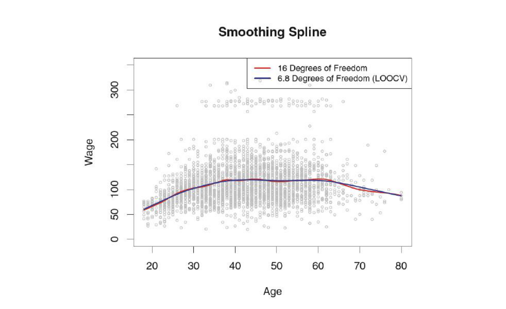

> 图源：[原课件第 20 页](../output/pdf/SDSC5001_Topic7_slides.pdf#page%3D20) · [Lumen 图示定位](obsidian://lumen-pdf?vault=guideline&file=course%2F5001%2Foutput%2Fpdf%2FSDSC5001_Topic7_slides.pdf&annotation=sdsc5001-t7-a74ccc0f51-crop-020)。读图：平滑样条不同自由度的曲线；图例中的 LOOCV 表示相应选择依据。

### PPT 第 19 页逐项讲解：平滑参数的两个极端

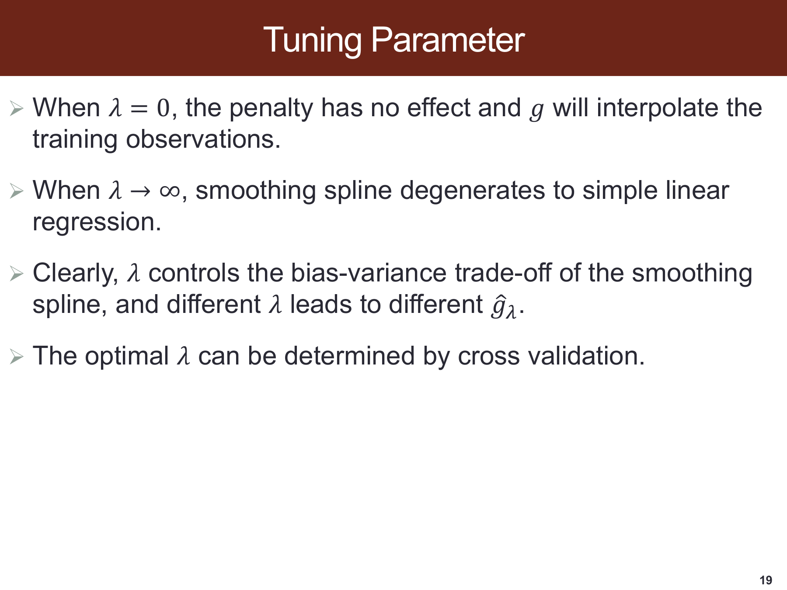

> 原课件：[第 19 页](../output/pdf/SDSC5001_Topic7_slides.pdf#page=19)。截图保留课件原貌，下面按阅读顺序解释；原页简写与笔误以正文核对为准。

**先看目标函数中的惩罚对象。**罚的是二阶导平方积分，所以直线属于零惩罚空间。$\lambda$ 很大时保留下来的不是常数，而是最小二乘意义下最合适的直线。

**原页把 $\lambda=0$ 简写为插值。**标准平滑样条宜理解为 $\lambda\to0^+$ 的极限；在完全不限函数的零惩罚问题中，插值函数可不唯一，相同位置的冲突响应也不能同时穿过。

**“由 CV 决定”包括整个拟合流程。**每个候选参数在训练折求曲线，再预测验证位置。有效自由度是平滑矩阵的迹，不是截图里结点数量，也不一定是整数。

## 11. 局部线性回归：每个预测点拟一条局部直线
> [课件第 21–24 页](../output/pdf/SDSC5001_Topic7_slides.pdf#page%3D21) · [Lumen 本节定位](obsidian://lumen-pdf?vault=guideline&file=course%2F5001%2Foutput%2Fpdf%2FSDSC5001_Topic7_slides.pdf&annotation=sdsc5001-t7-a74ccc0f51-page-021) · [逐页索引](Topic7_%E8%AF%BE%E4%BB%B6%E9%80%90%E9%A1%B5%E5%AF%B9%E5%BA%94%E8%A1%A8.md)

在目标点 $x_0$ 处选择附近的 $s$ 个训练点，为近点赋大权重、远点赋小权重，范围外赋 0。推荐用中心化的局部表示：

$$\min_{a,b}\sum_i w_i(x_0)[y_i-a-b(x_i-x_0)]^2,\qquad \hat f(x_0)=\hat a.$$

等价地可用 $\beta_0+\beta_1x_i$ 拟合，再在 $x_0$ 处取 $\hat\beta_0+\hat\beta_1x_0$。**课件第 21 页最后一步的 $x_i$ 应改为目标位置 $x_0$。**拟合中使用多个训练 $x_i$，输出时只针对一个目标 $x_0$。

记 $S_r=\sum_iw_i(x_i-x_0)^r$、$T_r=\sum_iw_i(x_i-x_0)^ry_i$，只要 $S_0S_2-S_1^2>0$，有

$$\hat a=\frac{S_2T_0-S_1T_1}{S_0S_2-S_1^2}.$$

这说明局部模型至少需要足够不同的邻近位置和有效权重。若邻居全部重合或太少，局部斜率不一定可识别。

### 11.1 带宽、span 与权重函数

span 可表示邻居数 $s$，也可表示样本比例 $s/n$，软件含义需要区分。小 span 更局部、更灵活，也更不稳定；大 span 更平滑，可能遗漏局部变化。权重函数决定邻域内远近的影响，局部常数、线性、二次则决定每个窗口内的模型形式。

补充的 tricube 权重常写为 $w_i=(1-|u_i|^3)^3\mathbf1\{|u_i|<1\}$，其中 $u_i$ 是按局部带宽标准化的距离。具体核函数不是本章唯一固定选择。

### 11.2 为什么局部线性优于简单邻域平均

局部常数拟合只平均响应，在边界或采样密度不均时，邻域可能主要位于目标点一侧，产生偏差。局部直线能补偿一部分局部趋势。但边界外没有邻近信息，任何局部法都不能保证可靠远距离外推。

### 11.3 计算例子

在 $x_0=2$ 附近取 $x=(1,2,3)$、$y=(1,2,4)$、权重 $(0.5,1,0.5)$。有 $S_0=2,S_1=0,S_2=1,T_0=4.5$，所以 $\hat f(2)=2.25$，局部斜率 $T_1/S_2=1.5$。预测不必恰等于 $x=2$ 的观测值 2，因为平滑使用了邻居。

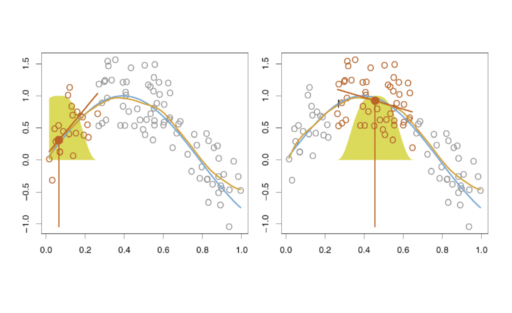

> 图源：[原课件第 22 页](../output/pdf/SDSC5001_Topic7_slides.pdf#page%3D22) · [Lumen 图示定位](obsidian://lumen-pdf?vault=guideline&file=course%2F5001%2Foutput%2Fpdf%2FSDSC5001_Topic7_slides.pdf&annotation=sdsc5001-t7-a74ccc0f51-crop-022)。读图：局部线性回归示意，目标点移动时邻域、权重和局部直线一起改变。

### 深入讲解：边界处局部平均为什么会偏

**补充手算。**预测目标为 $x_0=0$，邻近训练点 $x=(0,1,2)$，响应严格来自直线 $y=1+2x$，即 $y=(1,3,5)$。暂给三个点相同权重，以单独观察局部模型形式。

局部常数就是响应平均，预测为 3；但目标位置真值为 1。原因是邻域全部位于目标点右边，它平均的实际上是靠右位置的响应。

局部线性拟合使用 $y_i\approx a+b(x_i-x_0)$。此时 $S_0=3,S_1=3,S_2=5,T_0=9,T_1=13$，故

$$\hat a=\frac{5\times9-3\times13}{3\times5-3^2}=1,\qquad
\hat b=\frac{3\times13-3\times9}{6}=2.$$

代入目标点给出 1，准确恢复这条直线。它能补偿边界一侧采样造成的趋势偏差，而非只平均邻居的响应。

本例局部线性预测还可写为 $\hat f(0)=\frac56y_1+\frac13y_2-\frac16y_3$。第三项权重为负并非算错：等效响应权重不等于拟合目标中指定的非负距离权重；其和为 1，且对位置的一阶加权和为 0，正是恢复局部直线所需的条件。

在有噪声、非线性和稀疏数据时，局部线性仍有误差，负的等效权重也可能增加方差。带宽要用验证选择，不能由这个无噪声算例推出局部线性总优于所有平均方法。

### PPT 第 22 页逐项讲解：局部权重与目标点预测

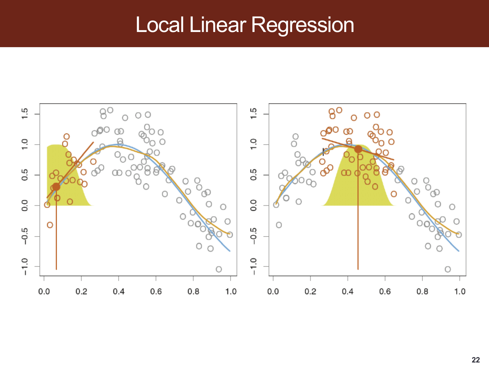

> 原课件：[第 22 页](../output/pdf/SDSC5001_Topic7_slides.pdf#page=22)。截图保留课件原貌，下面按阅读顺序解释；原页简写与笔误以正文核对为准。

**竖直橙线标出当前预测位置。**左图靠近边界，右图移到中间；每换一个目标点，邻域及相应权重也随之移动。黄色形状用来示意局部权重范围，不是响应的概率密度。

**橙色样本是本次局部拟合关注的邻近点。**在这些点上拟合局部直线，然后必须回到竖线所在目标位置取值。不能分别在各训练点代入后就把它当作同一个新点预测。

**边界处邻居主要在一侧。**这正对应补充例子中局部平均偏向右侧、局部线性利用斜率补偿的机制。左右图也表明局部法并非只拟合一条固定直线，而是多个局部拟合组成一条曲线。

## 12. GAM：多个可解释曲线的相加
> [课件第 25–26 页](../output/pdf/SDSC5001_Topic7_slides.pdf#page%3D25) · [Lumen 本节定位](obsidian://lumen-pdf?vault=guideline&file=course%2F5001%2Foutput%2Fpdf%2FSDSC5001_Topic7_slides.pdf&annotation=sdsc5001-t7-a74ccc0f51-page-025) · [逐页索引](Topic7_%E8%AF%BE%E4%BB%B6%E9%80%90%E9%A1%B5%E5%AF%B9%E5%BA%94%E8%A1%A8.md)

课件的连续响应形式为

$$Y_i=\beta_0+\sum_{j=1}^p f_j(x_{ij})+\epsilon_i.$$

它允许每个特征有不同非线性曲线，同时保留按变量查看的解释方式。为避免截距与各函数任意平移而不可识别，通常约束各 $f_j$ 在训练样本上的平均值为 0。

更一般的 GAM 使用链接函数 $g$：$g(E[Y\mid X])=\beta_0+\sum_jf_j(X_j)$。Logistic GAM 的相加发生在 log-odds 尺度，而不是直接相加概率。

### 12.1 补充的回拟合思路

先给各函数初值，再轮流更新第 $j$ 项：从响应中减去截距和其他函数贡献，得到部分残差；用单变量平滑器拟合该部分残差对 $X_j$；中心化更新函数；反复直到稳定。实际惩罚拟合还需要同时处理平滑参数与相应优化。

### 12.2 优点、限制与应用

GAM 适合既需灵活曲线又需按变量解释的任务，例如研究温度、季节和设备负载分别与能耗的关系。基本加性形式无法表达“温度的影响随负载而变化”，这需要显式加入 $f_{jk}(X_j,X_k)$ 等交互。

如果输入变量高度相关，即便画出每个曲线，分配给各变量的贡献也可能不稳定，不能仅因曲线可画就断言因果可解释。新数据还需处在训练支持范围，函数项应结合不确定性及数据密度阅读。

### 深入讲解：GAM 回拟合究竟在减掉什么

对 $y_i=\beta_0+f_1(x_{i1})+f_2(x_{i2})+\epsilon_i$，可先取 $\hat\beta_0=\bar y$，两个函数初始为 0。更新 $f_1$ 时构造部分残差 $r_i^{(1)}=y_i-\hat\beta_0-\hat f_2(x_{i2})$，再用 $X_1$ 的平滑器拟合它。

**补充数值步骤。**某次迭代中 $y=(4,7,10)$、$\hat\beta_0=7$、当前第二项贡献为 $(-1,0,1)$，则第一项要拟合的部分残差为 $(-2,0,2)$。如果平滑器给出 $(-1.5,0,1.5)$，它已均值为 0，可直接作为更新。

随后更新 $f_2$ 时，使用刚更新的第一项，部分残差变为 $y-7-(-1.5,0,1.5)=(-1.5,0,1.5)$。各函数轮流解释扣除其他项后的剩余结构，直到拟合稳定；不能一次分别拟合 $Y$ 对各变量再直接相加，否则同一响应变化可能被重复解释。

若某项更新值的样本均值不为 0，应减去该均值，并按所采用的参数化调整截距以保持整体拟合，避免函数与截距之间任意平移。约束能固定整体水平的分配，但相关输入仍可能使不同平滑函数间的贡献难以区分。

上述步骤针对连续响应和加性平方损失。Logistic GAM 的相加发生在 logit 尺度，通常还需要相应的迭代加权拟合，不能把二元响应照抄成同一套普通残差平滑。基本加性模型也不能自动学习交互，需预先指定合适的二维项等扩展。

### 外部拓展：可加的非线性仍然不能自动表示交互

**课内衔接：**[本章第 12 节](#section-12) · [原课件第 25 页](../output/pdf/SDSC5001_Topic7_slides.pdf#page=25) · [复用原有 Lumen 定位](obsidian://lumen-pdf?vault=guideline&file=course%2F5001%2Foutput%2Fpdf%2FSDSC5001_Topic7_slides.pdf&annotation=sdsc5001-t7-a74ccc0f51-page-025)

**外部拓展｜连接 GAM 的可解释性与限制。**两变量可加模型写成 $m(x,z)=\beta_0+f(x)+g(z)$。m 为条件均值，β₀ 为截距，f、g 分别是只依赖一个变量的曲线。即使每条曲线都很灵活，x 的作用仍不随 z 改变。

不用求导也能检查可加性。任取 x₁、x₂、z₁、z₂，定义混合差分

$$\Delta=m(x_2,z_2)-m(x_1,z_2)-m(x_2,z_1)+m(x_1,z_1).$$

下标 1、2 表示各变量的两个取值，不是观测轮次。把 β₀、f、g 分别代入，所有项抵消，故任何严格可加模型都满足 Δ=0。读作：比较两种 z 水平下，x 从 x₁ 变到 x₂ 的响应变化是否相同。

**自编反例。**真实均值 m(x,z)=xz，x、z 各取 −1、1，四格均值为：

| x / z | −1 | 1 |
|---|---:|---:|
| −1 | 1 | −1 |
| 1 | −1 | 1 |

取 x₁=z₁=−1、x₂=z₂=1，Δ=1−(−1)−(−1)+1=4，故只加两条单变量曲线不可能精确还原四格。均衡数据中行、列均值都为零，更能看出单变量平均效应可以掩盖强交互。

可以在 GAM 中增加二维平滑 $h(x,z)$；mgcv 的 `ti` 用于已有相应主效应时构造张量积交互，`te` 表示完整张量积平滑，不能把二者仅看成不同拼写。增加交互会增加数据与复杂度要求，应在验证中比较。

**可识别性。**将 f 加常数 c、截距减 c，不改变预测，所以常需对训练样本中心化约束。这个约束解决任意平移，不保证高度相关变量的曲线都稳定；非线性项彼此可近似替代时，还可能出现 concurvity。解释单条曲线时要一起检查数据覆盖与变量依赖。

**外部来源与阅读定位：**[mgcv：张量积平滑与交互项](https://stat.ethz.ch/R-manual/R-devel/library/mgcv/html/te.html)；[mgcv：平滑项的可识别性约束](https://stat.ethz.ch/R-manual/R-devel/library/mgcv/html/gam.side.html)。本文推导与自编算例用于解释相应方法，不冒充来源中的实验结果。

## 13. 方法对照与选择逻辑

| 方法 | 主要调节量 | 连接/平滑方式 | 主要限制 |
|---|---|---|---|
| 全局多项式 | 次数 $d$ | 一个全局函数 | 高次边界不稳定、局部影响全局 |
| 阶梯函数 | 切点与箱数 | 箱内常数、箱间可跳 | 丢失箱内变化 |
| 回归样条 | 结点与基数 | 分段并施加导数连续 | 结点选择影响复杂度 |
| 自然样条 | 结点及边界 | 额外的边界线性条件 | 远距离外推仍需假设 |
| 平滑样条 | $\lambda$ 或有效 df | 曲率平方惩罚 | 调参、损失尺度要一致 |
| 局部线性 | span/带宽及权重 | 每个目标点局部重拟合 | 稀疏区与高维问题 |
| GAM | 各函数的平滑度 | 单变量项相加 | 基本形式不含交互 |

建立比较时使用相同训练/验证划分和损失。分箱、结点、缩放与平滑参数均应视为学习流程的一部分。输出一条好看的曲线之前，先看数据在哪些区间实际上足够密集。

## 14. 自测与参考答案

1. 多项式回归对 $x$ 非线性，为何还能用 OLS？
2. 为什么截距加全部分箱指示变量会秩亏？
3. 两段三次多项式要求前两阶导连续后还剩多少自由系数？
4. $K$ 个内部结点的一般三次样条含多少系数？
5. 截断三次幂为什么能保证前两阶导连续？
6. 自然样条减少边界波动是否证明外推正确？
7. 平滑样条有 $n$ 个结点是否等于有效 df 为 $n$？
8. 为什么 $\lambda\to\infty$ 趋于直线？
9. 相同特征位置有不同响应，能否同时插值？
10. 局部回归预测公式中该代入 $x_i$ 还是 $x_0$？
11. span 增大通常会怎样？12. GAM 的可解释性是否自动表示因果？

> [!success]- 参考答案
> 1. 它对系数线性。2. 指示变量和恒为 1。3. 5 个。4. $K+4$，含截距。5. 截断项在结点处值、一阶导和二阶导都为 0。6. 不能。7. 不等于，惩罚决定有效自由度。8. 二阶导平方为零的函数是直线。9. 不能，需按重复位置的均值/误差处理。10. 目标点 $x_0$。11. 通常更平滑、局部性降低。12. 不表示，仍是条件关联模型，且需检查相关变量与识别条件。

---

[返回课程总目录](README.md) · [26 页课件索引](Topic7_%E8%AF%BE%E4%BB%B6%E9%80%90%E9%A1%B5%E5%AF%B9%E5%BA%94%E8%A1%A8.md)
