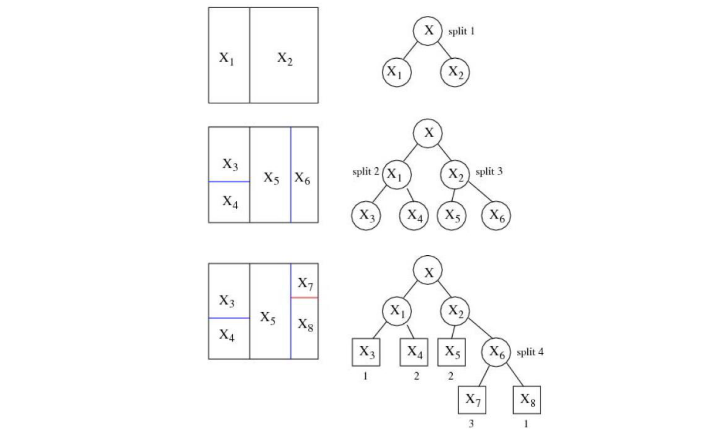
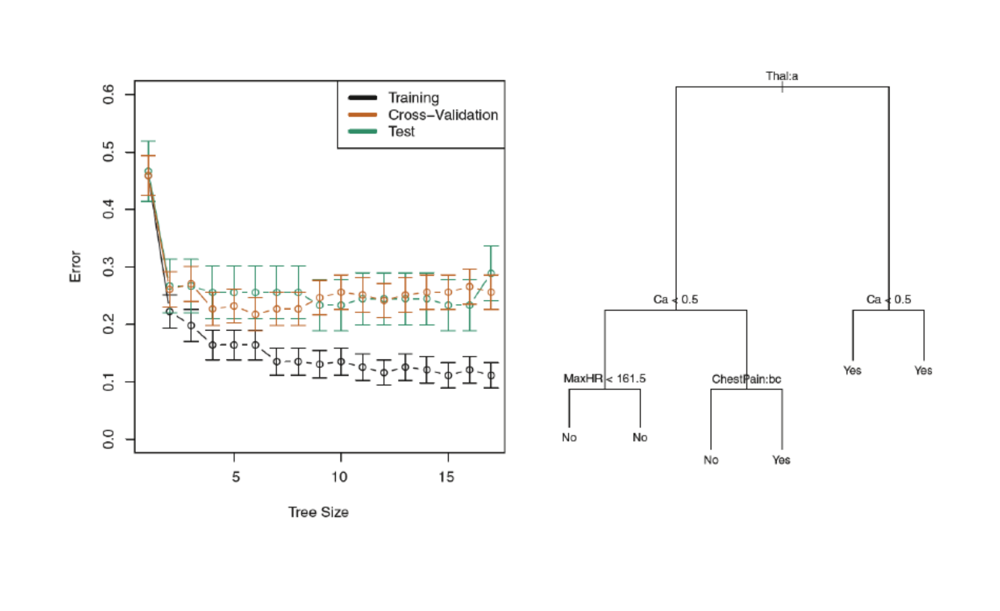
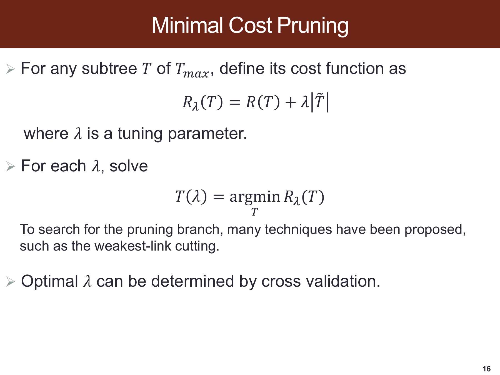
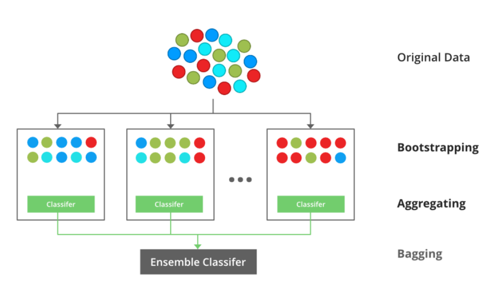
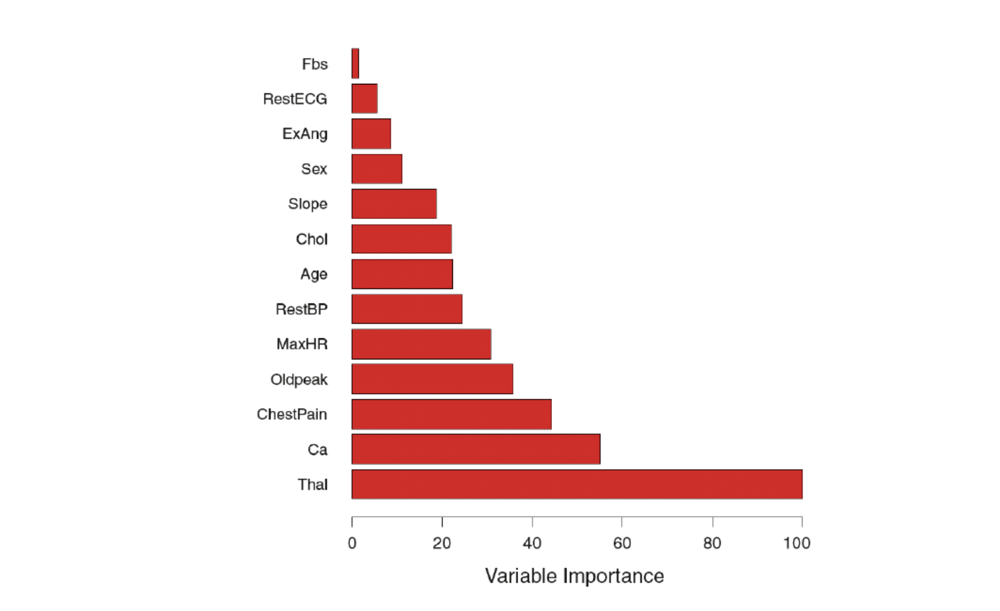
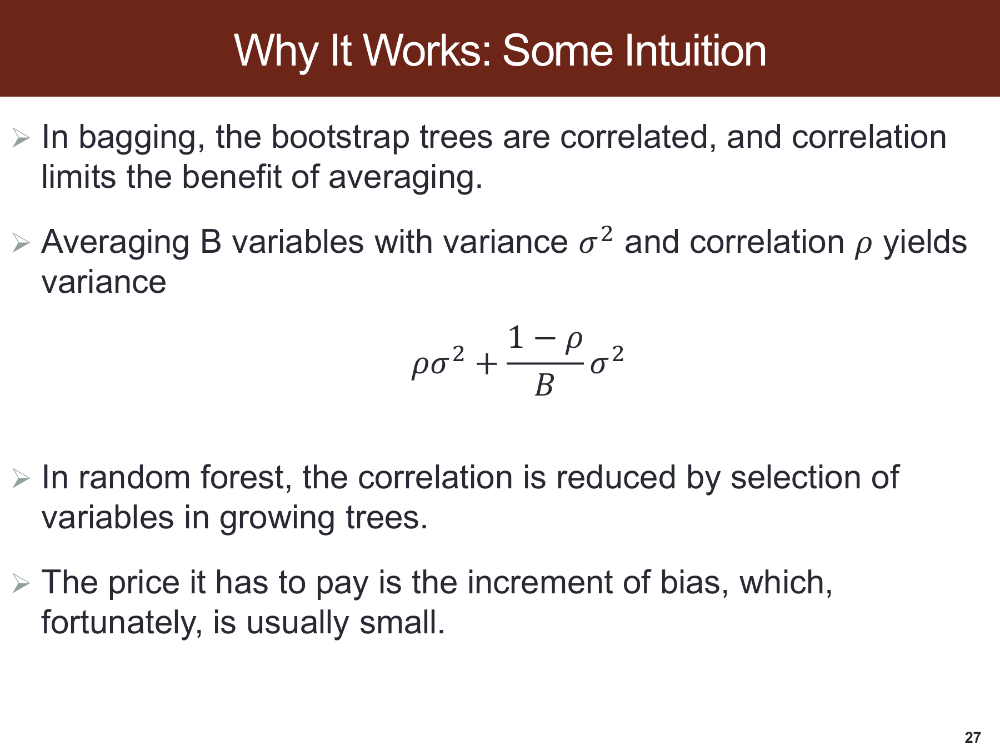
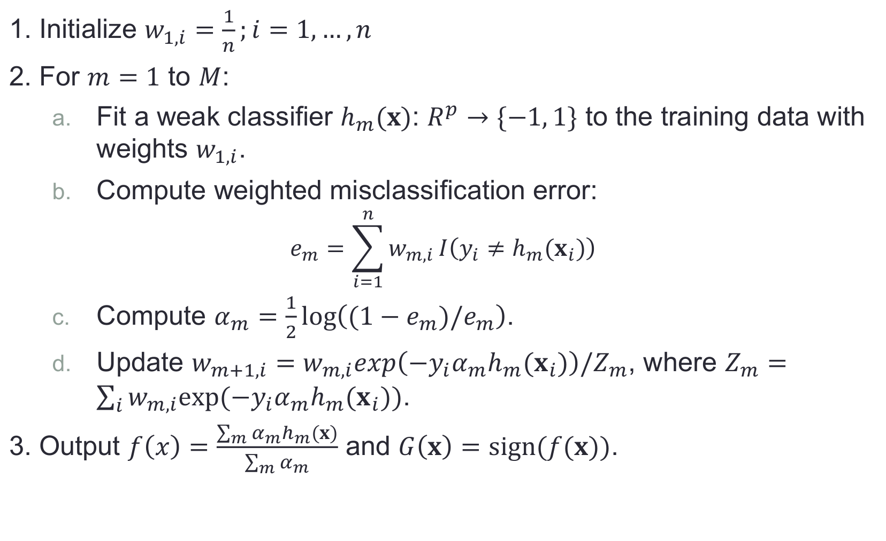
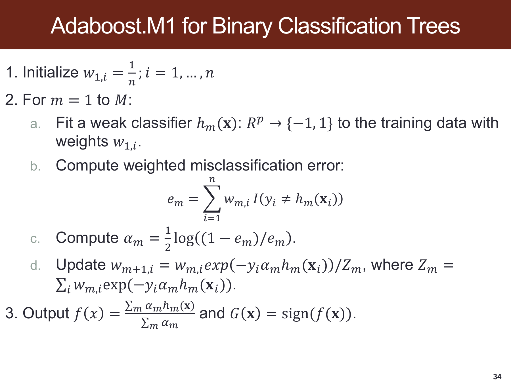
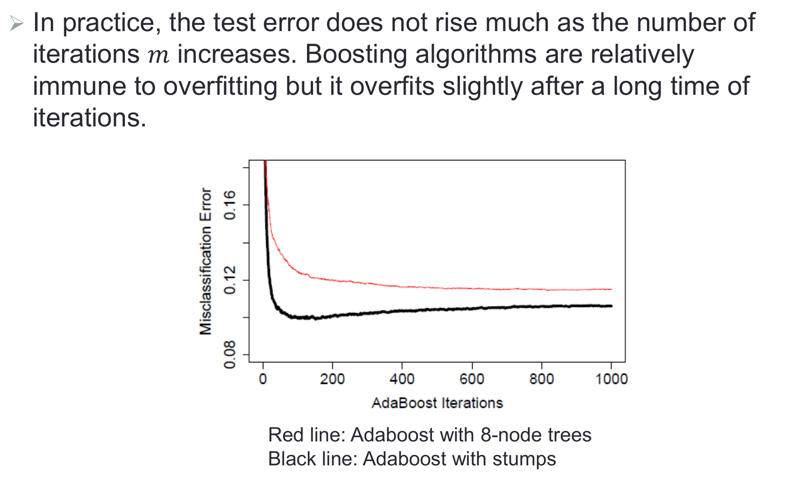

# SDSC5001 Topic 8：分类回归树与集成学习详细笔记

[课程总目录](README.md) · [逐页对应表](Topic8_%E8%AF%BE%E4%BB%B6%E9%80%90%E9%A1%B5%E5%AF%B9%E5%BA%94%E8%A1%A8.md) · [离线 HTML 阅读版](5001_Topic8_%E8%AF%A6%E7%BB%86%E7%AC%94%E8%AE%B0.html)

> 来源：本地 `SDSC5001_Topic 8 Tree.pptx`，共 41 页，PDF 页序与幻灯片页序一致。按课件顺序讲解，补充推导、手算、应用与自测；补充内容和课件表述核对均在正文注明。
>
> Lumen 用法：在 Obsidian 的 guideline 笔记库点击“Lumen 本节定位”或“Lumen 图示定位”，可回到原 PDF 标记区域；标记备注可返回对应中文小节。图片为原课件局部截图，公式保留为可编辑 LaTeX。

## 阅读导航

- [0. 从一棵树到集成学习](#section-0)
- [1. 节点、区域和递归划分](#section-1)
- [2. 候选分裂：数值阈值与类别子集](#section-2)
- [3. 节点纯度、Gini、熵与错分率](#section-3)
- [4. 停止规则与叶子预测](#section-4)
- [5. 树的训练风险为何随生长不增加](#section-5)
- [6. 成本复杂度剪枝与 weakest link](#section-6)
- [7. 回归树：为什么叶子取均值](#section-7)
- [8. 单棵树的优点与限制](#section-8)
- [9. Bagging：bootstrap 后平均](#section-9)
- [10. 变量重要性：知道模型依赖了什么](#section-10)
- [11. Random Forest：让平均中的树更不一样](#section-11)
- [12. Boosting 的加性与序贯结构](#section-12)
- [13. 平方损失回归 Boosting 的逐步手算](#section-13)
- [14. AdaBoost：误差、学习器权重与样本权重](#section-14)
- [15. 迭代次数、学习率与是否过拟合](#section-15)
- [16. 三类集成的对照与应用](#section-16)
- [17. 自测与参考答案](#section-17)

> **深化阅读（2026-10-31）：**本章新增 4 组分节详解与 3 张 PPT 完整截图。新增推导与手算均为配套补充，截图旁附逐项解读，沿用原有课件定位。
>
> [枚举候选阈值完整训练一层回归树](#deep-t8-s7) · [weakest-link 的风险必须按同一尺度算](#deep-t8-s6) · [OOB 的 36.8% 与森林平均方差](#deep-t8-s11) · [梯度 Boosting 为什么不总是在拟合普通残差](#deep-t8-s12)

> **外部资料强化（2026-11-01）：**本章在对应知识点内加入以下拓展，所有数值算例与教学图明确区分于课件原始内容。外部来源在小节末就近提供。
>
> [置换重要性是一个模型依赖量，不是变量的固有价值](#ext-t8-importance) · [从一阶残差走到二阶 Boosting：叶子权重怎样算出来](#ext-t8-newton_tree) · [早停也是模型选择，验证集不能兼任最终测试集](#ext-t8-earlystop)

## 0. 从一棵树到集成学习
> [课件第 1–3 页](../output/pdf/SDSC5001_Topic8_slides.pdf#page%3D1) · [Lumen 本节定位](obsidian://lumen-pdf?vault=guideline&file=course%2F5001%2Foutput%2Fpdf%2FSDSC5001_Topic8_slides.pdf&annotation=sdsc5001-t8-497e61f568-page-001) · [逐页索引](Topic8_%E8%AF%BE%E4%BB%B6%E9%80%90%E9%A1%B5%E5%AF%B9%E5%BA%94%E8%A1%A8.md)

树模型把特征空间递归地切成若干区域，在各区域内使用简单预测：回归取样本均值，分类取多数类或类别比例。单棵树容易解释，但对样本扰动敏感；Bagging、Random Forest 与 Boosting 分别通过重采样平均、降低树间相关、序贯修正来改善预测。

课件的临床树例子使用初始 24 小时的观测判断风险，目的是说明“按条件逐层判断”的模型形式，不提供实际诊疗规则。读树时先看根节点，每次只沿满足条件的一条分支走到叶子，不能把不同路径的条件任意拼在一起。

本笔记用 $t$ 表示节点、$n_t$ 表示节点样本量、$\mathcal L(T)$ 表示叶子集合、$|\mathcal L(T)|$ 表示叶子数，以免课件中 $T$ 与带装饰的 $T$ 在复制时丢失区别。

## 1. 节点、区域和递归划分
> [课件第 4–7 页](../output/pdf/SDSC5001_Topic8_slides.pdf#page%3D4) · [Lumen 本节定位](obsidian://lumen-pdf?vault=guideline&file=course%2F5001%2Foutput%2Fpdf%2FSDSC5001_Topic8_slides.pdf&annotation=sdsc5001-t8-497e61f568-page-004) · [逐页索引](Topic8_%E8%AF%BE%E4%BB%B6%E9%80%90%E9%A1%B5%E5%AF%B9%E5%BA%94%E8%A1%A8.md)

根 root 覆盖整个输入空间；内部节点对应一个测试问题；左右子节点的区域互斥且合起来等于父区域；叶 terminal/leaf node 不再继续分裂。除根外每个节点只有一个父节点，同父节点的两个孩子是兄弟节点。

路径条件是逐步相交的。例如先判断 $X_1\le3$，再在左侧判断 $X_2>5$，对应叶子区域为 $\{x:X_1\le3,X_2>5\}$。轴平行分裂得到矩形或高维长方体区域，并非任意方向的边界。

建树有四个要素：候选问题集合、分裂评分、停止规则、叶子预测规则。只记 Gini 还不能完整定义一棵树，因为不同的候选阈值、最小叶子量和剪枝策略都可能改变结果。

> 图源：[原课件第 6 页](../output/pdf/SDSC5001_Topic8_slides.pdf#page%3D6) · [Lumen 图示定位](obsidian://lumen-pdf?vault=guideline&file=course%2F5001%2Foutput%2Fpdf%2FSDSC5001_Topic8_slides.pdf&annotation=sdsc5001-t8-497e61f568-crop-006)。读图：特征平面的连续划分与相应树结构；每次只把某个已有区域一分为二。

## 2. 候选分裂：数值阈值与类别子集
> [课件第 8 页](../output/pdf/SDSC5001_Topic8_slides.pdf#page%3D8) · [Lumen 本节定位](obsidian://lumen-pdf?vault=guideline&file=course%2F5001%2Foutput%2Fpdf%2FSDSC5001_Topic8_slides.pdf&annotation=sdsc5001-t8-497e61f568-page-008) · [逐页索引](Topic8_%E8%AF%BE%E4%BB%B6%E9%80%90%E9%A1%B5%E5%AF%B9%E5%BA%94%E8%A1%A8.md)

数值或有序变量通常使用 $X_j\le c$ 与 $X_j>c$。训练样本按 $X_j$ 排序后，只需在相邻不同观测值之间考虑候选阈值，区间内不同切点产生相同训练分组。缺失值如何路由还需单独定义。

无序类别变量可问“是否属于类别子集 $A$”。若有 $q$ 个类别，非空、非全集的子集有 $2^q-2$ 个；左右互换表示同一个划分，故不同二分有

$$\frac{2^q-2}{2}=2^{q-1}-1.$$

课件第 20 页讨论的候选数来自这里。类别很多时搜索膨胀，某些二分类/平方损失任务可按类别响应摘要排序简化，但不能据此假设所有多分类情形都具有同样简化。

## 3. 节点纯度、Gini、熵与错分率
> [课件第 9–10 页](../output/pdf/SDSC5001_Topic8_slides.pdf#page%3D9) · [Lumen 本节定位](obsidian://lumen-pdf?vault=guideline&file=course%2F5001%2Foutput%2Fpdf%2FSDSC5001_Topic8_slides.pdf&annotation=sdsc5001-t8-497e61f568-page-009) · [逐页索引](Topic8_%E8%AF%BE%E4%BB%B6%E9%80%90%E9%A1%B5%E5%AF%B9%E5%BA%94%E8%A1%A8.md)

记节点经验类别比例为 $p_{tk}=n_t^{-1}\sum_{i\in t}\mathbf1\{y_i=k\}$。纯节点只有一个类别，以下不纯度都为 0：

$$G_{err}(t)=1-\max_kp_{tk},$$

$$G_{Gini}(t)=1-\sum_kp_{tk}^2,\qquad G_H(t)=-\sum_kp_{tk}\log p_{tk}.$$

熵中按连续延拓约定 $0\log0=0$。二分类时 Gini 为 $2p(1-p)$，在 $p=1/2$ 处最大为 $1/2$；熵在同处最大，自然对数下为 $\log2$。不同底数只改变比例尺度。

分裂评分要按子节点样本量加权：

$$\Delta(s,t)=G(t)-\frac{n_L}{n_t}G(t_L)-\frac{n_R}{n_t}G(t_R).$$

不加权会让极小节点和大节点占一样的影响，偏离总体不纯度下降的含义。贪心 CART 在当前节点选 $\Delta$ 最大的分裂，未保证得到全局最优树。

### 3.1 补充手算：10 个对象

父节点 6 正、4 负，Gini 为 $1-0.6^2-0.4^2=0.48$。候选分裂的左节点 5 正、0 负，右节点 1 正、4 负，子节点加权 Gini 为 $0.5\times0+0.5\times0.32=0.16$，增益为 0.32。父节点错分率为 0.4，子节点加权错分率为 $0+0.5\times0.2=0.1$。

### 3.2 为什么生长时常用 Gini/熵

错分率只关注最大类别，可能对纯度改进不够敏感。例如父节点 8 正、2 负，分成 $(5,0)$ 与 $(3,2)$，错分人数仍为 2，但 Gini 从 0.32 降到 $0.5\times0+0.5\times0.48=0.24$。Gini 能识别这一变化，训练错分率暂时不变。

## 4. 停止规则与叶子预测
> [课件第 11–13 页](../output/pdf/SDSC5001_Topic8_slides.pdf#page%3D11) · [Lumen 本节定位](obsidian://lumen-pdf?vault=guideline&file=course%2F5001%2Foutput%2Fpdf%2FSDSC5001_Topic8_slides.pdf&annotation=sdsc5001-t8-497e61f568-page-011) · [逐页索引](Topic8_%E8%AF%BE%E4%BB%B6%E9%80%90%E9%A1%B5%E5%AF%B9%E5%BA%94%E8%A1%A8.md)

课件给出的停止思路是，若当前节点的最优加权增益已经小于阈值，就停止。实际也常限制最大深度、最小分裂样本量、最小叶子样本量。深度和叶子大小不是完全相同的约束：同一深度的不同分支可以包含不同数量的对象。

0–1 损失下叶子预测多数类 $\hat k(t)=\arg\max_kp_{tk}$，类别概率可暂用 $p_{tk}$ 估计。若错误成本不等，应最小化 $\sum_k C(a,k)p_{tk}$，不能始终选最大比例类。

小叶子比例方差大，纯叶子报告 100% 不代表真实风险为零；概率校准还需独立评估。停止太早也可能错过需要先作弱分裂才能暴露的交互结构，因此课件转向“先长大树，再剪枝”的路线。

## 5. 树的训练风险为何随生长不增加
> [课件第 14–15 页](../output/pdf/SDSC5001_Topic8_slides.pdf#page%3D14) · [Lumen 本节定位](obsidian://lumen-pdf?vault=guideline&file=course%2F5001%2Foutput%2Fpdf%2FSDSC5001_Topic8_slides.pdf&annotation=sdsc5001-t8-497e61f568-page-014) · [逐页索引](Topic8_%E8%AF%BE%E4%BB%B6%E9%80%90%E9%A1%B5%E5%AF%B9%E5%BA%94%E8%A1%A8.md)

训练分类风险可写为

$$R(T)=\sum_{t\in\mathcal L(T)}\frac{n_t}{n}[1-\max_kp_{tk}].$$

对任意一次分裂，子节点可以沿用父节点类别，所以重新选多数类后总错分人数不会更大。训练风险因此不增加，但测试风险可能因为拟合偶然分组而上升。回归树的训练 SSE 同理不增加。

大树中的叶子可能只含极少对象，规则受某个样本决定。课件“right-sized tree”的目标是找到泛化合适的大小，而非让每个训练叶子都纯。

## 6. 成本复杂度剪枝与 weakest link
> [课件第 16–17 页](../output/pdf/SDSC5001_Topic8_slides.pdf#page%3D16) · [Lumen 本节定位](obsidian://lumen-pdf?vault=guideline&file=course%2F5001%2Foutput%2Fpdf%2FSDSC5001_Topic8_slides.pdf&annotation=sdsc5001-t8-497e61f568-page-016) · [逐页索引](Topic8_%E8%AF%BE%E4%BB%B6%E9%80%90%E9%A1%B5%E5%AF%B9%E5%BA%94%E8%A1%A8.md)

在大树 $T_{max}$ 的子树中比较

$$R_\lambda(T)=R(T)+\lambda|\mathcal L(T)|.$$

第一项计拟合误差，第二项计叶子复杂度。$\lambda$ 越大，对额外叶子的代价越高，通常倾向小树。误差若从平均改成总和，参数的数值尺度也会改变。

补充：对以 $t$ 为根的子树 $T_t$，比较保留整棵子树与剪成一个叶子，其临界代价为

$$g(t)=\frac{R(t)-R(T_t)}{|\mathcal L(T_t)|-1}.$$

weakest-link 思路优先剪掉单位叶子数带来收益最少的分支，从而产生嵌套候选树序列。再用 CV 选择复杂度，不必枚举所有可能子树。

### 6.1 补充算例

大树有 8 个叶子、训练风险 0.08，小树有 3 个叶子、风险 0.12。$\lambda=0.005$ 时目标分别为 0.12 与 0.135，大树较好；$\lambda=0.01$ 时分别为 0.16 与 0.15，小树较好。相等点为 $(0.12-0.08)/(8-3)=0.008$。

CV 可选最小误差的树，也可补充使用 one-standard-error 思路选表现相近的较小树。误差条显示估计波动，不能只看训练曲线最低的位置。

> 图源：[原课件第 17 页](../output/pdf/SDSC5001_Topic8_slides.pdf#page%3D17) · [Lumen 图示定位](obsidian://lumen-pdf?vault=guideline&file=course%2F5001%2Foutput%2Fpdf%2FSDSC5001_Topic8_slides.pdf&annotation=sdsc5001-t8-497e61f568-crop-017)。读图：树大小对应训练、交叉验证和测试误差，右侧是一个剪枝后的结构。

### 深入讲解：weakest-link 的风险必须按同一尺度算

**补充算例。**某分支当前有 3 个叶子，这些叶子对整棵树的风险贡献合计为 0.04；把该分支剪成一个叶子，贡献变为 0.10。两种方案在该分支上的惩罚目标分别为 $0.04+3\lambda$ 与 $0.10+\lambda$。

相等点为 $\lambda=(0.10-0.04)/(3-1)=0.03$。小于它时保留分支更好，大于它时剪枝更好。另一分支若由 2 个叶子变为 1 个，风险从 0.02 增至 0.06，则阈值为 0.04，因而当前优先剪去第一条分支。

这里的风险贡献都使用**对整个训练样本的统一归一化**。若把一个小分支内部的错分率直接拿来与整个树的错分率相减，就会混入不同分母。例如全样本 100 条，某分支 10 条、错 2 条，它的整体贡献是 0.02，而不是分支内错分率 0.2。

剪掉分支后，要更新祖先节点的候选收益与叶子数，再继续产生嵌套树序列。原先计算的每个节点阈值不能完全不变地一路排序到底。

最终用 CV 评价不同惩罚强度的树：每折先在该折训练数据长树并剪枝，再预测验证折。验证损失可能选择比训练最优更小的树，因为额外叶子带来的训练收益不一定能在新数据重现。课件中的大树与剪后树图应按“规则简化后损失了什么、保留了什么”对照阅读。

### PPT 第 16 页逐项讲解：成本复杂度剪枝

> 原课件：[第 16 页](../output/pdf/SDSC5001_Topic8_slides.pdf#page=16)。截图保留课件原貌，下面按阅读顺序解释；原页简写与笔误以正文核对为准。

**$R(T)$ 与叶子数是两个不同代价。**第一项衡量拟合误差，第二项按叶子数收费。课件带装饰的树符号表示终端节点数，正文统一写成 $|\mathcal L(T)|$，避免与整棵树混淆。

**第二行只在已长大树的子树中选。**剪枝不是重新搜索所有可能的划分树，而是在固定大树结构上逐步删除分支，因此得到的最优范围要按该候选空间理解。

**weakest-link 与 CV 分工不同。**前者构造候选剪枝路径，后者比较泛化表现并选择参数。补充阈值算例解释何时某条分支的额外叶子不再值得保留。

## 7. 回归树：为什么叶子取均值
> [课件第 18 页](../output/pdf/SDSC5001_Topic8_slides.pdf#page%3D18) · [Lumen 本节定位](obsidian://lumen-pdf?vault=guideline&file=course%2F5001%2Foutput%2Fpdf%2FSDSC5001_Topic8_slides.pdf&annotation=sdsc5001-t8-497e61f568-page-018) · [逐页索引](Topic8_%E8%AF%BE%E4%BB%B6%E9%80%90%E9%A1%B5%E5%AF%B9%E5%BA%94%E8%A1%A8.md)

在节点内用常数 $c$ 最小化 $\sum_{i\in t}(y_i-c)^2$，求导得 $c=\bar y_t$。回归树按父节点 SSE 减去两个子节点 SSE 选择分裂：

$$G(t)=\sum_{i\in t}(y_i-\bar y_t)^2,\quad \Delta=G(t)-G(t_L)-G(t_R).$$

此处 $G$ 已经是总和，不能再额外乘 $n_L/n_t$，否则会重复加权；若将 $G$ 定义成节点平均方差，则需相应样本比例。课件的分类与回归评分写法不同，原因是定义不同。

**补充手算。**响应为 $1,2,8,9$，父节点均值 5，SSE 为 50。分成 $(1,2)$ 与 $(8,9)$ 后，两叶均值为 1.5、8.5，合计 SSE 为 1，减少 49。若改用绝对损失，叶子的最佳常数将是中位数，而不是均值。

### 深入讲解：枚举候选阈值完整训练一层回归树

**补充手算。**一维训练数据 $x=(1,2,3,4)$、$y=(1,1,3,5)$，排序后的相邻中点给出候选阈值 1.5、2.5、3.5。父节点均值为 2.5，SSE 为 $2.25+2.25+0.25+6.25=11$。

阈值 1.5：左叶预测 1，右叶响应 $1,3,5$ 的均值为 3，SSE 为 $0+(4+0+4)=8$。

阈值 2.5：左叶响应为 $1,1$、预测 1；右叶为 $3,5$、预测 4；SSE 为 $0+(1+1)=2$。

阈值 3.5：左叶均值为 $5/3$，SSE 为 $4/9+4/9+16/9=8/3$；右叶只有一个 5，SSE 为 0。因此最优根分裂是 2.5，使 SSE 降低 $11-2=9$。

分裂后新点 $x_0=2.8$ 落入右叶，预测为 4；这不是在两个叶子预测之间插值得到的平滑曲线。轴平行树的预测通常是分段常数，在阈值处可跳跃。

若最小叶子样本数设为 2，阈值 1.5、3.5 都不合法，应在评分前排除，而不是先选最优后才检查。若继续让右叶分裂，可以进一步降低训练误差，但是否保留这一层还需剪枝或验证判断。

## 8. 单棵树的优点与限制
> [课件第 19–20 页](../output/pdf/SDSC5001_Topic8_slides.pdf#page%3D19) · [Lumen 本节定位](obsidian://lumen-pdf?vault=guideline&file=course%2F5001%2Foutput%2Fpdf%2FSDSC5001_Topic8_slides.pdf&annotation=sdsc5001-t8-497e61f568-page-019) · [逐页索引](Topic8_%E8%AF%BE%E4%BB%B6%E9%80%90%E9%A1%B5%E5%AF%B9%E5%BA%94%E8%A1%A8.md)

树可以自然表示条件分支、变量交互与非线性区域，不强制所有变量具有统一线性效应，且对单调变换后的数值分裂常保持相同排序结构。概念上它能处理类别变量，但具体程序是否原生接受无序类别还取决于实现。

局限包括轴平行边界、分段常数不平滑、高方差、贪心局部选择，以及大量候选分裂带来的选择偏好。某个变量靠近根节点不意味着它是唯一的真实原因；高度相关特征可能互相替代。

回归树通常不能沿训练响应范围之外作线性外推，因为预测是某个叶子的训练均值。把更多变量加进去也不保证解释更真实，仍需关注采样、标签质量和验证。

## 9. Bagging：bootstrap 后平均
> [课件第 21–23 页](../output/pdf/SDSC5001_Topic8_slides.pdf#page%3D21) · [Lumen 本节定位](obsidian://lumen-pdf?vault=guideline&file=course%2F5001%2Foutput%2Fpdf%2FSDSC5001_Topic8_slides.pdf&annotation=sdsc5001-t8-497e61f568-page-021) · [逐页索引](Topic8_%E8%AF%BE%E4%BB%B6%E9%80%90%E9%A1%B5%E5%AF%B9%E5%BA%94%E8%A1%A8.md)

从原训练集有放回抽取 $n$ 次得到一个 bootstrap 样本，重复 $B$ 次，每次拟一棵树。回归把预测平均；分类可按类别投票，也可先平均类别概率再选最大者。两种分类汇总在一般情形下不必完全相同。

$$\hat f_{bag}(x)=\frac1B\sum_{b=1}^B\hat f_b^*(x).$$

有放回意味着部分记录重复、部分没有入样，单棵树数据量为 $n$ 次抽取，但互异对象数通常少于 $n$。bootstrap 样本是围绕同一原始数据产生的，所以不同树通常仍相关。

课件用理想化独立估计平均来说明平方损失下降。这解释平均的动机，但不能推出有限样本、所有损失下 Bagging 都严格优于任意单树。

> 图源：[原课件第 22 页](../output/pdf/SDSC5001_Topic8_slides.pdf#page%3D22) · [Lumen 图示定位](obsidian://lumen-pdf?vault=guideline&file=course%2F5001%2Foutput%2Fpdf%2FSDSC5001_Topic8_slides.pdf&annotation=sdsc5001-t8-497e61f568-crop-022)。读图：原始训练数据、bootstrap 子样本、各棵模型与汇总预测的流程。

### 9.1 补充：袋外 OOB 评价

一条观测没有被某次 bootstrap 抽中的概率为 $(1-1/n)^n\to e^{-1}\approx0.368$。可汇总“没有用该观测训练”的树来预测它，形成 OOB 误差。一个树样本中的互异观测比例约 0.632。

OOB 便于内部评估，但若先用全数据标签筛选特征，或反复选择参数，仍需注意整体流程的乐观效应；按人/设备依赖的数据也不能仅靠标准逐行 bootstrap 解决。

## 10. 变量重要性：知道模型依赖了什么
> [课件第 24 页](../output/pdf/SDSC5001_Topic8_slides.pdf#page%3D24) · [Lumen 本节定位](obsidian://lumen-pdf?vault=guideline&file=course%2F5001%2Foutput%2Fpdf%2FSDSC5001_Topic8_slides.pdf&annotation=sdsc5001-t8-497e61f568-page-024) · [逐页索引](Topic8_%E8%AF%BE%E4%BB%B6%E9%80%90%E9%A1%B5%E5%AF%B9%E5%BA%94%E8%A1%A8.md)

课件给出变量重要性的例图。补充两类常见定义：按某变量带来的不纯度下降累计；或在验证/OOB 数据中打乱该变量，观察损失上升多少。

前者可能偏好可选切分多的变量，后者受变量相关性影响：两个变量高度相关时，打乱其中一个，另一个可能继续提供替代信息。重要性高说明模型的预测依赖或分裂收益，不自动说明因果作用，也不意味着系数方向。

> 图源：[原课件第 24 页](../output/pdf/SDSC5001_Topic8_slides.pdf#page%3D24) · [Lumen 图示定位](obsidian://lumen-pdf?vault=guideline&file=course%2F5001%2Foutput%2Fpdf%2FSDSC5001_Topic8_slides.pdf&annotation=sdsc5001-t8-497e61f568-crop-024)。读图：课件变量重要性图，阅读时先辨认横轴度量，不把排序直接解释成因果强弱。

### 外部拓展：置换重要性是一个模型依赖量，不是变量的固有价值

**课内衔接：**[本章第 10 节](#section-10) · [原课件第 24 页](../output/pdf/SDSC5001_Topic8_slides.pdf#page=24) · [复用原有 Lumen 定位](obsidian://lumen-pdf?vault=guideline&file=course%2F5001%2Foutput%2Fpdf%2FSDSC5001_Topic8_slides.pdf&annotation=sdsc5001-t8-497e61f568-page-024)

**外部拓展｜展开本节的重要性限制。**固定已经训练好的模型 f，在未用于训练的评价集 D 上计算损失 L。第 r 次仅打乱第 j 列，得到 $D_j^{\pi_r}$，定义

$$I_j=\frac1R\sum_{r=1}^R\left[L(f,D_j^{\pi_r})-L(f,D)\right].$$

j 为特征索引，R 是重复置换次数，π_r 是第 r 次行索引排列；上标表示置换数据，不是概率或乘方。这里 L 越小越好，因此损失上升代表模型依赖该列。若用准确率等越大越好的分数，应反过来做原始分数减置换分数。

**自编手算。**评价 MSE=2.0；置换某列三次后 MSE=2.4、2.8、2.6，则重要性=(0.4+0.8+0.6)/3=0.6，单位仍是响应单位的平方。换成 MAE 后数值与单位都会变，不能直接比较大小。

**为什么相关性影响解释。**若两列都记录几乎相同的信息，模型可能主要使用其中一列；对分散利用替代信息的模型，单列置换后另一列还可补救，因此每列重要性可能都偏小。反之，置换也可能制造原数据中不会出现的组合，例如互相关联的身高与臂长，造成难以解释的外分布输入。影响大小取决于模型实际如何使用这些列，不是必然同一种方向。

若任务关心整组信息，可联合置换同一组的列，保持组内对应关系；若关心给定其余变量的额外价值，则需要研究条件置换等更专门的问题。二者不能混称同一个指标。

不纯度重要性还可能偏好候选切分多的变量。应先确认模型在隔离数据上确有预测能力，再解释重要性；多次置换的波动也不等于包含训练样本不确定性的完整区间。任何一种重要性都不能直接变成干预的因果效应。

**外部来源与阅读定位：**[scikit-learn：置换重要性及相关特征的限制](https://scikit-learn.org/stable/modules/permutation_importance.html)。本文推导与自编算例用于解释相应方法，不冒充来源中的实验结果。

## 11. Random Forest：让平均中的树更不一样
> [课件第 25–27 页](../output/pdf/SDSC5001_Topic8_slides.pdf#page%3D25) · [Lumen 本节定位](obsidian://lumen-pdf?vault=guideline&file=course%2F5001%2Foutput%2Fpdf%2FSDSC5001_Topic8_slides.pdf&annotation=sdsc5001-t8-497e61f568-page-025) · [逐页索引](Topic8_%E8%AF%BE%E4%BB%B6%E9%80%90%E9%A1%B5%E5%AF%B9%E5%BA%94%E8%A1%A8.md)

随机森林在 bootstrap 的基础上，**每个节点分裂前**再随机选择一部分特征，只在该子集里寻找最优分裂。特征子集通常在不同节点重新抽取，不是整棵树固定只看同一组特征。

若每次允许全部 $p$ 个变量，便接近 Bagging 的分裂机制；允许的特征数较少时，强特征不再总支配每棵树，树间相关性下降，但单树可能变弱。课件分类例子使用约 $\sqrt p$ 的启发式数量，不是所有任务的固定最优值。

假设各树同方差 $\sigma^2$、两两等相关 $\rho$，平均的方差为

$$\operatorname{Var}\left(\frac1B\sum_bT_b\right)=\rho\sigma^2+\frac{1-\rho}{B}\sigma^2.$$

$B$ 增大只消除第二项，相关项成为下限，所以随机森林除了多长树，还要降低相关。补充例子：$\sigma^2=4$、$B=100$，$\rho=0.5$ 时方差 2.02，$\rho=0.1$ 时为 0.436。这个公式基于理想等相关模型，用于解释趋势。

树数增加通常减少集成的蒙特卡洛波动，深度、叶子大小、每次候选特征数仍会影响偏差—方差和计算成本。不能把“随机森林有很多树”理解为每增加一棵都等于加一层更复杂的顺序模型。

### 深入讲解：OOB 的 36.8% 与森林平均方差

在 $n$ 个对象中有放回抽 $n$ 次建一棵 bootstrap 树。对指定对象 $i$，每次没抽中它的概率为 $1-1/n$，因此整棵树未使用它的概率为

$$P(i\text{为袋外对象})=(1-1/n)^n\longrightarrow e^{-1}\approx0.368.$$

这不是说每棵树恰有 36.8% 袋外对象，也不是每棵树只训练了 63.2% 条记录；训练输入仍有 $n$ 条抽样记录，只是包含重复。预期不同对象比例趋近 63.2%。

若森林有 500 棵树，一个对象平均约有 184 棵未见过它的树。OOB 预测只聚合这些树，最后对每个对象的一次聚合预测计损失，不能把见过它的树混进来充当袋外预测。若使用标签筛选等额外全数据处理，OOB 也不会自动消除那一步泄漏。

固定 $x$，假设单棵树预测方差均为 9、两两相关系数为 0.6，100 棵树平均的方差为 $9[0.6+0.4/100]=5.436$，无限增树时仍趋近 5.4。若随机特征使相关降为 0.1，且暂保持单树方差 9，则方差降为 $9[0.1+0.9/100]=0.981$。

后一比较把其他条件固定以突出相关性的作用；真实随机森林改变候选特征也会改变单树强度和方差。树数主要决定平均结果的稳定程度，每节点候选特征数和叶子约束则影响树间差异与单树拟合能力，不能只凭“树越多”解释所有提升。

### PPT 第 27 页逐项讲解：为什么树间相关会限制平均收益

> 原课件：[第 27 页](../output/pdf/SDSC5001_Topic8_slides.pdf#page=27)。截图保留课件原貌，下面按阅读顺序解释；原页简写与笔误以正文核对为准。

**式子可拆成不消失的相关部分和会消失的独立部分。**$\rho\sigma^2$ 不随树数 $B$ 增大而消失，$(1-\rho)\sigma^2/B$ 才被平均压低。因此树多不等于所有波动都消失。

**随机森林在节点分裂时只给部分候选变量。**这样可以减少总由同一个强变量开头造成的树间相似，但也可能降低单树能力。原页所说偏差代价通常较小是经验解释，具体数据仍需验证。

**这不是单棵树的内部误差方差。**公式针对固定预测点、重复训练下各树预测的方差与相关。正文用保持单树方差不变的比较，单独显示降低相关性的收益。

## 12. Boosting 的加性与序贯结构
> [课件第 28–31 页](../output/pdf/SDSC5001_Topic8_slides.pdf#page%3D28) · [Lumen 本节定位](obsidian://lumen-pdf?vault=guideline&file=course%2F5001%2Foutput%2Fpdf%2FSDSC5001_Topic8_slides.pdf&annotation=sdsc5001-t8-497e61f568-page-028) · [逐页索引](Topic8_%E8%AF%BE%E4%BB%B6%E9%80%90%E9%A1%B5%E5%AF%B9%E5%BA%94%E8%A1%A8.md)

Boosting 逐轮构造模型，每轮利用前面模型的不足：

$$F_M(x)=F_0(x)+\sum_{m=1}^M\nu\alpha_mh_m(x).$$

$h_m$ 是弱学习器，$\alpha_m$ 是本轮贡献，$\nu$ 是学习率。与 Bagging 的并行重采样平均不同，后一轮依赖前一轮，不能把各轮训练完全交换顺序。

课件的“拟合残差”对平方损失回归最直观；分类 AdaBoost 则通过改观测权重来强调困难点。更一般的梯度 Boosting 拟合所选损失的负梯度，不能把所有损失下的伪响应都写成 $y-\hat y$。

课件说 Boosting 不做 bootstrap，是在描述这里的基本算法。后续一些变体会随机子采样，这不改变它序贯修正的核心；不能把一张概述页当作对所有变体的排除性定义。

### 深入讲解：梯度 Boosting 为什么不总是在拟合普通残差

设当前总分为 $F_{m-1}(x)$，一般梯度 Boosting 用损失对该分数的负导数构造伪响应：

$$r_{im}=-\left.\frac{\partial L(y_i,F)}{\partial F}\right|_{F=F_{m-1}(x_i)}.$$

平方损失若定义为 $L=\tfrac12(y-F)^2$，伪响应恰为 $y-F$，所以回归 Boosting 看起来是在拟合残差。若平方损失没有 $1/2$，负梯度多一个 2，更新系数也需采用一致约定。

对于 $y\in\{0,1\}$ 的 Logistic 对数损失 $L=\log(1+e^F)-yF$，概率为 $p=\sigma(F)$，负梯度为 $y-p$，而不是 $y-F$。例如 $y=1$、当前概率为 0.8，则伪响应为 0.2；当前 logit 分数为 $\log4\approx1.386$，直接算 $1-1.386$ 会得到错误方向。

拟合树 $h_m$ 后，可按具体算法再做线搜索或求叶子更新系数，最终以学习率 $\nu$ 更新 $F_m=F_{m-1}+\nu\rho_mh_m$。因此只知道“拟合负梯度”还不足以决定所有实现细节。

AdaBoost 则可从指数损失 $\exp[-yF]$ 推出样本权重和学习器系数。它与平方损失残差更新使用不同对象，不应把两者的 $\alpha_m$、权重更新和伪响应混成同一个公式。课件第 34 页训练弱分类器时应使用当前轮 $w_{m,i}$，而不是一直使用初始 $w_{1,i}$。

### 外部拓展：从一阶残差走到二阶 Boosting：叶子权重怎样算出来

**课内衔接：**[本章第 12 节](#section-12) · [原课件第 28 页](../output/pdf/SDSC5001_Topic8_slides.pdf#page=28) · [复用原有 Lumen 定位](obsidian://lumen-pdf?vault=guideline&file=course%2F5001%2Foutput%2Fpdf%2FSDSC5001_Topic8_slides.pdf&annotation=sdsc5001-t8-497e61f568-page-028)

**外部拓展｜连接梯度 Boosting 与 Topic 6 的 Newton。**二分类时令 F_i 为当前模型对第 i 个样本的原始分数，$p_i=\sigma(F_i)$ 为正类概率，$y_i\in\{0,1\}$。对二元 log loss，关于分数的一阶与二阶导为

$$g_i=p_i-y_i,\qquad h_i=p_i(1-p_i).$$

g_i、h_i 是导数，不是新的预测标签。拟合负梯度使用 y_i−p_i；二阶方法进一步利用 h_i 衡量局部曲率。若新树某个叶子包含样本集合 A，并为它们统一增加分数 w，二阶近似加 L2 叶权重惩罚为

$$\sum_{i\in A}\left(g_iw+\frac12h_iw^2\right)+\frac\lambda2w^2
=Gw+\frac12(H+\lambda)w^2,$$

其中 $G=\sum_{i\in A}g_i$、$H=\sum_{i\in A}h_i$，λ≥0 为叶权重惩罚，均采用求和损失约定。对 w 求导得到 $w^*=-G/(H+\lambda)$；星号表示该二次近似下的最优叶权重。

**自编手算。**叶子里四个对象当前概率均为 0.5，标签 [1,1,1,0]，故 G=−1、H=1。λ=1 时 w*=0.5；若学习率 ν=0.1，实际分数只增加 νw*=0.05，新概率约为 σ(0.05)=0.5125。不能直接把“概率 0.5 加 0.05”得到 0.55，因为树更新的是 logit 分数。

**适用边界。**这里在固定叶分组内求权重，不是已经求解了全局最优树。实际还需比较分裂收益、限制叶子数、最小曲率和学习率；二阶展开是局部近似，过大步长或极小 H 都可能影响稳定性。XGBoost 的完整目标还可包含叶数惩罚与其他正则项。

**外部来源与阅读定位：**[XGBoost 作者文档：二阶目标与叶子权重](https://xgboost.readthedocs.io/en/stable/tutorials/model.html)。本文推导与自编算例用于解释相应方法，不冒充来源中的实验结果。

## 13. 平方损失回归 Boosting 的逐步手算
> [课件第 32–33 页](../output/pdf/SDSC5001_Topic8_slides.pdf#page%3D32) · [Lumen 本节定位](obsidian://lumen-pdf?vault=guideline&file=course%2F5001%2Foutput%2Fpdf%2FSDSC5001_Topic8_slides.pdf&annotation=sdsc5001-t8-497e61f568-page-032) · [逐页索引](Topic8_%E8%AF%BE%E4%BB%B6%E9%80%90%E9%A1%B5%E5%AF%B9%E5%BA%94%E8%A1%A8.md)

取 $F_0(x)=\bar y$。第 $m$ 轮计算 $r_{im}=y_i-F_{m-1}(x_i)$，用浅回归树拟合 $(x_i,r_{im})$，再更新 $F_m=F_{m-1}+\nu h_m$。平方损失取 $\frac12(y-F)^2$ 时，其负梯度正好是残差。

**补充例子。**响应 $(2,4,8,10)$，初始均值为 6，残差 $(-4,-2,2,4)$。假设一个树桩把前两点与后两点分开，两个叶子预测残差为 $-3,3$。若学习率 $\nu=0.5$，更新后预测为 $(4.5,4.5,7.5,7.5)$，新残差为 $(-2.5,-0.5,0.5,2.5)$。

训练 SSE 从 $16+4+4+16=40$ 降到 $6.25+0.25+0.25+6.25=13$。再往后应继续针对新残差学习，而不是反复拟合最初那组残差。这是课程所说“逐步学习剩余信号”的具体含义。

## 14. AdaBoost：误差、学习器权重与样本权重
> [课件第 34–36 页](../output/pdf/SDSC5001_Topic8_slides.pdf#page%3D34) · [Lumen 本节定位](obsidian://lumen-pdf?vault=guideline&file=course%2F5001%2Foutput%2Fpdf%2FSDSC5001_Topic8_slides.pdf&annotation=sdsc5001-t8-497e61f568-page-034) · [逐页索引](Topic8_%E8%AF%BE%E4%BB%B6%E9%80%90%E9%A1%B5%E5%AF%B9%E5%BA%94%E8%A1%A8.md)

采用 $y_i,h_m(x_i)\in\{-1,+1\}$，初始 $w_{1i}=1/n$。每轮用**当前轮**权重训练弱分类器，课件第 34 页训练行的 $w_{1,i}$ 应改为 $w_{m,i}$。

$$e_m=\sum_iw_{mi}\mathbf1\{y_i\ne h_m(x_i)\},\qquad \alpha_m=\frac12\log\frac{1-e_m}{e_m},$$

$$w_{m+1,i}=\frac{w_{mi}\exp[-\alpha_my_ih_m(x_i)]}{Z_m}.$$

分错时 $y_ih_m=-1$，未归一化权重乘 $e^{\alpha_m}$；分对时乘 $e^{-\alpha_m}$。$Z_m$ 使权重和为 1。最终 $G(x)=\operatorname{sign}(\sum_m\alpha_mh_m(x))$。课件在总分外还除以 $\sum_m\alpha_m$，当分母为正时不改变最终符号，但该平均分仍不能直接当作概率。

### 14.1 为什么贡献系数取这个形式

把前面模型对应的权重固定，新增 $\alpha h$ 后的指数损失正比于

$$Z(\alpha)=(1-e)e^{-\alpha}+ee^\alpha.$$

对 $\alpha$ 求导并令为 0，得到 $ee^\alpha=(1-e)e^{-\alpha}$，所以 $\alpha=\frac12\log[(1-e)/e]$。误差越小，学习器贡献越大。$e<1/2$ 才有正系数；$e=1/2$ 没有正向贡献，$e=0$ 则应停止或作数值处理，不能直接计算无穷大后继续。

### 14.2 四点算例

四个样本初始权重相同，第一轮恰错一个，则 $e=1/4$、$\alpha=\frac12\log3\approx0.5493$。归一化后，错点权重为 $1/2$，每个对点权重为 $1/6$。下一轮需要认真处理这个错点，但若它本身是错标签，反复强调也可能使算法追逐噪声。

> 图源：[原课件第 34 页](../output/pdf/SDSC5001_Topic8_slides.pdf#page%3D34) · [Lumen 图示定位](obsidian://lumen-pdf?vault=guideline&file=course%2F5001%2Foutput%2Fpdf%2FSDSC5001_Topic8_slides.pdf&annotation=sdsc5001-t8-497e61f568-crop-034)。读图：AdaBoost 原页公式；注意当前样本权重与弱学习器贡献权重是两类不同对象。

### PPT 第 34 页逐项讲解：AdaBoost 的一轮算法

> 原课件：[第 34 页](../output/pdf/SDSC5001_Topic8_slides.pdf#page=34)。截图保留课件原貌，下面按阅读顺序解释；原页简写与笔误以正文核对为准。

**先区分两个下标。**$m$ 是轮次，$i$ 是样本。第 a 步原页写 $w_{1,i}$，应按算法使用当前轮 $w_{m,i}$；否则上一轮提高困难样本权重的作用无法传到下一轮训练。

**本轮误差也是加权误差。**$e_m$ 不是简单错点数除以样本数，而是当前错点权重之和。随后 $\alpha_m=\frac12\log[(1-e_m)/e_m]$ 决定这棵树对总分的贡献，不能与样本权重混用。

**更新后还要除以 $Z_m$。**错分对象因 $y_ih_m(x_i)=-1$ 而放大，正确对象相对缩小，再归一化使权重和为 1。最终总分的正负决定类别；原页对总分除以正的学习器权重和不改变符号。$e_m=0$ 或不优于随机时还需处理相应算法边界。

## 15. 迭代次数、学习率与是否过拟合
> [课件第 37–40 页](../output/pdf/SDSC5001_Topic8_slides.pdf#page%3D37) · [Lumen 本节定位](obsidian://lumen-pdf?vault=guideline&file=course%2F5001%2Foutput%2Fpdf%2FSDSC5001_Topic8_slides.pdf&annotation=sdsc5001-t8-497e61f568-page-037) · [逐页索引](Topic8_%E8%AF%BE%E4%BB%B6%E9%80%90%E9%A1%B5%E5%AF%B9%E5%BA%94%E8%A1%A8.md)

课件的模拟和垃圾邮件图展示特定数据下训练/测试误差随轮数的变化。它们可以说明 Boosting 在部分条件下测试误差下降较慢、对轮数变化较稳健，不能证明不会过拟合。标签噪声、强弱学习器、样本量和损失都会改变行为。

主要复杂度参数包括轮数 $M$、学习率 $\nu$、单树深度与叶子约束。学习率小通常需要更多轮；$M$ 与 $\nu$ 共同控制累计更新，但不能只看乘积就断定两套模型等价，因为每一步拟合的残差/权重都在变化。

early stopping 用验证曲线决定何时停止，而不是在最终测试集上反复挑最佳轮数。课件的 stump 应理解为只有一次分裂的树桩，即一个内部节点、两个叶子；若按全部节点计数，并非真的只有一个节点。

> 图源：[原课件第 39 页](../output/pdf/SDSC5001_Topic8_slides.pdf#page%3D39) · [Lumen 图示定位](obsidian://lumen-pdf?vault=guideline&file=course%2F5001%2Foutput%2Fpdf%2FSDSC5001_Topic8_slides.pdf&annotation=sdsc5001-t8-497e61f568-crop-039)。读图：课件的迭代误差曲线，图中不同弱树结构表现不同；应据验证数据判断停止位置。

### 外部拓展：早停也是模型选择，验证集不能兼任最终测试集

**课内衔接：**[本章第 15 节](#section-15) · [原课件第 37 页](../output/pdf/SDSC5001_Topic8_slides.pdf#page=37) · [复用原有 Lumen 定位](obsidian://lumen-pdf?vault=guideline&file=course%2F5001%2Foutput%2Fpdf%2FSDSC5001_Topic8_slides.pdf&annotation=sdsc5001-t8-497e61f568-page-037)

**外部拓展｜连接 Boosting 的轮数选择。**树的轮数 M 与树深、学习率一样，是模型复杂度的一部分。每训练一轮都看验证误差，再决定在哪轮停下，等于使用验证集选择 M；最终报告该验证最小值仍可能乐观。

**自编过程。**若第 1–8 轮的验证损失为 [0.70,0.60,0.55,0.53,0.54,0.535,0.54,0.55]，patience=3，且容许改善阈值 tol=0，则第 4 轮是最佳点，到第 7 轮已有连续三轮未改善，可触发停止。停止轮次是 7，最佳轮次是 4，二者不同。

不同 API 可能保存最后轮模型、最佳检查点，或依据滚动准则而非“全局最佳加 patience”判断。因此上述是教学规则，不能不看文档就当成某个软件的精确行为。要记录返回模型究竟使用多少棵树。

**一次清楚的流程。**训练部分用于拟合树，内部验证用于选最佳轮次和其他参数，隔离测试集仅用于冻结流程后的评价。若最佳轮次选好后用训练加验证数据重拟合，应预先规定固定轮次等重拟合方案，并说明这产生的是另一个训练结果。

对时间序列预测，不应随意从全部记录随机抽内部早停集；应让验证时段晚于训练时段，并保持特征当时可用。对重复设备观测，要匹配“同设备未来”或“新设备”目标，必要时自己提供分组/时间验证。

**与学习率的关系。**较小学习率常需要更多轮次，但不能保证“学习率减半、轮数加倍”得到同一个模型；每轮拟合的残差和分裂都会随路径改变。比较早停效果时，要同时比较验证损失与训练成本。

**外部来源与阅读定位：**[scikit-learn：Gradient Boosting 的早停](https://scikit-learn.org/stable/auto_examples/ensemble/plot_gradient_boosting_early_stopping.html)。本文推导与自编算例用于解释相应方法，不冒充来源中的实验结果。

## 16. 三类集成的对照与应用
> [课件第 41 页](../output/pdf/SDSC5001_Topic8_slides.pdf#page%3D41) · [Lumen 本节定位](obsidian://lumen-pdf?vault=guideline&file=course%2F5001%2Foutput%2Fpdf%2FSDSC5001_Topic8_slides.pdf&annotation=sdsc5001-t8-497e61f568-page-041) · [逐页索引](Topic8_%E8%AF%BE%E4%BB%B6%E9%80%90%E9%A1%B5%E5%AF%B9%E5%BA%94%E8%A1%A8.md)

| 方法 | 数据/随机机制 | 树间关系 | 汇总方式 | 主要作用 |
|---|---|---|---|---|
| Bagging | bootstrap | 可并行训练，但预测通常相关 | 平均/投票 | 降低不稳定模型方差 |
| Random Forest | bootstrap + 每节点随机特征 | 增强多样性、降低相关 | 平均/投票 | 改善平均的降方差效果 |
| Boosting | 当前残差、权重或负梯度 | 必须按轮依次训练 | 带学习率的加性和 | 持续修正剩余预测结构 |

课件最后以“局部最优”解释 Bagging 的限制，应结合贪心建树与树间相似理解；Bagging 本身并不是在同一个非凸目标上反复梯度下降，核心统计限制是相关平均的收益有限。

需要可审核规则时，受控复杂度的单树可能更便于展示；优先预测稳定性时可比较随机森林；若愿意细致调参、利用逐步修正结构，可比较 Boosting。选择仍以适合任务的验证损失为准，重要性或漂亮树图都不能替代测试表现和数据质量核对。

## 17. 自测与参考答案

1. 分类树左右两个孩子是否必须构成父区域的划分？
2. 类别数为 4 时有多少个不同无序二分？
3. 分裂后的不纯度为什么要加权？4. 错分率为何可能比 Gini 不敏感？
5. 大树训练误差低，为什么还要剪枝？6. $\lambda$ 增大通常怎样影响树？
7. 回归节点 SSE 已经是总和时，还要按节点比例再加权吗？
8. bootstrap 抽 $n$ 次是否得到 $n$ 个不同对象？
9. 为什么只增加树数不能消除树间相关造成的方差？
10. 随机森林的特征子集是每个节点还是整棵树只抽一次？
11. 所有 Boosting 的伪响应都等于原始残差吗？
12. AdaBoost 中样本权重与 $\alpha_m$ 各控制什么？
13. $e_m=1/4$ 时一个错点的下一轮权重是多少？
14. 小学习率配多轮与大学习率配少轮是否一定相同？

> [!success]- 参考答案
> 1. 是。2. $2^3-1=7$。3. 各子节点包含对象数不同。4. 它只看最大类，类别比例改变不一定改变错分人数。5. 训练风险会乐观且大树方差高。6. 倾向更小。7. 不应重复加权。8. 不是，有重复且有袋外对象。9. 平均方差有 $\rho\sigma^2$ 下限。10. 标准机制每个节点重抽。11. 不是，要看损失的负梯度或权重机制。12. 前者控制本轮关注哪些观测，后者控制学习器对总分的贡献。13. 四点等权、仅错一例时为 $1/2$。14. 不一定，各轮更新路径不同。

---

[返回课程总目录](README.md) · [41 页课件索引](Topic8_%E8%AF%BE%E4%BB%B6%E9%80%90%E9%A1%B5%E5%AF%B9%E5%BA%94%E8%A1%A8.md)
