# SDSC5001 Topic 9：支持向量机详细笔记

[课程总目录](README.md) · [逐页对应表](Topic9_%E8%AF%BE%E4%BB%B6%E9%80%90%E9%A1%B5%E5%AF%B9%E5%BA%94%E8%A1%A8.md) · [离线 HTML 阅读版](5001_Topic9_%E8%AF%A6%E7%BB%86%E7%AC%94%E8%AE%B0.html)

> 来源：本地 `SDSC5001_Topic 9 SVM.pptx`，共 50 页，PDF 页序与幻灯片页序一致。按课件顺序讲解，补充推导、手算、应用与自测；补充内容和课件表述核对均在正文注明。
>
> Lumen 用法：在 Obsidian 的 guideline 笔记库点击“Lumen 本节定位”或“Lumen 图示定位”，可回到原 PDF 标记区域；标记备注可返回对应中文小节。图片为原课件局部截图，公式保留为可编辑 LaTeX。

## 阅读导航

- [0. SVM 的三条主线与统一符号](#section-0)
- [1. 超平面、法向量与带符号距离](#section-1)
- [2. 可分与最大间隔](#section-2)
- [3. 从几何优化变成硬间隔二次规划](#section-3)
- [4. 硬间隔对个别样本为什么敏感](#section-4)
- [5. 松弛变量与 hinge loss 的精确关系](#section-5)
- [6. 两种参数形式：课件最容易混淆的地方](#section-6)
- [7. 消去松弛变量：正则化的 hinge loss](#section-7)
- [8. 拉格朗日函数与驻点条件](#section-8)
- [9. 对偶问题为什么只用内积](#section-9)
- [10. KKT、支持向量与截距恢复](#section-10)
- [11. 复杂度与“稳健性”的范围](#section-11)
- [12. 基函数扩展与非线性边界](#section-12)
- [13. 核技巧与核函数的条件](#section-13)
- [14. 二次多项式核的显式展开](#section-14)
- [15. 核计算成本与 RBF 的局部性](#section-15)
- [16. 训练 ROC、测试 ROC 与超参数选择](#section-16)
- [17. 多分类：OvO 与 OvR](#section-17)
- [18. 支持向量回归 SVR 的补充形式](#section-18)
- [19. 一维硬间隔完整手算](#section-19)
- [20. 自测与参考答案](#section-20)

> **深化阅读（2026-10-31）：**本章新增 4 组分节详解与 3 张 PPT 完整截图。新增推导与手算均为配套补充，截图旁附逐项解读，沿用原有课件定位。
>
> [把原变量代回去，逐项看对偶如何出现](#deep-t9-s9) · [没有自由支持向量时怎样判断截距](#deep-t9-s10) · [核矩阵、RBF 半径与调参怎样对应](#deep-t9-s13) · [SVR 为什么要有上下两套松弛量](#deep-t9-s18)

> **外部资料强化（2026-11-01）：**本章在对应知识点内加入以下拓展，所有数值算例与教学图明确区分于课件原始内容。外部来源在小节末就近提供。
>
> [SVM 的 C 与平均损失中的 λ：必须把样本数算进去](#ext-t9-svc_scale) · [核近似把“隐式高维”变成可计算的显式特征](#ext-t9-approx) · [SVM 分数怎样校准成概率，为什么不保证准确率提高](#ext-t9-svm_probability)

## 0. SVM 的三条主线与统一符号
> [课件第 1–4 页](../output/pdf/SDSC5001_Topic9_slides.pdf#page%3D1) · [Lumen 本节定位](obsidian://lumen-pdf?vault=guideline&file=course%2F5001%2Foutput%2Fpdf%2FSDSC5001_Topic9_slides.pdf&annotation=sdsc5001-t9-30ef9e8ce7-page-001) · [逐页索引](Topic9_%E8%AF%BE%E4%BB%B6%E9%80%90%E9%A1%B5%E5%AF%B9%E5%BA%94%E8%A1%A8.md)

SVM 把分类问题写成“选一个间隔较大的分隔面”，通过凸二次规划和对偶形式求解，并用核函数处理非线性。课件的三步思路是：先研究线性可分，再允许违反间隔，最后扩展特征空间。

训练数据为 $(x_i,y_i)$，$x_i\in\mathbb R^p$、$y_i\in\{-1,+1\}$。分数 $f(x)=\beta^Tx+b$，分类为 $\operatorname{sign}f(x)$。本笔记用 $b$ 对应课件 $\beta_0$，$\alpha_i$ 为对偶变量，$\xi_i$ 为松弛量。

**最重要的记号提醒：**课件第 20–25 页用 $C$ 表示“松弛预算”，第 26 页起又用 $C$ 表示“惩罚系数”，两者增大的方向相反。本文将预算记为 $B$，惩罚系数记为 $C$，避免在后续推导中混用。

## 1. 超平面、法向量与带符号距离
> [课件第 5–7 页](../output/pdf/SDSC5001_Topic9_slides.pdf#page%3D5) · [Lumen 本节定位](obsidian://lumen-pdf?vault=guideline&file=course%2F5001%2Foutput%2Fpdf%2FSDSC5001_Topic9_slides.pdf&annotation=sdsc5001-t9-30ef9e8ce7-page-005) · [逐页索引](Topic9_%E8%AF%BE%E4%BB%B6%E9%80%90%E9%A1%B5%E5%AF%B9%E5%BA%94%E8%A1%A8.md)

在 $\beta\ne0$ 时，$L=\{x:\beta^Tx+b=0\}$ 是一个仿射超平面，法向量为 $\beta$。二维为直线，三维为平面，$p$ 维空间中维数为 $p-1$。$b=0$ 时才必然经过原点。

取平面上一点 $x_0$，则 $\beta^Tx_0+b=0$。将 $x-x_0$ 投影到单位法向量 $\beta/\|\beta\|$，得到

$$d_{signed}(x,L)=\frac{\beta^Tx+b}{\|\beta\|}=\frac{f(x)}{\|\beta\|}.$$

不带符号的距离是绝对值。乘上真实标签，得到标签方向的几何间隔 $D_i=y_if(x_i)/\|\beta\|$：正数表示分对，负数表示分错，0 表示落在决策边界。类别在边界处如何处理需要约定。

$f(x)$ 的绝对值本身依赖尺度：将 $(\beta,b)$ 同乘正数，预测类别不变、几何距离不变，但原始分数变大。它不是一个直接可比较的概率。第 8 页所说的“confidence”应按离边界的几何相对位置理解，不等于校准后的正确概率。

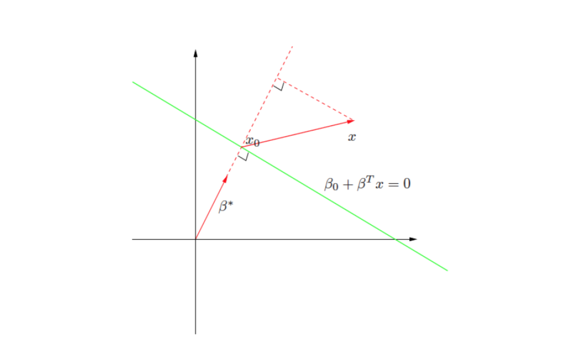

> 图源：[原课件第 6 页](../output/pdf/SDSC5001_Topic9_slides.pdf#page%3D6) · [Lumen 图示定位](obsidian://lumen-pdf?vault=guideline&file=course%2F5001%2Foutput%2Fpdf%2FSDSC5001_Topic9_slides.pdf&annotation=sdsc5001-t9-30ef9e8ce7-crop-006)。读图：法向量与点到超平面的正交投影，用来推导距离公式。

## 2. 可分与最大间隔
> [课件第 8–12 页](../output/pdf/SDSC5001_Topic9_slides.pdf#page%3D8) · [Lumen 本节定位](obsidian://lumen-pdf?vault=guideline&file=course%2F5001%2Foutput%2Fpdf%2FSDSC5001_Topic9_slides.pdf&annotation=sdsc5001-t9-30ef9e8ce7-page-008) · [逐页索引](Topic9_%E8%AF%BE%E4%BB%B6%E9%80%90%E9%A1%B5%E5%AF%B9%E5%BA%94%E8%A1%A8.md)

线性可分意味着存在 $\beta,b$ 使所有 $y_i(\beta^Tx_i+b)>0$。满足该条件的分隔面往往不唯一，SVM 从中选择最小几何间隔最大的一个：

$$M=\min_i\frac{y_i(\beta^Tx_i+b)}{\|\beta\|}.$$

有些资料把单侧距离 $M$ 称为 margin，有些把两条边界间总宽 $2M$ 称为 margin，解题时必须先声明。本笔记把 $M$ 作为单侧距离。

最大间隔面由最靠近边界的训练点限制。对硬间隔非退化情形，这些点在两侧间隔边界上。移动一个远离边界且仍保持不约束最优解的点，不一定改变分类面；若它移到边界附近，或跨到错误一侧，则可能改变解。

课件第 10 页用最优 $M$ 的正负讨论是否可分。严格可分需要正间隔；$M=0$ 属于边界或退化情况，不能直接按“正/负二选一”忽略。

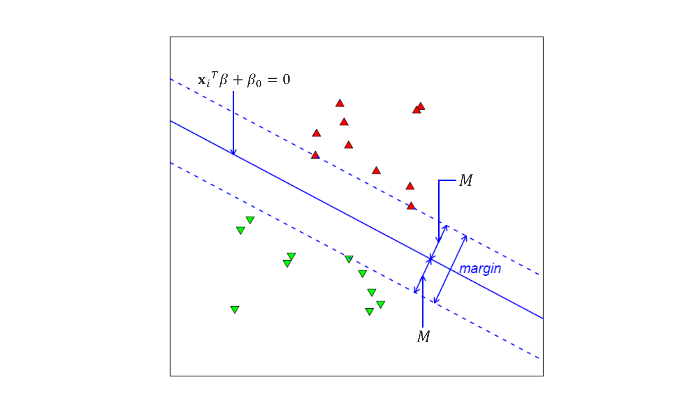

> 图源：[原课件第 11 页](../output/pdf/SDSC5001_Topic9_slides.pdf#page%3D11) · [Lumen 图示定位](obsidian://lumen-pdf?vault=guideline&file=course%2F5001%2Foutput%2Fpdf%2FSDSC5001_Topic9_slides.pdf&annotation=sdsc5001-t9-30ef9e8ce7-crop-011)。读图：最大间隔示意，中心为决策面，两条虚线到它各相距 $M$。

## 3. 从几何优化变成硬间隔二次规划
> [课件第 13–15 页](../output/pdf/SDSC5001_Topic9_slides.pdf#page%3D13) · [Lumen 本节定位](obsidian://lumen-pdf?vault=guideline&file=course%2F5001%2Foutput%2Fpdf%2FSDSC5001_Topic9_slides.pdf&annotation=sdsc5001-t9-30ef9e8ce7-page-013) · [逐页索引](Topic9_%E8%AF%BE%E4%BB%B6%E9%80%90%E9%A1%B5%E5%AF%B9%E5%BA%94%E8%A1%A8.md)

先固定 $\|\beta\|=1$ 最大化 $M$，约束 $y_i(\beta^Tx_i+b)\ge M$。单位球面约束不是凸约束。在线性可分、$M>0$ 时，可利用正比例缩放，把最小函数间隔规范为 1：

$$y_i(\beta^Tx_i+b)\ge1.$$

此时单侧几何间隔为 $1/\|\beta\|$，最大间隔等价于

$$\min_{\beta,b}\frac12\|\beta\|^2\quad\text{s.t.}\quad y_i(\beta^Tx_i+b)\ge1,\ i=1,\ldots,n.$$

目标凸、约束线性，所以是凸二次规划。$1/2$ 便于求导，不改变极小点。决策面为 $f=0$，两条间隔边界为 $f=\pm1$，不是 $f=\pm M$。

尺度规范化并不是假设真实数据天然具有数值间隔 1，而是从一族等价参数中选代表。若数据不可分，硬间隔约束无可行解，不能通过“继续增大系数”解决互相冲突的标签。

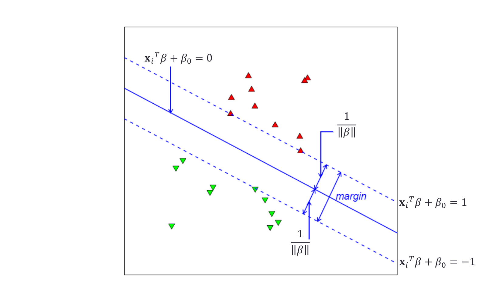

> 图源：[原课件第 15 页](../output/pdf/SDSC5001_Topic9_slides.pdf#page%3D15) · [Lumen 图示定位](obsidian://lumen-pdf?vault=guideline&file=course%2F5001%2Foutput%2Fpdf%2FSDSC5001_Topic9_slides.pdf&annotation=sdsc5001-t9-30ef9e8ce7-crop-015)。读图：规范化后的三条平行面：$f=-1,0,1$，总带宽为 $2/\|\beta\|$。

## 4. 硬间隔对个别样本为什么敏感
> [课件第 16–19 页](../output/pdf/SDSC5001_Topic9_slides.pdf#page%3D16) · [Lumen 本节定位](obsidian://lumen-pdf?vault=guideline&file=course%2F5001%2Foutput%2Fpdf%2FSDSC5001_Topic9_slides.pdf&annotation=sdsc5001-t9-30ef9e8ce7-page-016) · [逐页索引](Topic9_%E8%AF%BE%E4%BB%B6%E9%80%90%E9%A1%B5%E5%AF%B9%E5%BA%94%E8%A1%A8.md)

一个靠近另一类别的点就可能把最小间隔压得很窄，迫使整个分隔面明显转动。即使仍可分，为了迁就一个异常或错标签对象，也可能损害多数对象的稳定性。

软间隔的想法是允许部分对象进入间隔带，甚至被分错，交换更平滑、稳定的整体边界。它没有取消错分代价，而是在间隔大小和违反程度之间作优化权衡。

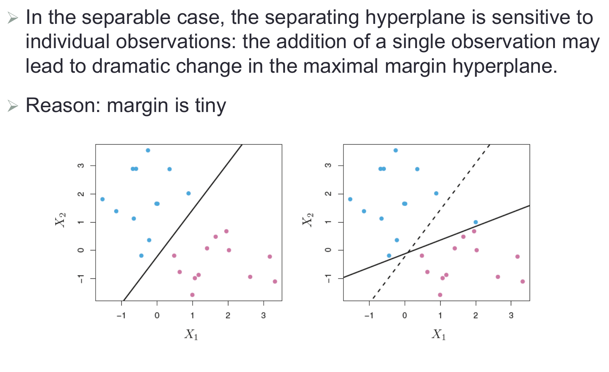

> 图源：[原课件第 17 页](../output/pdf/SDSC5001_Topic9_slides.pdf#page%3D17) · [Lumen 图示定位](obsidian://lumen-pdf?vault=guideline&file=course%2F5001%2Foutput%2Fpdf%2FSDSC5001_Topic9_slides.pdf&annotation=sdsc5001-t9-30ef9e8ce7-crop-017)。读图：加入单个靠近另一类的对象后，硬间隔面发生较大改变。

## 5. 松弛变量与 hinge loss 的精确关系
> [课件第 20–23 页](../output/pdf/SDSC5001_Topic9_slides.pdf#page%3D20) · [Lumen 本节定位](obsidian://lumen-pdf?vault=guideline&file=course%2F5001%2Foutput%2Fpdf%2FSDSC5001_Topic9_slides.pdf&annotation=sdsc5001-t9-30ef9e8ce7-page-020) · [逐页索引](Topic9_%E8%AF%BE%E4%BB%B6%E9%80%90%E9%A1%B5%E5%AF%B9%E5%BA%94%E8%A1%A8.md)

放宽为 $y_if(x_i)\ge1-\xi_i$、$\xi_i\ge0$。对于固定分类面，最小可行松弛为

$$\xi_i^*=(1-y_if(x_i))_+=\max\{0,1-y_if(x_i)\}.$$

因此在采用最小松弛解释时：

| 函数间隔 $m_i=y_if(x_i)$ | 最小 $\xi_i$ | 几何含义 |
|---|---|---|
| $m_i>1$ | 0 | 正确且在间隔带外 |
| $m_i=1$ | 0 | 恰在正确一侧间隔边界 |
| $0<m_i<1$ | $1-m_i\in(0,1)$ | 分类正确，但违反间隔 |
| $m_i=0$ | 1 | 决策边界，需平局规则 |
| $m_i<0$ | $>1$ | 分类错误 |

松弛量是函数间隔损失，不直接是原空间的长度；相应几何差要除以 $\|\beta\|$。约束允许把 $\xi$ 取得更大，但在正惩罚系数的最优解中没有必要浪费松弛。预算形式也可选取相同分类面对应的最小松弛来解释。

补充算例：若函数间隔为 $1.8,1,0.4,-0.2$，最小松弛依次为 $0,0,0.6,1.2$。第三点分类正确但处在间隔内，第四点才真正分错。不能把所有 $\xi>0$ 的点都称为错分。

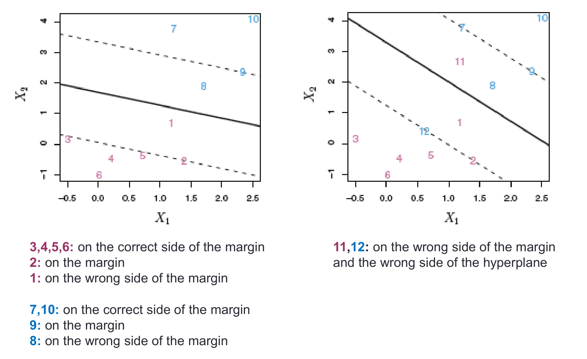

> 图源：[原课件第 23 页](../output/pdf/SDSC5001_Topic9_slides.pdf#page%3D23) · [Lumen 图示定位](obsidian://lumen-pdf?vault=guideline&file=course%2F5001%2Foutput%2Fpdf%2FSDSC5001_Topic9_slides.pdf&annotation=sdsc5001-t9-30ef9e8ce7-crop-023)。读图：带编号的点与两种违反：位于间隔内仍可能分类正确，跨过中心面才是错分。

### PPT 第 23 页逐项讲解：违反间隔与真正错分

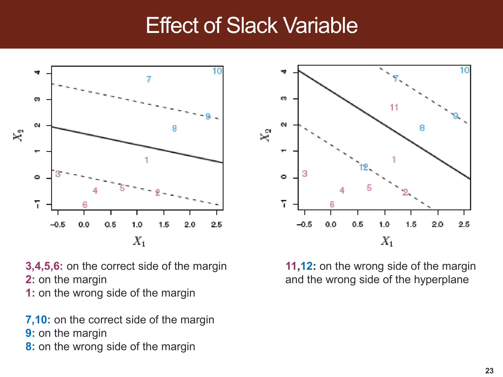

> 原课件：[第 23 页](../output/pdf/SDSC5001_Topic9_slides.pdf#page=23)。截图保留课件原貌，下面按阅读顺序解释；原页简写与笔误以正文核对为准。

**实线是决策超平面，虚线是两侧间隔边界。**颜色表示真实类别，先看点位于实线哪侧，再看它是否越过本类虚线；这两个判断不能混为一个。

**左图的 1、8 在正确分类侧但进入间隔。**它们有正 hinge loss，却仍可能分类正确；2、9 位于间隔边界，最小松弛为 0。右图 11、12 越过实线，被分错，对应最小松弛大于 1。

**编号不是损失大小。**应通过 $m_i=y_if(x_i)$ 算 $\xi_i=(1-m_i)_+$：$0<m_i<1$ 为带内正确，$m_i<0$ 才是错分。截图直观区分两者，正文补充数字把图形条件变成可复算量。

## 6. 两种参数形式：课件最容易混淆的地方
> [课件第 24–26 页](../output/pdf/SDSC5001_Topic9_slides.pdf#page%3D24) · [Lumen 本节定位](obsidian://lumen-pdf?vault=guideline&file=course%2F5001%2Foutput%2Fpdf%2FSDSC5001_Topic9_slides.pdf&annotation=sdsc5001-t9-30ef9e8ce7-page-024) · [逐页索引](Topic9_%E8%AF%BE%E4%BB%B6%E9%80%90%E9%A1%B5%E5%AF%B9%E5%BA%94%E8%A1%A8.md)

### 6.1 预算形式：本文记 $B$

$$\min_{\beta,b,\xi}\frac12\|\beta\|^2\quad\text{s.t.}\quad y_if(x_i)\ge1-\xi_i,\quad\xi_i\ge0,\quad\sum_i\xi_i\le B.$$

$B$ 大表示允许更多总违反，通常可取得更小范数、更宽间隔、较强平滑。$B=0$ 恢复硬间隔，数据不可分时可能无解。第 24 页“大 $C$ 更容忍违反”的讨论针对这个预算量。

### 6.2 惩罚形式：本文记 $C$

$$\min_{\beta,b,\xi}\frac12\|\beta\|^2+C\sum_i\xi_i\quad\text{s.t.}\quad y_if(x_i)\ge1-\xi_i,\quad\xi_i\ge0.$$

$C>0$ 大表示违反更昂贵，模型更努力拟合训练约束，通常正则化相对更弱；$C$ 小则更容忍违反。两种形式在适当最优参数对应下有关联，但数值不是同一个，更不是简单处处互为倒数。

**读题规则：先看 $C$ 位于约束右侧还是目标中的乘号前，再判断方向。**课件第 26 页说等价时沿用了相同字母，这是重参数化，而非把第 20 页的同一数值直接代入。

若采用平均 hinge loss 的目标 $\frac\lambda2\|\beta\|^2+\frac1n\sum_i\ell_i$，与上式匹配时 $C=1/(n\lambda)$。损失缩放和样本量也影响参数换算。

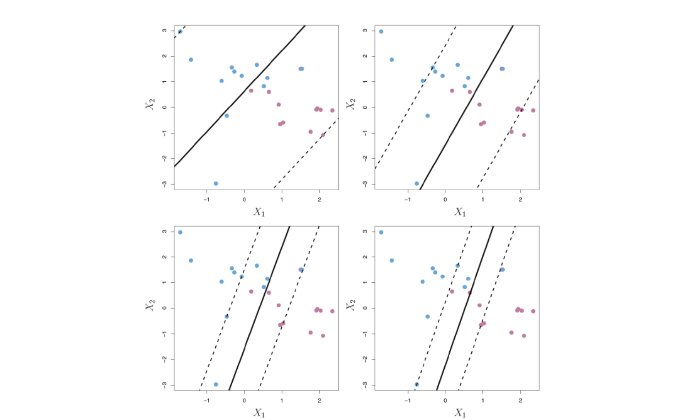

> 图源：[原课件第 25 页](../output/pdf/SDSC5001_Topic9_slides.pdf#page%3D25) · [Lumen 图示定位](obsidian://lumen-pdf?vault=guideline&file=course%2F5001%2Foutput%2Fpdf%2FSDSC5001_Topic9_slides.pdf&annotation=sdsc5001-t9-30ef9e8ce7-crop-025)。读图：不同松弛预算的边界示例；应连同前页的预算定义阅读，不能套用惩罚系数的方向。

### 外部拓展：SVM 的 C 与平均损失中的 λ：必须把样本数算进去

**课内衔接：**[本章第 6 节](#section-6) · [原课件第 24 页](../output/pdf/SDSC5001_Topic9_slides.pdf#page=24) · [复用原有 Lumen 定位](obsidian://lumen-pdf?vault=guideline&file=course%2F5001%2Foutput%2Fpdf%2FSDSC5001_Topic9_slides.pdf&annotation=sdsc5001-t9-30ef9e8ce7-page-024)

**外部拓展｜继续核对惩罚形式的尺度。**令 w 为分类超平面系数，b 为截距，训练标签 $y_i\in\{-1,+1\}$，分数为 $f_i=w^Tx_i+b$。单样本 hinge 损失为 $\ell_i=\max(0,1-y_if_i)$。比较两种目标：

$$J_C=\frac12\|w\|^2+C\sum_{i=1}^n\ell_i,\qquad
J_\lambda=\frac\lambda2\|w\|^2+\frac1n\sum_{i=1}^n\ell_i.$$

n 为训练样本数，C>0 是对求和损失的系数，λ>0 是平均损失目标中的惩罚系数。将 J_C 乘以正数 1/(Cn)，不会改变最小解，因此这两套定义对应

$$\lambda=\frac1{Cn}.$$

这是在明确的 1/2 与 1/n 约定下推导的等价，不适用于写法不同却未换算的参数。也不是“C 与 λ 只要互为倒数就行”。

**自编手算。**n=100、C=1 对应 λ=0.01。把每条记录精确复制一遍，n'=200；若仍取 C=1，求和损失翻倍，等价平均损失惩罚变成 λ'=0.005。若要复制数据后保持完全相同的目标比例，应取 C'=0.5。

**应用边界。**新收集的两倍数据不等于复制数据；最优 C 是否随样本数怎样变化，取决于统计目标与分布，上述代数不能推出通用调参规律。交叉验证改变训练量时，应明确软件约定，不能凭这条等式擅自改动既定 CV 算法再混报结果。

类权重或样本权重会改变每条损失的贡献，总权重的归一化也需要记录。比较不同软件的 SVM、Logistic 和正则化回归时，先写目标函数，再讨论参数大小。

**外部来源与阅读定位：**[scikit-learn：SVC 正则化参数与样本数](https://scikit-learn.org/stable/auto_examples/svm/plot_svm_scale_c.html)。本文推导与自编算例用于解释相应方法，不冒充来源中的实验结果。

## 7. 消去松弛变量：正则化的 hinge loss
> [课件第 26 页](../output/pdf/SDSC5001_Topic9_slides.pdf#page%3D26) · [Lumen 本节定位](obsidian://lumen-pdf?vault=guideline&file=course%2F5001%2Foutput%2Fpdf%2FSDSC5001_Topic9_slides.pdf&annotation=sdsc5001-t9-30ef9e8ce7-page-026) · [逐页索引](Topic9_%E8%AF%BE%E4%BB%B6%E9%80%90%E9%A1%B5%E5%AF%B9%E5%BA%94%E8%A1%A8.md)

在 $C>0$ 的惩罚形式中，给定 $\beta,b$，取最小 $\xi_i$，得到无显式松弛的等价目标：

$$\min_{\beta,b}\frac12\|\beta\|^2+C\sum_i(1-y_i(\beta^Tx_i+b))_+.$$

hinge loss 在函数间隔达到 1 后为 0，在 $m<1$ 时线性增加。它是 0–1 错分损失的凸上界，但不是概率对数损失，也没有把所有正确样本的损失都设成 0。

几何上，范数控制间隔；损失控制训练对象对该间隔的违反。对特征缩放后范数惩罚的几何意义会改变，所以 SVM 尤其需要关注特征尺度。

## 8. 拉格朗日函数与驻点条件
> [课件第 27 页](../output/pdf/SDSC5001_Topic9_slides.pdf#page%3D27) · [Lumen 本节定位](obsidian://lumen-pdf?vault=guideline&file=course%2F5001%2Foutput%2Fpdf%2FSDSC5001_Topic9_slides.pdf&annotation=sdsc5001-t9-30ef9e8ce7-page-027) · [逐页索引](Topic9_%E8%AF%BE%E4%BB%B6%E9%80%90%E9%A1%B5%E5%AF%B9%E5%BA%94%E8%A1%A8.md)

把约束写成 $1-\xi_i-y_i(\beta^Tx_i+b)\le0$ 和 $-\xi_i\le0$。对偶变量为 $\alpha_i\ge0$、$\mu_i\ge0$：

$$L=\frac12\|\beta\|^2+C\sum_i\xi_i+\sum_i\alpha_i[1-\xi_i-y_i(\beta^Tx_i+b)]-\sum_i\mu_i\xi_i.$$

固定乘子，对原变量求下确界；驻点给出

$$\beta=\sum_i\alpha_iy_ix_i,\qquad \sum_i\alpha_iy_i=0,\qquad C-\alpha_i-\mu_i=0.$$

因此 $0\le\alpha_i\le C$。课件第 27 页把求解简写成对原变量最小化，需理解完整的原始—对偶结构：不能把所有乘子也一起无约束最小化，否则就不再是在求原问题的对偶。

## 9. 对偶问题为什么只用内积
> [课件第 28 页](../output/pdf/SDSC5001_Topic9_slides.pdf#page%3D28) · [Lumen 本节定位](obsidian://lumen-pdf?vault=guideline&file=course%2F5001%2Foutput%2Fpdf%2FSDSC5001_Topic9_slides.pdf&annotation=sdsc5001-t9-30ef9e8ce7-page-028) · [逐页索引](Topic9_%E8%AF%BE%E4%BB%B6%E9%80%90%E9%A1%B5%E5%AF%B9%E5%BA%94%E8%A1%A8.md)

代回并消去原变量后：

$$\max_\alpha\left\{\sum_i\alpha_i-\frac12\sum_{i,j}\alpha_i\alpha_jy_iy_jx_i^Tx_j\right\}$$

$$\text{s.t.}\quad \sum_i\alpha_iy_i=0,\qquad 0\le\alpha_i\le C.$$

原空间 $p$ 维坐标只通过两两内积 $x_i^Tx_j$ 进入优化。求解后 $\hat\beta=\sum_i\hat\alpha_iy_ix_i$，预测为

$$f(x)=\sum_i\hat\alpha_iy_i x_i^Tx+b.$$

这是核技巧的准备：只要能算扩展空间中的内积，就不必显式建立其全部坐标。它也说明样本数 $n$ 很大时，$n\times n$ 的 Gram 矩阵可能成为计算瓶颈，而不只是特征维度 $p$。

### 深入讲解：把原变量代回去，逐项看对偶如何出现

沿用惩罚型软间隔 $C>0$。将拉格朗日函数重新分组：

$$L=\frac12\|\beta\|^2-\beta^T\sum_i\alpha_iy_ix_i
-b\sum_i\alpha_iy_i+\sum_i\alpha_i
+\sum_i(C-\alpha_i-\mu_i)\xi_i.$$

求关于原变量的下确界时，若 $\sum_i\alpha_iy_i\ne0$，$b$ 项可向负无穷变化，不能给出有限对偶值；因此必须有 $\sum_i\alpha_iy_i=0$。松弛系数的驻点关系给出 $C-\alpha_i-\mu_i=0$，结合非负乘子得到 $0\le\alpha_i\le C$。

记 $v=\sum_i\alpha_iy_ix_i$，关于 $\beta$ 的部分为 $\frac12\|\beta\|^2-\beta^Tv$，在 $\beta=v$ 取得最小值 $-\frac12\|v\|^2$。再展开

$$\|v\|^2=\sum_{i,j}\alpha_i\alpha_jy_iy_jx_i^Tx_j,$$

便得到正文的对偶目标。内积来自范数展开，盒约束来自松弛变量，并不是为了方便套核函数才事后添加的规则。

在这些条件下，软间隔原问题是凸的，并可取足够大松弛满足严格可行性，因而适用相应强对偶结论。求出满足 KKT 的原/对偶可行解可核对最优性；数值上还可看原始与对偶目标差距，而不只看训练分类是否全对。

## 10. KKT、支持向量与截距恢复
> [课件第 29–31 页](../output/pdf/SDSC5001_Topic9_slides.pdf#page%3D29) · [Lumen 本节定位](obsidian://lumen-pdf?vault=guideline&file=course%2F5001%2Foutput%2Fpdf%2FSDSC5001_Topic9_slides.pdf&annotation=sdsc5001-t9-30ef9e8ce7-page-029) · [逐页索引](Topic9_%E8%AF%BE%E4%BB%B6%E9%80%90%E9%A1%B5%E5%AF%B9%E5%BA%94%E8%A1%A8.md)

除驻点、原始可行和对偶可行外，还需互补松弛：

$$\alpha_i[y_if(x_i)-1+\xi_i]=0,\qquad (C-\alpha_i)\xi_i=0.$$

按非退化情况下的典型含义：

- $m_i>1$：约束不紧，$\alpha_i=0$，不参与预测展开。
- $0<\alpha_i<C$：$\xi_i=0$ 且 $m_i=1$，位于间隔边界。
- $m_i<1$：有正松弛，$\alpha_i=C$，可能正确但在带内，也可能错分。

**支持向量严格按 $\alpha_i>0$ 定义。**约束恰好紧不一定反推乘子严格为正；退化情形可能有 $m_i=1,\alpha_i=0$，也可能有 $m_i=1,\alpha_i=C$。因此第 30 页把所有等号点都直接当作支持向量，以及把边界点都限定为 $0<\alpha<C$，需要保留这一退化情形说明。

若存在 $0<\alpha_i<C$ 的点，可用

$$b=y_i-\sum_j\alpha_jy_jK(x_j,x_i)$$

恢复截距，多点可平均以减小数值误差。若不存在自由支持向量，不能随便选一个 $\alpha_i=C$ 的错分点代入同一边界等式，应利用 KKT 给出的截距区间或求解器结果。

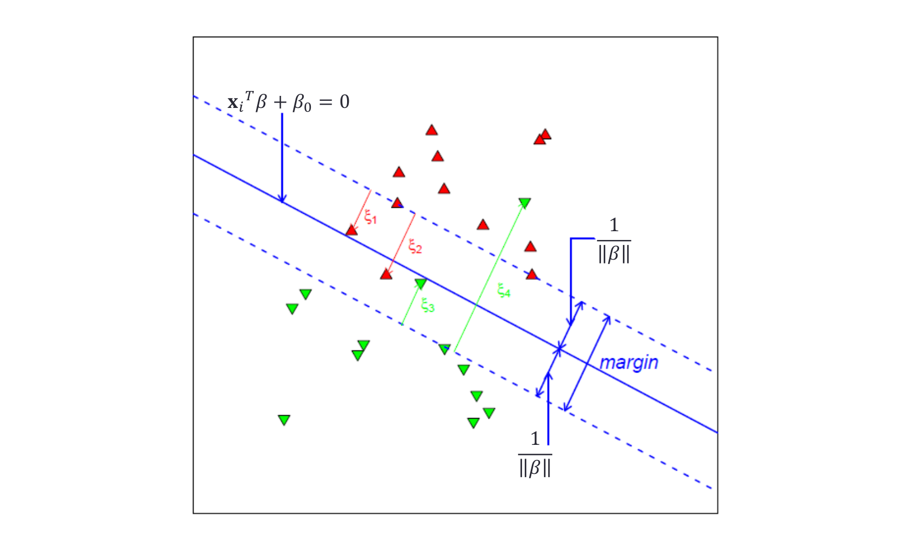

> 图源：[原课件第 31 页](../output/pdf/SDSC5001_Topic9_slides.pdf#page%3D31) · [Lumen 图示定位](obsidian://lumen-pdf?vault=guideline&file=course%2F5001%2Foutput%2Fpdf%2FSDSC5001_Topic9_slides.pdf&annotation=sdsc5001-t9-30ef9e8ce7-crop-031)。读图：软间隔下的支持向量及违反程度；不只两条边界上的点可能参与解。

### 深入讲解：没有自由支持向量时怎样判断截距

令 $g_i=\sum_j\alpha_jy_jK(x_j,x_i)$，则 $f_i=g_i+b$。若 $0<\alpha_i<C$，KKT 给 $y_if_i=1$，可直接求 $b=y_i-g_i$。若所有非零乘子都卡在上界，就应使用不等式而不是强行当成间隔边界：

- $y_i=+1,\alpha_i=0$ 时，$b\ge1-g_i$；$y_i=+1,\alpha_i=C$ 时，$b\le1-g_i$。
- $y_i=-1,\alpha_i=0$ 时，$b\le-1-g_i$；$y_i=-1,\alpha_i=C$ 时，$b\ge-1-g_i$。

汇总所有下界与上界，得到可行截距区间。端点出现等号允许退化情形；实际数值求解还需相应容差。

**补充手算。**取训练点 $(-1,-1),(1,+1)$ 和 $C=1/4$。本章两点算例给出 $\beta=1/2$、$\alpha_1=\alpha_2=C$。正类给 $b\le1-1/2=1/2$，负类给 $b\ge-1+1/2=-1/2$，所以任意 $b\in[-1/2,1/2]$ 均可取最优。

例如取 $b=0$，两个函数间隔都为 0.5、松弛都为 0.5，总目标为 $(1/2)(1/2)^2+(1/4)(1)=3/8$。强行把每个支持向量设为间隔边界，会分别算出不同的端点截距；这反映它们不是自由支持向量，不能据此断言解矛盾或截距唯一。

此例也显示严格凸的范数项可以确定 $\beta$，但未被惩罚的 $b$ 仍可能不唯一。分类规则和支持向量的解释应以所求解的具体最优解为准。

### PPT 第 29 页逐项讲解：KKT 的乘积等于零怎样读

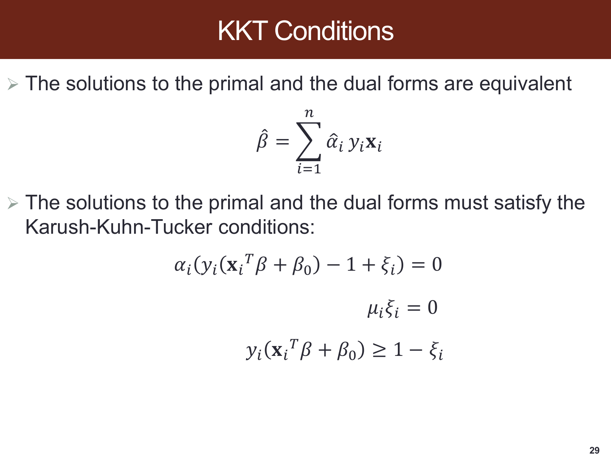

> 原课件：[第 29 页](../output/pdf/SDSC5001_Topic9_slides.pdf#page=29)。截图保留课件原貌，下面按阅读顺序解释；原页简写与笔误以正文核对为准。

**第一条把法向量写成训练点的加权和。**乘子为 0 的点不出现在预测展开中，非零乘子的点才在本笔记定义中称支持向量。

**互补松弛是两个因子至少一个为零。**$\alpha_i[y_if_i-1+\xi_i]=0$ 不表示两个因子都为零，也不表示约束取等号就必然有正乘子。第二个乘积 $\mu_i\xi_i=0$ 还需结合 $\mu_i=C-\alpha_i$。

**综合后才分三类。**自由乘子 $0<\alpha_i<C$ 给出零松弛且在边界；正松弛迫使 $\alpha_i=C$；间隔外点有零乘子。没有自由支持向量时，应按补充例子用上下界恢复截距。

## 11. 复杂度与“稳健性”的范围
> [课件第 32 页](../output/pdf/SDSC5001_Topic9_slides.pdf#page%3D32) · [Lumen 本节定位](obsidian://lumen-pdf?vault=guideline&file=course%2F5001%2Foutput%2Fpdf%2FSDSC5001_Topic9_slides.pdf&annotation=sdsc5001-t9-30ef9e8ce7-page-032) · [逐页索引](Topic9_%E8%AF%BE%E4%BB%B6%E9%80%90%E9%A1%B5%E5%AF%B9%E5%BA%94%E8%A1%A8.md)

预测时只需要非零 $\alpha_i$ 的对象，支持向量越少通常预测越便宜。但训练复杂度还受 $n$、核计算、特征维度、优化算法和精度要求影响，不能只由最后支持向量数量决定。

正确一侧、远离间隔的点通常不参与解；错误一侧很远的对象则有较大 hinge loss，可能影响分类面。课件“对离边界很远的异常值不敏感”的表述只适用于不构成有效约束的方向，不能理解为 SVM 对任意异常和错标签都稳健。

特征标准化、异常核对与合理的 $C$ 依然重要。软间隔解决的是容忍违反，不等于自动清洗数据，也不保证对所有分布漂移稳定。

## 12. 基函数扩展与非线性边界
> [课件第 33–39 页](../output/pdf/SDSC5001_Topic9_slides.pdf#page%3D33) · [Lumen 本节定位](obsidian://lumen-pdf?vault=guideline&file=course%2F5001%2Foutput%2Fpdf%2FSDSC5001_Topic9_slides.pdf&annotation=sdsc5001-t9-30ef9e8ce7-page-033) · [逐页索引](Topic9_%E8%AF%BE%E4%BB%B6%E9%80%90%E9%A1%B5%E5%AF%B9%E5%BA%94%E8%A1%A8.md)

把 $x$ 变成 $h(x)=(h_1(x),\ldots,h_M(x))$，在扩展空间拟合线性超平面：

$$f(x)=\beta^Th(x)+b.$$

它在 $h$ 空间中线性，回到原坐标可能非线性。例如加入 $x_1^2,x_2^2$ 后，$x_1^2+x_2^2-r^2=0$ 是原平面的圆，却是坐标 $(x_1^2,x_2^2)$ 中的直线形式。

课件使用各变量平方项演示扩展；若需要一般二次边界，还可能需要交互 $x_jx_k$。仅加入各自平方不等于已经包含全部二次多项式。第 37 页混用了单位范数几何形式与规范化松弛形式，推导时应选择一套一致的约束；本文使用第 6 节的规范化惩罚形式，再将 $x_i$ 全部替换为 $h(x_i)$。

Cover 定理提供高维非线性映射更容易产生可分结构的直觉，但不保证任意升维都改善独立测试表现。把训练数据分得更开，也可能只是让过拟合更容易。

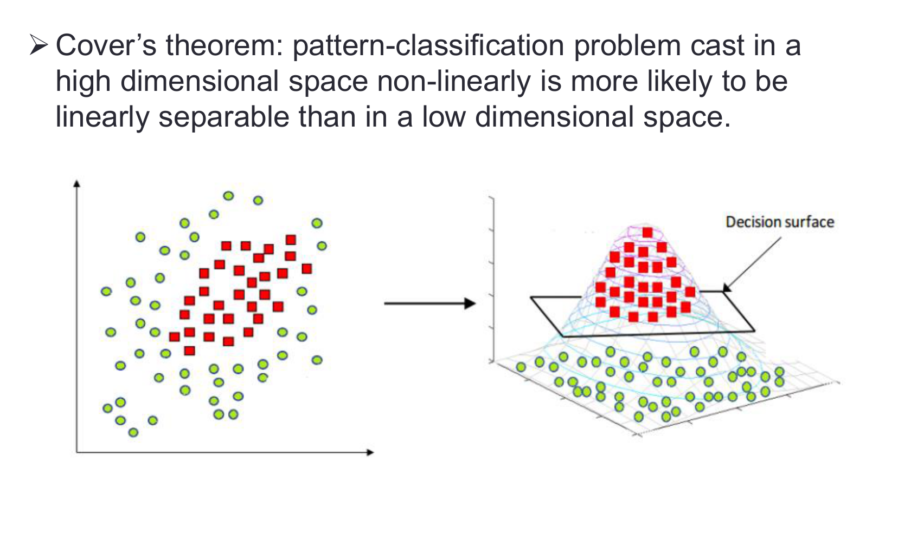

> 图源：[原课件第 35 页](../output/pdf/SDSC5001_Topic9_slides.pdf#page%3D35) · [Lumen 图示定位](obsidian://lumen-pdf?vault=guideline&file=course%2F5001%2Foutput%2Fpdf%2FSDSC5001_Topic9_slides.pdf&annotation=sdsc5001-t9-30ef9e8ce7-crop-035)。读图：非线性升维后出现线性分隔面的示意；原空间的分类边界仍然可以是弯曲的。

## 13. 核技巧与核函数的条件
> [课件第 40–42 页](../output/pdf/SDSC5001_Topic9_slides.pdf#page%3D40) · [Lumen 本节定位](obsidian://lumen-pdf?vault=guideline&file=course%2F5001%2Foutput%2Fpdf%2FSDSC5001_Topic9_slides.pdf&annotation=sdsc5001-t9-30ef9e8ce7-page-040) · [逐页索引](Topic9_%E8%AF%BE%E4%BB%B6%E9%80%90%E9%A1%B5%E5%AF%B9%E5%BA%94%E8%A1%A8.md)

内积为 $a^Tb=\sum_ja_jb_j$。定义

$$K(x,z)=\langle h(x),h(z)\rangle.$$

将对偶目标与预测公式中的内积全部换成 $K$：

$$f(x)=\sum_{i\in SV}\alpha_iy_iK(x_i,x)+b.$$

核函数提供扩展空间的内积，而不仅是一个随意的“相似分”。一个有效实核应对称，并使任意有限样本的 Gram 矩阵半正定：$v^TKv\ge0$。这保证对应一个内积表示，也支持凸二次规划的结构。任意手写距离函数并不自动是有效核。

| 核 | 形式 | 主要含义 |
|---|---|---|
| 线性 | $x^Tz$ | 原空间线性分类 |
| 多项式 | $(1+x^Tz)^d$ | 包含交互与幂次的有限维扩展 |
| RBF/Gaussian | $\exp[-\gamma\|x-z\|^2]$，$\gamma>0$ | 按距离局部衰减、隐式无限维扩展 |

核空间的几何间隔与原始坐标中的欧氏距离不是同一个对象；非线性决策边界附近的分数变化也不必像线性模型那样对应一个固定法向量。

### 深入讲解：核矩阵、RBF 半径与调参怎样对应

一个对称“相似度”矩阵未必是有效核。例如两点上的候选矩阵 $K=\begin{pmatrix}1&2\\2&1\end{pmatrix}$，取 $v=(1,-1)^T$，有 $v^TKv=-2<0$。它不能作为这两点在实内积空间中的 Gram 矩阵；对称性本身不够，正的对角线也不够。

RBF 核 $K(x,z)=\exp[-\gamma\|x-z\|^2]$ 在 $\gamma>0$ 时具有有效核结构。若想直观理解影响范围，可解 $K=1/2$：

$$r_{1/2}=\sqrt{\frac{\log2}{\gamma}}.$$

**补充数值。**$\gamma=0.5$ 时，距离 1 的核值为 $e^{-0.5}\approx0.6065$，距离 2 的核值为 $e^{-2}\approx0.1353$。若 $\gamma$ 增大四倍，半值半径减半，而不是减为四分之一。

输入缩放同样改变距离。把所有坐标同乘 $a$，为保持相同核值需将 $\gamma$ 换成 $\gamma/a^2$；若每一维采用不同缩放，则无法只用一个全局 $\gamma$ 完全补偿。这说明标准化与核参数必须作为整体流程验证。

在惩罚形式中，$C$ 控制违反间隔的代价，$\gamma$ 控制核相似范围。调参可在开发数据内对二者作对数尺度网格或其他搜索，检查验证表现是否在搜索边界仍明显改进。高 $C$、高 $\gamma$ 往往能拟合很细碎的训练结构，但最终选择由独立验证而非训练正确率决定。

## 14. 二次多项式核的显式展开
> [课件第 43–44 页](../output/pdf/SDSC5001_Topic9_slides.pdf#page%3D43) · [Lumen 本节定位](obsidian://lumen-pdf?vault=guideline&file=course%2F5001%2Foutput%2Fpdf%2FSDSC5001_Topic9_slides.pdf&annotation=sdsc5001-t9-30ef9e8ce7-page-043) · [逐页索引](Topic9_%E8%AF%BE%E4%BB%B6%E9%80%90%E9%A1%B5%E5%AF%B9%E5%BA%94%E8%A1%A8.md)

当 $p=2$，取

$$h(x)=(1,\sqrt2x_1,\sqrt2x_2,x_1^2,x_2^2,\sqrt2x_1x_2)^T.$$

两向量内积为

$$1+2x_1z_1+2x_2z_2+x_1^2z_1^2+x_2^2z_2^2+2x_1x_2z_1z_2=(1+x^Tz)^2.$$

$\sqrt2$ 保证交叉项系数正确，不能在抄写时把根号丢掉。相同核值可不必真的生成这六项；在更高维和更高次时，节省显式扩展的成本更明显。

补充算例：$x=(1,2)$、$z=(3,4)$，$x^Tz=11$，核值为 $12^2=144$。按六维映射求内积也得 144，这是很适合检查映射系数的算例。

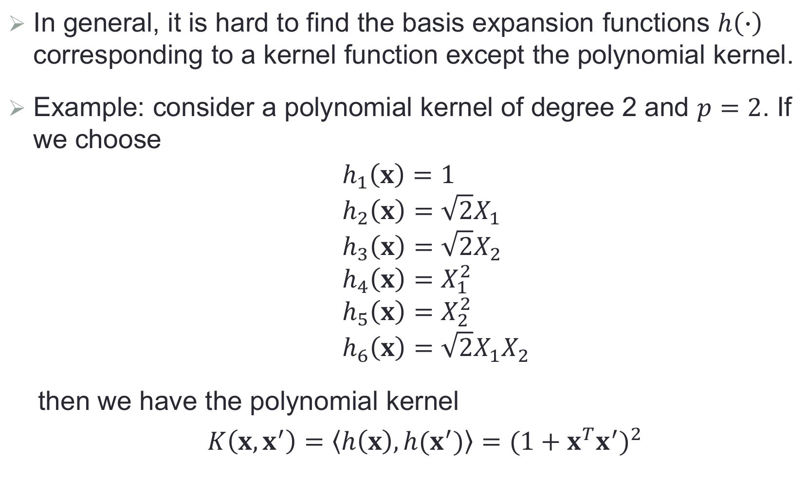

> 图源：[原课件第 44 页](../output/pdf/SDSC5001_Topic9_slides.pdf#page%3D44) · [Lumen 图示定位](obsidian://lumen-pdf?vault=guideline&file=course%2F5001%2Foutput%2Fpdf%2FSDSC5001_Topic9_slides.pdf&annotation=sdsc5001-t9-30ef9e8ce7-crop-044)。读图：二次核的六个基函数，特别留意三个 $\sqrt2$ 系数。

### PPT 第 44 页逐项讲解：二次核的六维显式映射

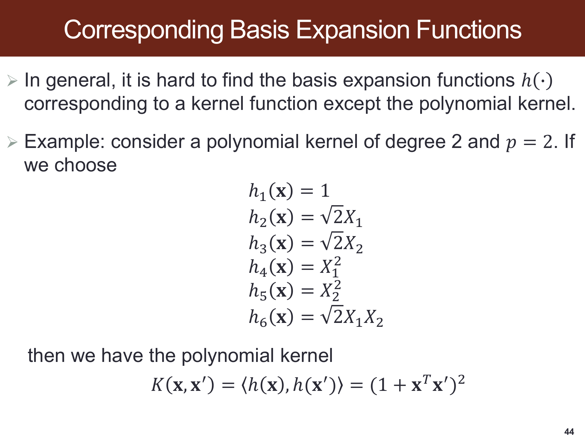

> 原课件：[第 44 页](../output/pdf/SDSC5001_Topic9_slides.pdf#page=44)。截图保留课件原貌，下面按阅读顺序解释；原页简写与笔误以正文核对为准。

**先数坐标，再展开内积。**常数、两个一次项、两个平方项、一个交叉项共六维。一次项与交叉项前的 $\sqrt2$ 用来让内积中相应系数变成 2，不能抄成普通的 2。

**底部等式是核技巧的具体实例。**原来要在六维坐标中求内积，现在直接算 $(1+x^Tx')^2$，两者结果完全相同。正文的 $(1,2)$ 与 $(3,4)$ 例子核值为 144，可逐项复算。

**高维表示与预测有效性分开。**映射允许原坐标中的二次边界，但不保证升维后测试误差下降；仍需选择正则化并独立评价。RBF 无需显式列出无限维坐标，也不表示训练样本之间的核计算和存储没有成本。

## 15. 核计算成本与 RBF 的局部性
> [课件第 45–46 页](../output/pdf/SDSC5001_Topic9_slides.pdf#page%3D45) · [Lumen 本节定位](obsidian://lumen-pdf?vault=guideline&file=course%2F5001%2Foutput%2Fpdf%2FSDSC5001_Topic9_slides.pdf&annotation=sdsc5001-t9-30ef9e8ce7-page-045) · [逐页索引](Topic9_%E8%AF%BE%E4%BB%B6%E9%80%90%E9%A1%B5%E5%AF%B9%E5%BA%94%E8%A1%A8.md)

核方法避免显式操作高维甚至无限维特征，但仍需处理训练样本间的核关系。完整存储 Gram 矩阵需要 $O(n^2)$ 内存；具体求解器可缓存、分块或用近似，并不一定一次存下全部矩阵。预测一般与支持向量数和单次核计算成本有关。

RBF 中，当 $\|x-z\|$ 大时核值接近 0；相近样本的局部影响更强。$\gamma$ 大时衰减快，单个点影响范围窄，边界可更曲折；$\gamma$ 小时变化缓慢，模型可能过于平滑。不能只调 $C$ 而忽略 $\gamma$，两者共同控制拟合。

若某维单位从米改为毫米，平方距离会大幅变化，同一 $\gamma$ 不再表达同样相似范围。因此缩放参数必须在训练折内拟合，并在验证/测试数据上复用。

### 外部拓展：核近似把“隐式高维”变成可计算的显式特征

**课内衔接：**[本章第 15 节](#section-15) · [原课件第 45 页](../output/pdf/SDSC5001_Topic9_slides.pdf#page=45) · [复用原有 Lumen 定位](obsidian://lumen-pdf?vault=guideline&file=course%2F5001%2Foutput%2Fpdf%2FSDSC5001_Topic9_slides.pdf&annotation=sdsc5001-t9-30ef9e8ce7-page-045)

**外部拓展｜连接核方法的内存成本。**精确核分类需要处理样本间的相似度，完整 n×n Gram 矩阵元素为 $K_{ij}=k(x_i,x_j)$。n 是训练样本数，k 是所选核函数；大写 K 这里是矩阵，不是折数。

Nyström 选择 m 个代表点 $c_1,\ldots,c_m$，m 远小于 n。定义 $C_{ij}=k(x_i,c_j)$ 为 n×m 矩阵，$W_{jl}=k(c_j,c_l)$ 为 m×m 矩阵，近似

$$K\approx CW^\dagger C^T.$$

dagger 表示 Moore–Penrose 伪逆，用于处理奇异或低秩矩阵。C 在这里是交叉核矩阵，不是前节的 SVM 惩罚参数。对称半正定 W 可经特征分解构造逆平方根：正特征值开方后取倒数，零方向按选定截断处理；显式特征矩阵可取 $Z=CW^{\dagger/2}$，于是 $ZZ^T$ 等于上述近似。

读作：不保留每个训练对象与全部对象的关系，而保留它与 m 个代表点的关系，再校正代表点之间的重复信息。m 控制近似容量，代表点选择和正则化都会影响效果。

另一条路线是为平移不变核采样随机 Fourier 特征，例如用随机频率和相位构造有限维 z(x)，使 $z(x)^Tz(x')$ 近似 k(x,x')。这与 Nyström 从训练数据选代表点的机制不同。

**自编规模核对。**n=100,000，完整矩阵有 10¹⁰ 个元素，仅 float64 原始存储约 80 GB；m=500 时，n×m 特征有 5×10⁷ 个元素，原始存储约 400 MB，另需 m×m 矩阵和求解器开销。1 GB 在此按 10⁹ 字节计算；这不是峰值内存或精确运行时间承诺。

近似特征后仍需训练线性模型并验证精度。Nyström 的代表点、缩放和后续模型应只在训练折学习；近似维度和随机种子也应进入实验记录。近似不保证与精确 SVM 同等的预测性能。

**外部来源与阅读定位：**[scikit-learn：Nyström 与随机 Fourier 核近似](https://scikit-learn.org/stable/modules/kernel_approximation.html)。本文推导与自编算例用于解释相应方法，不冒充来源中的实验结果。

## 16. 训练 ROC、测试 ROC 与超参数选择
> [课件第 47–48 页](../output/pdf/SDSC5001_Topic9_slides.pdf#page%3D47) · [Lumen 本节定位](obsidian://lumen-pdf?vault=guideline&file=course%2F5001%2Foutput%2Fpdf%2FSDSC5001_Topic9_slides.pdf&annotation=sdsc5001-t9-30ef9e8ce7-page-047) · [逐页索引](Topic9_%E8%AF%BE%E4%BB%B6%E9%80%90%E9%A1%B5%E5%AF%B9%E5%BA%94%E8%A1%A8.md)

ROC 用连续分数改变阈值，画出 TPR 对 FPR。原始 SVM 分数即可排序和构造 ROC，不需要先把它当成概率。若需要概率，例如计算预期风险，还需额外校准，并把校准放进正确的训练/验证流程。

课件 Heart Data 分别画训练与测试曲线。训练曲线更漂亮不保证测试也更好，某个 $\gamma$ 在训练近乎完美，测试优势仍可能有限。图只支持该样本划分下的比较，不应编造没有给出的精确 AUC 数值。

选核、$C$ 和 $\gamma$ 应使用开发数据内的验证/CV，最终测试集用于报告。类别不平衡或错分成本不同，还需选择指标与阈值，最大化准确率不一定符合目标。

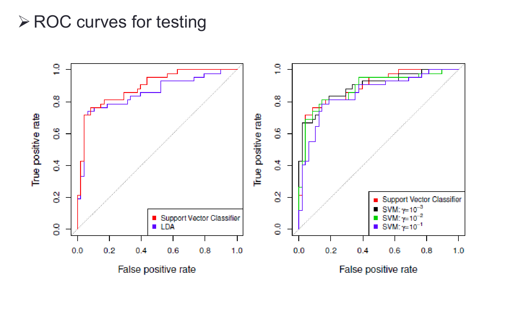

> 图源：[原课件第 48 页](../output/pdf/SDSC5001_Topic9_slides.pdf#page%3D48) · [Lumen 图示定位](obsidian://lumen-pdf?vault=guideline&file=course%2F5001%2Foutput%2Fpdf%2FSDSC5001_Topic9_slides.pdf&annotation=sdsc5001-t9-30ef9e8ce7-crop-048)。读图：独立测试 ROC 与训练图对照，不能只根据上一页的训练曲线选模型。

### 外部拓展：SVM 分数怎样校准成概率，为什么不保证准确率提高

**课内衔接：**[本章第 16 节](#section-16) · [原课件第 47 页](../output/pdf/SDSC5001_Topic9_slides.pdf#page=47) · [复用原有 Lumen 定位](obsidian://lumen-pdf?vault=guideline&file=course%2F5001%2Foutput%2Fpdf%2FSDSC5001_Topic9_slides.pdf&annotation=sdsc5001-t9-30ef9e8ce7-page-047)

**外部拓展｜连接 ROC、排序和概率决策。**SVM 输出的 $f(x)$ 是分类分数；正负号用于判类，绝对大小与模型约定相关，不能直接叫“80% 的概率”。绘制 ROC 只需要排序分数，不要求已经校准。

一种 sigmoid 校准写作

$$q(x)=\frac1{1+\exp(Af(x)+B)}.$$

q 是估计的正类概率，A、B 是从独立于拟合该分数的数据中学习的校准参数；A 不是 AUC，B 不是样本量。这个符号约定常与 Logistic 的正号 logit 写法相反，所以必须连同公式解释。

**自编手算。**A=−1、B=0.5 时，f=0 对应 q≈0.3775；q=0.5 对应 f=0.5。因此按 f≥0 判类与按 q≥0.5 判类可能不同。LIBSVM 作者 FAQ 也明确说明概率阈值与原始决策阈值不保证完全对应。

当 A<0 时，该 sigmoid 对 f 严格递增，单一固定模型的原始排序不变，因而不因这个单调映射本身改变 ROC AUC；但概率尺度、log loss 与按概率阈值的行动可以改变。若做多模型折平均或多分类组合，还要另行分析，不能照搬这条单一映射结论。

**正确训练流程。**SVM 在训练部分拟合，校准器使用隔离校准部分或合适的折外分数学习；阈值如需调节，再在验证流程中决定；最终测试只用于评价。用拟合训练数据的原位分数来训练校准器，可能继承过拟合的自信。

概率输出的用途是风险估计与成本决策，不保证分类准确率提高。应分别检查 Brier/log loss、可靠性图、AUC，以及最终阈值下的业务损失；部署先验改变还要回到 Topic 6 的分布条件。

**外部来源与阅读定位：**[LIBSVM 作者 FAQ：概率输出](https://www.csie.ntu.edu.tw/~cjlin/libsvm/faq.html)。本文推导与自编算例用于解释相应方法，不冒充来源中的实验结果。

## 17. 多分类：OvO 与 OvR
> [课件第 49 页](../output/pdf/SDSC5001_Topic9_slides.pdf#page%3D49) · [Lumen 本节定位](obsidian://lumen-pdf?vault=guideline&file=course%2F5001%2Foutput%2Fpdf%2FSDSC5001_Topic9_slides.pdf&annotation=sdsc5001-t9-30ef9e8ce7-page-049) · [逐页索引](Topic9_%E8%AF%BE%E4%BB%B6%E9%80%90%E9%A1%B5%E5%AF%B9%E5%BA%94%E8%A1%A8.md)

One-versus-one 对每一对类别训练二分类器，共 $\binom K2=K(K-1)/2$ 个，用投票或相应聚合决策。每个分类器只看该对类别，训练对象少，但模型数量随类别数增长较快。

One-versus-rest 对每一类训练“该类 vs 其余”分类器，共 $K$ 个，再按分数选类。各二分类任务的不平衡程度可能不同，原始分数跨模型比较需要注意尺度、训练设置和具体决策机制。

例如 $K=4$，OvO 有 6 个模型，OvR 有 4 个。二者都需要处理票数/分数并列，不能仅按模型数量就断言谁一定更准确。

## 18. 支持向量回归 SVR 的补充形式
> [课件第 50 页](../output/pdf/SDSC5001_Topic9_slides.pdf#page%3D50) · [Lumen 本节定位](obsidian://lumen-pdf?vault=guideline&file=course%2F5001%2Foutput%2Fpdf%2FSDSC5001_Topic9_slides.pdf&annotation=sdsc5001-t9-30ef9e8ce7-page-050) · [逐页索引](Topic9_%E8%AF%BE%E4%BB%B6%E9%80%90%E9%A1%B5%E5%AF%B9%E5%BA%94%E8%A1%A8.md)

SVR 使用 $\epsilon$ 不敏感损失：

$$L_\epsilon(y,f)=\max\{0,|y-f|-\epsilon\}.$$

误差绝对值在 $\epsilon$ 管道内时不收费，超出部分按线性增长。标准线性 SVR 可写为

$$\min_{\beta,b}\frac12\|\beta\|^2+C\sum_iL_\epsilon(y_i,\beta^Tx_i+b).$$

等价松弛形式有 $\xi_i,\xi_i^*$，分别处理管道上下两侧，约束 $y_i-f(x_i)\le\epsilon+\xi_i$、$f(x_i)-y_i\le\epsilon+\xi_i^*$。用核也可以构造非线性 SVR。

课件只给概念，上述公式为配套展开。$\epsilon$ 控制无惩罚管道宽，$C$ 控制管道外损失权重，二者不是同一个参数。线性尾部相对平方损失减弱了极端残差的增长，但仍不能笼统说对任何异常都免疫。

### 深入讲解：SVR 为什么要有上下两套松弛量

分类只关心标签方向，回归则既可能低估也可能高估。令残差 $r_i=y_i-f(x_i)$，标准 SVR 约束为

$$r_i\le\epsilon+\xi_i,\qquad -r_i\le\epsilon+\xi_i^*,\qquad
\xi_i,\xi_i^*\ge0.$$

给定函数时，正惩罚使最优松弛为 $\xi_i=(r_i-\epsilon)_+$、$\xi_i^*=(-r_i-\epsilon)_+$。两者之和即 $\max(0,|r_i|-\epsilon)$。一个处理真实值在管道上方，另一个处理在下方。

**补充手算。**取 $\epsilon=0.5$，三个残差为 $0.2,0.7,-1.1$，两套松弛分别为 $(0,0.2,0)$ 与 $(0,0,0.6)$，损失为 $0,0.2,0.6$。残差为 0.7 的对象不是交全部 0.7 的代价，而只交超出管道的 0.2。

管道半宽 $\epsilon$ 与响应有相同单位；$C$ 则权衡管道外损失与函数范数。改变响应单位后，不能无声沿用相同 $\epsilon$ 并认为问题完全相同。$\epsilon$ 大会让更多点不产生管道外损失，但也可能忽略有意义的细小变化。

对偶形式有两组乘子，核预测写成 $f(x)=\sum_i(\alpha_i-\alpha_i^*)K(x_i,x)+b$，约束包括 $\sum_i(\alpha_i-\alpha_i^*)=0$ 和 $0\le\alpha_i,\alpha_i^*\le C$。与分类的 $\alpha_i y_i$ 相比，这里上下两侧的作用由乘子之差表示，不能直接把分类标签公式复制过来。

严格位于管道内的点不产生对应有效乘子；管道边界也可能出现零乘子的退化点。支持向量数量与预测成本有关，但它不是回归泛化质量的直接指标。

## 19. 一维硬间隔完整手算

取两个点 $(x_1,y_1)=(-1,-1)$、$(x_2,y_2)=(1,+1)$。规范化约束为 $\beta-b\ge1$、$\beta+b\ge1$。最小范数解是 $\beta=1,b=0$，单侧间隔为 1，总宽 2。

对偶等式给 $\alpha_1=\alpha_2=a$，而 $\beta=\sum_i\alpha_iy_ix_i=2a$，所以 $a=1/2$。两个点都是支持向量，预测 $f(x)=x$。把参数同乘 2 后分类不变，但规范化目标范数变大，不再是该规范下的最小解。

软间隔且惩罚 $C>0$ 时，由对称性 $b=0$ 可取最优，目标变成 $\frac12\beta^2+2C(1-\beta)_+$，解为 $\hat\beta=\min(2C,1)$。当 $C\ge1/2$ 时恢复硬间隔；当 $C$ 小时允许两点处于间隔内，却仍可分对。这也再次说明“违反间隔”不等于“训练错分”。

## 20. 自测与参考答案

1. $f(x)$ 为什么必须除以 $\|\beta\|$ 才是几何距离？
2. margin 的单侧和总宽怎样对应？3. 硬间隔规范化为何可行？
4. $\xi=0.6$ 是否一定错分？5. 预算 $B$ 与惩罚 $C$ 增大的方向相同吗？
6. hinge loss 为零要求分类正确就够了吗？
7. 对偶为什么有 $\sum_i\alpha_iy_i=0$？8. 为什么 $\alpha_i\le C$？
9. 约束紧是否必然 $\alpha_i>0$？10. 任何 $\alpha_i=C$ 的点都能用边界公式求 $b$ 吗？
11. 离决策面很远的错分点是否必然无影响？
12. 任意相似度函数都是核吗？13. RBF 的 $\gamma$ 大意味着什么？
14. 四类 OvO 需要多少模型？15. SVM 分数可以直接当概率吗？
16. SVR 的 $\epsilon$ 和 $C$ 各控制什么？

> [!success]- 参考答案
> 1. 参数可任意正比例缩放，归一化才尺度不变。2. 单侧为 $1/\|\beta\|$，总宽两倍。3. 正间隔可分时可按最小函数间隔缩放。4. 最小松弛下函数间隔为 0.4，仍分对。5. 相反，前者放宽约束，后者加重惩罚。6. 还需函数间隔至少 1。7. 对截距求驻点。8. 因 $C-\alpha_i-\mu_i=0$ 且 $\mu_i\ge0$。9. 不必，退化点可零乘子。10. 不行，它可能有正松弛。11. 不必，错误方向上可有大损失。12. 不是，需相应对称半正定条件。13. 相似度衰减更快、影响更局部。14. 6 个。15. 不可以，需额外概率校准。16. 前者管道宽度，后者管道外损失权重。

---

[返回课程总目录](README.md) · [50 页课件索引](Topic9_%E8%AF%BE%E4%BB%B6%E9%80%90%E9%A1%B5%E5%AF%B9%E5%BA%94%E8%A1%A8.md)
