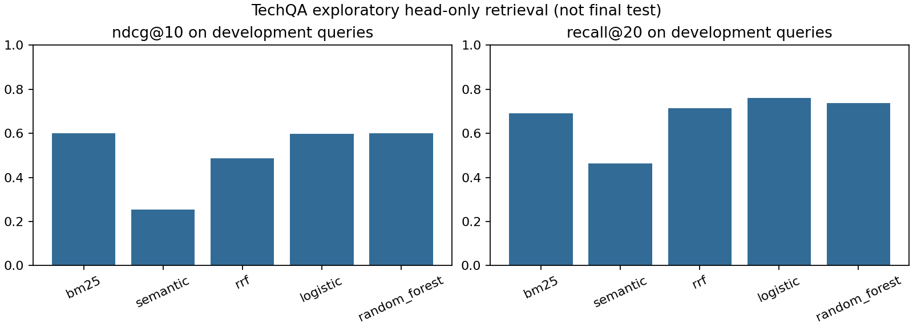

# TechQA 探索实验结果

最新完成的第二轮包含完整 BGE、强融合基线、六项训练对照和一次冻结保留集，见 [第二轮结果](iteration2_summary.md)、[实验协议](../protocol/TechQA_v2.md)。下文保留首轮 LSA 历史记录，不能当作当前完成状态。

2026-11-14 已完成一轮可重现的 BM25／LSA 检索和监督重排实验。当前主要发现是：学习重排改善了这条固定 RRF 基线，但 RF 与 BM25 的开发集 nDCG@10 几乎相同；这轮结果不足以宣称学习重排优于强词项基线。

## 数据与实现

运行目录为 `20261114T113500971378Z_lsa`，使用已核验的 NVIDIA TechQA 固定快照、28,478 篇去重文档和 581 个有已知证据的问题。共享 gold 文档及自动近重复问题连接成 482 个组件，按组件划分得到 412 个训练、84 个开发、85 个保留测试查询。所有方法接收相同的 head256words 文档输入。

本轮语义方法是 TF-IDF／128 维 LSA／精确 cosine 检索，由共享文档语料拟合，没有使用查询标签；它不是预训练神经 embedding。原 FiQA Proposal 与原配置保持独立。

训练使用三个组件分组验证折、每个查询至多 50 个代理负例和相同查询总权重。Logistic 的 CV 选择为 C=0.1；RF 为 200 棵树、最大深度 12、叶节点至少 10 行。最终训练使用 17,646 对样本；66 个训练查询未从候选中召回 gold，未被补入 gold，仍保留在总体评价。RRF 常数由开发集从 10／60／100 中选择为 10。

## 开发集结果

84 个查询属于 72 个组件；完整候选并集的已知 gold 召回率为 0.8333。每个问题当前只有一篇已知 gold，因此 Recall@20 在此等于已知 gold 的 hit@20，不能代表穷尽相关证据的召回率。

| 方法 | nDCG@10 | Recall@20 |
| --- | ---: | ---: |
| BM25 | 0.5997 | 0.6905 |
| LSA | 0.2530 | 0.4643 |
| RRF | 0.4877 | 0.7143 |
| Logistic | 0.5987 | 0.7619 |
| RF | 0.6008 | 0.7381 |

相对 RRF，Logistic 的 nDCG@10 差值为 +0.1110，组件配对 bootstrap 的 95% 百分位区间为 [0.0446, 0.1769]；RF 为 +0.1131，区间 [0.0453, 0.1797]。区间基于开发集选择后的探索结果，并不是最终测试证据。RF 相对 BM25 仅约 +0.0011，不应把“超过 RRF”写成“全面胜过检索基线”。

## 重复在线耗时

对按 ID 排序的前 20 个开发查询，以串行 CPU、BLAS／OpenMP 两线程执行：每种方法预热一轮，再重复五轮，共 300 次正式查询。计时包含 query 编码、BM25、精确向量检索、候选合并、必要特征、重排与输出 top-k；不含下载、加载模型或文本生成。RRF 路径不计算它不需要的学习特征。

| 方法 | 总耗时 median ms | 总耗时 p95 ms |
| --- | ---: | ---: |
| RRF | 31.50 | 36.73 |
| Logistic | 48.36 | 58.50 |
| RF | 84.65 | 100.80 |

这些是本机串行预热耗时，不能外推到并发服务。相比 RF，Logistic 在本轮以较小的在线开销获得近似的 nDCG 和更高的 Recall@20，适合作为进一步神经检索实验的轻量学习基线。

## 证据与复核

- [完整结果及配置摘要](20261114T113500971378Z_lsa/results.json)
- [逐查询逐方法指标](20261114T113500971378Z_lsa/per_query_metrics.csv)
- [独立核验记录](20261114T113500971378Z_lsa/verification.json)
- [重复计时的全部样本与口径](20261114T113500971378Z_lsa/latency_benchmark.json)
- [五本可执行复核 notebook](../notebooks/)

独立核验逐查询从保存的本地索引重算 top100 并集，核对 92,491 个 SQL 候选，按独立公式重算全部 496 个 train/dev 查询的 nDCG、Recall、候选召回及聚合，结果均一致。SQL 保存了 49,600 条 top20 排名，保留测试集排名为零。早期本轮没有保存原始完整检索列表，核验明确标记候选来源为事后从索引重算；后续运行会同时保存完整列表和运行开始时的源码 SHA-256。

## 神经模型与下一步

首轮 BGE small 已按固定 revision 下载，使用当时的 CPU 执行环境完成探针，未生成全量成绩。32 篇长文中，动态 int8 最大提速约 1.21 倍，相对 float32 的向量 cosine 均值约 0.971，因此没有用量化结果替代原模型。第二轮随后确认可用 GPU，通过 DirectML 完成全量 FP32，见上方最新报告。

后续应先完成人工语义近重复复核、统一长文分块与文档级聚合策略，并记录最终神经 encoder、revision 和截断策略。当前 `final_test_enabled=false`；正式测试需在协议冻结后另行运行。当前应用演示为带文档 ID 的证据摘录，没有生成式回答或问答准确率结论。
