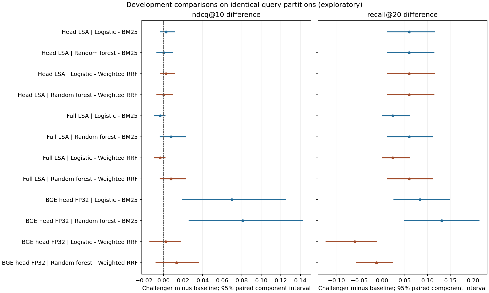

# TechQA 第二轮实验结果

主线为预先确定的 BGE FP32 文档头检索与轻量监督重排序。开发集用于固定范围的融合选择和敏感性分析；三条管线使用完全相同的问题分区。

固定语料含 28,481 篇原始文档，去重后 28,478 篇；581 个候选问题中隔离 3 个跨历史分区问题，保留 578 个问题。
Train、Dev、Test 分别为 410、84、84 个问题；开发集含 72 个独立组件。

## 开发集方法比较

Head LSA 和 BGE FP32 使用前 256 个空白分隔词；BGE 再按本地 Tokenizer 截断至 512 token。Full LSA 使用原始全文。nDCG@10 与 Recall@20 按问题宏平均；Recall 针对提供的正例，未标注候选作为代理负例。

| 管线 | 方法 | nDCG@10 | Recall@20 | 候选召回 |
| --- | --- | ---: | ---: | ---: |
| Head LSA | BM25 | 0.599669 | 0.690476 | 0.833333 |
| Head LSA | Semantic | 0.253042 | 0.464286 | 0.833333 |
| Head LSA | RRF | 0.487670 | 0.714286 | 0.833333 |
| Head LSA | Weighted RRF | 0.599669 | 0.690476 | 0.833333 |
| Head LSA | Logistic | 0.602271 | 0.750000 | 0.833333 |
| Head LSA | Random forest | 0.599895 | 0.750000 | 0.833333 |
| Full LSA | BM25 | 0.596034 | 0.690476 | 0.857143 |
| Full LSA | Semantic | 0.243767 | 0.476190 | 0.857143 |
| Full LSA | RRF | 0.490440 | 0.726190 | 0.857143 |
| Full LSA | Weighted RRF | 0.596034 | 0.690476 | 0.857143 |
| Full LSA | Logistic | 0.592490 | 0.714286 | 0.857143 |
| Full LSA | Random forest | 0.603533 | 0.750000 | 0.857143 |
| BGE head FP32 | BM25 | 0.599669 | 0.690476 | 0.928571 |
| BGE head FP32 | Semantic | 0.686528 | 0.797619 | 0.928571 |
| BGE head FP32 | RRF | 0.656692 | 0.797619 | 0.928571 |
| BGE head FP32 | Weighted RRF | 0.667284 | 0.833333 | 0.928571 |
| BGE head FP32 | Logistic | 0.669473 | 0.773810 | 0.928571 |
| BGE head FP32 | Random forest | 0.680588 | 0.821429 | 0.928571 |

区间按独立组件配对重采样，保留组件内全部问题；图中差值为学习模型减对应基线。开发集区间属于探索性比较，包含融合选择和多项敏感性分析的影响。

精确数值：[方法表](iteration2_development_methods.csv)、[逐问题指标](iteration2_development_per_query.csv)、[配对区间](iteration2_development_contrasts.csv)、[完整 JSON](iteration2_summary.json)。

## 固定模型参数

| 管线 | Logistic C | RF 深度 | RF 最小叶节点 | 树数 | 训练权重 |
| --- | ---: | ---: | ---: | ---: | --- |
| Head LSA | 0.1 | 12 | 30 | 200 | 各问题等总权重，样本权重再归一至均值 1 |
| Full LSA | 10 | 6 | 10 | 200 | 各问题等总权重，样本权重再归一至均值 1 |
| BGE head FP32 | 0.1 | 12 | 10 | 200 | 每问题总权重 51 |

模型参数由各自训练组件交叉验证选择。加权 RRF 的常数和语义权重取自各管线预先给定的开发集网格；语义权重为 0 时，该配置不使用语义名次项。

## 单因素敏感性分析

六个变体固定复用主线训练 CV 参数和同一原始候选、特征、分区，主线仍按预先记录的方案保留。负采样上限比较固定每问题总权重，控制 Logistic 有效正则化的变化。

| 变体 | 模型 | nDCG@10 | Recall@20 | 相对主线 nDCG 差值及 95% CI |
| --- | --- | ---: | ---: | --- |
| negative_cap10 | Logistic | 0.665209 | 0.797619 | -0.004264 [-0.014139, +0.000651] |
| negative_cap10 | Random forest | 0.690215 | 0.809524 | +0.009626 [-0.004357, +0.025509] |
| hard_bm25_cap50 | Logistic | 0.061294 | 0.107143 | -0.608178 [-0.726542, -0.478420] |
| hard_bm25_cap50 | Random forest | 0.015488 | 0.035714 | -0.665100 [-0.768241, -0.555813] |
| balanced_query_classes | Logistic | 0.662132 | 0.821429 | -0.007340 [-0.020594, +0.001305] |
| balanced_query_classes | Random forest | 0.676649 | 0.821429 | -0.003940 [-0.026570, +0.019190] |
| training_seed20261115 | Logistic | 0.662132 | 0.809524 | -0.007340 [-0.020594, +0.001305] |
| training_seed20261115 | Random forest | 0.682051 | 0.821429 | +0.001462 [-0.012004, +0.014527] |
| training_seed20261116 | Logistic | 0.669967 | 0.821429 | +0.000495 [-0.013102, +0.013342] |
| training_seed20261116 | Random forest | 0.669138 | 0.821429 | -0.011451 [-0.028025, +0.001888] |
| rank_features_only | Logistic | 0.670110 | 0.773810 | +0.000637 [+0.000000, +0.002058] |
| rank_features_only | Random forest | 0.666187 | 0.785714 | -0.014401 [-0.029029, -0.001911] |

[单因素精确数值](iteration2_ablation_methods.csv)与[相对主线区间](iteration2_ablation_contrasts.csv)。

## 冻结保留集评价

以下对应已完成的冻结评价，共 84 个问题、72 个独立组件；模型、融合参数、候选及特征均来自已固定的主线。

| 方法 | nDCG@10 | Recall@20 | 候选召回 |
| --- | ---: | ---: | ---: |
| BM25 | 0.510022 | 0.654762 | 0.928571 |
| Semantic | 0.577842 | 0.750000 | 0.928571 |
| RRF | 0.553764 | 0.726190 | 0.928571 |
| Weighted RRF | 0.584744 | 0.726190 | 0.928571 |
| Logistic | 0.578763 | 0.738095 | 0.928571 |
| Random forest | 0.590379 | 0.738095 | 0.928571 |

本地预先记录的主要对比为 Logistic 相对加权 RRF 的 nDCG@10：差值 -0.005981，95% 组件配对区间 [-0.023426, +0.011785]。该协议未作外部注册。

该区间跨过 0，主要对比没有显示学习重排稳定优于强融合；其他方法的最高点分数不能替代这一预先指定的主要结论。

停止规则：After this one frozen heldout evaluation, report positive or negative result; do not retune using test outcomes

[保留集精确方法表](iteration2_holdout_methods.csv)与[配对区间](iteration2_holdout_contrasts.csv)。

## 结果边界和复现来源

本实验评价固定技术支持档案中的已提供相关性标注；标注稀疏、来源文本冲突和近重复审查覆盖限制仍保留。语义逐对判读由 Codex 助手完成，真实成员或领域专家尚未独立核验。检索指标不代表生成答案正确率或穷尽相关性召回。结果 JSON 中的采样耗时为单次观察；独立重复延迟另存 latency_benchmark.json，缓存加载与首次编码分开记录。

- Head LSA：[20261114T135003226733Z_lsa](20261114T135003226733Z_lsa/results.json)、[配置](../results/20261114T135003226733Z_lsa/configuration.json)、[独立核验](20261114T135003226733Z_lsa/verification.json)。
- Full LSA：[20261114T135456567288Z_lsa](20261114T135456567288Z_lsa/results.json)、[配置](../results/20261114T135456567288Z_lsa/configuration.json)、[独立核验](20261114T135456567288Z_lsa/verification.json)。
- BGE head FP32：[20261114T144053296846Z_onnx](20261114T144053296846Z_onnx/results.json)、[配置](../results/20261114T144053296846Z_onnx/configuration.json)、[独立核验](20261114T144053296846Z_onnx/verification.json)。
- 冻结评价：[frozen_e2324b7a967c5dbe2766ecc3](frozen_e2324b7a967c5dbe2766ecc3/results.json)、[冻结记录](frozen_e2324b7a967c5dbe2766ecc3/freeze_manifest.json)、[协议](frozen_e2324b7a967c5dbe2766ecc3/protocol.json)、[独立核验](frozen_e2324b7a967c5dbe2766ecc3/verification.json)。
- BGE 模型：[固定版本 BAAI bge small en v1.5](https://huggingface.co/BAAI/bge-small-en-v1.5/tree/5c38ec7c405ec4b44b94cc5a9bb96e735b38267a)；实际 ONNX、输入和配置哈希保存在 JSON 与各 run 的核验记录中。
